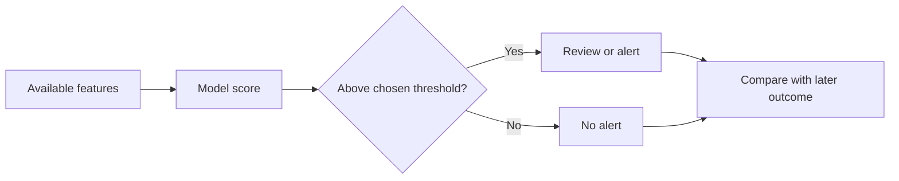

# Classify outcomes and choose useful metrics

**Before this lesson:** [Fit a regression model with gradients](03-regression-and-optimization.md).

**Classification** predicts a category. A binary classifier handles two categories, such as late and on-time delivery. It often produces a score first and uses a **threshold** to turn that score into a decision. The score, the category, and the action are three separate things.

Logistic regression uses a weighted sum called a **logit**, then the sigmoid function `1 / (1 + exp(-logit))` to produce a value between zero and one. Here `exp(z)` means the exponential function `e ** z`; review [exponentials and logarithms](../mathematics/02-functions-and-gradients.md#exponentials-and-logarithms) if needed. Despite its name, it is commonly used for classification. Its fitted scores still need evaluation before treating them as reliable probabilities.

## Count the four possible outcomes

Call “late” the positive class. A **confusion matrix** counts predictions against observed labels:

| | Actually late | Actually on time |
| --- | ---: | ---: |
| Predicted late | 12 true positives | 3 false positives |
| Predicted on time | 8 false negatives | 77 true negatives |

A false positive creates an unnecessary alert. A false negative misses a late delivery. Their costs may differ, so one overall accuracy number may hide the important failure.

**Precision** asks how many positive predictions were correct. **Recall** asks how many actual positive cases were found. **F1** is their harmonic mean, useful when both matter but unable to express every operational cost. [Scikit-learn classification metrics](https://scikit-learn.org/stable/modules/model_evaluation.html#classification-metrics).

```python runnable
tp, fp, fn, tn = 12, 3, 8, 77
precision = tp / (tp + fp)
recall = tp / (tp + fn)
f1 = 2 * precision * recall / (precision + recall)
accuracy = (tp + tn) / (tp + fp + fn + tn)
print(f"Accuracy={accuracy:.2f}, precision={precision:.2f}, recall={recall:.2f}, F1={f1:.3f}")
```

```text output
Accuracy=0.89, precision=0.80, recall=0.60, F1=0.686
```

The classifier finds only 12 of 20 late deliveries. Always predicting on-time would already achieve 80% accuracy here. This makes the baseline essential. In general-purpose metric code, define how to handle an empty denominator instead of dividing by zero.

## Choose a threshold for a decision

Lowering a fixed classifier's threshold generally sends more cases to the positive class: recall can increase while false alarms also increase. A threshold of 0.5 is a convention, not a universal business rule.



Choose a threshold using validation data and a declared cost or workload limit. Then freeze it before final testing. If the review team can handle ten cases per hour, inspect precision and recall at that operating point, not only a curve averaged across every threshold.

**Calibration** concerns the meaning of probabilities: among many cases scored near 0.8, roughly 80% should be positive if those scores are calibrated for that population. The ROC curve compares true-positive and false-positive rates across thresholds. Its area, **ROC AUC**, summarizes ranking behavior but does not establish calibration. Precision-recall curves are useful when positive cases are rare. A calibrated model can become miscalibrated when the deployment population changes.

## Work a threshold decision from start to finish

Use six validation cases with scores `[0.9, 0.8, 0.7, 0.4, 0.3, 0.1]` and observed labels `[1, 0, 1, 1, 0, 0]`. Here 1 means late. We will alert when the score is **at least** the threshold, including equality.

At threshold 0.8, two cases trigger alerts. One is truly late and one is on time. Two late cases are missed. Precision is 1/2; recall is 1/3.

At threshold 0.4, four cases trigger alerts. Three are truly late and one is on time. Precision is 3/4 and recall is 3/3. Lowering the threshold improved both in this particular sample; precision need not move monotonically as a threshold changes.

```python runnable
scores = [0.9, 0.8, 0.7, 0.4, 0.3, 0.1]
labels = [1, 0, 1, 1, 0, 0]

for threshold in [0.8, 0.4]:
    decisions = [score >= threshold for score in scores]
    tp = sum(predicted and label == 1 for predicted, label in zip(decisions, labels))
    fp = sum(predicted and label == 0 for predicted, label in zip(decisions, labels))
    fn = sum(not predicted and label == 1 for predicted, label in zip(decisions, labels))
    cost = fp * 1 + fn * 4  # Hypothetical costs declared before comparison.
    print(f"threshold={threshold:.1f} alerts={sum(decisions)} cost={cost}")
```

```text output
threshold=0.8 alerts=2 cost=9
threshold=0.4 alerts=4 cost=1
```

The cost assumes an unnecessary alert costs 1 unit and a missed late delivery costs 4. If a reviewer can handle only two alerts, the lower-cost option exceeds capacity. Decide whether to increase capacity, prioritize a limited set, or change the service contract. Do not hide the constraint by reporting only F1.

For more than two classes, **macro averaging** gives each class's metric equal weight. **Micro averaging** combines the underlying counts before calculating a metric. A rare class can matter greatly to a macro score while contributing little to pooled counts. Report class counts and choose the averaging rule before comparison.

**Check your understanding:** if the threshold is 0.95, no cases trigger alerts. Is precision 100%?

<details>
<summary>Handle the empty case honestly</summary>

No. There are no positive predictions, so the denominator in precision is zero. Report it as undefined or use an explicitly documented convention. Recall is zero because the sample contains late deliveries and none were found. An empty alert list is not evidence of perfect alerts.

</details>

## Learn from errors and alternatives

Inspect false negatives, false positives, and relevant slices such as route type or time period. A tiny slice needs a count and uncertainty alongside its score. Do not choose a favorable slice after seeing the test results and present it as the original objective.

For several exclusive classes, such as package categories, evaluate per-class performance and the confusion between classes. **Multilabel** classification is different: one example may have several labels at once. A rule, logistic model, tree, or nearest-neighbor baseline may be adequate before considering a neural network.

## Practice

An alert model has 95% accuracy, but only 2% of cases are positive. What baseline must you check? If missing a positive case is costly, should you automatically deploy a lower threshold?

<details>
<summary>Check your reasoning</summary>

An always-negative baseline has 98% accuracy, so 95% alone is not persuasive. Compare recall, precision, counts, and the declared decision cost. Test threshold changes on validation data, including review capacity and false-positive cost. A lower threshold is a candidate policy, not an automatic improvement. Keep the final test independent of this choice.

</details>

---

## Depth lab: train a logistic classifier from scratch

Binary logistic regression maps a linear score to a probability using sigmoid. Combining sigmoid with binary cross-entropy gives the score derivative `p-y`. For a weight, multiply by its feature; for the bias, multiply by one. This simple derivative does not mean the prediction is automatically calibrated on a new population.

```python runnable
import math
x, y = [-2.0, -1.0, 1.0, 2.0], [0, 0, 1, 1]
def sigmoid(z):
    if z >= 0:
        return 1/(1+math.exp(-z))
    value = math.exp(z)
    return value/(1+value)
def loss(w, b):
    scores = [w*a+b for a in x]
    return sum(max(z,0)-z*t+math.log1p(math.exp(-abs(z)))
               for z,t in zip(scores,y))/len(y)

w, b = 0.0, 0.0
before = loss(w,b)
for _ in range(100):
    errors = [sigmoid(w*a+b)-t for a,t in zip(x,y)]
    dw = sum(e*a for e,a in zip(errors,x))/len(x)
    db = sum(errors)/len(x)
    w, b = w-0.1*dw, b-0.1*db
predicted = [int(sigmoid(w*a+b) >= 0.5) for a in x]
print(predicted)
print(loss(w,b) < before)
```

```text output
[0, 0, 1, 1]
True
```

The loss expression uses stable softplus rather than directly taking the logarithm of a rounded probability. This separable four-point fixture verifies mechanics, not real-world performance. Add a finite-difference check and a nonseparable case; unregularized separable logistic training need not have a finite optimum.

### Debug and deploy decisions

Recompute TP, FP, TN, and FN from saved predictions. Test the exact threshold boundary and define zero-denominator metrics. Compare ROC and precision-recall behavior with prevalence in mind; a high ranking score does not choose the right operational threshold.

Select thresholds using validation evidence and costs/capacity, then assess the frozen procedure on held-out data. Preserve score, threshold version, action, and delayed outcome where appropriate. Failed or abstained cases need separate counts.

Optimize inference by batching or choosing a simpler model only after comparing quality slices and tail latency. A lower threshold increases workload for downstream reviewers; that operational cost belongs in the design.

<details>
<summary>Expert defense: why can the same model have different precision in two populations?</summary>

Precision depends on prevalence as well as conditional true/false-positive rates. Even unchanged detector behavior can produce many more false alarms relative to true positives when events are rarer. Reconstruct a count table rather than treating precision as an immutable model property.

</details>

**Teach it:** derive p−y, trace one update, and let a learner choose a threshold under two different error-cost assumptions.

**Previous:** [Fit a regression model with gradients](03-regression-and-optimization.md) · **Next:** [Learn decisions with trees and ensembles](05-trees-and-ensembles.md)
