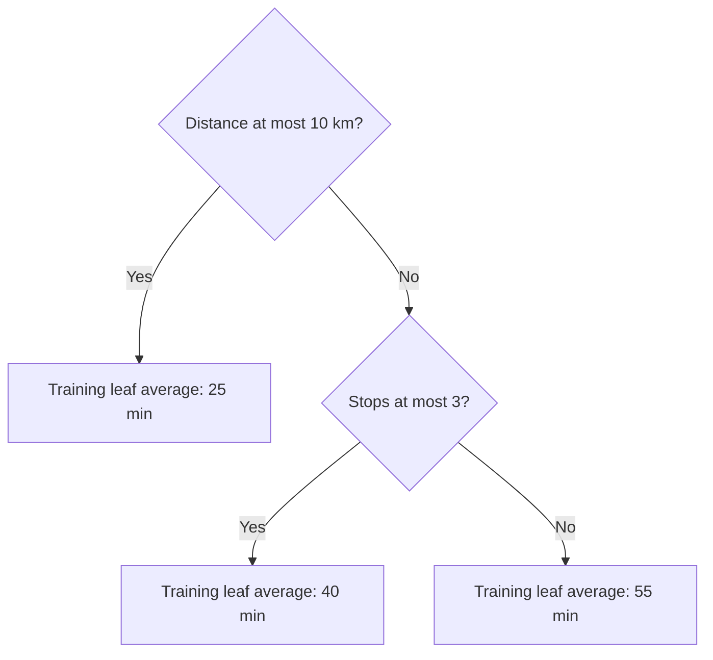

# Learn decisions with trees and ensembles

**Before this lesson:** [Classify outcomes and choose useful metrics](04-classification-and-metrics.md).

A **decision tree** predicts by asking a sequence of questions about features. An internal node chooses a branch; a **leaf** produces the final prediction. For delivery time, a question might be “Is the planned distance at most 10 km?” Classification leaves can store class frequencies; regression leaves can store an average target.

A tree does not need the same straight-line relationship as linear regression. It can describe interactions through its branches: the next question depends on the answer to the previous one. That flexibility also makes it easy to fit accidental details.

## Choose a split using training data

For classification, **Gini impurity** measures how mixed a node's labels are: `1 - sum(p_class ** 2)`. A pure node has impurity zero. Compare a parent's impurity with the size-weighted impurity of its children. Evaluate candidate thresholds using training rows only.

```python runnable
def gini(labels):
    if not labels:
        return 0.0
    return 1 - sum((labels.count(label) / len(labels)) ** 2 for label in set(labels))

parent = [0, 0, 1, 1]
left, right = [0, 0], [1, 1]
children = (len(left) * gini(left) + len(right) * gini(right)) / len(parent)
print(f"Parent impurity: {gini(parent):.2f}")
print(f"Weighted child impurity: {children:.2f}")
print(f"Reduction: {gini(parent) - children:.2f}")
```

```text output
Parent impurity: 0.50
Weighted child impurity: 0.00
Reduction: 0.50
```

This only scores a proposed split. A full learner must search possible features and thresholds, obey stopping rules, and record predictions. Perfectly separating four labels does not show that the rule works on future examples.



The numbers in this diagram illustrate a fitted tree; they are not rules derived from the tiny label list above.

## Learn the question, not just its score

Consider four training deliveries with distances 2, 4, 6, and 8 km and labels on time, on time, late, late. Candidate thresholds between observed distances are 3, 5, and 7 km.

At 3 km, the left child has one on-time example; the right has one on-time and two late examples. The left impurity is zero and the right impurity is `1 − (1/3)² − (2/3)² = 4/9`. Weight by child sizes: `(1/4) × 0 + (3/4) × (4/9) = 1/3`. The reduction from the parent's 1/2 is only 1/6.

At 5 km, both children are pure, so the reduction is 1/2. At 7 km, the situation mirrors 3 km. A greedy tree learner chooses the best immediate split: 5 km. **Greedy** means choosing the best current step; it does not guarantee the best possible complete tree.

```python runnable
distances = [2, 4, 6, 8]
labels = [0, 0, 1, 1]
results = []
for threshold in [3, 5, 7]:
    weighted_impurity = 0.0
    for goes_left in [True, False]:
        child = [label for distance, label in zip(distances, labels)
                 if (distance <= threshold) == goes_left]
        p = sum(child) / len(child)
        impurity = 1 - p ** 2 - (1 - p) ** 2
        weighted_impurity += len(child) / len(labels) * impurity
    results.append((weighted_impurity, threshold))
    print(f"threshold={threshold} weighted impurity={weighted_impurity:.3f}")
print("Chosen threshold:", min(results)[1])
```

```text output
threshold=3 weighted impurity=0.333
threshold=5 weighted impurity=0.000
threshold=7 weighted impurity=0.333
Chosen threshold: 5
```

This search is deliberately limited to one feature and nonempty children. A production learner also handles repeated values, stopping conditions, and task-specific loss. The [decision-tree guide](https://scikit-learn.org/stable/modules/tree.html) describes splitting criteria and model constraints.

**Predict a new case:** the one-split tree classifies 5 km as on time and 5.1 km as late. This abrupt change is part of its decision rule, not evidence that delivery risk truly jumps at exactly 5 km. Test near-boundary cases and compare against a smoother baseline.

## Control flexibility

Limit maximum depth, require enough examples per leaf, or prune branches using a declared selection procedure. Choose these settings with validation data. Deep trees can produce nearly perfect training predictions while varying sharply when a few rows change.

Numeric feature scaling is usually unnecessary for ordinary threshold trees because the ordering determines the splits. Missing values and categorical values still need supported handling; do not assume every implementation accepts them directly. A regression tree usually predicts a value from a training leaf rather than extending a linear trend far beyond the training range.

## Combine several learners

An **ensemble** combines models. **Bagging** trains models on resampled training sets and aggregates their predictions. A **random forest** also introduces feature randomness so its trees do not all make the same decisions. **Boosting** adds models sequentially to improve a shared objective; gradient boosting uses loss information to guide each added learner. These strategies have different training procedures. [Scikit-learn ensemble guide](https://scikit-learn.org/stable/modules/ensemble.html).

| Candidate | Useful reason to try it | Cost to inspect |
| --- | --- | --- |
| Small tree | A short sequence of decisions is easy to trace. | Instability and missed smooth trends. |
| Random forest | Averaging can reduce an individual tree's variability. | Larger storage and more prediction work. |
| Gradient-boosted trees | Flexible models for structured feature tables. | More interacting settings and overfitting risk. |
| Linear model | A compact, fast baseline. | Limited interactions unless represented explicitly. |

Do not infer causation from a split or a feature-importance ranking. A model may use a convenient proxy for another input. The next evaluation lesson explains what importance can and cannot establish.

## Practice

Why can a leaf with one training row have zero training error and still be unreliable? Would fitting 100 identical trees on identical data guarantee improvement?

<details>
<summary>Check your reasoning</summary>

A one-row leaf can memorize its outcome without estimating a stable relationship. It gives little evidence about other cases. Identical trees make identical predictions, so averaging them does not remove their shared errors. Ensemble gains depend on useful learners and differences in their errors, not the count of copies alone.

</details>

---

## Depth lab: derive a split before growing a forest

A binary classification node with positive proportion p has Gini impurity `1-p²-(1-p)²`. For a candidate split, weight each child's impurity by its fraction of training examples. The improvement is parent impurity minus weighted child impurity.

**Worked example:** labels [0,0,1,1] have parent impurity 0.5. A split into [0,0] and [1,1] gives child impurity zero, so gain is 0.5. A split into [0] and [0,1,1] gives weighted impurity `(1/4)*0+(3/4)*(4/9)=1/3` and gain 1/6. The first is better for this training criterion.

Implement a decision stump that enumerates thresholds between distinct sorted feature values. Compare its selected split with hand calculations. Test constant features, duplicate values, tied gains, and a minimum-leaf-size rule. A tree must also define unseen/missing-value behavior under the chosen implementation.

### Debug flexibility and ensembles

A deep tree can memorize small partitions. Inspect leaf sizes, training/validation curves, and error slices. A random forest combines trees trained with controlled variation; independent-looking trees can still share errors. Boosting fits additional learners to improve a specified objective; it is not simply averaging independent trees.

Compare a stump, a bounded tree, and an ensemble using the same split and tuning budget. A fair experiment includes preprocessing and model selection. Feature importance can be unstable with correlated features and does not establish causality.

### Production and optimization

Trees need feature-order and value contracts just like linear models. A changed category encoding can silently redirect branches. Measure traversal latency, model size, feature computation, and batch behavior. Limiting depth or tree count trades capacity for speed; validate rare and boundary cases after compression.

<details>
<summary>Expert defense: why does a perfect training split not prove a useful feature?</summary>

The split may exploit noise, a small sample, a future-derived feature, or repeated entities across partitions. The impurity calculation is a training criterion. Generalization requires a valid evaluation design and independent evidence.

</details>

**Teach it:** have a learner calculate both split gains above, then add one mislabeled example and reconsider the split. Keep the stump implementation, a leakage case, and a baseline/ensemble comparison.

**Previous:** [Classify outcomes and choose useful metrics](04-classification-and-metrics.md) · **Next:** [Find groups and recommend useful items](06-clustering-and-recommendations.md)
