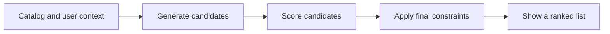

# Find groups and recommend useful items

**Before this lesson:** [Learn decisions with trees and ensembles](05-trees-and-ensembles.md).

Not every learning problem comes with a correct category for each row. **Unsupervised learning** looks for structure without supplied target labels. Clustering is one example: it groups records according to a chosen representation and similarity rule. A cluster is a mathematical grouping, not automatically a meaningful human category.

Imagine grouping library items by topic-related features. Decide what “similar” should mean before selecting an algorithm. Page count and publication year alone may group items neatly while ignoring the reason a reader wants them.

## Distances depend on representation

A distance compares feature vectors. If one feature ranges from zero to one and another from zero to a million, raw Euclidean distance can be dominated by the second. Scale features using training data when the distance requires it. Also ask whether ordinary numeric distance makes sense: item IDs are labels, not positions on a number line.

**K-means** summarizes a dataset with a chosen number of centers and associates each point with a center. It favors groups that fit its distance and shape assumptions. The number of groups is a modeling choice, not a fact supplied by the algorithm. Use the existing [K-means implementation lesson](../../DSA/ml/k-means/README.md) for the mechanics, and [nearest neighbors](../../DSA/ml/knn/README.md) for optional distance-based prediction practice.

Inspect representative examples and outliers, repeat with different initializations, and test stability. A silhouette score compares within-group and between-group distances, but optimizing that score does not prove business usefulness. Density-based methods can be alternatives for irregular groups or noise; they bring different distance and density assumptions.

## Run the two steps of K-means

Work with four one-dimensional points, `[1, 2, 8, 9]`, and two initial centers, `[2, 8]`. Each iteration does two jobs:

1. **Assign:** put each point in the group with the nearest center.
2. **Update:** replace each center with the mean of its assigned points.

The first groups are [1, 2] and [8, 9]. Their means are 1.5 and 8.5. Reassigning with those centers leaves the groups unchanged, so this example has stabilized.

```python runnable
points = [1.0, 2.0, 8.0, 9.0]
centers = [2.0, 8.0]
for _ in range(10):
    groups = [[] for _ in centers]
    for point in points:
        nearest = min(range(len(centers)), key=lambda i: (point - centers[i]) ** 2)
        groups[nearest].append(point)
    updated = [sum(group) / len(group) if group else centers[i]
               for i, group in enumerate(groups)]
    if updated == centers:
        break
    centers = updated
error = sum((point - centers[i]) ** 2
            for i, group in enumerate(groups) for point in group)
print("Centers:", centers)
print(f"Within-group squared error: {error:.1f}")
```

```text output
Centers: [1.5, 8.5]
Within-group squared error: 1.0
```

The measured objective is the sum of squared distances to assigned centers. A single center at the overall mean, 5, gives squared error 50. Four centers placed on the four points give zero. Therefore, choosing the number of groups by the lowest training error alone would favor too many groups.

This teaching loop keeps an empty group's previous center and uses exact equality to detect stability. Larger implementations need a deliberate empty-cluster policy, numerical tolerance, and an iteration limit. Different starting centers can settle at different solutions; compare several starts under the same objective. The [K-means guide](https://scikit-learn.org/stable/modules/clustering.html#k-means) discusses its assumptions and initialization.

**Challenge:** why might grouping books by page count fail even if squared error is tiny?

<details>
<summary>Separate the objective from usefulness</summary>

The optimization can accurately group lengths while ignoring topic, reading level, language, or the reader's goal. A small clustering error establishes fit to the chosen numerical representation. It does not establish useful recommendations.

</details>

## Recommendations are an ordering problem

A recommender chooses useful items for a particular situation. A **content-based** system compares item attributes with a user's stated or observed interests. **Collaborative filtering** learns from patterns of interactions among users and items. A **cold-start** case has little interaction history, such as a new reader or new book.

A useful baseline recommends popular available items. Compare personalization against it. Here is a tiny content-based scoring rule with two topic dimensions, not a trained recommendation model. In `sorted`, the `key` argument supplies a function that computes each item's sorting value. `lambda item: ...` creates a short unnamed function. Here it returns a pair: negative score first, then item name. Sorting these pairs in ascending order puts higher scores first and uses names to break ties:

```python runnable
interest = [0.8, 0.2]  # Programming and art, chosen for this example.
items = {"Python notebook": [1.0, 0.0], "Sketching guide": [0.0, 1.0]}
scores = {name: sum(a * b for a, b in zip(interest, vector)) for name, vector in items.items()}
for name in sorted(scores, key=lambda item: (-scores[item], item)):
    print(f"{name}: {scores[name]:.1f}")
```

```text output
Python notebook: 0.8
Sketching guide: 0.2
```

The dot product links your vector mathematics to ranking. Learned **embeddings** replace these hand-chosen attributes with fitted vectors. In matrix factorization, user and item vectors are trained so their combinations predict interactions. Missing interactions are generally unknown preferences, not confirmed dislikes.



Candidate generation, scoring, and re-ranking often have separate goals. For example, ranking cannot recover a useful item that candidate generation never supplied. [Google recommendation-system architecture](https://developers.google.com/machine-learning/recommendation/overview/types).

## Evaluate what people actually receive

Hold out later interactions and construct histories from earlier events only. **Precision at k** measures relevant items among the top `k`; **recall at k** measures how many known relevant items appear there. State how relevance and the evaluation candidate pool are defined. Sampled easy negatives can make a ranking task look easier than the deployed catalog.

Clicks are influenced by what was shown and where it appeared. Offline accuracy does not by itself prove that a new ranking improves user satisfaction. Inspect coverage, repeated items, unavailable items, and whether the system keeps narrowing a reader's choices.

## Practice

A new book has no clicks. Which baseline can still recommend it? Why is “the user did not click” weaker evidence than an explicit dislike?

<details>
<summary>Check your reasoning</summary>

Content features, editorial selection, or a controlled new-item policy can include the book without interaction history. A popularity-only baseline may omit it. A missing click may mean the user never saw the item, its position was poor, or the session ended. Record exposure and context instead of treating every missing event as a negative preference.

</details>

---

## Depth lab: the representation defines “near”

K-means minimizes squared distances to assigned centroids under its standard objective. Assignment chooses the nearest centroid; updating a nonempty cluster to its mean minimizes that cluster's squared-error objective. Those two facts explain why alternating the steps does not increase the objective when implemented consistently.

**Implement:** start with two fixed centroids on a tiny two-dimensional dataset. Save assignments, centroids, and objective after each full iteration. Compare with a direct objective calculation. Test ties, an empty cluster, duplicate points, and a feature rescaled by 1,000. State the empty-cluster policy; arbitrary reinitialization may change the simple monotonicity argument.

### Recommendations need a different evaluation contract

A popularity recommender ranks frequently selected items. A personalized model may use user/item representations, but evaluation must reconstruct information available at recommendation time. Negative items are not automatically disliked; they may never have been exposed.

For a user with relevant items `{A,C}`, a top-three list `[B,A,C]` has precision 2/3 and recall 1. Change the list length and watch the denominators. Evaluate new users, rare items, and coverage, not only aggregate ranking quality. Avoid using later interactions to create features for an earlier recommendation.

### Debug, optimize, and design

A high clustering score can describe a mathematically coherent but useless grouping. Inspect representatives and task relevance. For recommendations, investigate exposure, position bias, stale inventory, and duplicated items. Keep eligibility and access filters outside a similarity score.

Exact neighbor search is a useful oracle for approximate retrieval. Measure recall, latency, and update cost under the same filters. Cache recommendations only with explicit freshness and user/context scope. Document a fallback for cold-start users and unavailable items.

<details>
<summary>Expert defense: why can a recommender's offline score rise while user value falls?</summary>

The evaluation may reflect historical exposure rather than preference, reward popularity excessively, use leaked future events, or ignore diversity and eligibility. Define the user decision and compare a representative online or otherwise appropriate evaluation, with operational constraints included.

</details>

**Teach it:** show how rescaling one coordinate changes a cluster, then contrast clustering an item with deciding whether to recommend it. Deliver a checked clustering loop and a time-aware ranking report.

**Previous:** [Learn decisions with trees and ensembles](05-trees-and-ensembles.md) · **Next:** [Validate a model and finish the ML project](07-validation-and-explanations.md)
