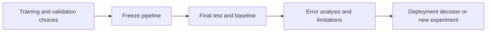

# Validate a model and finish the ML project

**Before this lesson:** [Find groups and recommend useful items](06-clustering-and-recommendations.md).

A model is ready for a useful comparison when its data preparation, learned parameters, and selection rules are fixed. **Generalization** means performance on cases beyond those used for fitting. One favorable test result is evidence about a particular sample and setup; it is not a guarantee for every future population.

This lesson completes the delivery-duration project. You will compare a learned model with a mean baseline, explain the split, and report what the result does not establish.

## Match evaluation to the real question

**Cross-validation** repeatedly fits on some training partitions and validates on another. It can show how sensitive a result is to the chosen partition. Preprocessing must be refitted inside each fold. Keep groups together when evaluating new groups, and keep time order when evaluating future observations. Standard shuffled folds are not a substitute for these assumptions. [Scikit-learn cross-validation guidance](https://scikit-learn.org/stable/modules/cross_validation.html).

Training data fits parameters. Validation guides choices. A final test is used after those choices. If you repeatedly change the model after seeing test errors, that set has become part of development; report this honestly and obtain a fresh independent assessment.

## Inspect errors before explaining features

Compare aggregate metrics, subgroup counts, individual failures, and the simple baseline. A confidence interval or a repeated split can communicate sampling uncertainty, but neither repairs biased data or a leaking feature. Keep the unit of resampling consistent with the independent unit, such as a customer rather than each repeated row.

**Permutation importance** measures how much a fitted model's score changes when one feature is shuffled. It describes reliance under that procedure, not a causal effect. Correlated features can substitute for one another, making individual importance misleading. [Scikit-learn permutation importance](https://scikit-learn.org/stable/modules/permutation_importance.html).

A local explanation describes one prediction; it is not automatically a faithful explanation of the whole model. Before explaining a model, establish that it predicts useful outcomes. A clear explanation of a poor predictor does not make it accurate.



## Run the offline delivery project

Download [delivery_regression.py](pathname:///examples/ai/machine-learning/delivery_regression.py). It uses only Python's standard library, creates synthetic records in memory, and needs no network or accounts. Open a terminal in the folder containing the downloaded file:

```sh
python3 delivery_regression.py
```

Expected output:

```text
Rows: train=60 validation=20 test=20
Selected ridge: 0.0; validation MAE: 0.695 minutes
Test MAE: model=0.697; mean baseline=14.475 minutes
Example prediction (10 km, 3 stops): 36.085 minutes
Checks passed: ordered split, training-only scaler, finite predictions, baseline comparison
```

Read the program in this order:

1. `make_data` defines 100 invented dispatches. Distance and stop count are inputs; minutes are the later target.
2. Rows 0–59 train the model, 60–79 select the ridge penalty, and 80–99 provide the final test.
3. `fit_scaler` uses training inputs only. `fit` uses standardized features, MSE gradients, and a ridge penalty.
4. Validation MAE selects among three fixed penalties. The test set does not choose the winner.
5. The frozen model and a mean-of-training-targets baseline are both measured on the same test cases.

The assertions check split order, the scaler's source, finite predictions, and improvement over the baseline on this known teaching dataset. They do not certify a real delivery service. The synthetic target was deliberately made close to a linear relationship, so this is a demonstration of a correct workflow rather than a realistic accuracy benchmark.

## Make the report reviewable

Write the prediction time, feature units, target definition, partition rules, candidate settings, selected setting, baseline result, final metric, and limitations. Include a failure example, not only a successful prediction. Note that the test contains just 20 synthetic cases and represents no actual customer population.

A deployable system would additionally need representative data, input validation, saved preprocessing and parameters, versioned artifacts, monitoring, and a way to handle uncertain or unsupported inputs. The later engineering stage develops those concerns; do not mistake this small script for that system.

## Practice and stage checkpoint

Predict what changes if distance is measured in meters at prediction time but the saved scaler expects kilometers. Then extend the experiment with one predeclared candidate feature, choosing it without consulting the test result.

<details>
<summary>Check your reasoning</summary>

A unit mismatch produces values on the wrong scale and can create extreme predictions. Reject or convert inputs using the feature contract. For an extension, define a feature available at dispatch, fit any transformations on training rows, compare candidates on validation, and reserve a fresh final assessment if previous test observations have influenced the new idea. Report the original and new experiment separately.

</details>

---

## Depth lab: keep model selection inside the experiment

Suppose you try 50 feature sets and report the best score on the same “test” set. That set has influenced selection and is now development evidence. Renaming it does not restore independence.

**Implement:** separate training, model-selection, and final assessment roles. For small-data comparisons, use an appropriate nested procedure when estimating the performance of a selection process: the inner split chooses settings and the outer split assesses that choice. Keep all fitted transforms inside the relevant training partition. The final deployment model can be refit under a declared protocol after evaluation.

### Debug an impressive result

Rebuild the simplest baseline, verify label definitions, inspect duplicates/groups, and audit feature timing. Recompute metrics from saved prediction rows. Compare evaluation examples with training examples for near duplicates when appropriate.

An explanation method describes aspects of a fitted model under its assumptions. Permuting one of two correlated features may show little impact because the other substitutes for it. A feature receiving high importance may reflect leakage or bias. Remove a feature family and retrain as a separate experiment; that answers a different question from perturbing inputs to a fixed model.

### Production and optimization

Store split definitions, data versions, selection history, evaluator version, and the complete chosen pipeline. A release report should include uncertainty, counts, slices, and known failures. Monitor data and delayed outcomes without treating every distribution alert as automatic proof of degraded quality.

Optimize search effort by using informed small baselines and bounded trials. Compare methods under a similar budget. Repeatedly choosing the best random seed hides variance and inflates reported performance.

<details>
<summary>Expert defense: can the final test be inspected to diagnose a failure?</summary>

Yes, but subsequent changes informed by that inspection use the set as development evidence. Be honest about that change and obtain new appropriate held-out evidence for a fresh final claim. The problem is not learning from failures; it is claiming independence after doing so.

</details>

**Teach it:** draw the information flow from each partition to fitting, selection, and reporting. Ask a learner to identify the first point at which a leaked test result influences a decision.

**Previous:** [Find groups and recommend useful items](06-clustering-and-recommendations.md) · **Next:** [Trust scores, thresholds, and forecasts](08-calibration-and-time.md)
