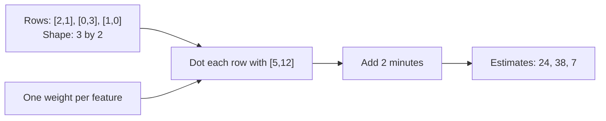

# Vectors and matrices: give numbers a structure

**Prerequisites:** the [foundations project](../foundations/07-data-tables-and-sql.md) and [data tools](../foundations/08-data-tools.md), lists, loops, functions, multiplication, and addition. You do not need previous linear algebra.

A model rarely receives “a learner” or “a document” directly. It receives a numerical representation. Mathematics helps us keep the meaning, order, and size of those numbers consistent.

## Begin with one example

A **scalar** is one number. A **vector** is an ordered list of numbers with a defined meaning for each position. Suppose a reading plan has two short articles and one long article. Its feature vector is `[2, 1]`, where the first position always counts short articles and the second counts long ones. A **feature** is a measured or constructed input property.

A vector is not just an unordered bag. `[1, 2]` describes a different plan. Save the feature order beside your data; swapping columns without swapping their meanings changes every later calculation.

Assume short articles take 5 minutes, long articles take 12, and opening the study materials takes 2. The estimated duration is:

`2 × 5 + 1 × 12 + 2 = 24 minutes`

The matching weights `[5, 12]` describe how each feature contributes. Multiplying matching positions and adding the results is a **dot product**. The extra 2 is an **intercept**, also called a bias: a contribution that does not depend on the features. These weights are hand-chosen estimates; learning weights from examples comes later.

## Put several vectors into a matrix

A **matrix** is a rectangular table of numbers. In this course, a data matrix usually has examples in rows and features in columns. Its **shape** is `(number of rows, number of columns)`. Three reading plans with two features each form a 3-by-2 matrix.



```python runnable
def dot(values, weights):
    if len(values) != len(weights):
        raise ValueError("one weight is required for each feature")
    total = 0
    for value, weight in zip(values, weights):
        total += value * weight
    return total

plans = [[2, 1], [0, 3], [1, 0]]
weights = [5, 12]
for plan in plans:
    print(dot(plan, weights) + 2)
```

```text output
24
38
7
```

`zip` pairs matching items. The length check matters because ordinary `zip` stops at the shorter input; without the check, a missing feature could silently disappear. Adding two vectors likewise requires matching positions and meanings, not just matching lengths.

## Learn the operations you will recognize later

A **transpose** exchanges rows and columns. A 3-by-2 matrix becomes 2-by-3. Matrix multiplication forms many dot products: multiplying a 3-by-2 matrix by a 2-by-4 matrix produces a 3-by-4 result. The inner sizes must match. This operation differs from multiplying corresponding entries one by one.

A vector's **length**, or norm, summarizes its magnitude. The Euclidean norm of `[3, 4]` is `sqrt(3² + 4²) = 5`. Euclidean distance between two vectors is the norm of their difference. These geometric ideas help describe similarity, but the feature scale matters: a distance using “income in rupees” and “age in years” can be dominated by the larger numerical scale.

## Practice: check meaning before calculating

Estimate a plan with one short and two long articles. Then explain why adding a third feature called “pages” requires changing the model, not merely appending a value to the existing row.

<details>
<summary>Check your answer</summary>

The estimate is `1 × 5 + 2 × 12 + 2 = 31`. A third feature needs its own weight and a definition of its units. It may also repeat information already represented by article counts. Feature availability does not automatically make a model better.

</details>

## Mistakes, tradeoffs, and further study

State shapes and units before performing operations. An identifier such as learner number 104 is not automatically a useful numerical quantity. A dot-product score is not automatically a probability, and a large magnitude is not automatically evidence of similarity.

Plain Python makes every multiplication visible. Later, array libraries perform the same kinds of operations efficiently on large batches. Understanding the shapes lets you use those libraries without guessing. For a deeper treatment, MIT's [linear algebra course](https://ocw.mit.edu/courses/18-06-linear-algebra-spring-2010/) develops vectors, matrices, and linear transformations.

## Depth lab: dimensions are part of the proof

Let X contain n examples as rows and d features as columns. A weight vector w has d values. The product Xw has n predictions because each row contributes one dot product. With h outputs, weights have shape d-by-h and the result has shape n-by-h.

Implement multiplication before calling a numerical library:

```python runnable
def multiply(a, b):
    if not a or not b or not b[0]:
        raise ValueError("Nonempty matrices required")
    if any(len(row) != len(a[0]) for row in a):
        raise ValueError("Ragged left matrix")
    if any(len(row) != len(b[0]) for row in b):
        raise ValueError("Ragged right matrix")
    if len(a[0]) != len(b):
        raise ValueError("Inner dimensions must match")
    return [[sum(a[i][k] * b[k][j] for k in range(len(b)))
             for j in range(len(b[0]))] for i in range(len(a))]

print(multiply([[1, 2, 3], [4, 5, 6]], [[1, 0], [0, 1], [1, 1]]))
try:
    multiply([[1, 2]], [[1, 2]])
except ValueError:
    print("shape rejected")
```

```text output
[[4, 5], [10, 11]]
shape rejected
```

The entry at row i, column j combines row i of the left matrix with column j of the right matrix. A direct implementation performs n*d*h multiply-add contributions and stores n*h results. Mathematical dimensions and feature names both matter: swapping two feature columns preserves shape but changes meaning.

### Debug, optimize, and design

Use asymmetric matrices with distinct values. Identity or all-zero fixtures can hide transposition errors. Compare one output entry by hand, then compare the full small result with a library. Reject ragged rows rather than letting zip silently truncate them.

Production numerical code should use tested kernels and a saved feature-order contract. Batch size changes memory and throughput; it does not change which axis means features. Measure conversion, data movement, and multiplication separately. Sparse data may benefit from sparse representation, but storage and operation support must match the workload.

<details>
<summary>Expert defense: why is a shape check necessary but insufficient?</summary>

Two columns can have the same numeric type and shape while representing different units or features. A weight trained for distance cannot be applied to a column containing temperature merely because dimensions align. Version feature names, order, units, and transforms with the model. Ask a learner to create a shape-correct but semantically wrong multiplication.

</details>

**Teach and demonstrate:** derive one output entry, explain the complexity, repair a transpose bug, and compare a scalar-loop oracle with a library implementation under stated tolerances.

**Previous:** [From Python lists to arrays, tables, and charts](../foundations/08-data-tools.md) · **Next:** [Functions, slopes, and gradient-based improvement](02-functions-and-gradients.md)
