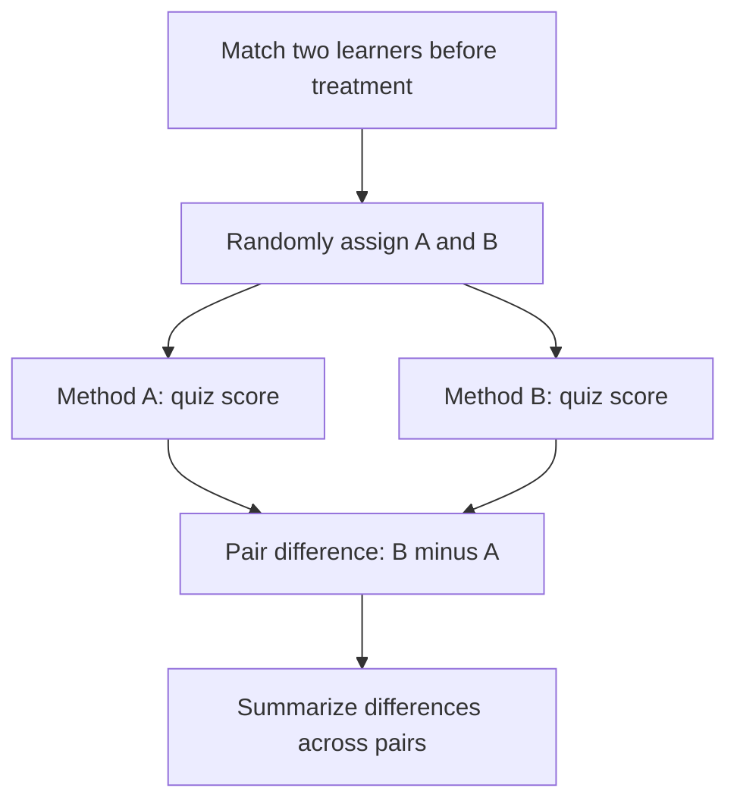

# Experiments, uncertainty, and an evidence-audit project

**Prerequisites:** [probability and sample summaries](./03-probability-and-statistics.md), functions, loops, and tests.

Suppose learners using study method B score higher than those using A. Is B better, or did the B group begin with stronger skills? An experiment connects a comparison to a defined question and makes uncertainty visible. This will later matter when comparing models, prompts, and product changes.

## Design the comparison before seeing the result

Define the population, outcome, treatment, and unit of assignment. For example: learners in one course; a quiz scored from 0 to 10; two study methods; one learner receiving one method. Define a practically useful improvement before choosing a statistical threshold.

**Random assignment** makes the choice of method independent of pre-existing learner characteristics in the assignment process. It does not guarantee perfectly balanced small groups or a representative sample. **Random sampling** concerns who enters the study; these are different operations.

Our fictional example uses six **matched pairs** of learners with similar earlier scores. Within each pair, randomly assign one learner to A and the other to B. Compare B minus A within each pair. Keep the quiz, available time, and scoring rule the same.



## Separate spread from uncertainty

The standard deviation describes variation between observations. The **standard error** estimates how much an estimated mean would vary across repeated samples. For independent pairs, the estimated standard error of the mean difference is `sample_sd_of_differences / sqrt(number_of_pairs)`.

More independent pairs usually reduce this uncertainty. Copying the same six rows ten times does not create sixty independent pairs. A **confidence interval** combines an estimate with an uncertainty calculation and its assumptions. A 95% procedure aims to cover the fixed population quantity in about 95% of repeated uses under those assumptions; it does not mean the quantity changes randomly after this particular interval is calculated. NIST explains this distinction in its [confidence-interval guide](https://www.itl.nist.gov/div898/handbook/eda/section3/eda352.htm).

Do not mechanically use “mean ± two standard errors” for every small or dependent sample. The method, sample size, and design matter.

## Stage project: audit a small comparison

[Download the complete offline project](pathname:///examples/ai/mathematics/method_comparison.py), save it as `method_comparison.py`, and run:

```sh
python3 method_comparison.py
```

The embedded fictional pairs are `(6,7), (7,9), (5,6), (8,8), (6,8), (7,8)`, with A first and B second. No packages or network access are needed.

```text
pairs=6 assignment_patterns=64
mean_A=6.500 mean_B=7.667
mean_gain_B=1.167
estimated_standard_error=0.307
two_sided_randomization_p=0.0625
At 0.05: do not reject the no-effect hypothesis.
This does not prove that the methods are equivalent.
self-checks passed
```

The project computes differences, their mean, their spread, and an exact small **randomization test**. Its **null hypothesis** is that assigning A or B has no effect on any learner's outcome. Under that hypothesis and the stated fair, independent assignment within each pair, swapping the two labels only reverses the sign of the observed difference.

There are `2 ** 6 = 64` possible sign patterns. The code examines every one and counts how often the absolute mean difference is at least as large as the observed one. Four patterns qualify, so the two-sided **p-value** is 4/64 = 0.0625. SciPy's [permutation-test documentation](https://docs.scipy.org/doc/scipy/reference/generated/scipy.stats.permutation_test.html) explains paired label permutations; our small implementation performs the enumeration directly.

A p-value is not the probability that the null hypothesis is true. At the preselected 0.05 threshold, this example does not reject it. That does not prove equivalence, erase the observed gain, or establish that a 1.167-point gain is useful in practice.

## Practice and project extension

Predict what happens if the A and B columns are exchanged. Inspect the project's check for that case. Then write a four-sentence report stating the observed gain, assignment assumptions, uncertainty result, and one limitation.

<details>
<summary>Check your answer</summary>

The mean difference changes sign; its magnitude and the two-sided p-value stay the same. A suitable report notes the fictional six-pair sample, fair within-pair assignment, observed 1.167-point gain, and p = 0.0625. It cannot claim that B works for all learners. The existing checks also cover no differences, too few pairs, and invalid scores.

</details>

Use `python3 method_comparison.py --output experiment_report.json` to save the computed report in your working folder. The project limits exact enumeration to at most 16 pairs because the number of patterns doubles with each additional pair. Larger studies need another justified computational method, not an unrestricted exponential loop.

## Mistakes and completion gate

Decide outcomes and stopping rules before repeatedly checking results. Trying many variants and reporting only the best exaggerates evidence. Keep effect size, uncertainty, practical cost, and population coverage separate.

Continue when you can explain why pairing changes the unit of analysis, why duplicated rows do not add evidence, and why a non-significant result is not proof of no effect. Those distinctions support honest model evaluation.

## Depth lab: pair the comparison before estimating uncertainty

Two methods evaluated on the same cases produce paired results. Compare each candidate result with its baseline result on the same case. Resampling the two methods independently would discard that relationship and answer a different uncertainty question.

For baseline errors [10, 100, 20] and candidate errors [9, 99, 19], each paired improvement is one. The methods vary greatly across cases, but their difference is constant on this tiny fixture. That illustrates why uncertainty about a difference is not the same as variation in raw task difficulty.

**Implement:** create a seeded paired bootstrap: sample case indexes with replacement, calculate the mean paired difference, and repeat. Test a constant-difference fixture, reversed method labels, and duplicated data. State the interval convention and avoid treating a tiny demonstration as a sufficient real sample.

### Choose the independent unit

If one user contributes 100 correlated requests, resampling rows treats those requests as independent. For a user-level claim, resample users and include their associated requests under a declared weighting rule. Time-dependent data may need blocks or a time-aware evaluation design instead of independent resampling.

Decide the primary metric, practical improvement threshold, test population, and stopping rule before reviewing outcomes. Trying many variants and reporting the most favorable interval without disclosing selection creates optimistic evidence. A confidence interval depends on the procedure and assumptions; it is not a guarantee about each future case.

### Debug and operate experiments

Keep method versions, input IDs, raw outcomes, exclusion reasons, and evaluator versions. Recompute one summary from raw records. Investigate unequal missing outcomes: dropping only a candidate's failed runs can make a worse method look better.

Optimize the experiment budget with small diagnostic runs, then a fixed final comparison. Do not economize by removing the baseline or by measuring different workloads. In a production experiment, define assignment, exposure, interference, and operational safeguards before rollout.

<details>
<summary>Expert defense: a statistically clear improvement is tiny—should it ship?</summary>

Statistical evidence and practical value are different questions. Compare effect size with cost, latency, failure severity, and the smallest useful change. A small effect can matter at large scale, but a narrow interval does not by itself justify operational complexity.

</details>

**Teach it:** use the three paired errors above, then add one catastrophic candidate failure. Ask the learner to explain how mean, tail risk, exclusions, and the deployment decision change. Keep the analysis code and a decision report.

**Previous:** [Probability, data summaries, and conditional questions](03-probability-and-statistics.md) · **Next:** [Update beliefs and measure information](05-bayes-and-information.md)
