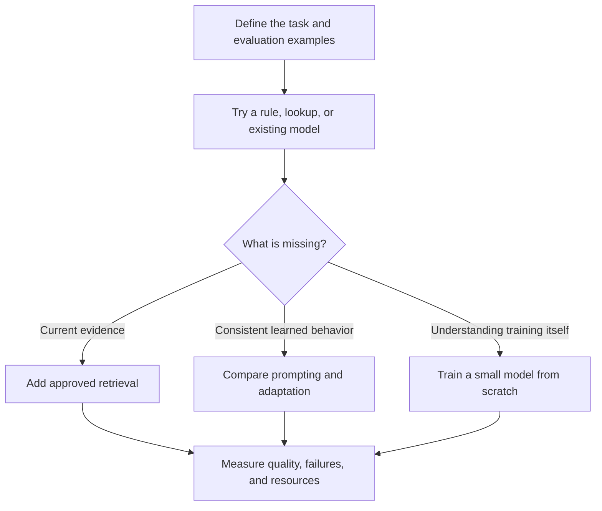

# Choose what to build, train, and run

**Before this lesson:** [decoding and alignment](../generative-ai/05-decoding-and-alignment.md), neural networks, and gradient descent. You can now move from using a model to creating and changing one. This stage ends with learned weights that you can save, load, evaluate, and adapt.

A **model** is a mathematical system with learned numbers, called weights. **Training** changes those numbers using examples. **Inference** uses them to make a prediction. Writing a prompt or connecting a model to a website does not, by itself, train it.

An **AI application** combines a model with ordinary software: a screen, data storage, permissions, and error handling. An **agent** is an application in which a model can help choose actions, usually through tools. You can build an application or an agent using someone else's model. You can also train a model that never uses tools or talks to a user.

For the school project, “build an AI” might mean three different deliverables: a catalogue search application, a model that writes short notices, or an assistant that proposes a room booking. Name the deliverable before choosing technology. Otherwise, a working chat screen can hide the fact that no learning or reliable task completion has been demonstrated.

## Make two separate decisions

First choose **where inference runs**. A hosted service runs a model for you behind an API. Self-hosting means you operate the model on your computer or server. Self-hosting an existing checkpoint does not mean you pretrained that model.

| Deployment choice | Useful when | Work you still own |
| --- | --- | --- |
| Hosted model service | You need a quick integration and its data-handling terms fit your task | Task evaluation, permissions, failure handling, recurring costs, and provider changes. |
| Existing model on your hardware | You need local operation or more deployment control | Compatible hardware, model loading, capacity, updates, and monitoring. |
| Small model embedded in an application | The task is narrow and resources are limited | Training or selecting the model, measuring quality, and distributing updates. |

Then choose **whether and how to change the model**. These choices can be combined with different deployment arrangements.

| Method | What changes | School example and main limitation |
| --- | --- | --- |
| Prompting | Instructions and examples in the input | Request a short notice. It uses context space and may still fail the format. |
| Retrieval, or RAG | Evidence supplied for a request | Find today's catalogue rules. Bad retrieval can supply incomplete evidence. |
| Full fine-tuning | Many or all existing weights | Adapt writing behavior using examples. It needs training memory and regression checks. |
| LoRA | Small added weight matrices | Adapt a pretrained model while freezing its original weights. It still needs the base model and evaluation. |
| Training from scratch | Random weights become learned weights | Study learning, or develop a model for a justified new setting. Useful broad language ability needs much more data and compute than this course fixture. |

**Pretraining** usually means the broad initial training that gives a model its starting capabilities. **Fine-tuning** starts from existing learned weights and trains further for a narrower task or domain. A small from-scratch exercise teaches the mechanism; it does not reproduce the capabilities of a large pretrained model. LoRA is one form of parameter-efficient adaptation, described in the [original LoRA paper](https://arxiv.org/abs/2106.09685).

## Work through a concrete choice

The librarian needs answers about rules that change each term. Start with approved lookup or retrieval because the facts must remain editable and attributable. Teaching new rules through fine-tuning makes updates and provenance harder. The application may still use a model to phrase a supported answer.

The communications team instead needs a consistent notice style. Start with a prompt and several examples. If a representative evaluation shows recurring style failures, and you have permitted examples of the desired behavior, test adaptation. Keep the underlying dates and policies outside the model when they change frequently.

Finally, your learning goal is to understand how text prediction becomes better through gradient updates. Here, training from scratch is appropriate. The next lessons build a small character predictor. You will inspect every component without renting a GPU or downloading model weights.



## Write an experiment contract before training

An **experiment contract** is a short record of what you will change and how you will judge it. For this stage, write: “Predict the next character in fictional school sentences. Compare a randomly initialized model with its trained version using held-out next-character loss.” The goal is measured learning, not a convincing conversation.

Record the training, validation, and test sources; the tokenizer; the model shape; the random seeds; the training budget; and the checkpoint-selection rule. **Validation** guides development. The **test set** is reserved for a final report after those choices are fixed. Also record what would make you stop: non-finite loss, incorrect labels, no held-out improvement, or a resource limit.

Keep a simple project folder containing the script, a data description, the tokenizer and weights, the run settings, and an evaluation report. A checkpoint with weights is enough for inference when the architecture and tokenizer match. Exact training continuation may additionally require optimizer state, progress counters, and random-generator state. Our first JSON checkpoint supports inference and a new adaptation run; it is not an exact-resume training snapshot.

## Check practical constraints early

Read a model's license and model card before adopting its weights. Check permitted uses, redistribution conditions, training-data information, supported languages, and documented limitations. Downloadable weights do not automatically grant every reuse. Record the exact model revision so another person can load the same starting point. The optional later recipe uses [DistilGPT2's published model card](https://huggingface.co/distilbert/distilgpt2) as a concrete example to inspect.

Budget for more than storing weights. Training also uses activations, gradients, optimizer state, and temporary buffers. LoRA reduces the number of trained parameters, but does not remove the base model or all activation memory. Benchmark a small run before promising a completion time. Using a larger machine does not fix contaminated evaluation data or an incorrectly shifted label.

## Practice: choose and justify

A school needs current opening hours, a consistent three-line notice style, and a lesson showing how weights learn. Choose a first method for each. State what result would justify adding complexity.

<details>
<summary>Compare your choices</summary>

Use an approved lookup or retrieval source for current hours. Try prompting for the notice style, then compare adaptation only if repeated failures remain on a representative set. Train the tiny model from scratch to study gradients. Add complexity after a measured failure that the new method could plausibly address, and retain the earlier baseline for comparison.

</details>

## Depth lab: compare feasible systems before optimizing cost

A **constraint** is a condition a candidate must meet. An **objective** is what you improve among feasible candidates. Mixing them can produce a cheap system that fails its job.

For an internal assistant, specify permitted data locations, answer-support requirements, p95 latency, and the load at which latency must hold. Compare complete systems: model, retrieval, validation, serving, and review.

```python runnable
# Invented measurements for a decision exercise.
candidates = [
    {"name": "small", "supported": 0.91, "p95_ms": 500, "monthly_cost": 80},
    {"name": "medium", "supported": 0.97, "p95_ms": 800, "monthly_cost": 160},
    {"name": "large", "supported": 0.98, "p95_ms": 1800, "monthly_cost": 600},
]
feasible = [
    c for c in candidates
    if c["supported"] >= 0.95 and c["p95_ms"] <= 1000
]
choice = min(feasible, key=lambda c: c["monthly_cost"], default=None)
print(choice["name"] if choice else "no feasible candidate")
```

```text output
medium
```

The selector is deterministic; its inputs require representative load tests, an informative evaluation set, and uncertainty estimates. A point estimate just above a threshold is weak evidence from a tiny sample.

**System cost:** separate one-time labeling and training from recurring inference, storage, monitoring, and review. Local serving trades service fees for infrastructure and operation. Hosted serving trades some control for management by another provider. Compare the same workload and obligations.

**Debugging a decision:** a local model meeting latency for one request may fail under load because of queueing. Poor quality on new documents may come from ingestion or retrieval. Identify the failing component before retraining.

**Optimization exercise:** add a candidate using better-selected, shorter evidence. Measure whether latency and answer support improve. A candidate is **dominated** when another is at least as good on every relevant objective and strictly better on one. Remove dominated options only after accounting for the important constraints and uncertainty.

<details>
<summary>Interview defense: when is training from scratch justified?</summary>

Reasons can include research, a different modality or architecture, or requirements available checkpoints cannot meet. The case needs suitable data, compute, evaluation, expertise, and maintenance. Compare prompting, retrieval, and adaptation first for a small application. Successful training of a tiny teaching model does not justify a large production training program.

</details>

**Deliver and teach:** write a decision record with workload, rejected options, evidence, unknowns, and conditions that would change your choice. Have a reviewer change one constraint and explain the resulting decision.

**Previous:** [Choose tokens and teach preferred behavior](../generative-ai/05-decoding-and-alignment.md) · **Next:** [Prepare data, tokenizers, and prediction targets](02-data-and-tokenizers.md)
