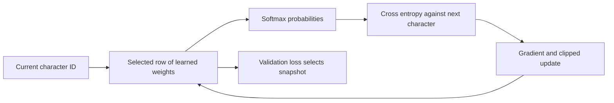

# Train, save, and reload a small neural language model

**Before this lesson:** [data and tokenizers](./02-data-and-tokenizers.md). You are ready to create learned weights. Download [train_language_model.py](pathname:///examples/ai/model-building/train_language_model.py). It uses Python 3.10 or later and the standard library. It needs no network, paid service, or accelerator, and writes nothing unless you request an output file.

The earlier generative-AI project counted word pairs. This project starts with small random weights and changes them through gradients. It is a **neural character bigram model**: a single learned linear layer followed by softmax, with only one previous character as context. There is no hidden layer, attention, or Transformer. Its small size lets you inspect the entire learning process.

## Understand the model's shape

The fitted vocabulary has 24 IDs, including four special tokens. Represent the current character as a **one-hot vector**: 24 numbers with one entry equal to one and the rest zero. Multiplying that vector by a 24 × 24 weight matrix selects one row of 24 scores. The code directly indexes the row rather than allocating the one-hot vector.

These scores are **logits**, unrestricted numbers describing preferences before normalization. **Softmax** turns them into nonnegative probabilities that add to one. A larger score gives its character more probability relative to the others. The model stores 576 weights; unused structural-token contexts do not receive training examples.

For the pair `t → h`, the target is `h`. **Cross-entropy loss** is the negative natural logarithm of the probability assigned to that target. Giving `h` very little probability produces a large loss. The average over many next-character pairs is the training objective. Its unit here is a **nat**, based on the natural logarithm.



## Follow one update with numbers

A **gradient** describes how a small weight change would change the loss. For softmax with a correct single target, the derivative with respect to a score is `predicted probability − target indicator`. The indicator is one for the correct token and zero elsewhere. Subtracting the gradient increases the correct token's relative score.

```python runnable
import math

logits = [0.0, 0.0]
probabilities = [0.5, 0.5]
target = 0
learning_rate = 0.2
for index in range(2):
    gradient = probabilities[index] - int(index == target)
    logits[index] -= learning_rate * gradient
normalizer = sum(math.exp(value) for value in logits)
new_probability = math.exp(logits[target]) / normalizer
print(f"Correct-token probability: {0.5:.3f} -> {new_probability:.3f}")
print(f"New loss: {-math.log(new_probability):.3f}")
```

```text output
Correct-token probability: 0.500 -> 0.550
New loss: 0.598
```

The full script averages gradients over a **minibatch** of 32 sampled training pairs. Its **learning rate** controls the step size. It also clips the gradient's overall length to a chosen limit before updating. Clipping can contain large updates; it does not correct bad labels or make any learning rate safe.

Read `encode`, `pairs`, `softmax`, `loss`, `gradient`, `update`, and `train` in that order. Softmax subtracts the largest logit before exponentiating to avoid unnecessary overflow. The loss uses the same stable log-normalization. Every 25 steps, validation loss is measured without a gradient update, and the best snapshot so far is copied.

## Run the complete experiment

Save the script in a new working folder and run:

```sh
python3 train_language_model.py
python3 train_language_model.py --self-test
```

The first command prints:

```text
Architecture: neural character bigram; 24 x 24 learned weights
Validation loss before training: 3.1786
Selected step (validation only): 550
Validation loss after training: 1.3765
Final test loss: 1.3287
Limits: one-character context; no factual or conversational ability
```

Training makes predictions less surprising on this held-out fixture. That is evidence of learning this narrow pattern distribution. It is not evidence of reasoning, factual accuracy, or general language competence. The sentences share vocabulary and style, so they are deliberately easier than unrelated real-world text.

The training budget is 700 updates, but the selected checkpoint comes from step 550. The test set does not choose that step. The self-test compares an analytic gradient with a finite-difference estimate, checks unknown-character handling and split separation, verifies checkpoint round trips, and checks bounded generation and adaptation. A loss decrease alone would not detect every implementation mistake.

## Save weights and prove that loading works

```sh
python3 train_language_model.py --output base.json --generate "the "
python3 train_language_model.py --load base.json --generate "the "
```

The first run prints the training report, writes `base.json`, and includes this sample. The second run prints exactly:

```text
Loaded: base.json
Sample: the ry nowr che ache a nose.
```

The nonsense is expected: one-character context cannot track a sentence's structure. Matching output after loading demonstrates that the saved tokenizer and weights reproduce this seeded generation. Generation excludes BOS and PAD as outputs, stops at EOS or the length limit, and samples from temperature-scaled probabilities. UNK, if sampled, appears as a replacement character.

The JSON checkpoint stores the vocabulary, architecture name, weights, selected step, seeds, and base-training-data hash. A **hash** is a compact fingerprint calculated from content; it helps detect whether that content changed. The loader checks dimensions and finite numeric values. `--output` only creates a new file in the working folder and refuses to overwrite an existing one. Choose a new filename for each experiment. Plain JSON avoids executing serialized Python objects, though any model artifact still needs provenance and resource checks.

## Optional: build a causal Transformer next

Download [train_transformer.py.txt](pathname:///examples/ai/model-building/train_transformer.py.txt) and save it as `train_transformer.py` beside the standard-library script. It contains a complete small PyTorch training program, including validation selection, a future-token leakage check, test evaluation, generation, saving, and reloading.

This extension uses token embeddings, position embeddings, one attention block with four heads, a feed-forward layer, and an output projection. A triangular **causal mask** prevents a position from looking at later tokens. Padding is masked separately. Unlike the bigram model, its predictions can use several earlier characters within a 64-position context.

In a separate environment on macOS or Linux, run:

```sh
python3 -m venv .venv-models
source .venv-models/bin/activate
python -m pip install torch
python train_transformer.py --steps 200 --output transformer-run
```

Use the [official PyTorch installation selector](https://pytorch.org/get-started/locally/) if your platform needs a different installation command. The recipe uses CPU by default and downloads no model weights. It prints measured losses and a sample, then writes `weights.pt` and `config.json`. Exact numerical output is not asserted: this optional recipe was checked for syntax and against documented APIs, but was not executed with PyTorch in this repository. Record a working package version after testing it locally.

The small dataset remains the main limitation. More attention layers do not create missing training evidence. Compare the Transformer with the bigram baseline on fixed splits before changing data, width, or training budget. The [TransformerEncoderLayer reference](https://docs.pytorch.org/docs/stable/generated/torch.nn.TransformerEncoderLayer.html) describes the block used here; the causal mask is what makes this use suitable for next-token prediction.

## Practice

Training loss keeps falling, but validation loss rises after step 550. Which checkpoint should the declared selection rule keep, and why should you not use the test loss to decide?

<details>
<summary>Check your reasoning</summary>

Keep the snapshot with the lowest validation loss. Continued training may fit training-specific patterns while becoming less useful on held-out examples. Choosing using test loss would turn the test set into another validation set. Freeze the selection rule first, report the final test result, and use new held-out data for further conclusions after repeated development.

</details>

## Depth lab: prove that a checkpoint can resume training

An inference checkpoint reproduces saved predictions. A resumable training checkpoint must also continue optimization. Momentum illustrates why the next update depends on optimizer state as well as weights.

```python runnable
import json

def step(weight, velocity):
    gradient = 2 * (weight - 3)
    velocity = 0.9 * velocity + gradient
    return weight - 0.1 * velocity, velocity

weight, velocity = step(0.0, 0.0)
checkpoint = json.dumps({"weight": weight, "velocity": velocity, "step": 1})
restored = json.loads(checkpoint)
continued = step(weight, velocity)
resumed = step(restored["weight"], restored["velocity"])
weights_only = step(restored["weight"], 0.0)
print("full state agrees:", continued == resumed)
print(f"full state weight: {resumed[0]:.2f}")
print(f"weights-only weight: {weights_only[0]:.2f}")
```

```text output
full state agrees: True
full state weight: 1.62
weights-only weight: 1.08
```

The earlier language-model checkpoint stores what its inference and adaptation paths need; it does not claim exact resumption of arbitrary training systems. Stochastic training may also need scheduler, random-number state, data cursor/order, mixed-precision scaler, accumulated gradients if saving mid-update, and distributed layout.

**Stronger verification:** compare uninterrupted training with a save/reload at an update boundary. Check the next batch, learning rate, loss, and parameters. Define a numerical tolerance; exact equality across hardware or nondeterministic kernels may be unrealistic.

**Debugging:** if loaded inference agrees but resumed training immediately diverges, inspect optimizer and data state. If loss differs before any update, inspect preprocessing, configuration, and train/evaluation mode.

**Production and optimization:** write to a temporary location, validate completion, and publish with a completion marker or atomic rename appropriate to the storage system. Check dimensions and checksums before loading. Retain known-good artifacts when cleaning runs. Less frequent checkpoints reduce I/O but increase work lost after failure; choose intervals using measured save time and acceptable recovery cost.

<details>
<summary>Interview defense: is a fixed random seed sufficient?</summary>

No. Seeds control particular random-number generators, not data order, software, hardware kernels, distributed operations, and all preprocessing. State the claim precisely: identical bytes, predictions within tolerance, or statistically similar conclusions across repeated runs.

</details>

**Teach-back:** explain the two weights above as evidence that momentum carries memory. Distinguish an inference artifact, a training-resume artifact, and an experiment report.

**Previous:** [Prepare data, tokenizers, and prediction targets](02-data-and-tokenizers.md) · **Next:** [Fine-tune a model and evaluate the release](04-fine-tune-and-release.md)
