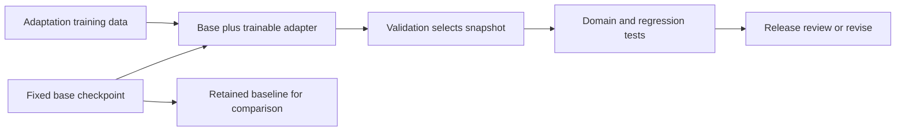

# Fine-tune a model and evaluate the release

**Before this lesson:** [train and reload a small model](./03-train-a-small-model.md). **Fine-tuning** means continuing training from learned weights using new examples. It changes the model. Retrieval supplies external evidence to a request, and prompting changes the input; neither operation necessarily changes weights.

You will first adapt the model you trained yourself. Then an optional recipe adapts a real pretrained language model using LoRA. Both routes need separate training and evaluation examples. A new style appearing in one generated sample is not enough evidence to release a model.

## Adapt your own checkpoint offline

Keep [train_language_model.py](pathname:///examples/ai/model-building/train_language_model.py) and the `base.json` checkpoint from the previous lesson in the same folder. The script includes a second fictional corpus about a robot. Its training, validation, and test sentences are separate, and its characters fit the existing vocabulary.

```sh
python3 train_language_model.py --load base.json --adapt --output adapted.json
python3 train_language_model.py --load adapted.json --generate "the robot "
```

The adaptation command prints:

```text
Loaded: base.json
Adaptation selected step (validation only): 250
Domain test loss: 2.1567 -> 1.3540
Original test loss: 1.3287 -> 1.6602
These tiny test sets illustrate a tradeoff; they are not release evidence.
Saved: adapted.json
```

The robot-domain test loss improves, while the original school-text test loss gets worse. **Forgetting** is a loss of previously useful behavior after further training. This fixture demonstrates the possibility using ordinary weight updates; it does not establish how much forgetting a different architecture or dataset will show.

The adapted model was selected using robot validation loss. The original test is reported as a regression check after that selection. Do not repeatedly tune settings against these two test sets and then present them as untouched final evidence. For a larger project, use development regression cases while tuning and reserve separate final domain and regression tests.

Possible development experiments include fewer updates, a smaller learning rate, or mixing permitted examples from the original domain into adaptation training. Compare them under a fixed budget. Preserve the original checkpoint so you can restore it. Keeping old weights on disk is a rollback plan; it does not prevent forgetting inside the new weights.

## Understand what LoRA changes

Full fine-tuning changes the original model weights. **LoRA**, short for Low-Rank Adaptation, keeps selected original weight matrices fixed and learns an additional update represented by two smaller matrices. **Rank** controls the size of that update representation. This reduces trained parameters and associated optimizer state, but the base model still occupies memory and supplies the starting capabilities.

An **adapter** is the saved set of these extra learned parameters and their configuration. Loading it requires the compatible base model. It is not a complete standalone replacement for the original model. The [LoRA paper](https://arxiv.org/abs/2106.09685) and [PEFT configuration guide](https://huggingface.co/docs/peft/guides/peft_model_config) explain this relationship.



## Optional: fine-tune real pretrained weights

Download [finetune_lora.py.txt](pathname:///examples/ai/model-building/finetune_lora.py.txt) and save it as `finetune_lora.py`. This is a complete recipe, not an offline simulation. It uses Hugging Face Transformers and PEFT to load `distilbert/distilgpt2`, attach LoRA to its attention projections, train on fictional short notices, save an adapter, reload it onto the same base revision, and generate text.

Read the [DistilGPT2 model card](https://huggingface.co/distilbert/distilgpt2) before downloading. It is an English text-completion model, not a modern chat assistant. The tiny notice corpus demonstrates continued language-model training; it is not instruction tuning or evidence of useful school-assistant quality. Check its documented limitations and license against your intended use.

This optional recipe downloads real weights and needs substantially more memory and time than the standard-library model. CPU is the default; an available CUDA device can be selected explicitly. **CUDA** is NVIDIA's computing platform for compatible graphics processors. We reviewed the APIs and checked the file's syntax, but did not install these dependencies, download weights, or execute pretrained-model training here. No untested package versions or numerical training results are presented as verified.

On macOS or Linux, use an isolated environment:

```sh
python3 -m venv .venv-lora
source .venv-lora/bin/activate
python -m pip install torch transformers peft huggingface_hub
python finetune_lora.py --output school-adapter --epochs 3
python -m pip freeze > requirements-tested.txt
```

The installation command intentionally has no claimed tested pins. After a successful local run, preserve the resolved package versions alongside the report. Use PyTorch's platform-specific installation instructions if necessary. The script resolves the requested model revision to a commit before loading the tokenizer and weights, and records that commit in `experiment.json`. To repeat the base selection, pass the recorded commit using `--revision`.

## Inspect the recipe before expanding it

The source contains the whole pipeline. `TRAIN`, `VALIDATION`, `TEST`, and `REGRESSION` are explicit document groups. It rejects oversized examples instead of silently truncating their endings. `batches` appends a real EOS token, pads rows, and sets labels to `-100` only where the attention mask marks artificial padding. GPT-style causal models shift these labels internally. [Causal language-model training guide](https://huggingface.co/docs/transformers/tasks/language_modeling).

The LoRA configuration targets `c_attn`, a projection name used by this model family. Its `fan_in_fan_out=True` setting matches the projection's weight layout. Names and layouts vary across architectures, so copying these settings to an unrelated model can fail or adapt the wrong layers. The script checks that only adapter parameters are trainable. [PEFT LoRA reference](https://huggingface.co/docs/peft/package_reference/lora).

Each epoch runs gradient updates, clips gradients, and evaluates without gradients. Validation chooses among adapter snapshots, including the initial no-change adapter if training only makes validation worse. The recipe reports both notice test loss and original-style regression loss. It weights evaluation by actual predicted tokens rather than averaging unequal batches equally.

Expected artifacts are adapter weights, adapter configuration, tokenizer files, and `experiment.json` under the new output directory. The script prints the base revision, trainable-parameter count, validation results, selected epoch, before/after test losses, and generated text. It then checks evaluation after reloading the saved adapter. Exact values depend on the resolved environment; inspect measured output rather than expecting a promised quality gain. Nothing is uploaded.

## Move from text completion to instruction training

The notice recipe trains text completion. To teach responses to requests, use **supervised fine-tuning**, or SFT, on examples containing the request and a desired answer. Revisit [adaptation methods](../generative-ai/03-adaptation-and-fine-tuning.md) for the broader comparison. One fictional training record could be:

```json
{
  "messages": [
    {"role": "user", "content": "Write a short notice: chess club, Friday, library."},
    {"role": "assistant", "content": "Chess club meets on Friday in the library."}
  ]
}
```

A **chat template** turns these roles and messages into the model's expected token sequence. Use compatible role markers, turn endings, and stopping tokens during both training and inference. Do not simply paste a different model's template onto an existing checkpoint.

With **assistant-only loss**, user and system tokens remain available as context, but only assistant-response positions contribute to the training objective. Inspect an encoded example and its label mask before launching training. TRL's `assistant_only_loss=True` requires a template that identifies assistant-generation spans; an arbitrary template does not supply this automatically. See the [SFT Trainer instructions](https://huggingface.co/docs/trl/sft_trainer#train-on-assistant-messages-only).

Keep related source documents, conversations, and users together when splitting data. Evaluate new requests, supported languages, refusals, and factual support. A single attractive training example cannot establish instruction-following ability; neither can the included notice LoRA run.

After a sound SFT baseline, **preference training** can learn from comparisons between better and worse responses to the same prompt. DPO uses chosen/rejected pairs directly. A conventional RLHF route trains a reward model from human preferences, then uses reinforcement learning to improve responses against that reward. Both depend on annotation quality and can reward undesirable shortcuts. They are follow-up experiments, not automatic safety guarantees. The [TRL DPO guide](https://huggingface.co/docs/trl/dpo_trainer) explains the preference-data format and its relationship to RLHF.

## Decide whether the candidate is usable

Language-model loss measures token prediction, not factual reliability or instruction-following. Add task-specific checks: notice length, required fields, supported language, unsupported claims, inappropriate disclosures, and behavior on unfamiliar requests. Compare with the original model and a simple prompt-based baseline on the same cases.

Record model and tokenizer revisions, adapter settings, data provenance, package versions, resource use, evaluation slices, and known failures. A model release also needs application permissions and operational monitoring, covered later in [AI engineering](../engineering/01-serving-and-apis.md). Keep the earlier artifact available and define the failure conditions that trigger rollback.

## Practice

The adapter improves notice style but starts inventing meeting dates. Should you add more sampled generations, change the temperature, or investigate the task design?

<details>
<summary>Reason through the failure</summary>

Investigate the design and evaluate factual support. Sampling and temperature do not supply authoritative dates. Keep changing facts in approved input or retrieval, test that the model uses them, and reject unsupported output. Adaptation may improve style while a separate retrieval or structured-template path provides current facts. Release only when the combined system meets the declared requirements.

</details>

## Depth lab: calculate and merge a low-rank update

For a dense weight matrix `W`, LoRA represents an update as `scale * B * A`. If `W` is `output × input`, `A` is `rank × input` and `B` is `output × rank`. The adapted layer computes `W*x + scale*B*(A*x)`, algebraically equivalent to the merged matrix under the same weights and scaling.

```python runnable
W = [[1.0, 2.0], [3.0, 4.0]]
A = [[1.0, -1.0]]
B = [[0.5], [2.0]]
x, scale = [2.0, 1.0], 0.5

def matvec(matrix, vector):
    return [sum(w * v for w, v in zip(row, vector, strict=True))
            for row in matrix]

base, update = matvec(W, x), matvec(B, matvec(A, x))
separate = [b + scale * u for b, u in zip(base, update, strict=True)]
merged = [[W[i][j] + scale * B[i][0] * A[0][j]
           for j in range(2)] for i in range(2)]
print(separate)
print(matvec(merged, x))
print("parameters:", len(A) * len(A[0]) + len(B) * len(B[0]))
```

```text output
[4.25, 11.0]
[4.25, 11.0]
parameters: 4
```

This tiny adapter has as many parameters as the base matrix. Savings appear when rank is small relative to real dimensions: `rank * (input + output)` instead of `input * output`.

The [LoRA paper](https://arxiv.org/abs/2106.09685) trains these matrices with frozen base weights. A common initialization sets one matrix to zero so the initial update is zero. Setting both to zero can block their gradients. Check your implementation's initialization and scaling.

**Debugging:** compare base-only, separate-adapter, and merged outputs on fixed inputs in evaluation mode. Inspect module names, orientation, base revision, rank, and scaling. Dropout and low-precision arithmetic can invalidate exact training-time equality; use an appropriate configuration and tolerance.

**Production and optimization:** adapters depend on compatible bases and tokenizers. Merging may remove a separate inference branch but changes full-model storage and adapter switching. Quantized weights require special handling during merging. Evaluate the resulting artifact instead of assuming algebraic equivalence guarantees identical numerical behavior.

<details>
<summary>Interview defense: does freezing the base eliminate its training memory?</summary>

No. Base weights participate in computation, and intermediate activations may be needed for adapter gradients. Freezing avoids gradients and optimizer state for frozen parameters. Total memory still includes weights, activations, buffers, adapter state, and framework overhead.

</details>

**Release project:** bind base revision, tokenizer, adapter settings, data fingerprint, package versions, and evaluations in a manifest. Reload in a fresh process, run domain and regression cases, and demonstrate rollback to the prior compatible bundle.

**Previous:** [Train, save, and reload a small neural language model](03-train-a-small-model.md) · **Next:** [Retrieval basics: find evidence before answering](../rag/01-retrieval-basics.md)
