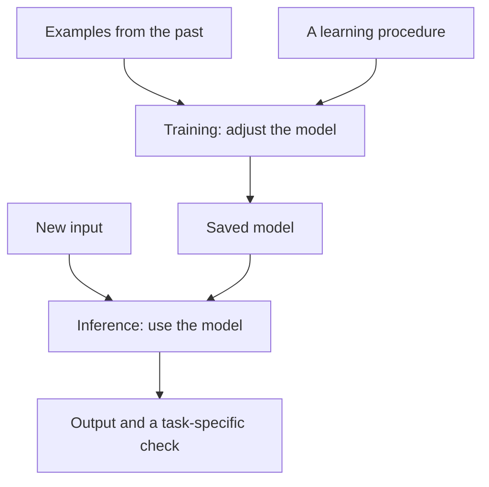

# What AI is, and what you will build

**Before this lesson:** nothing. You need only a way to read, write notes, and later run a small program.

A **program** is a set of instructions a computer follows. **Data** is information those instructions use: numbers, words, pictures, or recordings. An **input** is what you give a program; an **output** is what it produces.

Suppose a school library wants to help students find books. We can solve several different problems:

| Problem | A reasonable starting point |
| --- | --- |
| Find a book with an exact ID | Look up that ID in a table. |
| Show books with “space” in the title | Search the stored titles. |
| Estimate which books may be popular next month | Learn patterns from earlier borrowing data. |
| Draft a plain-language description | Use a model that generates text, then check its claims. |

The first two tasks do not need machine learning. Choosing a simple reliable method is part of good AI engineering.

## Rules, learning, and generation

With a **rule-based program**, people write the decision rule: “If a book is overdue, show a reminder.” With **machine learning**, a program uses examples to adjust a mathematical model. A **model** is a rule with adjustable numbers that produces an output from an input. Learning those numbers is called **training**. Using the trained model is called **inference**.

**Artificial intelligence**, or **AI**, is the broader field of building systems that perform tasks such as recognizing patterns, planning actions, or working with language. Machine learning is one approach. **Deep learning** uses models made of connected layers; those layers will be built step by step later. **Generative AI** produces content such as text or images. A generated sentence can sound sensible and still be false.

Training does not mean storing a perfect answer to every future question. We need to test whether the model works on examples it did not learn from. That idea, called **generalization**, will guide the whole course.

## Your first design decision

Imagine you have 100 book descriptions and want to show the five containing a student's search word. A word search is cheap, easy to explain, and may already solve the problem. A learned search model may later help with related meanings, but needs more evaluation and resources.

Write down the user, the input, the useful output, and the cost of a mistake before choosing a model. For a library helper, returning an irrelevant book wastes time. Inventing an opening time may cause a wasted trip. These failures need different checks.

Use public, fictional, or permissioned examples while learning. **Personal data** is information about a person; removing a name does not always make a record anonymous. Later lessons teach access rules and data handling. You can begin with fictional book records today.

## Choose your route through the submenu

Begin with the core sequence if Python, data handling, or the mathematics is new. Each expandable stage now has an overview explaining its purpose and the lessons it contains.

- **New to programming:** continue to [numbers and notation](foundations/00-numbers-and-notation.md), then complete the Python/data stage.
- **Already building applications:** use the [developer roadmap](developer-roadmap/index.md) and demonstrate its prerequisite gates before skipping material.
- **Ready for a focused project:** choose one [professional studio](careers.md) after its shared foundations; use the [lab directory](syllabus.md#lab-directory) to find runnable examples.
- **Reviewing for interviews:** attempt the [mastery demonstrations](assessments.md#eight-mastery-demonstrations), record the failed reasoning step, and return to its canonical lesson.

The route changes which lesson you visit next, not the evidence required to claim mastery.

## How the projects grow

You will first build small data-processing programs. Next, you will train simple predictors and inspect their errors. Then you will study neural networks, generated language, evidence retrieval, and tool-using programs. Finally, you will wrap systems in services, test releases, and reproduce a research result.

Python is the main teaching language because it is widely used for data and models. A **library** is reusable code written for a particular job. You will learn plain Python before relying on its model-building libraries. A **GPU**, or graphics processing unit, can speed up large numerical calculations; the first projects use an ordinary computer's CPU instead.

## Try it yourself

For each task, choose a rule, a lookup, or a learned model as your first attempt: checking whether a required form field is empty; locating a book by ID; predicting tomorrow's borrowing count. Explain what evidence would make you change your choice.

Compare your reasoning

An empty-field check is an explicit rule. A book ID is a lookup. A borrowing forecast may benefit from learning, but first compare it with a simple baseline such as last week's count. More complex methods are useful only if the improvement matters for the task and survives a fair test.

**Mini-project:** write a four-line problem brief for the library. Name the user, input, output, and one unacceptable failure. Add the simplest non-AI solution. Keep this brief: later you will measure whether a model improves it.

**Remember:** start with a problem, use evidence, and treat a model's output as something to evaluate.

## Depth lab: make your first explanation testable

Begin with a small claim: “A lookup can answer which title belongs to book B17.” Write three fictional records on paper and perform the lookup yourself. Then change the question to “Which new book will students enjoy?” Explain why the original table no longer supplies a complete answer.

For each problem, record what is known, what must be estimated, and what a wrong answer would cost. A learned prediction needs examples and a fair check. A generated description needs checking against its source. An exact rule needs checking against the rule's intended conditions.

**Your first debugging exercise:** place two different titles under B17. The lookup is now ambiguous because the data violates an assumption: each ID should identify one record. Choosing the more fluent title would not repair that assumption. Decide whether to reject the duplicate or obtain a corrected source.

**Your first optimization exercise:** compare looking through every record with keeping an organized ID lookup. Predict which helps as the library grows. Later lessons will implement these alternatives and measure their work.

**Teach-back:** explain rules, learning, and generation with one example each. Ask the learner to classify a fourth task they have not seen. Their answer is more useful evidence than simply asking whether your explanation sounded clear.

You will return to these habits throughout the course. The [eight mastery demonstrations](./assessments.md#eight-mastery-demonstrations) provide a later review structure; you do not need to understand production systems or advanced mathematics before starting the next lesson.

**Next:** [Numbers, units, and the symbols you will meet](foundations/00-numbers-and-notation.md)
