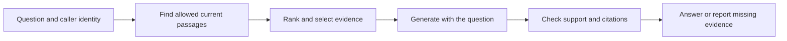

# Retrieval basics: find evidence before answering

**Before this lesson:** complete [model building and adaptation](../model-building/04-fine-tune-and-release.md). You can now distinguish changing a model's weights from supplying evidence at answer time.

**Retrieval** means finding relevant information in a collection. A collection might contain the school handbook, library notices, and club schedules. A **query** is the search request. A **retriever** selects candidate documents or passages for that query.

**Retrieval-augmented generation**, or **RAG**, supplies retrieved material to a generator so that it can answer using that evidence. This separates the model’s learned patterns from information that can be updated or access-controlled outside its weights. The [original RAG paper](https://arxiv.org/abs/2005.11401) studied a particular combination of neural retrieval and generation; modern applications use several different designs under the same broad name.

## Start with a small question

A student asks, “How long can I borrow a book?” The current handbook says “Students may borrow books for 21 days.” An old notice says 14 days. A staff-only note discusses a different borrowing arrangement.

The assistant needs more than a sentence that contains “book.” It needs evidence that is relevant, current, and permitted for that student. A correct answer must preserve the source’s meaning. The retriever’s score alone cannot establish all of those properties.

1. Identify the caller through the application’s normal authentication.
2. Search only material that caller may access, using the current document versions.
3. Rank candidate passages and keep a small useful set.
4. Ask the generator to answer from those passages, with source identifiers.
5. Check the answer and report when the evidence is missing or conflicting.



## Two ways to find a passage

**Lexical search** matches words or tokens. It is useful for exact names, codes, and unusual phrases. “Book return deadline” may fail to match a source that only says “loan period,” unless the search system handles those differences.

**Dense retrieval** represents text using an **embedding**: a list of learned numbers. A query embedding is compared with stored passage embeddings using a similarity function. Related meanings can be close, but this depends on the embedding model, language, domain, and task. A nearby vector is not proof that a passage answers a question.

These routes are often combined. A **hybrid search** can gather lexical and dense candidates before merging their rankings. A **reranker** then reorders a smaller candidate set using a more detailed relevance check. The [Sentence Transformers retrieval guide](https://www.sbert.net/examples/sentence_transformer/applications/retrieve_rerank/README.html) illustrates retrieval followed by reranking.

## Work a ranking example by hand

| Candidate | Why it might be found | Why it may not be usable |
| --- | --- | --- |
| Current loan handbook | Contains borrowing rules | Must still apply to this borrower and item type |
| Old loan notice | Strong word overlap | Replaced by the current version |
| Staff borrowing note | Related meaning | Student lacks permission |
| Library opening hours | Same topic and vocabulary | Does not state the loan period |

If the correct handbook passage never reaches the candidate set, a reranker cannot recover it from nothing. If it reaches the generator but the answer changes 21 to 14, retrieval succeeded and generation failed. Keep these stages separately visible when debugging.

## Trade-offs and alternatives

Use a direct database lookup when a field such as `loan_days` has an exact authoritative value. Use ordinary search when users prefer to read the sources themselves. RAG helps when questions need explanation across prose documents, but introduces indexing, freshness, ranking, and generation work.

Adding every document to the prompt can exceed the context budget, expose restricted data, and bury the relevant passage. Retrieving nothing and guessing defeats the purpose. Start with a small approved collection and measure the failures before adding more components.

## Practice

The top-ranked passage is an old policy with the exact query words. A lower-ranked passage is the current policy with different wording. Which should the system use, and where should that rule live?

<details>
<summary>Check your answer</summary>

Use the current applicable policy. Version and access rules belong in the application’s data and retrieval controls, not only in an instruction asking the model to “be careful.” Ranking then compares the valid candidates. If current evidence is unavailable, report that limit rather than using a superseded value as if it were current.

</details>

## Depth lab: build and test cosine retrieval

Cosine similarity compares vector direction by dividing a dot product by both vector lengths. It is useful when direction carries meaning and magnitude should not dominate. This example uses explicit word-count coordinates so every number is inspectable. Learned embeddings use the same mathematical operation but do not make their coordinates ordinary word counts.

```python runnable
import math

def cosine(left, right):
    if len(left) != len(right):
        raise ValueError("incompatible dimensions")
    denominator = math.sqrt(sum(x*x for x in left) * sum(y*y for y in right))
    if denominator == 0:
        return None
    return sum(x*y for x, y in zip(left, right, strict=True)) / denominator

# Coordinates: book, return, hours.
query = [1, 1, 0]
documents = {"loan": [2, 2, 0], "hours": [0, 0, 3], "mixed": [1, 0, 1]}
ranked = sorted(
    ((name, cosine(query, vector)) for name, vector in documents.items()),
    key=lambda item: (-item[1], item[0])
)
print([(name, round(score, 3)) for name, score in ranked])
print("empty query:", cosine([0, 0, 0], query))
```

```text output
[('loan', 1.0), ('mixed', 0.5), ('hours', 0.0)]
empty query: None
```

The loan vector has twice the query's magnitude but the same direction. Normalization removes that scale difference. A zero vector has no direction; returning a missing score makes that failure explicit. Do not silently rank an empty query as a meaningful match.

**Implement further:** create a vocabulary from training documents, count words, and add inverse-document-frequency weights so ubiquitous terms contribute less. Keep preprocessing identical for documents and queries. Test punctuation, case, exact identifiers, and words absent from the vocabulary. This lexical vector baseline still cannot recognize arbitrary paraphrases.

**Debugging and production:** trace a missed result through extraction, tokenization, vector creation, filtering, and ranking. Dimension equality alone does not establish compatibility: vectors from two different models can have the same width and incompatible meanings. Store the representation version and distance convention with the index.

**Optimization:** brute-force cosine costs work proportional to document count times vector width. Pre-normalizing nonzero vectors turns repeated cosine calculations into dot products. Verify the same rankings before and after this change. Approximate indexing is a later tradeoff; preserve exact search as a small reference.

<details>
<summary>Interview defense: is a cosine score of 0.9 a 90% chance of relevance?</summary>

No. It is a geometric score under a representation. Its relationship to relevance depends on the model, corpus, and query population. Set thresholds with labeled development cases and measure failures. A high score also says nothing by itself about source authority, freshness, or access.

</details>

**Teach-back:** draw two arrows with the same direction and different lengths. Explain why cosine ties them and a raw dot product may not. Then show a semantically wrong passage that shares query words.

**Previous:** [Fine-tune a model and evaluate the release](../model-building/04-fine-tune-and-release.md) · **Next:** [Indexing, chunks, and search choices](02-indexing-and-search.md)
