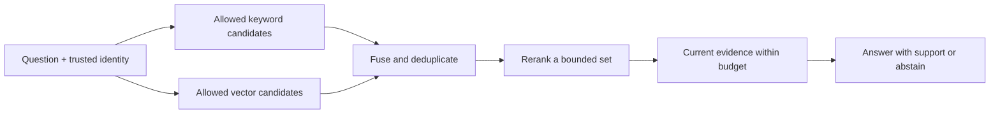

# Build and evaluate a hybrid retrieval pipeline

**Before this lesson:** [indexing](./02-indexing-and-search.md), [grounded answers](./03-grounded-answers.md), and [RAG evaluation](./04-rag-evaluation.md). Reuse those definitions rather than learning a second vocabulary.

Keyword search handles exact terms well. A meaning-based retriever can find related wording. A **hybrid** pipeline combines their candidates. The engineering question is whether the combination improves useful evidence at an acceptable cost.

## Fuse ranks without adding incompatible scores

A keyword score of 12 and an embedding similarity of 0.8 use different scales. Adding them directly gives the first system an accidental advantage. **Reciprocal rank fusion**, or RRF, combines positions instead:

`score(document) = sum of 1 / (constant + rank) across result lists`

Rank starts at one. A document absent from a list contributes zero for that list. A positive constant controls how strongly top ranks dominate. Choose it on validation data rather than assuming one setting always wins. The [Elasticsearch RRF reference](https://www.elastic.co/docs/reference/elasticsearch/rest-apis/reciprocal-rank-fusion) describes this rank-based combination.

```python runnable
rankings = [["hours", "returns", "map"], ["returns", "hours", "events"]]
scores = {}
for ranking in rankings:
    for rank, document in enumerate(ranking, start=1):
        scores[document] = scores.get(document, 0) + 1 / (60 + rank)
ordered = sorted(scores, key=lambda document: (-scores[document], document))
print(ordered)
print(f"hours score: {scores['hours']:.5f}")
```

```text output
['hours', 'returns', 'events', 'map']
hours score: 0.03252
```

The first two items tie; alphabetical order makes this example deterministic. Document IDs must be stable across lists. Deduplicate repeated IDs inside each list so one retriever cannot vote twice for the same item.

## Add reranking only when it solves a measured problem

A **reranker** examines the question and a candidate together to assign a more detailed relevance score. A cross-encoder processes the pair jointly. It can be more accurate than independently encoded vectors but costs more per candidate. It cannot recover a passage that the first-stage retrieval never supplied.



Apply access rules before protected text reaches any model. If an index cannot filter within approximate search, retrieve in a trusted boundary, filter before downstream processing, and evaluate whether too few allowed results remain. Caches must include permission scope and source/index version, or remain restricted to a single authorized user.

## Exact search, approximate search, and freshness

Exact vector search compares a query with every vector. **Approximate nearest-neighbor search**, or ANN, uses an index to reduce work while accepting some missed neighbors. A graph index connects nearby vectors and navigates through them. Quantized indexes compress vector values. Both trade memory, speed, build time, and retrieval quality.

Compare ANN with an exact-search reference on sampled queries. Measure recall of neighbors as well as task relevance: the exact nearest vector may itself be irrelevant. Document deletion, changed permissions, and a new embedding model require explicit index updates. Do not mix vectors from incompatible embedding models.

For a changing handbook, attach document ID, version, effective date, and access scope to every passage. A new version should be visible in the index and invalidate affected cached answers. Returning yesterday's correct answer can be today's failure.

## A reproducible experiment

Build 30 questions over fictional documents: ten exact-term queries, ten paraphrases, five unanswerable questions, and five permission or superseded-source cases. Keep separate development and final evaluation sets. Manually label relevant evidence before comparing systems.

Run keyword-only, vector-only if available, fusion, and fusion plus reranking. Use the same corpus version and evidence budget. Report recall at k, first-relevant rank, supported-answer rate, abstention behavior, and latency. If you use hand-written ranked lists, label that experiment a fusion fixture, not an embedding-model benchmark.

Use the downloadable [retrieval fusion lab](pathname:///examples/ai/rag/hybrid_retrieval.py) for an offline fixture. Save it locally, then run:

```bash
python hybrid_retrieval.py
python hybrid_retrieval.py --self-test
```

It checks rank fusion, duplicates, unknown IDs, access filtering, and empty results. It does not train embeddings or measure a live reranker.

## Practice and completion gate

The fusion system improves recall but generates less-supported answers. How can both results be true?

<details>
<summary>Trace the failure by stage</summary>

Relevant evidence may be present but buried in extra irrelevant passages, omitted by the context budget, or ignored by the generator. Inspect the evidence actually sent, not only the retrieval list. A better retriever does not automatically produce a better answer.

</details>

**Deliver:** a query set, labeled evidence, four-system comparison or clearly stated unavailable components, two failure traces, and a decision to keep or reject the extra complexity. Prefer the simpler pipeline if the improvement does not justify its measured cost.

## Depth lab: separate neighbor recall from task relevance

An exact vector search is a reference for approximate nearest-neighbor search, not an oracle of human relevance. Measure both relationships.

```python runnable
exact_top3 = {"A", "B", "C"}
approximate_top3 = {"A", "C", "D"}
human_relevant = {"B", "D"}

neighbor_recall = len(exact_top3 & approximate_top3) / len(exact_top3)
task_recall = len(approximate_top3 & human_relevant) / len(human_relevant)
print(f"neighbor recall: {neighbor_recall:.3f}")
print(f"task recall: {task_recall:.3f}")
print("reranker can recover B:", "B" in approximate_top3)
```

```text output
neighbor recall: 0.667
task recall: 0.500
reranker can recover B: False
```

The approximate index misses B, which matters to this task, and includes D, which is relevant despite not belonging to the exact top three. Higher geometric recall can help, but it is not identical to answer quality.

**Build the experiment:** freeze corpus, embedding model, normalization, distance metric, and queries. Produce exact rankings for a small sample. Sweep the approximate index's search-effort setting and candidate count. Record neighbor recall, labeled task recall, memory, and latency under the same concurrency. Then evaluate the evidence actually selected after fusion and reranking.

**Failure drill:** apply a restrictive access filter that leaves only one of the retrieved candidates. Compare filtering within search against over-fetching and filtering inside a trusted boundary. Neither unauthorized text nor its generated summary may reach a caller. Report when authorized evidence is insufficient; do not fill the quota with forbidden results.

**Optimization and design:** increasing candidates can improve coverage while making reranking expensive. If scoring one pair costs a given amount, doubling candidates roughly doubles that component's work before batching effects. Measure the whole request, including query embedding and context construction. Use timeouts and a declared fallback, such as lexical-only results with an appropriate status.

<details>
<summary>Interview defense: why can a reranker reduce answer quality?</summary>

It can reorder the correct evidence downward, overvalue topical similarity, or select redundant passages that consume the context budget. It can also add latency and failures. Check sufficient-evidence coverage after selection and supported answers downstream. A high reranker benchmark score does not guarantee improvement on your domain.

</details>

**Teach-back:** draw candidate generation as a doorway and reranking as rearranging objects already inside. Explain why widening the doorway and improving the ordering address different failure modes. Present an ablation table showing which added component earned its cost.

**Previous:** [RAG evaluation and an offline evidence-search project](04-rag-evaluation.md) · **Next:** [Tools, workflows, and agents](../agents/01-tools-and-workflows.md)
