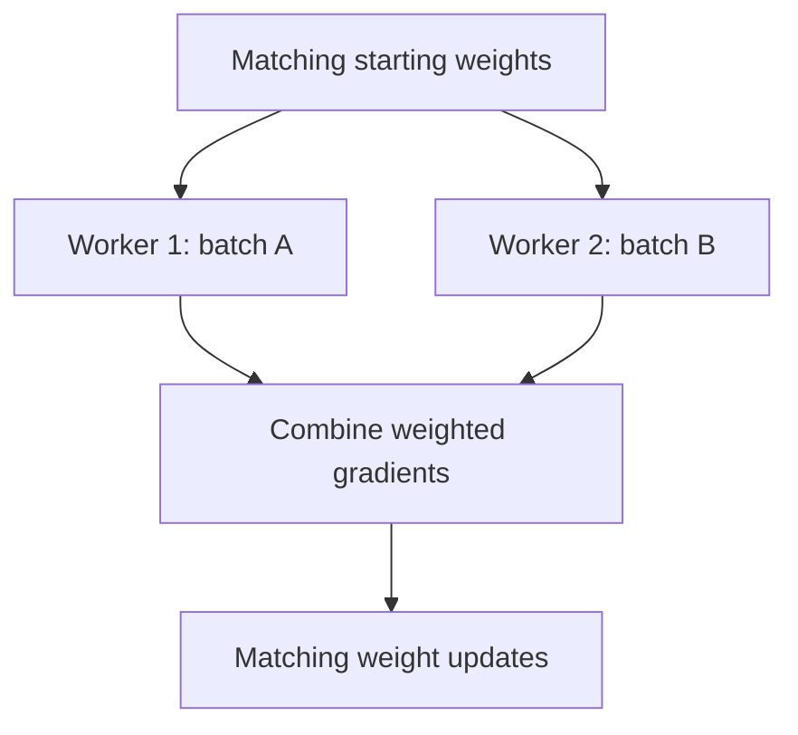

# Understand training and inference at scale

**Before this lesson:** [papers and experiments](./01-papers-and-experiments.md), gradients, neural-network training, Transformers, and service architecture. Scale magnifies both useful work and mistakes. Profile a correct small run before distributing it.

A **parameter** is a learned number such as a weight. An **activation** is an intermediate value computed for an input. Training needs memory for parameters, gradients, optimizer state, and saved activations. Inference usually does not need gradients, but generated sequences may keep an attention cache.

## Count memory before choosing hardware

```python runnable
parameters = 1_000_000_000
bytes_per_parameter = 2
weight_bytes = parameters * bytes_per_parameter
print(f"Weights alone: {weight_bytes / 1_000_000_000:.1f} GB")
print("Training also needs gradients, optimizer state, and activations.")
```

```text output
Weights alone: 2.0 GB
Training also needs gradients, optimizer state, and activations.
```

This is decimal gigabytes, not a claim that a one-billion-parameter model trains in 2 GB. Optimizers may keep multiple additional arrays, and longer sequences increase activation and attention-cache memory. Precision formats, optimizer choice, implementation, and checkpointing change the total.

### Build a complete planning estimate

For an illustrative setup using different numerical formats for different stored values, assume one billion parameters and these storage choices:

| Stored item | Bytes per parameter | Decimal GB |
| --- | --- | --- |
| Low-precision working weights | 2 | 2 |
| Gradients stored in 32-bit numbers | 4 | 4 |
| Two optimizer history arrays, each 32-bit | 8 | 8 |
| A separate 32-bit master weight copy | 4 | 4 |
| **Subtotal** | **18** | **18** |

The optimizer chooses how gradients change the weights. Adam, for example, keeps moving averages of gradients and squared gradients, giving two history arrays. Its [algorithm reference](https://docs.pytorch.org/docs/stable/generated/torch.optim.Adam.html) shows the update equations. A master copy, when the implementation uses one, keeps weight updates at higher precision than the working weights.

This subtotal still excludes activations, temporary operation buffers, communication buffers, and runtime overhead. It is a stated example, not a universal “18 bytes per parameter” rule: implementations can store gradients differently, avoid a master copy, use another optimizer, or shard state across workers. Verify the actual implementation and measure peak memory for the intended batch and sequence length.

**Planning checkpoint:** a device has 24 GB available and the stated model-state estimate is 18 GB. Can you conclude that training fits?

<details>
<summary>Check the budget</summary>

No. Only 6 GB remains for all excluded storage, and the activation requirement is still unknown. Measure a small run, account for peak temporary storage, and vary batch size and sequence length. A model that loads successfully can still run out of memory during the backward pass or optimizer step.

</details>

## Four ways to divide work

| Technique | What is divided | Main tradeoff |
| --- | --- | --- |
| Data parallelism | Each worker processes different examples with a model copy | Gradients must be combined; copies consume memory. |
| Model/tensor parallelism | Parts of model operations run on different devices | Communication can become the bottleneck. |
| Pipeline parallelism | Different layers run on different devices | Idle gaps and scheduling complexity. |
| State sharding | Parameters, gradients, or optimizer state are partitioned | Memory savings require coordination and communication. |

In ordinary data-parallel training, workers compute gradients for their local batches and combine them before a matching update. Weight examples correctly when batch sizes differ; averaging worker averages blindly can change the intended objective. PyTorch's [DistributedDataParallel tutorial](https://docs.pytorch.org/tutorials/intermediate/ddp_tutorial.html) shows the framework workflow and synchronization requirements.



**Gradient accumulation** adds gradients from several small batches before updating. To match the average loss of a larger batch, scale contributions correctly. It does not make every aspect identical: batch-dependent layers, dropout, and optimizer update frequency can differ.

**Mixed precision** uses more than one numerical format to balance speed, memory, and stability. **Activation checkpointing** saves fewer intermediates and recomputes them during the backward pass. Both require correctness checks; neither is free speed in every workload.

## Work through uneven batches

Suppose two workers start with the same weight and calculate a mean gradient for their own examples:

- Worker A processes one example and reports a mean gradient of `4`.
- Worker B processes three examples and reports a mean gradient of `10`.

The intended objective gives each of the four examples equal weight. The combined gradient is therefore `(1 * 4 + 3 * 10) / 4 = 8.5`. Simply averaging the two worker means gives `7` and gives A's single example too much influence.

```python runnable
counts = [1, 3]
mean_gradients = [4.0, 10.0]
equal_worker_mean = sum(mean_gradients) / len(mean_gradients)
example_mean = sum(
    count * gradient for count, gradient in zip(counts, mean_gradients)
) / sum(counts)
weight, learning_rate = 2.0, 0.1

print(f"Equal worker mean: {equal_worker_mean:.1f}")
print(f"Equal example mean: {example_mean:.1f}")
print(f"Updated weight: {weight - learning_rate * example_mean:.2f}")
```

```text output
Equal worker mean: 7.0
Equal example mean: 8.5
Updated weight: 1.15
```

`zip` pairs each worker's count with its mean. This is a scalar illustration; for many parameters, apply the same weighting to every gradient entry. The calculation assumes all gradients were evaluated at the same weights and that per-example contributions define the objective.

Frameworks may reduce gradients by summing or averaging, while your loss can itself be a sum or mean. Work out both operations before adding a scaling factor. For a token-level loss, the relevant count may be valid prediction tokens rather than sequences; padding tokens should not silently receive training weight.

**Correctness lab:** use the four example gradients `[4, 8, 10, 12]`. Compute their mean in one process, then simulate the `1 + 3` split. Both should give `8.5`. Next split them `2 + 2` and repeat. In a real training test, compare a small single-worker update with the distributed update using a declared numerical tolerance before measuring throughput. Check that data loading neither duplicates nor drops examples unintentionally.

## Serving has a different bottleneck

Use the [inference systems lesson](../engineering/07-inference-systems.md) for the main explanation of prefill, decoding, KV caches, batching, quantization, and distillation. Here, compare a training profile with a serving profile for the same model: training includes backward work and optimizer state, while serving includes queues and growing output sequences. A faster training configuration is not automatically a better serving configuration.

## Exercise: diagnose slow scaling

One GPU processes 100 examples per second. Four process 180 in total. What should you inspect before buying more GPUs?

<details>
<summary>Reason through the system</summary>

Check data loading, device utilization, communication time, batch size, synchronization, and whether the same amount of useful work is measured. The speedup is 1.8×, not 4×. A serial input pipeline or communication-heavy model may dominate. Compare cost per useful training step and final quality, not device count alone.

</details>

**Lab:** profile a small model from the deep-learning stage. Write a memory budget and a timing breakdown. Change only batch size first; record both speed and loss behavior. You can complete the reasoning on CPU before renting accelerators. A scaling claim requires measured hardware runs; a spreadsheet estimate is a planning tool.

## Depth lab: estimate a scaling ceiling before buying compute

**Amdahl's law** describes a simple limit: if some fraction of a fixed workload remains serial, parallelizing the rest cannot remove it. With serial fraction `s` and `n` workers, the ideal speedup is `1 / (s + (1-s)/n)`. Communication and scheduling add further costs.

```python runnable
serial_fraction = 0.2
for workers in [1, 2, 4, 8]:
    normalized_time = serial_fraction + (1 - serial_fraction) / workers
    print(workers, f"ideal speedup={1 / normalized_time:.2f}")
print("four workers with 0.1 extra overhead:",
      round(1 / (serial_fraction + 0.8 / 4 + 0.1), 2))
```

```text output
1 ideal speedup=1.00
2 ideal speedup=1.67
4 ideal speedup=2.50
8 ideal speedup=3.33
four workers with 0.1 extra overhead: 2.0
```

This is a fixed-workload planning model, not a measured GPU benchmark. Real systems can change batch size, kernel efficiency, memory behavior, or the amount of work. Distinguish **strong scaling**, processing the same workload with more workers, from **weak scaling**, increasing total work with workers.

**Profile before distributing:** separate data loading, forward pass, backward pass, gradient communication, optimizer update, and checkpoint I/O. A slowest worker can hold up synchronous training. Check whether uneven sequence lengths or data access explain the imbalance.

**Correctness drill:** compare one small single-worker update with the distributed equivalent. Use the same examples, global loss normalization, and update count. Verify data sharding and valid-token counts; averaging worker means equally is wrong when workers contribute unequal numbers of scored targets.

**Optimization choices:** activation checkpointing trades recomputation for memory. Sharding optimizer state reduces per-worker storage but adds communication. Pipeline parallelism can leave devices idle while stages fill or drain. Larger batches change optimization as well as utilization. Choose based on the measured bottleneck, then confirm quality.

**Production research design:** save recoverable state and test restart with the intended worker layout. Detect stalled workers and incomplete checkpoints. Count failed runs and recovery time in the experiment's actual compute cost rather than reporting only the fastest completed run.

<details>
<summary>Interview defense: why can eight devices be slower than four?</summary>

Communication, synchronization, smaller per-device workloads, data bottlenecks, and stragglers can outweigh added compute. Scaling efficiency is workload- and implementation-dependent. Inspect the timing breakdown and correctness before increasing worker count again.

</details>

**Teach-back:** draw a timing bar with serial work, parallel work, and communication. Double worker count and show which segments shrink, stay fixed, or grow.

**Previous:** [Read a paper and test its claim](01-papers-and-experiments.md) · **Next:** [Choose a research question and run an independent experiment](03-research-directions.md)
