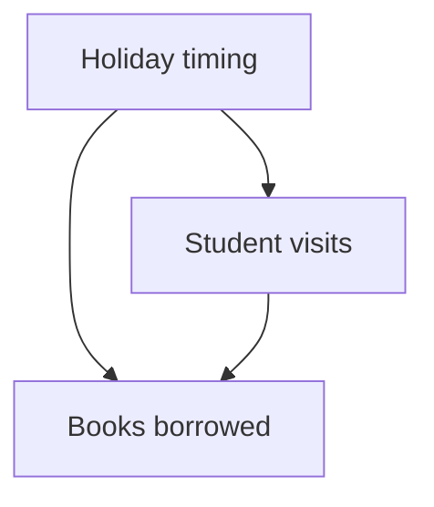

import useBaseUrl from '@docusaurus/useBaseUrl';

# Choose a research question and run an independent experiment

**Before this lesson:** [training at scale](./02-training-at-scale.md). You now have the shared foundations for specialization. Research is open-ended; choose one well-defined uncertainty instead of trying to master every frontier at once.

## Understand what a prediction cannot tell you

**Correlation** is an observed association. **Causation** concerns what changes when we intervene. Borrowing and hot weather may rise together because both change during a holiday. Predicting borrowing from weather does not show that changing the weather would cause the same borrowing change.

A **confounder** influences both a proposed cause and an outcome. A causal diagram makes these assumptions visible. In this example, holiday timing may influence both how many students visit and how many books are borrowed:



A randomized intervention can help separate effects under appropriate conditions. Observational causal methods need assumptions about missing causes and how data was collected. They do not turn a predictive model into a causal explanation automatically. The authors' open text [Causal Inference: What If](https://miguelhernan.org/whatifbook) is a deeper study route after probability and experiments.

## Pick one deeper direction

| Direction | The core question | First experiment |
| --- | --- | --- |
| Uncertainty and calibration | Does stated confidence match observed correctness? | Compare confidence bins with actual outcomes; test shifted data separately. |
| Bayesian learning | How should prior assumptions change after evidence? | Start with a coin model; compare a prior belief with its posterior after observations. |
| Interpretability | Does an explanation reflect the mechanism that produced the output? | Remove or change an allegedly important input and test the effect. |
| Robustness | Which harmless or hostile changes break a system? | Test spelling changes, missing fields, source changes, and explicit attacks separately. |
| Graph learning | Can relationships between objects improve prediction? | Compare features alone with features aggregated from neighboring nodes. |
| Causal learning | What effect would an intervention have? | State a causal diagram and an identifiable, ethical intervention question. |
| Efficient learning | Can a method reach useful quality with fewer examples or operations? | Compare learning curves under matched data and compute budgets. |
| Embodied AI | How do actions change the world an agent observes? | Begin in a simulator with bounded actions and measured failure recovery. |

In Bayesian learning, a **prior** describes uncertainty before the current evidence; the **posterior** is the updated distribution after using that evidence. In graph learning, **message passing** means updating a node's representation using information from connected nodes. Both require assumptions about data and relationships; inspect those assumptions before reaching for a framework.

Interpretability has a special trap: a plausible explanation can be unfaithful. A language model's written explanation is an output to test, not direct access to its internal computation. A feature that predicts a label may also be an accidental shortcut. Compare behavior under interventions, avoid overstating what one test proves, and report counterexamples.

## Stage project: test a feature hypothesis

Download <a href={useBaseUrl('/examples/ai/research/feature_experiment.py')} download>feature_experiment.py</a> and run:

```sh
python3 feature_experiment.py
```

It creates fictional curved data, compares a line with a model that also uses a squared input, and reports paired held-out errors over five fixed seeds. The models use identical training and test rows for each seed. Settings are fixed before the reported comparisons. The script writes `feature-experiment.json` in your working directory and checks that its intended synthetic comparison holds.

This experiment tests the value of a known feature for a deliberately chosen data-generating process. It does not establish that quadratic models are generally best. The point is to connect a hypothesis, a controlled change, and inspectable evidence.

Extend it in three steps. First, change the generator to a straight line and explain the new result. Second, increase noise and reduce training data; report variability rather than only an average. Third, choose a real permissioned dataset and preregister your split, candidate features, metric, and resource budget before evaluating it. If you use a result to select settings, reserve a new final test rather than reusing it as untouched evidence.

<details>
<summary>What a good report contains</summary>

State the question, generator or dataset, split procedure, fixed settings, exact code revision, per-seed results, paired comparison, resource use, failures, and limitations. Include a command another learner can run. A negative result is valid if the experiment is informative and fairly reported. If the hypothesis failed, explain that instead of changing the claim after seeing the data.

</details>

**Next decision:** choose a [role-based capstone](../careers.md) or continue one research direction with a supervisor, reading group, or independent reproduction plan. Depth comes from repeated experiments and careful feedback.

## Depth lab: implement one graph update and one feedback controller

Advanced directions become understandable when you isolate their central mechanism. A **graph** contains nodes and edges. In a simple message-passing step, each node averages its own value with neighboring values:

```python runnable
values = {"A": 2.0, "B": 0.0, "C": 4.0}
neighbors = {"A": ["B"], "B": ["A", "C"], "C": ["B"]}
updated = {}
for node in values:
    received = [values[node]] + [values[other] for other in neighbors[node]]
    updated[node] = sum(received) / len(received)
print(updated)
print("original:", values)
```

```text output
{'A': 1.0, 'B': 2.0, 'C': 2.0}
original: {'A': 2.0, 'B': 0.0, 'C': 4.0}
```

Updates use the same old state. Updating in place can make results depend on node iteration order. A graph neural network adds learned transformations and a training objective. Repeated averaging can blur node differences, a problem related to **oversmoothing**. Compare with a features-only baseline and prevent future or test-label information from leaking through edges.

A **knowledge graph** stores typed relationships such as “book authored by person.” It need not be a neural network. Keep source, date, and confidence/provenance with relations; an extracted edge is not automatically a verified fact. Search over graph relations can complement document retrieval when the task needs relationships.

In robotics, a **feedback controller** chooses an action from current error. This idealized scalar system moves toward a target with a proportional gain:

```python runnable
for gain in [0.5, 2.5]:
    position, trajectory = 0.0, []
    for _ in range(3):
        error = 1.0 - position
        position += gain * error
        trajectory.append(position)
    print(gain, trajectory)
```

```text output
0.5 [0.5, 0.75, 0.875]
2.5 [2.5, -1.25, 4.375]
```

The error follows `next_error = (1 - gain) * error`. In this ideal system it converges when the magnitude of `1 - gain` is below one. Real robots add dynamics, sensor noise, delays, action limits, and safety constraints. This simulation does not justify operating hardware.

**Debug and optimize:** test graph permutation invariance and synchronous updates; test controller delay, noise, and saturation in simulation. Compare correctness and stability before speed. For learned controllers, evaluate on environments beyond the training settings.

<details>
<summary>Interview defense: how should a self-improving agent change itself?</summary>

Treat proposed changes as candidates in a controlled development loop: versioned data and code, independent evaluation, fixed resource and permission limits, review, staged release, and rollback. Letting a candidate rewrite its own success criteria can produce apparent improvement without useful progress. Self-modification does not remove the need for external evidence.

</details>

**Teach-back project:** choose graph learning, knowledge graphs, or simulated control. Reimplement the tiny mechanism, break one assumption deliberately, and use the result to define a narrow research question. Continue with the [advanced research module](../developer-roadmap/19-advanced-research.md) rather than attempting all directions simultaneously.

**Previous:** [Understand training and inference at scale](02-training-at-scale.md) · **Next:** [From a promising result to a defensible research claim](04-causal-and-reproducible-studies.md)
