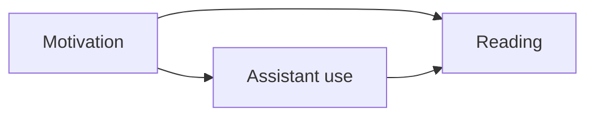

# From a promising result to a defensible research claim

**Before this lesson:** [research directions](./03-research-directions.md), [experimental uncertainty](../mathematics/04-experiments-and-uncertainty.md), and [production evaluation](../engineering/02-evaluation-and-monitoring.md).

Research is a claim plus evidence and clearly stated limits. A larger benchmark number is a starting observation. You still need to ask what caused the difference, whether it repeats, and where the explanation breaks.

## Prediction does not establish intervention effects

Students who use a reading assistant may read more books. Perhaps the assistant helped. Perhaps already-motivated students chose to use it. **Confounding** occurs when another factor influences both the apparent cause and the outcome.

A **causal diagram** shows assumptions about directions of influence. It does not prove those assumptions. Here motivation can affect both usage and reading:



Random assignment to an offered treatment can make groups comparable on average, including on unmeasured factors. It does not guarantee perfect balance in a small sample. Decide the unit of assignment: a student, class, or school. If classmates share access, assigning individual students may create spillovers. Report the effect of assignment separately from the effect of actual usage.

Observational alternatives such as matching or regression adjustment depend on assumptions about measured confounders. A sophisticated model cannot automatically remove unmeasured confounding.

## State the experiment before seeing the answer

Write a primary question, dataset, baseline, metric, exclusion rules, expected failure modes, and stopping plan. A **preregistered** plan is recorded before the relevant results are examined. It helps distinguish planned tests from later exploration.

An **ablation** removes or changes one component to test its contribution. If you change the dataset, model, prompt, and compute budget together, the result describes a bundle; it does not isolate the prompt's effect.

Run a fair compute comparison when a method uses more resources. Report both a matched-budget comparison and any useful best-effort result. Keep unsuccessful runs unless a prespecified rule excludes them. A failed run can be part of the method's reliability cost.

## Estimate uncertainty using the correct unit

Repeated random seeds measure variation from parts of training randomness. They do not by themselves measure uncertainty over future users or datasets. If several questions come from one document, their errors may be related. Resample documents or users when that is the independent unit.

The **bootstrap** resamples observed units with replacement and recomputes a statistic. A **paired** comparison keeps two systems' results for the same unit together. Here is a deliberately small illustration of an improvement estimate:

```python runnable
import random

differences = [0, 1, 0, 1, -1, 1, 0, 0]
rng = random.Random(17)
estimates = []
for _ in range(2000):
    sample = [rng.choice(differences) for _ in differences]
    estimates.append(sum(sample) / len(sample))
estimates.sort()
print(f"observed mean improvement: {sum(differences) / len(differences):.2f}")
print(f"interval includes zero: {estimates[50] <= 0 <= estimates[1949]}")
```

```text output
observed mean improvement: 0.25
interval includes zero: True
```

The percentile bounds illustrate a rough 95% bootstrap interval. Eight observations are a weak basis for a strong population claim. Bootstrap resampling cannot create missing populations, repair biased sampling, or guarantee accurate coverage in tiny samples.

## Avoid selecting your conclusion from many tries

If you try many settings and report only the best result, you can select noise. Keep an experiment ledger and reserve a final evaluation set. **Multiple comparisons** require special care when making statistical claims across many hypotheses. A small p-value, when used, is not the probability that your hypothesis is true.

Report effect size and practical relevance alongside uncertainty. A statistically detectable improvement can be too small to justify additional cost. Conversely, an inconclusive small study does not prove two methods equivalent.

Test **distribution shift** by naming what changed: time period, population, language, document style, or device. A random split from the same source can conceal these shifts. Include a declared stress set and avoid presenting it as a representative deployment sample.

## Make a study reproducible and reviewable

Package code revision, environment, data sources and licenses, source hashes where appropriate, split rules, seeds, hyperparameters, hardware, runtime, failed-run policy, raw per-example results, and the command that builds report tables. A model checkpoint alone cannot reproduce a research claim.

Separate three levels: reproducing the original code's results, reimplementing the method independently, and extending it with a new hypothesis. Each answers a different question. Document discrepancies before explaining them away.

## Practice and final research checkpoint

A study tries 40 prompts, picks the best on the test set, and reports a one-point gain from one seed. What should happen next?

<details>
<summary>Repair the study</summary>

Treat that test set as development data. Freeze a selection procedure, evaluate on new untouched examples, repeat relevant training randomness, and report the search budget. Use paired per-example comparisons where appropriate. State whether the gain matters for the application's costs and failures.

</details>

**Deliver:** a one-page preregistered extension to the [feature experiment](./03-research-directions.md), an experiment ledger, at least one ablation, uncertainty at the justified unit, and a limitations paragraph that could change a reader's decision. Then choose a [professional studio](../careers.md).

## Depth lab: expose a misleading aggregate comparison

A system can look better overall while doing worse in each task category. This can happen when the compared systems receive different mixes of easy and hard tasks.

```python runnable
results = {
    "A": {"easy": (80, 100), "hard": (1, 10)},
    "B": {"easy": (9, 10), "hard": (20, 100)},
}
for name, slices in results.items():
    successes = sum(correct for correct, total in slices.values())
    trials = sum(total for correct, total in slices.values())
    easy = slices["easy"][0] / slices["easy"][1]
    hard = slices["hard"][0] / slices["hard"][1]
    standardized = (easy + hard) / 2
    print(name, f"easy={easy:.2f}", f"hard={hard:.2f}",
          f"overall={successes/trials:.3f}", f"equal mix={standardized:.2f}")
```

```text output
A easy=0.80 hard=0.10 overall=0.736 equal mix=0.45
B easy=0.90 hard=0.20 overall=0.264 equal mix=0.55
```

B performs better in both categories, but A receives mostly easy work. The raw overall rates describe those particular workloads; they do not isolate a system effect. Reweighting to an equal mix creates a descriptive comparison for that chosen population. It becomes a causal estimate only under additional justified assumptions about assignment and confounding.

**Experiment design:** randomly assign comparable eligible requests where appropriate, choose the assignment unit, and measure spillovers or repeated-user effects. Keep the same outcome definition and follow-up window. If randomization is unavailable, state the identification assumptions and examine plausible alternative explanations.

**Debugging a research claim:** reconstruct the aggregate from subgroup counts, inspect missing outcomes, and check whether inclusion rules differ by system. Examine whether labels were available at prediction time and whether evaluation categories were chosen after seeing results.

**Optimization and reporting:** use development data for exploration, preserve a final test, and record every selected configuration. Report effect size, uncertainty, workload composition, and practical cost. A confidence interval for the wrong population remains an answer to the wrong question.

<details>
<summary>Interview defense: does controlling for more variables always improve causal inference?</summary>

No. Adjustment depends on the causal structure and question. Controlling for a consequence of treatment can remove part of the effect; conditioning on a common effect can introduce bias. Draw and justify the causal assumptions before choosing variables. Predictive usefulness alone does not identify a valid adjustment set.

</details>

**Teach-back:** explain the table using two boxes of easy and hard questions. Ask a peer to choose a deployment mix, recalculate both rates, and distinguish a prediction comparison from a claim about intervention.

**Previous:** [Choose a research question and run an independent experiment](03-research-directions.md) · **Next:** [Choose a role and build a capstone](../careers.md)
