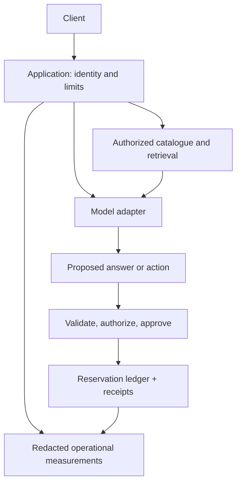

# AI Architect studio: design a system you can defend

**Entry:** the shared curriculum and [capstone brief](../careers.md). Review [architecture and cost](../engineering/04-architecture-and-cost.md), [inference systems](../engineering/07-inference-systems.md), and [durable workflows](../agents/07-durable-workflows.md).

**Client:** a fictional network of libraries needs document answers, catalogue lookup, and approved reservations. Some branches have unreliable connectivity. The design must balance usefulness, privacy, cost, availability, and operational effort.

## Begin with measurable requirements

Write expected traffic, typical and maximum input size, freshness target, latency objective, data retention, access rules, supported languages, and recovery goals. Separate hard constraints from preferences.

A **recovery time objective** states how quickly a service should return after a disruption. A **recovery point objective** states how much recent data loss is acceptable. A reservation ledger and a rebuildable search index may need different objectives.

Choose numbers for the fictional case and justify them. Estimates are not measurements. State which decisions depend on later load testing or a real contract.

## Compare three credible designs

| Option | Useful strengths | Costs and limits |
| --- | --- | --- |
| Search plus fixed workflow | Simple, inspectable, predictable permissions | Less flexible language interaction. |
| Hosted model with retrieval and local authorization | Lower model-operation burden, flexible language | Network dependency, provider constraints, variable usage cost. |
| Self-hosted model with the same retrieval and authorization | More deployment and data-placement control | Hardware, updates, capacity planning, and operations ownership. |

Keep tool authorization and durable receipts in trusted application services regardless of model placement. Do not let a diagram quietly move identity checks into a prompt.

## Prototype the decisions with the largest uncertainty

Measure evidence recall on the planned corpus, quality on representative questions, latency under a stated workload, and retry behavior after a simulated failure. A small vertical slice can disprove an architecture assumption before a full application exists.

Calculate cost per useful completed task, including model calls, retrieval, storage, rejected outputs, retries, and human review. Compare a quiet day with a burst. Fixed hardware can be underused; per-request pricing can grow unexpectedly under loops and retries.

Document **failure domains**: components that can fail together. Two services in the same region may not provide independent recovery. A model fallback is not safe unless it meets the same output, privacy, and tool contracts.

## Plan change and ownership

Write an architecture decision record containing context, alternatives, chosen option, evidence, consequences, and a trigger for revisiting it. Assign owners for model releases, source updates, access revocation, incidents, and data deletion.

Migrate with versioned contracts and reversible steps. Rebuild an index from a versioned source before switching readers. Keep a rollback path that accounts for data compatibility, not just a previous container image.

The paper [Hidden Technical Debt in Machine Learning Systems](https://research.google/pubs/hidden-technical-debt-in-machine-learning-systems/) explains why dependencies and surrounding system behavior matter beyond model code. Use that lens to inspect your own design rather than adding every possible service.

## Challenge: a regional outage during a write

A reservation call loses its reply during an outage. The fallback model is available. May it repeat the reservation through another region?

Follow the authority

Only under a cross-region consistency and idempotency contract that makes the action safe. The model's availability does not establish the ledger's state. Reconcile the receipt or hold the operation as uncertain. Explain the availability-versus-consistency trade for this use case.

**Deliver:** requirements, three-option comparison, architecture and trust-boundary diagrams, measured prototype evidence, cost model, recovery exercise, migration plan, and two decision records.

**Finish when:** a reviewer can challenge a number or failure assumption and trace its effect on the design. Apply the [common rubric](../careers.md#review-the-work-not-the-tool-list). Architectural expertise includes operating and revising systems over time, not just drawing them.

## Depth lab: defend a design when one assumption breaks

Choose the assumption with the largest consequence: peak traffic, source freshness, data placement, model availability, or write consistency. Change it materially and walk through the design. Identify which components need a different contract and which can remain unchanged.

**Failure drill:** combine a regional outage with an uncertain reservation and a revoked staff role. The fallback must not treat model availability as proof of ledger state or permission. Show the user-visible degraded behavior and the conditions for recovery.

| Defense question | A strong answer establishes |
| --- | --- |
| Why this deployment model? | Measured workload, operational ownership, data constraints, total cost, and credible alternatives. |
| How much capacity is needed? | Explicit arrival, length, concurrency, latency, and memory assumptions, followed by representative load tests. |
| What can be rebuilt and what must be recovered? | Search indexes can often be regenerated from sources; authoritative action records need their own recovery guarantees. |
| What does rollback restore? | A compatible model/prompt/tokenizer/index/application bundle, with separate treatment for irreversible effects and data migrations. |

**Optimization requirement:** create a sensitivity table varying demand, useful-outcome rate, review cost, and cache hit rate. Show where the preferred option changes. Avoid claiming a precise total from uncertain inputs without ranges or scenarios.

**Teach-back and sign-off:** present the architecture first without product names. Explain data flow, ownership, failure boundaries, and the smallest useful implementation. Then map actual tools to those responsibilities. A reviewer should challenge one number, remove one dependency, and trace the consequences using your decision records and measured prototype evidence.

**Return:** [Choose a direction](../careers.md) · [Syllabus](../syllabus.md)
