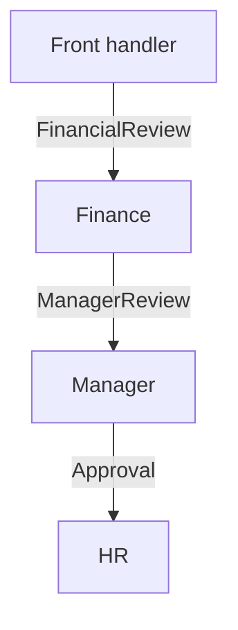

# Chain of Responsibility Pattern ⛓️

A chain passes a request from one handler to the next. A handler is simply a piece of code that checks or handles a request. This example uses a fixed approval sequence.

## Example: resignation approval chain {/* #javascript-walkthrough */}

This example connects application, finance, manager, and HR handlers. Each recognizes one request label, performs its step, and forwards the next label to its successor.

```js runnable
function Handler() {
  this.handleRequest = function (request) {};
}
function FrontHandler(nextHandler) {
  Handler.call(this);
  this.nextHandler = nextHandler;
  this.handleRequest = function (request) {
    if ("ResignationApply" == request) {
      console.log(String("Resignation Apply -> ").trim());
      if (this.nextHandler != null) {
        this.nextHandler.handleRequest("FinancialReview");
      }
    }
  };
}
function FinanceHandler(nextHandler) {
  Handler.call(this);
  this.nextHandler = nextHandler;
  this.handleRequest = function (request) {
    if ("FinancialReview" == request) {
      console.log(String("Financial Review Completed -> ").trim());
      if (this.nextHandler != null) {
        this.nextHandler.handleRequest("ManagerReview");
      }
    }
  };
}
function ManagerHandler(nextHandler) {
  Handler.call(this);
  this.nextHandler = nextHandler;
  this.handleRequest = function (request) {
    if ("ManagerReview" == request) {
      console.log(String("Manager Review Completed -> ").trim());
      if (this.nextHandler != null) {
        this.nextHandler.handleRequest("Approval");
      }
    }
  };
}
function HrHandler(nextHandler) {
  Handler.call(this);
  this.nextHandler = nextHandler;

  this.handleRequest = function (request) {
    if ("Approval" == request) {
      console.log(String("HR Approval -> ").trim());
      if (this.nextHandler != null) {
        this.nextHandler.handleRequest("Approval Completed");
      }
    }
  };
}
var hrHandler = new HrHandler(null);
var managerHandler = new ManagerHandler(hrHandler);
var financeHandler = new FinanceHandler(managerHandler);
var frontHandler = new FrontHandler(financeHandler);
frontHandler.handleRequest("ResignationApply");
```

```text output
Resignation Apply ->
Financial Review Completed ->
Manager Review Completed ->
HR Approval ->
```

<span id="walk-through-the-source" />
<span id="understand-the-collaboration" />

## How it works

A chain links handlers through successor references, keeping assembly separate from the initial caller. The client builds this chain from the end backward and invokes only `frontHandler`; each handler knows its successor rather than the entire route.

FrontHandler recognizes the resignation request and forwards `FinancialReview`. Finance produces `ManagerReview`, the manager produces `Approval`, and HR completes the chain. Each printed arrow represents one handler’s work. Neighboring stages must agree on these labels because each stage receives its predecessor’s transformed request. HR’s null successor ends the demonstrated route.



## What the example does not establish

This is an ordered workflow rather than a chain that stops when the first applicable handler claims the original request. Forwarding occurs only inside matching conditions, so an unknown label is silently ignored. Successor references separate the caller from later stages, but shared labels still couple neighboring handlers. The implementation provides no cycle detection or error recovery.

## Practical case: event bubbling through nested elements

A bubbling DOM event visits handlers on its route toward ancestors. This resembles a chain, but several listeners can handle the same event. It is not automatically a “first handler wins” policy.

```html
<!doctype html>
<html lang="en">
<meta charset="utf-8">
<title>Event handler chain</title>
<body id="page">
<label><input id="stop" type="checkbox">Stop at the inner button</label>
<div id="outer">
  <div id="middle">
    <button id="inner">Send event</button>
  </div>
</div>
<p id="result" role="status"></p>
<script>
  const output = document.querySelector("#result");
  const stop = document.querySelector("#stop");
  for (const id of ["inner", "middle", "outer", "page"]) {
    document.getElementById(id).addEventListener("click", (event) => {
      if (event.target.id !== "inner") return;
      if (id === "inner") output.textContent = "";
      output.textContent += `${output.textContent ? " -> " : ""}${event.currentTarget.id}`;
      if (id === "inner" && stop.checked) event.stopPropagation();
    });
  }
</script>
</body>
</html>
```

**Expected interaction:** Sending an event prints `inner -> middle -> outer -> page`. Selecting the checkbox and sending again prints only `inner`.

`target` identifies the original button; `currentTarget` identifies the element whose listener is running. [`stopPropagation()`](https://developer.mozilla.org/en-US/docs/Web/API/Event/stopPropagation) stops travel to later nodes, but does not cancel default behavior or other listeners on the current node. Use `preventDefault()` or `stopImmediatePropagation()` only when those different effects are intended.

## Design decisions and failure modes

A handler must decide whether to finish or forward a request. Calling the next handler twice can duplicate a side effect; never forwarding can silently drop a request.

## Exercises

Build a three-step validation chain and record visited handlers for an accepted and rejected request. Add an unknown request type.

<details>
<summary>Expected reasoning and checks</summary>

The rejection stops at the intended handler; acceptance follows the documented order. Define an explicit terminal result for an unhandled request. Guard accidental double forwarding and test order-sensitive checks.

</details>

## Interview questions & answers

<details>
<summary>How is this different from a pipeline?</summary>

A chain often permits a handler to consume the request and stop delegation. A pipeline usually applies a prescribed sequence of transformations. State whether skipping, short-circuiting, and multiple handlers are allowed.

</details>

**Key takeaway:** Define order, termination, and the unhandled case.

## Continue reading

Use the shared [review checkpoint](../index.md#completion-checkpoint), then return to the [pattern catalog](../index.md).
