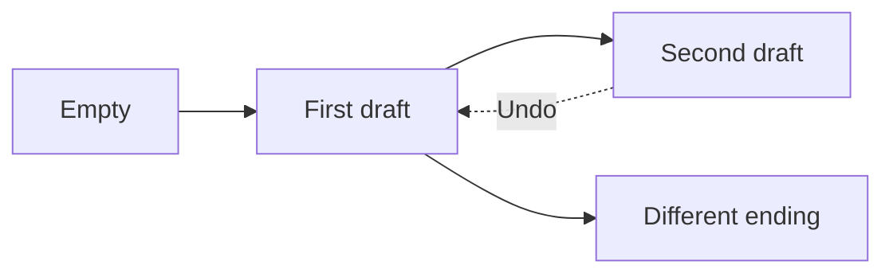

# Memento Pattern 💾

A Memento saves a snapshot so an object can return to an earlier state. A snapshot records a chosen moment; changing or displaying the current state does not automatically save it.

## Example: saving and restoring text states {/* #javascript-walkthrough */}

This example separates the originator’s current text from Memento objects holding saved strings. TextEdit keeps those objects in an array and moves an index backward or forward.

```js runnable
function Memento(state) {
  this.state = state;
  this.getState = function () {
    return this.state;
  };
  this.setState = function (state) {
    this.state = state;
  };
}
function TextEdit() {
  this.mementos = [];
  this.index = 0;
  this.push = function (memento) {
    this.mementos.push(memento);
    this.index += 1;
  };
  this.forward = function () {
    var memento = this.mementos[this.index];
    this.index += 1;
    return memento;
  };
  this.back = function () {
    this.index -= 1;
    var memento = this.mementos[this.index];
    return memento;
  };
}

function Originator() {
  this.state = "";
  this.getState = function () {
    return this.state;
  };
  this.setState = function (state) {
    this.state = state;
  };
  this.createMemento = function () {
    return new Memento(this.state);
  };
  this.setMemento = function (memento) {
    this.state = memento.getState();
  };
  this.show = function () {
    console.log(String(this.state).trim());
  };
}
/////////////////////test///////////////////////////////////////////////////////
var textEdit = new TextEdit();
// Enter text in textEdit, save while saving
var originator = new Originator();
originator.setState("Move you in the direction of your dream. ");
textEdit.push(originator.createMemento());
originator.setState("Ways to start your day positively. ");
textEdit.push(originator.createMemento());
originator.setState("Love can change the world. ");
originator.show();
// Undo  redo   Recovery history

originator.setMemento(textEdit.back());
originator.show();
originator.setMemento(textEdit.back());
originator.show();
console.log(String("------------------------------ ").trim());
originator.setMemento(textEdit.forward());
originator.show();
originator.setMemento(textEdit.forward());
originator.show();
```

```text output
Love can change the world.
Ways to start your day positively.
Move you in the direction of your dream.
------------------------------
Move you in the direction of your dream.
Ways to start your day positively.
```

<span id="walk-through-the-source" />
<span id="understand-the-collaboration" />

## How it works

`Originator` owns the current text and creates or restores Memento objects holding saved strings. `TextEdit` retains those objects and selects one with its cursor; it does not perform the restoration. Changing the originator’s text leaves earlier saved strings unchanged because saving and editing are separate assignments.

The demonstration saves two text states, then displays a third without saving it. Two backward moves restore the second and first saved strings. The first forward move reads the first string again before advancing; the next reads the second. This output follows the cursor rules, while displaying text alone never creates a snapshot.

## What the example does not establish

The history has no boundary checks and does not discard a redo branch when a new state is saved. Moving outside the demonstrated range can return undefined. Memento fields and setters remain public, so snapshots can be changed even though their stored strings are immutable. Restoring a saved value does not by itself establish a complete undo/redo policy.

## Practical case: undo and redo an editor safely

The editor creates snapshots; the history selects when to restore them. The caretaker does not inspect the saved text. This version checks boundaries and discards the old redo branch after a new edit.

```js runnable
class Editor {
  #text = "";
  get text() { return this.#text; }
  setText(text) { this.#text = text; }
  snapshot() {
    const savedText = this.#text;
    return Object.freeze({ restore: () => { this.#text = savedText; } });
  }
}
class History {
  #editor;
  #states;
  #index = 0;
  constructor(editor) {
    this.#editor = editor;
    this.#states = [editor.snapshot()];
  }
  edit(text) {
    this.#editor.setText(text);
    this.#states.splice(this.#index + 1);
    this.#states.push(this.#editor.snapshot());
    this.#index++;
  }
  undo() { return this.#restore(this.#index - 1); }
  redo() { return this.#restore(this.#index + 1); }
  #restore(index) {
    if (index < 0 || index >= this.#states.length) return false;
    this.#index = index;
    this.#states[index].restore();
    return true;
  }
}
const editor = new Editor();
const history = new History(editor);
console.log(history.undo());
history.edit("First draft");
history.edit("Second draft");
history.undo();
console.log(editor.text);
history.redo();
console.log(editor.text);
history.undo();
history.edit("Different ending");
console.log(history.redo());
console.log(editor.text);
```

```text output
false
First draft
Second draft
false
Different ending
```



For an HTML editor, a snapshot might also include selection and document structure. This example stores immutable strings and ties each snapshot to its editor. It is not serializable history. Route edits through the history owner, set a history-size limit, and avoid treating restored HTML as trusted input.

## Design decisions and failure modes

A memento captures state for later restoration. An unbounded history retains memory, and shallow snapshots can change after they have supposedly been saved.

## Exercises

Type A, save, type B, undo, then type C. Define the redo stack and check that the saved A snapshot has not changed.

<details>
<summary>Expected reasoning and checks</summary>

A new edit after undo normally discards the abandoned redo branch. Snapshots need independent or immutable state. Bound history by a deliberate policy; collaborative undo requires more than restoring an old whole-document snapshot.

</details>

## Interview questions & answers

<details>
<summary>Why is memento not a database backup strategy?</summary>

A local object snapshot does not establish durable storage, cross-object consistency, access controls, or recovery objectives. Those require separate persistence and recovery contracts.

</details>

**Key takeaway:** Protect snapshot identity and define history limits.

## Continue reading

Use the shared [review checkpoint](../index.md#completion-checkpoint), then return to the [pattern catalog](../index.md).
