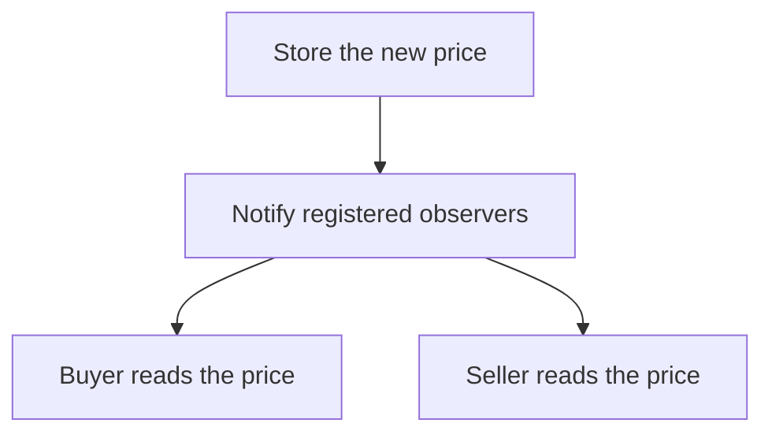

# Observer Pattern 🔔

Observer lets several interested parts hear about a change. Like subscribers to a notice board, they register once and receive later updates.

## Example: stock-price updates for buyers and sellers {/* #javascript-walkthrough */}

The StockData object stores a price and inherits observer registration and notification operations. Buyer and Seller subscribe to that same observable.

```js runnable
function Observable() {
  this.observerList = [];
  this.notifyObservers = function () {
    this.observerList.forEach(function (observer) {
      observer.update();
    });
  };
  this.addObserver = function (observer) {
    this.observerList.push(observer);
  };
}

function StockData(price) {
  Observable.call(this);
  this.price = price;
  this.getPrice = function () {
    return this.price;
  };
  this.setPrice = function (price) {
    this.price = price;
    this.notifyObservers();
  };
}
function Observer(observable) {
  this.observable = observable;
  this.observable.addObserver(this);
  this.update = function (observable) {};
}
function Buyer(observable) {
  Observer.call(this, observable);
  this.update = function (observable) {
    console.log(
      String("Buyer Price :" + this.observable.getPrice() + "").trim(),
    );
  };
}
function Seller(observable) {
  Observer.call(this, observable);
  this.update = function (observable) {
    console.log(
      String("Seller Price :" + this.observable.getPrice() + "").trim(),
    );
  };
}

/////////////////////test///////////////////////////////////////////////////////
var data = new StockData(16.9);
var buyer = new Buyer(data);
var seller = new Seller(data);
data.setPrice(18.9);
console.log(String("-------------------------").trim());
data.setPrice(12.9);
```

```text output
Buyer Price :18.9
Seller Price :18.9
-------------------------
Buyer Price :12.9
Seller Price :12.9
```

<span id="walk-through-the-source" />
<span id="understand-the-collaboration" />

## How it works

Observer connects one changing subject to multiple interested objects. Constructing Buyer and Seller registers them with StockData. Each keeps a reference to that subject, allowing later `setPrice` calls to notify both without the client naming them again.

`setPrice` stores the new price before notifying observers synchronously. Each `update` reads the price from `this.observable`; although it declares a parameter, the notification passes no argument. Array registration order determines the output: both observers print 18.9 after the first change and 12.9 after the second. The initial 16.9 is not printed because construction and registration do not notify.



## What the example does not establish

There is no unsubscribe operation, so the subject retains its observers. An exception from one synchronous callback can stop later notifications.

## Practical case: redraw several shapes after a color change

A color model notifies a bar chart and a pie chart. The model owns the value; observers decide what to draw. Returning an unsubscribe function gives each view a way to release its subscription.

```js runnable
class ColorModel {
  #color = "black";
  #listeners = new Set();
  subscribe(listener) {
    this.#listeners.add(listener);
    return () => this.#listeners.delete(listener);
  }
  setColor(color) {
    if (color === this.#color) return;
    this.#color = color;
    for (const listener of [...this.#listeners]) listener(color);
  }
}
const colors = new ColorModel();
const stopBar = colors.subscribe((color) => console.log(`Bar chart: ${color}`));
colors.subscribe((color) => console.log(`Pie chart: ${color}`));
colors.setColor("red");
stopBar();
colors.setColor("blue");
colors.setColor("blue");
```

```text output
Bar chart: red
Pie chart: red
Pie chart: blue
```

Subscribers receive changes after subscribing; registration itself does not redraw. Repeating the same color produces no extra notification. Iteration uses a snapshot of listeners for this update. An exception still stops the loop, so choose an explicit error policy when views must fail independently. Dispose subscriptions when views unmount, and batch high-frequency updates when redrawing is expensive.

## Design decisions and failure modes

A subscriber list is retained state. Forgetting to unsubscribe can keep destroyed views alive; one throwing listener can prevent later listeners from receiving an update if dispatch does not isolate failures.

## Exercises

Subscribe two listeners, let the first throw, and unsubscribe the second during a dispatch. State which callbacks should run.

<details>
<summary>Expected reasoning and checks</summary>

Choose and test a dispatch policy, including whether the listener set is snapshotted. Return a clear unsubscribe operation and call it at lifecycle end. Avoid assuming callback notification implies durable delivery.

</details>

## Interview questions & answers

<details>
<summary>Observer or a message broker?</summary>

An in-process observer typically shares memory and process fate. A broker adds persistence and delivery contracts that still require acknowledgement, deduplication, and ordering decisions.

</details>

**Key takeaway:** Notifications need lifecycle and failure policies.

## Continue reading

Use the shared [review checkpoint](../index.md#completion-checkpoint), then return to the [pattern catalog](../index.md).
