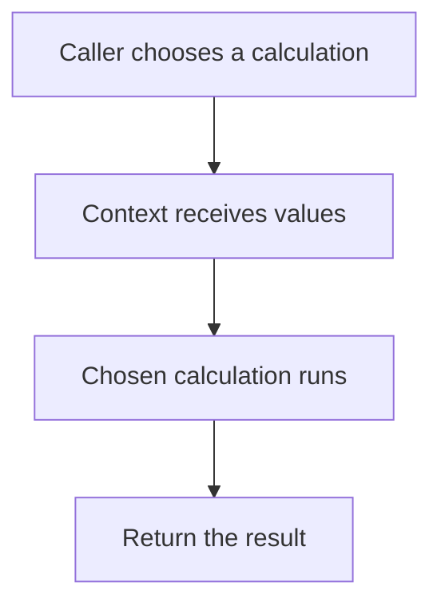

# Strategy Pattern 🎯

A Strategy lets a caller choose one way to do a job through the same operation. Sorting tasks by title or by due date is a practical example of choosing different rules.

## Example: arithmetic strategies {/* #javascript-walkthrough */}

This example puts addition, subtraction, multiplication, and division behind the same `caculate(a, b)` operation. A context stores one selected strategy and delegates the calculation to it.

```js runnable
function Addition() {
  this.caculate = function (a, b) {
    return a + b;
  };
}
function Subtraction() {
  this.caculate = function (a, b) {
    return a - b;
  };
}
function Multiplication() {
  this.caculate = function (a, b) {
    return a * b;
  };
}
function Division() {
  this.caculate = function (a, b) {
    return a / b;
  };
}
function Context(strategy) {
  this.strategy = strategy;
  this.caculate = function (a, b) {
    return this.strategy.caculate(a, b);
  };
}
var context = new Context(new Addition());
var result = context.caculate(4, 2);
console.log(String(result + "").trim());
var context = new Context(new Subtraction());
var result = context.caculate(4, 2);
console.log(String(result + "").trim());
var context = new Context(new Multiplication());
var result = context.caculate(4, 2);
console.log(String(result + "").trim());
var context = new Context(new Division());
var result = context.caculate(4, 2);
console.log(String(result + "").trim());
```

```text output
6
2
8
2
```

<span id="walk-through-the-source" />
<span id="understand-the-collaboration" />

## How it works

Strategy separates algorithm selection from the object using it. The client chooses `Addition`, `Subtraction`, `Multiplication`, or `Division`; `Context` depends only on `caculate(a, b)`. It forwards both arguments and returns the selected result without branching on the operation. Inputs four and two therefore produce six, two, eight, and two.

Selection remains the client’s responsibility. The shared method contract matters more than using constructors: an equivalent lookup-object version supplies the same collaboration without separate classes. This separation lets calculation choices change independently of their caller.



## What the example does not establish

The demonstration creates a new context for each operation; it provides no runtime-switching API. It neither validates types nor defines a domain-specific division-by-zero policy, leaving those behaviors to JavaScript. Substitution requires an agreed input/output contract. For these short operations, the constructors and context also add more code than the calculations themselves.

## Practical case: select a payment strategy

A checkout selects a payment method while keeping the same calling contract. Functions are enough when each strategy only needs one operation; a separate class is optional.

```js runnable
const paymentStrategies = new Map([
  ["MasterCard", (cents) => `MasterCard selected for ${cents} cents`],
  ["VisaCard", (cents) => `VisaCard selected for ${cents} cents`],
  ["PayPal", (cents) => `PayPal selected for ${cents} cents`],
]);
function checkout(method, cents) {
  const pay = paymentStrategies.get(method);
  if (!pay) throw new Error("Unsupported payment method");
  if (!Number.isSafeInteger(cents) || cents <= 0) {
    throw new Error("Amount must be a positive integer in cents");
  }
  return pay(cents);
}
for (const method of paymentStrategies.keys()) {
  console.log(checkout(method, 10000));
}
try { checkout("Unknown", 10000); }
catch (error) { console.log(error.message); }
```

```text output
MasterCard selected for 10000 cents
VisaCard selected for 10000 cents
PayPal selected for 10000 cents
Unsupported payment method
```

`checkout` validates and delegates; each function supplies interchangeable behavior. A radio-button UI would pass the selected method to this operation. Real payment integrations need a server-side contract for asynchronous results, failures, currency, and duplicate submissions. The strategy pattern alone supplies none of those guarantees.

### The same approach for arithmetic

This is the function-based alternative to the earlier constructor-based arithmetic example. The map avoids treating an inherited object property as an operation.

```js runnable
const operations = new Map([
  ["add", (a, b) => a + b],
  ["subtract", (a, b) => a - b],
  ["multiply", (a, b) => a * b],
  ["divide", (a, b) => {
    if (b === 0) throw new Error("Cannot divide by zero");
    return a / b;
  }],
]);
function calculate(name, a, b) {
  if (!Number.isFinite(a) || !Number.isFinite(b)) throw new Error("Use finite numbers");
  const operation = operations.get(name);
  if (!operation) throw new Error("Unknown operation");
  return operation(a, b);
}
for (const name of operations.keys()) console.log(calculate(name, 4, 2));
try { calculate("divide", 4, 0); }
catch (error) { console.log(error.message); }
```

```text output
6
2
8
2
Cannot divide by zero
```

## Design decisions and failure modes

Interchangeable algorithms need the same domain contract. A payment strategy that reports “accepted” while another reports “settled” is not safely interchangeable even if both return a boolean.

## Exercises

Add an asynchronous payment strategy that times out. Define pending, succeeded, and failed outcomes without charging twice on retry.

<details>
<summary>Expected reasoning and checks</summary>

Keep selection separate from operation identity and reconciliation. A timeout may mean the outcome is unknown. Test the same outcome contract across strategies and use the payment service’s idempotency mechanism where available.

</details>

## Interview questions & answers

<details>
<summary>When should Strategy remain a function?</summary>

When one operation expresses the variation and there is no meaningful per-strategy lifecycle. Use an object when several related operations or retained state belong together.

</details>

**Key takeaway:** Interchangeability is behavioral, not just a shared method name.

## Continue reading

Use the shared [review checkpoint](../index.md#completion-checkpoint), then return to the [pattern catalog](../index.md).
