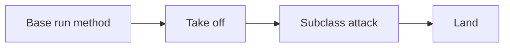

# Template Method Pattern 📋

A Template Method describes a fixed order of steps while allowing some steps to vary. This printing example shows inherited reuse, but its child object still controls the order.

## Example: a4 paper and red printing {/* #javascript-walkthrough */}

This example defines a parent printing operation for A4 paper and a child operation that calls it before describing the red color. The example demonstrates inheritance and reuse.

```js runnable
function PaperTemplate() {
  this.parentPrint = function () {
    console.log(String("Print A4 Paper").trim());
  };
}
function ColorTemplate() {}
/////////////////////test///////////////////////////////////////////////////////
ColorTemplate.prototype = new PaperTemplate();
ColorTemplate.prototype.colorPrint = function () {
  this.parentPrint();
  console.log(String("Set the color of A4 paper red").trim());
};
var template = new ColorTemplate();
template.colorPrint();
```

```text output
Print A4 Paper
Set the color of A4 paper red
```

<span id="walk-through-the-source" />
<span id="understand-the-collaboration" />

## How it works

`ColorTemplate.prototype` receives a `PaperTemplate` instance. Calling `template.colorPrint()` finds the child method through the prototype chain. Inside it, `this.parentPrint()` resolves the inherited operation using the same receiver.

The parent call prints the A4 message, then execution returns to the child method and prints the red-color message. Both lines come from one call to `colorPrint`: prototype lookup supplies reuse, while the two statements in the child method determine the order.

## What the example does not establish

Template Method normally places the fixed sequence in a base operation that invokes overridable steps. Here the child controls the sequence and could omit `parentPrint`, so the listing illustrates inheritance without the full base-controlled template structure. Using a constructed parent instance as the prototype can also share any mutable instance state added to it.

## Practical case: a common flight sequence with different attacks

All aircraft follow the same sequence: take off, attack, and land. The base class owns that order, while subclasses supply the attack step. This completes the Template Method structure missing from the printing analogy.

```js runnable
class Flight {
  run() {
    return [this.takeOff(), this.attack(), this.land()].join(" -> ");
  }
  takeOff() { return "Take off"; }
  attack() { throw new Error("Implement attack"); }
  land() { return "Land"; }
}
class LaserFlight extends Flight {
  attack() { return "Fire laser"; }
}
class MissileFlight extends Flight {
  attack() { return "Fire missile"; }
}
console.log(new LaserFlight().run());
console.log(new MissileFlight().run());
```

```text output
Take off -> Fire laser -> Land
Take off -> Fire missile -> Land
```



The intended extension point is `attack()`. JavaScript does not prevent a subclass from overriding `run()`, so the fixed workflow is a design contract. An exception skips later synchronous steps; use explicit failure handling if landing or cleanup must run.

## Design decisions and failure modes

Template Method fixes a workflow while subclasses customize selected steps. A subclass can violate the intended sequence if it overrides the whole template or a hook breaks an invariant.

## Exercises

Define load, transform, and save steps. Make transform fail and specify whether save and cleanup should run.

<details>
<summary>Expected reasoning and checks</summary>

The failure should prevent saving an invalid result while cleanup still follows its stated policy. Test the ordering and failure path, and keep required invariants outside optional hooks. Composition may be easier when steps vary independently.

</details>

## Interview questions & answers

<details>
<summary>Template Method or Strategy?</summary>

Template Method usually varies hooks through inheritance while retaining a skeleton. [Strategy](strategy.md) supplies interchangeable behavior through composition. Choose according to which variation needs to change independently.

</details>

**Key takeaway:** Protect the workflow’s invariants and test the failure sequence.

## Continue reading

Use the shared [review checkpoint](../index.md#completion-checkpoint), then return to the [pattern catalog](../index.md).
