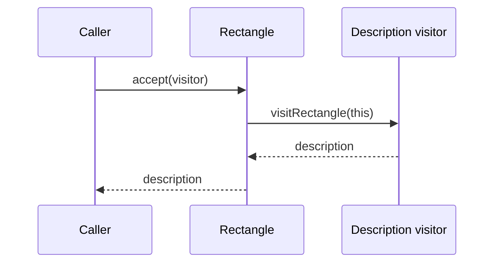

# Visitor Pattern 🏃‍♂️

Visitor keeps an operation separate from the different kinds of objects it visits. This example uses drag-and-drop as an analogy; moving a page element is not a full Visitor implementation.

## Example: a drag-and-drop analogy {/* #javascript-walkthrough */}

This browser example marks a book-list element draggable and provides a target accepting a drop. This is an analogy to Visitor rather than a full implementation.

```html
<style>
  #accept {
    width: 350px;
    height: 150px;
    border: 1px solid #cccccc;
    background-color: #fff0f3;
    text-align: left;
    padding: 20px;
  }
  #drag1 {
    width: 300px;
    height: 100px;
    text-align: left;
  }
</style>
<div id="accept" ondrop="drop(event)" ondragover="allowDrop(event)"></div>
<div id="visitor" draggable="true" ondragstart="drag(event)">
  <ul>
    <li>Easy Learning Javascript</li>
    <li>Easy Learning Python 3</li>
    <li>Easy Learning Java</li>
    <li>Easy Learning HTML CSS</li>
  </ul>
</div>
<script type="text/javascript">
  function allowDrop(event) {
    event.preventDefault();
  }
  function drag(event) {
    event.dataTransfer.setData("visitor_id", event.target.id);
  }
  function drop(event) {
    event.preventDefault();
    var visitor_id = event.dataTransfer.getData("visitor_id");
    event.target.appendChild(document.getElementById(visitor_id));
  }
</script>
```

**Expected interaction:** Drag the book list into the colored target. The existing list moves into that target.

<span id="walk-through-the-source" />
<span id="understand-the-collaboration" />

## How it works

The drag-start handler stores the book-list element’s ID in `DataTransfer`. Preventing the default drag-over behavior allows a drop. The drop handler retrieves the ID, finds the existing DOM node, and appends it to the event target. `appendChild` moves the same node into the colored area; it does not copy the list.

## What the example does not establish

Visitor normally separates operations from the objects they act on through element-specific dispatch to visitor methods. This example illustrates a “visitor” and “accept” analogy through DOM relocation; it does not implement that dispatch protocol. The drop handler also uses `event.target`, so dropping over a descendant can select that descendant instead of the outer drop area.

## Practical case: export different shape types

A real Visitor uses type-specific operations. Each shape accepts a visitor and calls the matching operation. The exporter can change without putting export formatting inside every shape class.

```js runnable
class Circle {
  constructor(radius) { this.radius = radius; }
  accept(visitor) { return visitor.visitCircle(this); }
}
class Rectangle {
  constructor(width, height) { this.width = width; this.height = height; }
  accept(visitor) { return visitor.visitRectangle(this); }
}
const descriptionVisitor = {
  visitCircle: (circle) => `Circle with radius ${circle.radius}`,
  visitRectangle: (rectangle) => `Rectangle ${rectangle.width} by ${rectangle.height}`,
};
const areaVisitor = {
  visitCircle: (circle) => Math.PI * circle.radius ** 2,
  visitRectangle: (rectangle) => rectangle.width * rectangle.height,
};
const shapes = [new Circle(2), new Rectangle(3, 4)];
for (const shape of shapes) console.log(shape.accept(descriptionVisitor));
console.log(shapes[1].accept(areaVisitor));
```

```text output
Circle with radius 2
Rectangle 3 by 4
12
```



There are two choices: which shape receives `accept`, then which visitor supplies the operation for that shape. This explicit dispatch distinguishes Visitor from the drag-and-drop analogy. Adding an operation means adding a visitor; adding a shape means updating every visitor that must support it. Use it when the element types are relatively stable and operations change more often.

## Design decisions and failure modes

Visitor is useful when element types are stable but operations keep growing. Adding a new element type usually requires updating every visitor.

## Exercises

Add a JSON export visitor for circles and rectangles, then add triangles. List the changes in both directions.

<details>
<summary>Expected reasoning and checks</summary>

The new operation can implement visits without changing each existing element’s core behavior. The new element needs dispatch and support in each relevant visitor. Test an unsupported element explicitly instead of silently omitting it.

</details>

## Interview questions & answers

<details>
<summary>When does Visitor become expensive?</summary>

When the element set changes frequently or visitors need privileged access to internals. A simple tagged-union dispatch or methods on the elements may be clearer for a small, unstable model.

</details>

**Key takeaway:** Choose which axis should be easy to extend.

## Continue reading

Use the shared [review checkpoint](../index.md#completion-checkpoint), then return to the [pattern catalog](../index.md).
