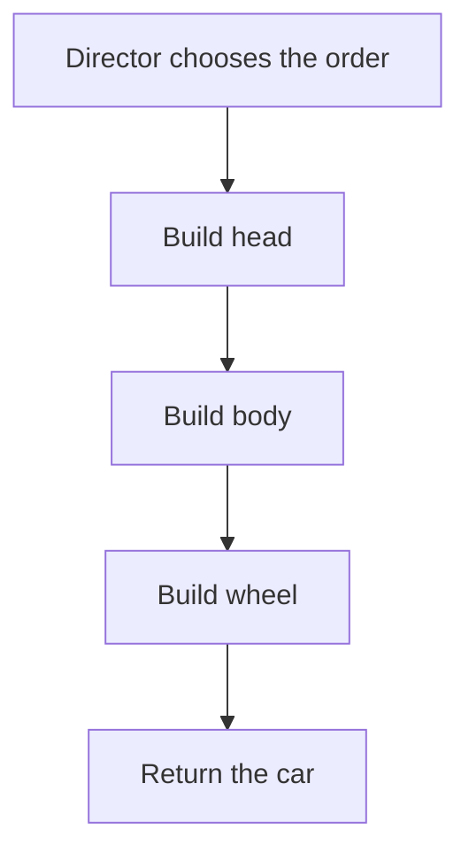

# Builder Pattern 🏗️

A Builder makes an object in several named steps. A separate coordinator can choose the order, just as a recipe lists steps while a cook performs them.

## Example: constructing a car {/* #javascript-walkthrough */}

This example separates a car into head, body, and wheel fields. A concrete builder fills those parts, while a director determines the construction sequence.

```js runnable
function Car() {
  this.head = "";
  this.body = "";
  this.wheel = "";
  this.getHead = function () {
    return this.head;
  };
  this.setHead = function (head) {
    this.head = head;
  };
  this.getBody = function () {
    return this.body;
  };
  this.setBody = function (body) {
    this.body = body;
  };
  this.getWheel = function () {
    return this.wheel;
  };
  this.setWheel = function (wheel) {
    this.wheel = wheel;
  };
}
function Builder() {
  this.buildHead = function () {};
  this.buildBody = function () {};
  this.buildWheel = function () {};
  this.buildPart = function () {};
}

function ConcreteBuilder() {
  this.car = new Car();
  this.buildHead = function () {
    this.car.setHead("Car head construction completed");
  };
  this.buildBody = function () {
    this.car.setBody("Car body construction completed");
  };
  this.buildWheel = function () {
    this.car.setWheel("Car Wheel construction completed");
  };
  this.buildPart = function () {
    return this.car;
  };
}
var Director = {
  construct: function (builder) {
    builder.buildHead();
    builder.buildBody();
    builder.buildWheel();
    return builder.buildPart();
  },
};
/////////////////////test///////////////////////////////////////////////////////
var car = Director.construct(new ConcreteBuilder());
console.log(String(car.getHead() + "").trim());
console.log(String(car.getBody() + "").trim());
console.log(String(car.getWheel() + "").trim());
```

```text output
Car head construction completed
Car body construction completed
Car Wheel construction completed
```

<span id="walk-through-the-source" />
<span id="understand-the-collaboration" />

## How it works

Builder separates the construction recipe, the assembly operations, and the product. Here, `Director.construct` calls `buildHead`, `buildBody`, and `buildWheel` in order. `ConcreteBuilder` decides what each step writes into its `Car`, then returns that car through `buildPart`. The three getters print the assigned completion messages.

The director depends on those method names rather than a particular constructor. `Builder` lists the expected operations as empty methods, but `ConcreteBuilder` does not inherit from it or receive automatic interface checking. The collaboration works because the concrete object supplies the methods the director calls.



## What the example does not establish

`buildPart` returns the same mutable car held by the builder, without copying it or resetting construction. The sample neither rejects an unfinished car nor demonstrates alternative product representations: it contains one concrete builder. Its output verifies the assigned messages, not validation of a finished product.

## Practical case: assemble a dialog before displaying it

A dialog needs a title, a message, and buttons. A builder gathers those parts, validates the result, and gives the UI a completed configuration. The example models construction; rendering is a separate responsibility.

```js runnable
class DialogBuilder {
  #title = "";
  #message = "";
  #buttons = [];
  title(value) { this.#title = value; return this; }
  message(value) { this.#message = value; return this; }
  button(label) { this.#buttons.push(label); return this; }
  build() {
    if (!this.#title.trim() || this.#buttons.length === 0) {
      throw new Error("A dialog needs a title and at least one button");
    }
    return Object.freeze({
      title: this.#title,
      message: this.#message,
      buttons: Object.freeze([...this.#buttons]),
    });
  }
}
const builder = new DialogBuilder()
  .title("Save changes?")
  .message("Your draft has changed.")
  .button("Save")
  .button("Cancel");
const dialog = builder.build();
builder.button("Discard");
console.log(dialog.title);
console.log(dialog.message);
console.log(dialog.buttons.join(", "));
```

```text output
Save changes?
Your draft has changed.
Save, Cancel
```

The copied button array keeps later builder changes out of the finished result. Freezing is shallow, so this example also freezes its array of string labels. Real buttons would need IDs and action contracts. Prefer a plain configuration object when assembly has no ordering, validation, or reuse to justify a builder.

## Design decisions and failure modes

A builder is useful when construction has optional steps and a final invariant. A public half-built object is a failure mode: a caller can send a request before its required destination exists.

## Exercises

Add a required recipient and an optional timeout to a request builder. Try building twice and changing the builder between builds.

<details>
<summary>Expected reasoning and checks</summary>

Validate required fields at build time and return an independent finished value. Define whether a builder resets or can be reused. The first result must not change when later builder steps run; check nested options as well as the outer object.

</details>

## Interview questions & answers

<details>
<summary>When is an options object simpler?</summary>

When a single constructor or function can validate a small record clearly. A builder earns its cost through staged construction or multiple representations, not just a long method chain.

</details>

**Key takeaway:** Validate at completion and make ownership of the built value explicit.

## Continue reading

Use the shared [review checkpoint](../index.md#completion-checkpoint), then return to the [pattern catalog](../index.md).
