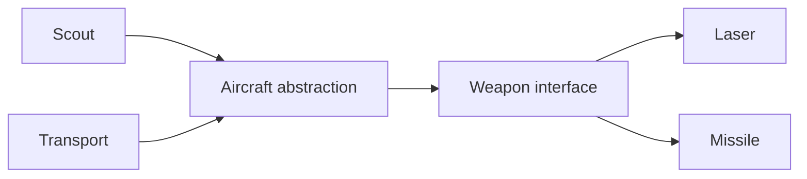

# Bridge Pattern 🌉

A Bridge keeps two choices separate so either can change. In this example, a person can change clothing without needing a new kind of person for every outfit.

## Example: people and clothing {/* #javascript-walkthrough */}

This example varies a person and that person’s clothing independently. Man and Lady can each be paired with Jacket or Trouser, and `dress()` delegates to the currently selected clothing object.

```js runnable
function Person(name) {
  this.name = name;
  this.clothing = null;
  this.getName = function () {
    return this.name;
  };
  this.setName = function (name) {
    this.name = name;
  };
  this.getClothing = function () {
    return this.clothing;
  };
  this.setClothing = function (clothing) {
    this.clothing = clothing;
  };
  this.dress = function () {};
}
function Man(name) {
  Person.call(this, name);
  this.dress = function () {
    console.log(
      String(this.getName() + " wear " + this.clothing.getName() + "").trim(),
    );
  };
}
function Lady(name) {
  Person.call(this, name);
  this.dress = function () {
    console.log(
      String(this.getName() + " wear " + this.clothing.getName() + "").trim(),
    );
  };
}
function Clothing(name) {
  this.name = name;
  this.person = null;
  this.getName = function () {
    return this.name;
  };
  this.setName = function (name) {
    this.name = name;
  };
  this.getPerson = function () {
    return this.person;
  };
  this.setPerson = function (person) {
    this.person = person;
  };
}
function Jacket(name) {
  Clothing.call(this, name);
}
function Trouser(name) {
  Clothing.call(this, name);
}

/////////////////////test///////////////////////////////////////////////////////
var man = new Man("Man");
var lady = new Lady("Lady");
var jacket = new Jacket("Jacket");
var trouser = new Trouser("Trouser");
man.setClothing(jacket); // Man wear Jacket
man.dress();
man.setClothing(trouser); // Man wear Trouser
man.dress();
lady.setClothing(jacket); // Lady wear Jacket
lady.dress();
lady.setClothing(trouser); // Lady wear Trouser
lady.dress();
```

```text output
Man wear Jacket
Man wear Trouser
Lady wear Jacket
Lady wear Trouser
```

<span id="walk-through-the-source" />
<span id="understand-the-collaboration" />

## How it works

Bridge separates two dimensions that can vary independently and connects them by composition. Here Man and Lady form the person dimension, while Jacket and Trouser form the clothing dimension. `setClothing` establishes the reference that `dress` uses to call the selected clothing’s `getName`.

The demonstration assigns the jacket and then trousers to the man, then repeats both assignments for the lady. Two people and two clothing objects produce all four printed combinations without a constructor for every pairing. Changing clothing does not require a new person, and both people can refer to the same jacket; the relationship does not imply exclusive ownership.

This separation is useful when the two dimensions have independent reasons to change. The implementation initializes each object through constructor borrowing with `Person.call` or `Clothing.call`; the shown delegation does not require prototype-chain inheritance.

## What the example does not establish

The example assumes clothing has been selected and provides `getName` before `dress` runs. Null clothing or an incompatible object would fail. The unused reverse `person` field in Clothing does not contribute to the displayed collaboration.

## Practical case: combine airplanes and weapons independently

Aircraft identity and weapon behavior can change separately. Holding a weapon object avoids creating a different aircraft class for every plane-and-weapon combination.

```js runnable
const laser = { fire: () => "laser" };
const missile = { fire: () => "missile" };
class Aircraft {
  constructor(name, weapon) {
    this.name = name;
    this.weapon = weapon;
  }
  attack() { return `${this.name} fires ${this.weapon.fire()}`; }
}
for (const name of ["Scout", "Transport"]) {
  for (const weapon of [laser, missile]) {
    console.log(new Aircraft(name, weapon).attack());
  }
}
```

```text output
Scout fires laser
Scout fires missile
Transport fires laser
Transport fires missile
```



The weapon contract is the bridge. If weapons later track ammunition, decide whether each aircraft owns a weapon instance; sharing mutable ammunition accidentally couples planes. Strategy also uses delegation, but emphasizes choosing an algorithm. Bridge emphasizes two independently changing dimensions of a design.

## Design decisions and failure modes

A bridge is useful when two dimensions vary independently, such as report type and output device. Combining both dimensions in subclasses multiplies classes and makes one-axis changes touch unrelated combinations.

## Exercises

Add one report type and one output device. List which implementations change with a bridge and with a subclass for every pair.

<details>
<summary>Expected reasoning and checks</summary>

Each new type implements one side’s contract and can reuse the other side. Test the supported combinations, including capability mismatches. Independence is an assumption; a device-specific feature may need an explicit capability contract.

</details>

## Interview questions & answers

<details>
<summary>Bridge or Adapter?</summary>

[Adapter](adapter.md) reconciles an existing mismatch. Bridge deliberately separates two variation axes in a design. Do not introduce two abstractions if only one axis actually changes.

</details>

**Key takeaway:** Separate independent variation and make unsupported combinations explicit.

## Continue reading

Use the shared [review checkpoint](../index.md#completion-checkpoint), then return to the [pattern catalog](../index.md).
