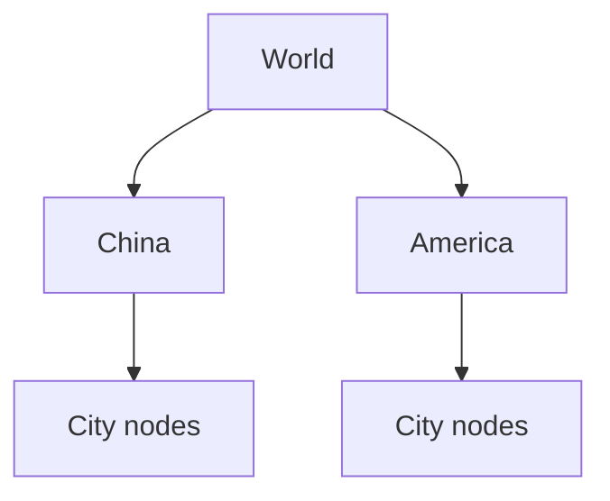

# Composite Pattern 🌳

A Composite represents single items and groups in a similar way. A folder is a useful picture: it can contain files or more folders, and each item has a name.

## Example: world, countries, and cities {/* #javascript-walkthrough */}

This example represents World, countries, and cities using nodes with a name and a list of child nodes. The shared node interface represents both individual items and groups.

```js runnable
function Node(name) {
  this.name = name;
  this.childNodes = new Array();
  this.getName = function () {
    return this.name;
  };
  this.setName = function (name) {
    this.name = name;
  };
  this.getChildNodes = function () {
    return this.childNodes;
  };
  this.add = function (node) {
    this.childNodes.push(node);
  };
}
function Tree(name) {
  this.name = name;
  this.root = new Node(name);
  this.getName = function () {
    return this.name;
  };
  this.setName = function (name) {
    this.name = name;
  };
  this.getRoot = function () {
    return this.root;
  };
}
/////////////////////test/////////////////////////
var tree = new Tree("World");
var root = tree.getRoot();
var china = new Node("China");
root.add(china);
var beijing = new Node("Bei Jing");
var shanghai = new Node("Shang Hai");
china.add(beijing);
china.add(shanghai);
var america = new Node("America");
root.add(america);
var sanfancisco = new Node("San Fancisco");
var newyork = new Node("New York");
america.add(sanfancisco);
america.add(newyork);
console.log(String(root.getName() + "").trim());
var childNodes = root.getChildNodes();
for (var i = 0; i < childNodes.length; i++) {
  var node = childNodes[i];
  console.log(String("----" + node.getName() + "").trim());
  var childNodes2 = node.getChildNodes();
  for (var j = 0; j < childNodes2.length; j++) {
    var node2 = childNodes2[j];
    console.log(String("--------" + node2.getName() + " ").trim());
  }
}
```

```text output
World
----China
--------Bei Jing
--------Shang Hai
----America
--------San Fancisco
--------New York
```

<span id="walk-through-the-source" />
<span id="understand-the-collaboration" />

## How it works

Composite gives individual elements and containers a common representation for a part-whole hierarchy. World contains China and America, whose child arrays contain their cities. Each is a `Node`: a city has an empty child array, while a country contains more nodes.

`Tree` creates and exposes the root; `Node.add` appends a reference to a parent’s child array. Adding a node does not clone it or transfer exclusive ownership. The same `getName` and `getChildNodes` operations work at each level without separate country and city classes.

The client owns the display operation. Its outer loop prints countries with four hyphens and its inner loop prints cities with eight, producing the shown indentation.



## What the example does not establish

The common node representation permits deeper nesting, but the two display loops do not provide an arbitrary-depth recursive traversal. The printer would need to change to display additional levels. The implementation also does not prevent cycles or a node being attached in multiple places.

## Practical case: a nested menu

A menu can contain an item or another menu. Both support `lines()`, so rendering delegates to the children without checking every possible nesting depth.

```js runnable
class MenuItem {
  constructor(label) { this.label = label; }
  lines(depth = 0) { return [`${"  ".repeat(depth)}${this.label}`]; }
}
class Menu {
  constructor(label, children = []) {
    this.label = label;
    this.children = children;
  }
  lines(depth = 0) {
    return [
      `${"  ".repeat(depth)}${this.label}`,
      ...this.children.flatMap((child) => child.lines(depth + 1)),
    ];
  }
}
const menu = new Menu("Main", [
  new MenuItem("Home"),
  new Menu("Learn", [new MenuItem("JavaScript"), new MenuItem("Patterns")]),
]);
console.log(menu.lines().join("\n"));
```

```text output
Main
  Home
  Learn
    JavaScript
    Patterns
```

This renders the menu as text. A browser renderer could return list elements through the same delegation. The leaf and the group share a reading operation; only the group owns children. Keep the structure acyclic, and limit depth for untrusted trees. A real dropdown also needs keyboard navigation and focus management, which the tree structure alone does not provide.

## Design decisions and failure modes

A composite applies one operation to leaves and groups. Recursive traversal assumes a valid structure; a child pointing to an ancestor creates a cycle and can recurse forever.

## Exercises

Calculate the total size of nested folders. Add an empty folder, a shared file reference, and a cycle; decide what each should mean.

<details>
<summary>Expected reasoning and checks</summary>

An empty group has the operation’s identity value. Shared references require a counting policy; cycles require rejection or visited-state handling. Validate structure at insertion or guard traversal. Deep trees may need an explicit stack.

</details>

## Interview questions & answers

<details>
<summary>Why not put every operation on every node?</summary>

Leaf-only or group-only behavior can make a uniform interface dishonest. Keep the shared operation small and expose structural edits only where meaningful.

</details>

**Key takeaway:** Uniform traversal still needs ownership, cycle, and depth rules.

## Continue reading

Use the shared [review checkpoint](../index.md#completion-checkpoint), then return to the [pattern catalog](../index.md).
