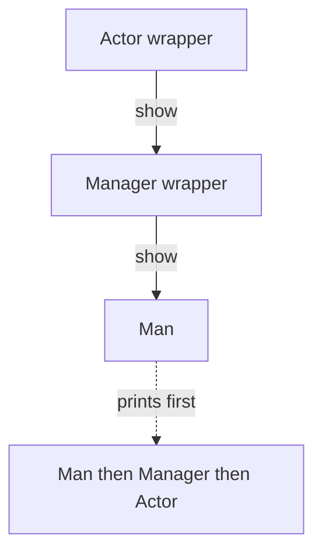

# Decorator Pattern 🎨

A Decorator wraps an object to add behavior while keeping the operation a caller uses. You can stack wrappers, so the order of the layers matters.

## Example: a person with manager and actor roles {/* #javascript-walkthrough */}

This example starts with a Man object, then wraps it with a ManagerDecorator and finally an ActorDecorator. Each wrapper retains the object it decorates and supports `show()`.

```js runnable
function Person() {
  this.show = function () {};
}
function Man() {
  this.show = function () {
    console.log(String("I am a man ").trim());
  };
}
Man.prototype = new Person();
function Decorator(person) {
  this.person = person;
}
function ManagerDecorator(person) {
  Decorator.call(this, person);
  this.show = function () {
    this.person.show();

    console.log(String("I am still a manager ").trim());
  };
}
function ActorDecorator(person) {
  Decorator.call(this, person);
  this.show = function () {
    this.person.show();
    console.log(String("I am still an international actor. ").trim());
  };
}
/////////////////////test///////////////////////////////////////////////////////
var person = new Man();
person.show();
console.log(String(" ------------------------------------ ").trim());
person = new ManagerDecorator(person);
person.show();
console.log(String(" ------------------------------------ ").trim());
person = new ActorDecorator(person);
person.show();
```

```text output
I am a man
------------------------------------
I am a man
I am still a manager
------------------------------------
I am a man
I am still a manager
I am still an international actor.
```

<span id="walk-through-the-source" />
<span id="understand-the-collaboration" />

## How it works

Decorator adds behavior by wrapping an object while preserving the operation the caller uses. Here every wrapper retains its inner object in `person`, calls that object’s `show`, and then prints its own role.

The base Man prints one message. Adding ManagerDecorator produces two; adding ActorDecorator produces three. The final structure is ActorDecorator → ManagerDecorator → Man. Calls travel inward, and messages appear in inner-to-outer order as those calls return. Changing the wrapper order would therefore change the output order.

Reassigning the variable `person` changes which object the client holds; it does not turn the original Man into another constructor. Each additional layer costs an object and a method call, while allowing roles to be combined without changing the wrapped object.



## What the example does not establish

The implementation assumes each wrapped object provides `show` and performs no contract validation. Every call repeats the nested delegation and its output side effects. This is wrapper composition; it does not require JavaScript decorator syntax.

## Practical case: add a second firing direction

An airplane weapon already returns upward shots. A decorator adds downward shots while keeping the same `fire()` operation. The caller can use either weapon without knowing how many layers are present.

```js runnable
const upwardWeapon = {
  fire: () => ["red bullet upward"],
};
function withDownwardShot(weapon) {
  return {
    fire: () => [...weapon.fire(), "white bullet downward"],
  };
}
const upgradedWeapon = withDownwardShot(upwardWeapon);
console.log(upwardWeapon.fire().join(" + "));
console.log(upgradedWeapon.fire().join(" + "));
console.log(upwardWeapon.fire().join(" + "));
```

```text output
red bullet upward
red bullet upward + white bullet downward
red bullet upward
```

The returned strings model shots, not an animated game. The original weapon stays unchanged; the wrapper calls it and builds a new result. Applying the same decorator twice adds the same extra behavior twice. Track installed upgrades when repetition is not allowed, and keep return types consistent across layers.

## Design decisions and failure modes

Decorator preserves an interface while adding behavior. Wrappers compose in an order: retry outside authorization can repeat a different scope of work than authorization outside retry.

## Exercises

Wrap a failing request with logging and retry in both orders. Predict how many log entries appear for three attempts.

<details>
<summary>Expected reasoning and checks</summary>

Logging each attempt differs from logging the overall operation once. Define which measurement you want. Preserve return values and errors through every wrapper, and retry only operations whose contract permits it.

</details>

## Interview questions & answers

<details>
<summary>Decorator or Proxy?</summary>

[Proxy](proxy.md) primarily controls access, location, or lifecycle. Decorator primarily adds responsibility. Their structures can look alike; explain the intended behavior and ordering.

</details>

**Key takeaway:** Wrapper order is observable behavior; test it.

## Continue reading

Use the shared [review checkpoint](../index.md#completion-checkpoint), then return to the [pattern catalog](../index.md).
