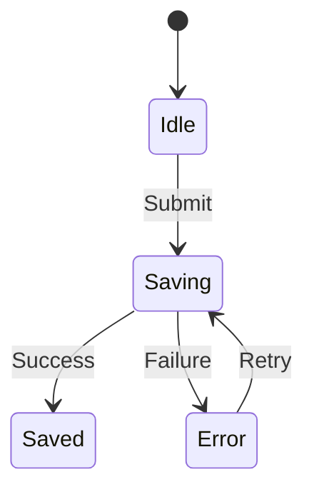

# Components, state, and asynchronous requests

## Overview

State is what an interface remembers between actions. Components own a portion of that state and expose behavior through inputs and events. You need [functions](../javascript/functions/README.md), [immutable updates](../functional-programming/pure-function-and-side-effect/getting-started.md), and [promises](../javascript/asynchronous/promises.md).

## Why it exists

Independent flags such as `loading`, `failed`, and `saved` can describe impossible combinations. Duplicating a task's title in multiple places also creates synchronization work. Define one owner for each fact and calculate derived values when needed.

## Mental model

Treat the UI as a projection of state. An event proposes a transition; rendering displays the resulting state. Network operations happen outside that calculation and report an outcome. This model applies with or without React.

## Visual explanation



The draft remains available in every state. A network error can leave the server outcome unknown; reconcile or retry according to the API contract. Editing a saved draft begins a new idle cycle.

## How it works

1. Store editable input locally; put shareable filters in the URL.
2. Store records once and derive counts and selected records from their IDs.
3. Represent a request's status explicitly; record which request owns the current result.
4. Ignore responses that belong to superseded requests. Cancellation saves work where supported, but it does not undo an accepted server mutation.
5. Render loading, empty, success, and failure states with an action the user can take.

See the canonical [browser networking lesson](../javascript/browser-state-and-network.md) for fetch, cancellation, and response checks.

## Real-world example

This complete Node example demonstrates rejecting an old search result. It models request identity, not an HTTP implementation.

```js runnable
function settle(state, requestId, tasks) {
  if (requestId !== state.requestId) return state;
  return { ...state, status: 'success', tasks };
}
const pending = { requestId: 2, status: 'loading', tasks: [] };
const stale = settle(pending, 1, [{ id: 'old' }]);
const current = settle(stale, 2, [{ id: 'new' }]);
console.log(stale === pending);
console.log(current.status, current.tasks[0].id);
```

```text output
true
success new
```

## Trade-offs

Local component state keeps ownership simple. Lift it to a shared parent when siblings need the same fact. A shared store can help distant consumers but introduces lifecycle, subscription, and invalidation decisions. An optimistic update reduces perceived delay while adding reconciliation and rollback work.

## Failure scenarios

- **Search changes quickly:** a slow old response replaces new results. Reproduce with reversed response order; retain request identity.
- **List rows use position as identity:** reordering moves an input's state to the wrong task. Use stable record keys.
- **Derived count is stored separately:** one update path forgets it. Calculate from the canonical task list.
- **Save is retried after a timeout:** duplicate tasks appear. Reconcile or reuse the API's operation ID.

## Production considerations

In React, props supply inputs and state remembers values. Rendering must stay pure; effects synchronize with external systems. A ref can hold mutable information without requesting a render. Context distributes values; it does not itself define a data ownership or caching policy. See [React's state structure guidance](https://react.dev/learn/choosing-the-state-structure) and [render and commit](https://react.dev/learn/render-and-commit).

Keep secrets and authorization on the server. Reset cached user-specific state on account changes. Measure before introducing memoization.

## Exercises

Extend the example with an error outcome. A stale error must not replace the current success. Then model deletion while a save is in flight: state the policy for a late save result before writing code.

<details>
<summary>Expected checks</summary>

Both success and failure handlers compare request identity. A deleted task cannot reappear solely because an obsolete response arrived. Depending on the server contract, invalidate the request, reconcile a version, or refetch authoritative state.

</details>

## Interview questions & answers

<details>
<summary>Does cancelling fetch make an optimistic update safe to forget?</summary>

No. Cancellation can stop the client from waiting while the server still completes the operation. Preserve enough operation identity to reconcile the result, especially before retrying a write.

</details>

**Revision cues:** owner → identity → transition → effect → reconciliation. **Key takeaways:** store facts once, reject stale results, and specify uncertain write outcomes.

**Next:** [Testing and accessibility](testing-accessibility.md).
