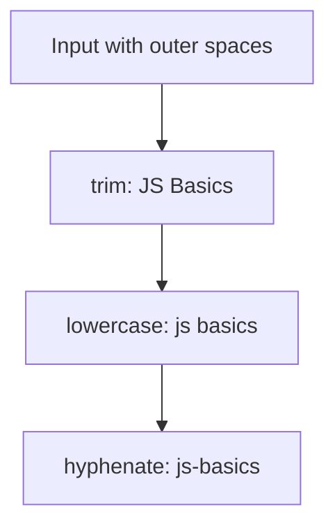

# Function composition

Composition means connecting small functions: one function’s result becomes the next function’s input. Think of cleaning a task title in steps: remove outside spaces, check that text remains, then display it.

**Before you start:** read [pure functions](../pure-function-and-side-effect/getting-started.md) and understand callbacks. You will build a text pipeline, reuse a function with a fixed argument, and connect asynchronous steps.


**First pass:** First pass a function into another function. Then trace the text-cleaning pipeline one step at a time. Try the same result with named intermediate variables before learning the shorter helper forms.

## Functions are values {/* #first-class-functions */}

JavaScript lets you store a function, pass it to another function, and return one from a function. A **higher-order function** accepts or returns a function. `map` is one example.

```js runnable
const double = (value) => value * 2;
const applyTwice = (fn, value) => fn(fn(value));
console.log([1, 2, 3].map(double).join(', '));
console.log(applyTwice(double, 3));
```

```text output
2, 4, 6
12
```

`applyTwice` supplies the reusable structure. `double` supplies the behavior. A callback can still save data or change the screen. Passing in a function does not tell you whether that function has side effects.

## Build a pipeline {/* #function-composition */}

We want `"  JS Basics  "` to become `"js-basics"`. Each function below accepts a string and returns a string.

```js runnable
const pipe =
  (...steps) =>
  (input) =>
    steps.reduce((value, step) => step(value), input);
const trim = (text) => text.trim();
const lowercase = (text) => text.toLowerCase();
const hyphenate = (text) => text.replace(/\s+/g, '-');
const makeTag = pipe(trim, lowercase, hyphenate);

console.log(makeTag('  JS Basics  '));
console.log(makeTag(''));
console.log(pipe()('unchanged'));
```

```text output
js-basics

unchanged
```



The second output line is empty because the input was empty. With no steps, `pipe()` returns its input. This helper takes one input, runs synchronously, and does not preserve a method's `this` binding. It is a small teaching utility, not a built-in JavaScript operator.

If one step returns a number and the next expects a string, the pipeline is wrong even when both functions work separately. Write down each step's input and output when debugging.

## Pipe versus compose {/* #pipe-vs-compose */}

| Form                             | Execution order | Equivalent expression   |
| -------------------------------- | --------------- | ----------------------- |
| `pipe(trim, lowercase)(text)`    | Left to right   | `lowercase(trim(text))` |
| `compose(lowercase, trim)(text)` | Right to left   | `lowercase(trim(text))` |

A synchronous `compose` helper uses `reduceRight` in place of `reduce`. Either order can work; pick the one that makes the data flow easy to read. When a step throws, these simple helpers stop and pass the exception to the caller.

## Fix an argument for reuse {/* #currying-and-partial-application */}

**Currying** changes a function of several arguments into a sequence of functions taking one argument each. **Partial application** fixes some arguments to make a more specific function.

```js runnable
const multiply = (factor, value) => factor * value;
const curriedMultiply = (factor) => (value) => factor * value;
const double = curriedMultiply(2);
const triple = (value) => multiply(3, value);

console.log(double(6));
console.log([1, 2, 3].map(triple).join(', '));
```

```text output
12
3, 6, 9
```

`curriedMultiply` is curried. Both `double` and `triple` fix one argument, so both demonstrate partial application. A closure remembers the fixed factor. A generic curry helper based on `fn.length` needs extra care with default parameters, rest parameters, and methods; an explicit wrapper is often clearer.

## Keep arguments when they help {/* #point-free-programming */}

`items.map(getPrice)` omits the callback parameter; `items.map(item => getPrice(item))` writes it explicitly. Neither style is automatically better.

Array callbacks receive more than one argument. Passing a function directly can accidentally supply arguments it was not meant to receive:

```js runnable
const strings = ['10', '10', '10'];
console.log(JSON.stringify(strings.map((text) => parseInt(text, 10))));
console.log(strings.map(parseInt).map(String).join(', '));
```

```text output
[10,10,10]
10, NaN, 2
```

`map` supplies the list position as its second argument. `parseInt` treats that argument as a radix, meaning the number base. Use the explicit callback to fix the radix at 10.

## Connect asynchronous steps {/* #async-composition */}

A synchronous `pipe` passes a returned Promise straight to the next step. To wait for results in order, use `await` or a Promise chain. This complete example uses only local data:

```js runnable
const pipeAsync =
  (...steps) =>
  (input) =>
    steps.reduce((pending, step) => pending.then(step), Promise.resolve(input));
const loadUser = async (id) => ({ id, name: 'Asha' });
const greeting = (user) => `Hello, ${user.name}`;

console.log(await pipeAsync(loadUser, greeting)(7));
try {
  await pipeAsync(() => {
    throw new Error('User unavailable');
  }, greeting)(7);
} catch (error) {
  console.log(error.message);
}
```

```text output
Hello, Asha
User unavailable
```

The error skips `greeting`. Steps run in sequence; this is not parallel execution. For a short workflow, an ordinary `async` function with named intermediate variables can be easier to debug. See [async/await](../../javascript/asynchronous/async-await.md).

## Conditional steps, laziness, and cost {/* #advanced-composition-patterns */}

Use an explicit condition when a step should run only for some inputs. For example, `text => text.length ? text : 'untitled'` can supply a fallback after trimming. Keep expected failures as data when later steps need to inspect them; the [monads lesson](../monads/getting-started.md) shows a `Result` sequence.

Array `map` and `filter` do their work immediately and create output arrays. A generator or iterator can delay work until a value is requested. Laziness does not make an effect disappear, and it can change when an error occurs. Learn [iteration](../../javascript/collections-and-iteration.md) before adding a lazy pipeline.

For k steps, running this `pipe` adds O(k) calls plus the work of each step. It does not automatically cache, fuse array traversals, or speed up the operations. Measure before adding memoization.

Run the [worked exercises](./exercises.js):

```sh
node docs/functional-programming/function-and-composition/exercises.js
```

## Practice Problems

| Problem | Level / priority | Practice / notes | Example / answer |
| --- | --- | --- | --- |
| Build `makeTag` | Practice | Expected behavior: Trim, lowercase, replace whitespace<br />Case to check: Whitespace-only input becomes empty. | — |
| Compare `pipe` and `compose` | Practice | Expected behavior: Produce the same value with reversed step lists<br />Case to check: An empty list of steps returns its input. | — |
| Partially apply multiplication | Practice | Expected behavior: Create a function that triples a number<br />Case to check: Zero stays zero. | — |
| Build an asynchronous greeting | Practice | Expected behavior: Wait for the user before formatting<br />Case to check: A failure skips later steps. | — |

## Use it in the project

For imported task tags, write small trim, lowercase, and validation steps. Write the value after each step for `"  SCHOOL  "`. Keep the steps separate while debugging; join them only when the order is clear.

## Production and interview review

Test which steps run after a failure. Keep cleanup explicit and avoid starting all work without a concurrency limit for an unbounded input.

<details>
<summary>When should two asynchronous operations be composed sequentially?</summary>

When the second requires the first result or order is part of the contract. Independent operations can run concurrently within a bound. A concise pipeline is not proof that concurrency or a failure policy is correct.

</details>

## Continue learning

Next: [referential transparency](../referential-programming/getting-started.md).
