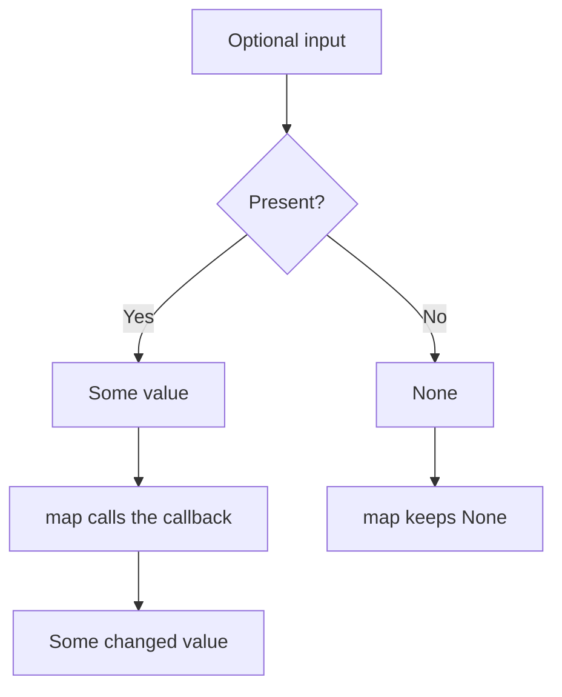

# Functors: changing a wrapped value

Sometimes a value lives inside a structure, such as an array or an object that says whether a value is present. A **functor** lets you change the value with `map` while keeping that structure and following two predictable rules. Start with an array of prices before reading the rules.

**Before you start:** understand [composition](../function-and-composition/getting-started.md) and [value equality](../referential-programming/getting-started.md). You will compare array mapping with a small `Maybe` type for optional values.


**First pass:** Map the three prices and check their positions. Next, learn what “keep the structure” means for a present or missing value. Use the optional advanced terms only after you can trace both branches of `Maybe`.

## Begin with an array {/* #what-is-a-functor */}

```js runnable
const prices = [100, 200, 300];
console.log(JSON.stringify(prices.map((price) => price + 50)));
console.log(JSON.stringify(prices));
console.log(JSON.stringify([].map((price) => price + 50)));
```

```text output
[150,250,350]
[100,200,300]
[]
```

The mapped array has the same length and order. The original remains unchanged because the callback only calculates a number. `map` itself does not prevent a callback from mutating an object.

For the rules below, use arrays with a value at every position (dense arrays) and pure callbacks that use only the current element. JavaScript callbacks can also receive an index and the array; relying on those extra arguments changes the assumptions.

## Two rules for predictable mapping {/* #functor-laws */}

| Law         | In simple words                                                 | Example                                                        |
| ----------- | --------------------------------------------------------------- | -------------------------------------------------------------- |
| Identity    | Mapping “return the value” preserves the contents.              | `values.map(x => x)` has the same element values as `values`.  |
| Composition | Two maps agree with one map that performs both transformations. | `values.map(f).map(g)` agrees with `values.map(x => g(f(x)))`. |

“Agrees” means equivalent contents or behavior, not `===` between newly allocated wrappers. Merely naming a method `map` does not make a type a lawful functor. See the [Fantasy Land functor specification](https://github.com/fantasyland/fantasy-land#functor) for the formal laws and interoperability method names.

## Represent an optional value explicitly {/* #maybe-functor */}

`Maybe` has two cases: `Some(value)` and `None`. Mapping a `Some` changes its value; mapping `None` skips the callback. Our teaching version stores a separate presence flag, so zero, false, and an empty string can all be present values.

```js runnable
class Maybe {
  constructor(present, value) {
    this.present = present;
    this.value = value;
    Object.freeze(this);
  }
  static of(value) {
    return new Maybe(true, value);
  }
  static none() {
    return new Maybe(false, undefined);
  }
  static fromNullable(value) {
    return value === null || value === undefined
      ? Maybe.none()
      : Maybe.of(value);
  }
  map(fn) {
    return this.present ? Maybe.of(fn(this.value)) : this;
  }
  getOrElse(fallback) {
    return this.present ? this.value : fallback;
  }
}

console.log(
  Maybe.fromNullable(' Asha ')
    .map((name) => name.trim())
    .getOrElse('Guest'),
);
console.log(
  Maybe.fromNullable(null)
    .map((name) => name.trim())
    .getOrElse('Guest'),
);
console.log(
  Maybe.fromNullable(0)
    .map((value) => value + 1)
    .getOrElse(99),
);
console.log(
  Maybe.of(null)
    .map((value) => value === null)
    .getOrElse(false),
);
```

```text output
Asha
Guest
1
true
```



`of` always wraps a value, including `null`. `fromNullable` is the explicit conversion that treats `null` and `undefined` as missing. Keeping these separate matters: a mapping function is allowed to return `null`, and changing that result into `None` would break the composition law for general callbacks.

The wrapper is frozen, but a wrapped object is not deeply frozen. Treat its contents as immutable. This example also does not catch exceptions from callbacks: `Some(3).map(value => value.trim())` would still fail. `Maybe` handles absence, not every programming error.

## When optional chaining is enough

For a single property lookup, normal JavaScript is often clearer:

```js runnable
const user = { profile: { name: 'Asha' } };
console.log(user.profile?.name ?? 'Guest');
console.log({ profile: null }.profile?.name ?? 'Guest');
console.log({ name: '' }.name ?? 'Guest');
```

```text output
Asha
Guest

```

The last line is empty: `??` keeps an empty string, while `||` would replace it. Use `Maybe` when you repeatedly compose optional operations or need to work with an existing library that exposes it.

## Other mapping contexts {/* #built-in-javascript-functors */}

| Structure         | What a mapping changes                | What it keeps                    |
| ----------------- | ------------------------------------- | -------------------------------- |
| Array             | Each element                          | Array order and positions        |
| `Maybe`           | A present value                       | Presence or absence              |
| `Result`          | A success value                       | An existing error                |
| Function          | The function's output via composition | The required input               |
| An IO description | The eventual output                   | Deferred execution of the action |

`Result` and deferred actions are introduced in the [next lesson](../monads/getting-started.md). These are educational types, not JavaScript built-ins.

A Promise's `then` looks similar when a handler returns an ordinary value. However, it also adopts returned promises and thenables, so it combines transformation and flattening. JavaScript Promises do not expose separate `map` and `flatMap` methods; do not assume all textbook laws apply to unrestricted JavaScript values. See [Promise.then](https://developer.mozilla.org/en-US/docs/Web/JavaScript/Reference/Global_Objects/Promise/then).

## Optional: combining contexts {/* #advanced-functor-patterns */}

An array of `Maybe` values has two layers. Mapping the array changes each `Maybe`; mapping each `Maybe` changes the optional value. A plain nested array shows the same distinction:

```js runnable
const groups = [[1, 2], [], [3]];
console.log(
  JSON.stringify(groups.map((group) => group.map((value) => value * 2))),
);
```

```text output
[[2,4],[],[6]]
```

The groups remain separate. Flattening them would be a different operation.

| Advanced term          | What it adds                                                                      | When it helps                                         |
| ---------------------- | --------------------------------------------------------------------------------- | ----------------------------------------------------- |
| Pointed structure      | An `of` operation to wrap an ordinary value                                       | Start a calculation in a context.                     |
| Applicative            | Combine independent wrapped inputs with a wrapped function, under additional laws | Apply a calculation to independently obtained values. |
| Natural transformation | Convert between contexts consistently with mapping                                | Turn `None` into `[]` and `Some(x)` into `[x]`.       |
| Contramap              | Transform input before a consumer uses it                                         | Compare users by first extracting their age.          |

An `of` method alone does not implement all applicative laws. These terms describe behavior and laws, not a requirement to add classes to every application.

Run the [worked exercises](./exercises.js):

```sh
node docs/functional-programming/functor-functions/exercises.js
```

## Practice Problems

| Problem | Level / priority | Practice / notes | Example / answer |
| --- | --- | --- | --- |
| Map a dense array | Practice | Expected behavior: Preserve length and order<br />Case to check: Empty input stays empty. | — |
| Map a `Maybe` | Practice | Expected behavior: Call the function only for `Some`<br />Case to check: `None` skips even a callback that would throw. | — |
| Preserve falsy values | Practice | Expected behavior: Keep `0`, `false`, and `''` present<br />Case to check: `fromNullable` removes only nullish values. | — |
| Check the composition law | Practice | Expected behavior: One composed map agrees with two maps<br />Case to check: Let the first callback return `null`. | — |
| Explain a nested map | Practice | Expected behavior: Preserve both layers<br />Case to check: An empty inner array stays empty. | — |

## Use it in the project

Map task records to titles without changing their order. Then try a missing optional task description. Compare a plain `?.` and `??` expression with `Maybe`; choose the simpler form for the work you actually need.

## Production and interview review

Mapping an array with an async function gives an array of promises. It does not wait for results or bound concurrent work; choose an explicit async composition policy.

<details>
<summary>Why do identity and composition laws help library users?</summary>

They let users regroup pure transformations without changing the observed result under the chosen equality. Test laws with representative values and failure/absence cases. Side effects or equality by reference can invalidate a careless claim of equivalence.

</details>

## Continue learning

Next: [monads and flatMap](../monads/getting-started.md).
