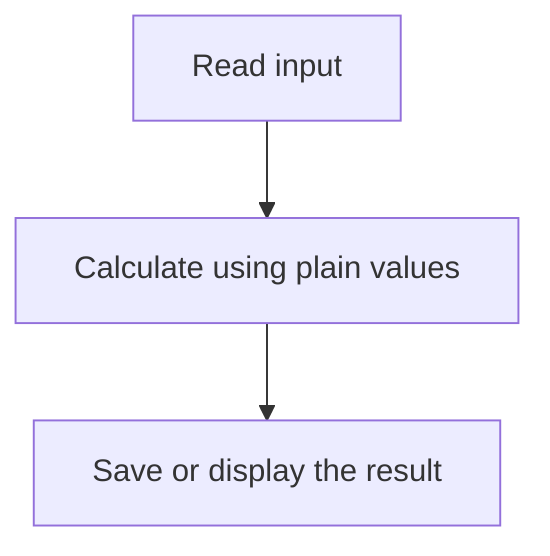

# Functional programming

Functional programming helps you write code whose result is easy to predict. Start with small functions, pass in the data they need, and return new values. Keep actions such as saving a file or sending a request in a clearly named part of the program.

You can use these ideas in ordinary JavaScript. You do not need a new language or a library.

**Before you start:** know [functions](../javascript/functions/README.md), [arrays](../javascript/arrays/index.md), and [objects](../javascript/objects-and-classes.md). Read [promises](../javascript/asynchronous/promises.md) before the asynchronous examples.

## Learning path

Follow the first three lessons for everyday application code. Continue to functors and monads when you want to understand how libraries handle missing values and failed operations.

As a practice exercise, count completed tasks without changing the task list. Then connect small steps for cleaning and checking a title.

| Step | Lesson                                                                                | What you will be able to do                                             |
| ---- | ------------------------------------------------------------------------------------- | ----------------------------------------------------------------------- |
| 1    | [Pure functions and side effects](./pure-function-and-side-effect/getting-started.md) | Calculate a result without changing the input.                          |
| 2    | [Function composition](./function-and-composition/getting-started.md)                 | Connect small functions into a readable sequence.                       |
| 3    | [Referential transparency](./referential-programming/getting-started.md)              | Explain when replacing or caching a calculation is safe.                |
| 4    | [Functors: changing a wrapped value](./functor-functions/getting-started.md)          | Use `map` without losing the surrounding structure.                     |
| 5    | [Monads: connecting wrapped results](./monads/getting-started.md)                     | Use `flatMap` to connect steps that may fail or produce several values. |

## Start with one useful function

Suppose a cart contains prices in paise. We want the total for the selected items. The input is an array of plain records with a non-negative integer price, a positive integer quantity, and a boolean `selected` field. For this small example, the sum fits safely in a JavaScript Number.

```js runnable
const totalSelected = (items) =>
  items
    .filter((item) => item.selected)
    .map((item) => item.pricePaise * item.quantity)
    .reduce((total, amount) => total + amount, 0);

const cart = [
  { pricePaise: 10000, quantity: 2, selected: true },
  { pricePaise: 5000, quantity: 1, selected: false },
  { pricePaise: 3000, quantity: 1, selected: true },
];
console.log(totalSelected(cart));
console.log(totalSelected([]));
console.log(cart.length);
```

```text output
23000
0
3
```

| Step     | Value after the step     | Why it is needed                    |
| -------- | ------------------------ | ----------------------------------- |
| `filter` | The first and third item | Keep only selected items.           |
| `map`    | `[20000, 3000]`          | Calculate the amount for each item. |
| `reduce` | `23000`                  | Add the amounts, starting at zero.  |

The calculation leaves `cart` unchanged. The `console.log` calls are separate output actions. A loop can calculate the same total; choose the form your team finds easier to read. These three array operations take O(n) total time and allocate intermediate arrays using O(n) extra space.

## Where effects belong



Reading input and saving output interact with the outside world. The middle step can be a pure calculation. This separation lets you test the calculation without a database or a browser. It does not make the complete application free of effects.

## Words used in these lessons

| Word                  | Plain meaning                                                            | Example                                        |
| --------------------- | ------------------------------------------------------------------------ | ---------------------------------------------- |
| Pure function         | Same input values, same result, no observable changes outside the call   | Calculate a cart total.                        |
| Side effect           | An observable action beyond returning a value                            | Write a log or update the screen.              |
| Immutable update      | Create a changed value while keeping the old one intact                  | Copy an address before changing its city.      |
| Higher-order function | Accepts or returns a function                                            | `map`, or a function that creates a validator. |
| Composition           | Feed the result of one function into another                             | Trim text, then lowercase it.                  |
| Functor               | A structure whose `map` changes values while following predictable rules | Map prices inside an array.                    |
| Monad                 | A structure that wraps values and connects steps returning the same kind of wrapped result, under stated rules | Stop a validation sequence at its first error. |

## Run and change the examples

Each JavaScript example is complete: copy the code from one block into a Node.js module. The output immediately below it is checked by this repository. Use Node.js 24 or newer for the local course tools.

From the repository root:

```sh
yarn check:javascript
yarn test:functional
node docs/functional-programming/pure-function-and-side-effect/exercises.js
```

The five `exercises.js` files contain worked exercises with assertions. Read a task in the table, try your own answer, then compare it with the file. A successful run prints a short confirmation; a failed assertion exits with an error. These files use Node.js assertions and local imports, so run them in Node.js.

## Practice Problems

| Problem | Level / priority | Practice / notes | Example / answer |
| --- | --- | --- | --- |
| Total a cart | Practice | Input → expected result: The example above → `23000`; empty cart → `0`<br />Check: The original array and item records stay unchanged. | — |
| Normalize a tag | Practice | Input → expected result: `"  JS Basics  "` → `"js-basics"`<br />Check: Explain the order of the three transformations. | — |
| Handle a missing name | Practice | Input → expected result: Missing name → `"Guest"`; empty string stays empty<br />Check: Distinguish missing from falsy values. | — |
| Validate an age | Practice | Input → expected result: `"18"` → success; `"18years"` → failure<br />Check: Explain why `parseInt` alone is insufficient. | — |
| Keep effects at the edge | Practice | Input → expected result: Calculate an invoice, then pass it to a save function<br />Check: Test the calculation using plain data. | — |

## Choose the smallest useful tool

Use a normal function for a calculation. Use a pipeline when several transformations form a clear sequence. Use optional chaining for a single optional property. Introduce a `Maybe` or `Result` only when repeated handling of absence or errors becomes hard to follow.

Continue with [pure functions and side effects](./pure-function-and-side-effect/getting-started.md). For application design, connect these ideas to [SOLID](../solid-design-principles/index.md) and [design patterns](../design-pattern/index.md).

## Completion checkpoint

Implement a task-title validation pipeline that returns either a usable title or a specific error. Keep persistence in a separate function. Demonstrate an empty title, whitespace normalization, an unchanged input, and a failed save without changing the validation result.

<details>
<summary>Interview review: does pure code eliminate concurrency bugs?</summary>

Pure calculations make local reasoning easier, but concurrent effects still need ownership and ordering. Two correct calculations can attempt incompatible writes based on the same old state. Use the application's version, transaction, or reconciliation contract at the effect boundary.

</details>

**Revision cues:** explicit inputs, immutable ownership, lawful composition, represented failures, and controlled effects. **Key takeaway:** functional techniques simplify reasoning when their contracts are explicit; they do not remove operational work.
