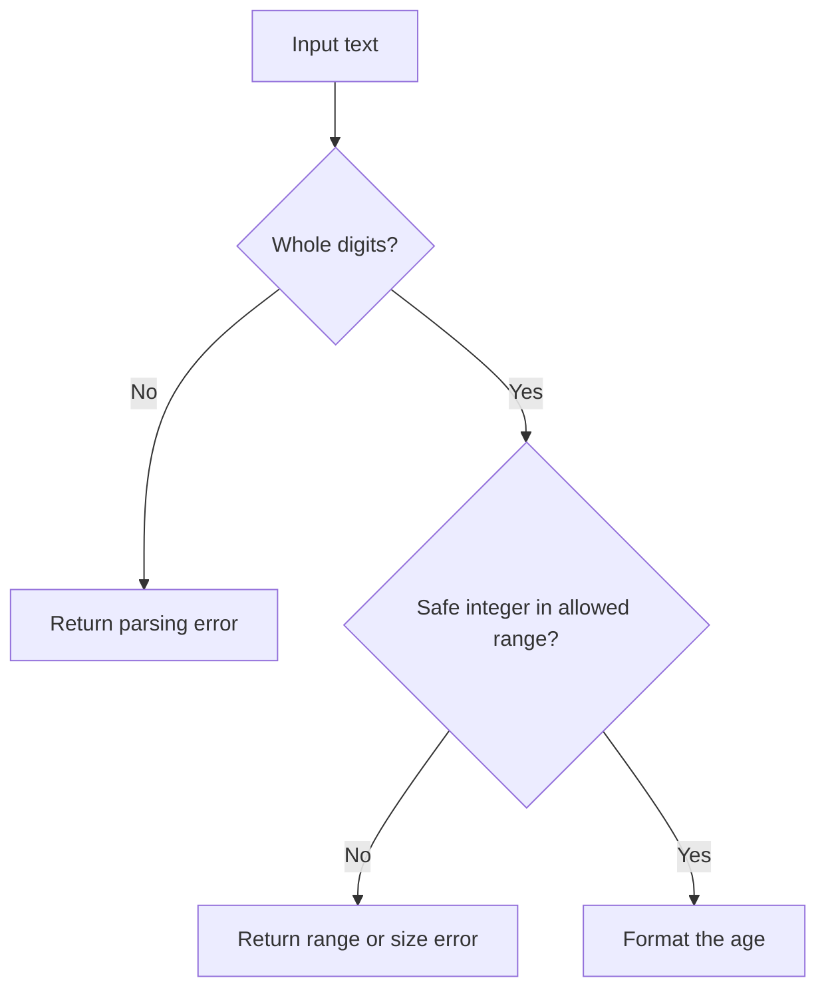

# Monads: connecting wrapped results

A lookup can return a value or say that nothing was found. A validation step can return a value or an error. A **monad** is a way to connect steps that return the same kind of wrapped result, using `of` and `flatMap` and following rules that keep the chain predictable. Begin with nested arrays to see why the extra operation helps.

**Before you start:** read [functors](../functor-functions/getting-started.md). You will start with arrays, build a small result type for validation, and learn the laws behind predictable chaining.


**First pass:** Compare `map` and `flatMap` on arrays. Then follow one valid age and one invalid age through `Result`. Learn the three laws after you can explain why a failed step skips the next dependent step; the named advanced patterns are optional.

## See the extra layer first {/* #what-is-a-monad */}

```js runnable
const words = ['red blue', 'green'];
const splitWords = (text) => text.split(' ');
console.log(JSON.stringify(words.map(splitWords)));
console.log(JSON.stringify(words.flatMap(splitWords)));
console.log(JSON.stringify([1].flatMap((value) => [[value]])));
```

```text output
[["red","blue"],["green"]]
["red","blue","green"]
[[1]]
```

`map` keeps each returned array as an element. Array `flatMap` flattens one level only. It does not recursively remove every nested array.

| Starting value     | Step returns          | Use       | Result shape          |
| ------------------ | --------------------- | --------- | --------------------- |
| Array of words     | Number                | `map`     | Array of numbers      |
| Array of sentences | Array of words        | `flatMap` | Array of words        |
| `Maybe` of a user  | A name                | `map`     | `Maybe` of a name     |
| `Maybe` of a user  | `Maybe` of an address | `flatMap` | `Maybe` of an address |
| `Result` of text   | `Result` of an age    | `flatMap` | `Result` of an age    |

## A result has two cases {/* #either-monad */}

`Result` represents `Ok(value)` or `Err(message)`. Some libraries call these `Right` and `Left` in an `Either` type. Here, `map` transforms success, `flatMap` connects a function returning another `Result`, and an error skips both callbacks.

This complete example accepts strings containing decimal digits only, optionally with outer whitespace. The accepted age range is 18 through 120. The range is a teaching rule, not a general age-validation standard.

```js runnable
class Result {
  constructor(ok, value, error) {
    this.ok = ok;
    this.value = value;
    this.error = error;
    Object.freeze(this);
  }
  static of(value) {
    return new Result(true, value, undefined);
  }
  static err(error) {
    return new Result(false, undefined, error);
  }
  map(fn) {
    return this.ok ? Result.of(fn(this.value)) : this;
  }
  flatMap(fn) {
    if (!this.ok) return this;
    const next = fn(this.value);
    if (!(next instanceof Result)) throw new TypeError('Return a Result');
    return next;
  }
  match(onError, onSuccess) {
    return this.ok ? onSuccess(this.value) : onError(this.error);
  }
}

const parseAge = (text) => {
  if (typeof text !== 'string' || !/^\d+$/.test(text.trim())) {
    return Result.err('Enter whole digits');
  }
  const age = Number(text.trim());
  return Number.isSafeInteger(age)
    ? Result.of(age)
    : Result.err('Age is too large');
};
const checkAge = (age) =>
  age >= 18 && age <= 120
    ? Result.of(age)
    : Result.err('Use an age from 18 to 120');
const describe = (text) =>
  parseAge(text)
    .flatMap(checkAge)
    .map((age) => `Age: ${age}`)
    .match(
      (error) => `Error: ${error}`,
      (value) => value,
    );

console.log(describe(' 18 '));
console.log(describe('17'));
console.log(describe('18years'));
console.log(describe(''));
```

```text output
Age: 18
Error: Use an age from 18 to 120
Error: Enter whole digits
Error: Enter whole digits
```



| Input       | Parse      | Range check | Format          |
| ----------- | ---------- | ----------- | --------------- |
| `"18"`      | `Ok(18)`   | `Ok(18)`    | `Ok("Age: 18")` |
| `"17"`      | `Ok(17)`   | `Err(...)`  | Skipped         |
| `"18years"` | `Err(...)` | Skipped     | Skipped         |

Using `map(checkAge)` would produce `Ok(Ok(18))` for a valid age. `flatMap(checkAge)` returns the inner `Result` directly. A callback that throws still throws; this type does not silently catch programming errors. Freezing the wrapper does not freeze an object stored inside it.

## The same idea for missing values {/* #maybe-monad */}

Add this method to the `Maybe` class from the previous lesson. This is a class-method fragment, not a standalone program:

```js
flatMap(fn) {
  if (!this.present) return this;
  const next = fn(this.value);
  if (!(next instanceof Maybe)) throw new TypeError('Return a Maybe');
  return next;
}
```

A lookup returning `Maybe<User>` can connect to an address lookup returning `Maybe<Address>`. `None` skips the address lookup. `Maybe` tells you a value is absent; `Result` keeps an explanation of failure. Pick based on what the caller needs.

## Three laws for reliable chaining {/* #monad-laws */}

A monad has a way to wrap a value (`of`) and connect wrapped computations (`flatMap`, also called `chain` or `bind`), with consistent mapping behavior. For pure callbacks returning the same wrapper type, these rules must hold:

| Law            | Expressions with equivalent behavior                            | Meaning                                            |
| -------------- | --------------------------------------------------------------- | -------------------------------------------------- |
| Left identity  | `M.of(x).flatMap(f)` and `f(x)`                                 | Wrapping first adds no extra behavior.             |
| Right identity | `m.flatMap(M.of)` and `m`                                       | Wrapping again preserves the existing computation. |
| Associativity  | `m.flatMap(f).flatMap(g)` and `m.flatMap(x => f(x).flatMap(g))` | Regrouping the chain preserves its behavior.       |

Compare the contents and the behavior of the wrappers. Two newly created wrappers need not be the same object according to `===`. These educational classes use short method names and do not implement the complete namespaced [Fantasy Land interface](https://github.com/fantasyland/fantasy-land#monad). Their exercises check the laws for representative successes, missing values, and failures.

For arrays, `of(x)` is `[x]`; a law-respecting `flatMap` callback returns an array. Native array `flatMap` also accepts non-array results, but that broader API is outside this restricted model.

## Promises and asynchronous results {/* #async-monad */}

Promise `then` adopts a returned Promise instead of leaving it nested. This resembles `flatMap`, but `then` also accepts ordinary values and thenables. Use it as JavaScript's asynchronous API, with its actual semantics, rather than treating it as an unrestricted mathematical model.

```js runnable
const loadName = async (id) => (id === 1 ? 'Asha' : null);
const name = await Promise.resolve(1).then(loadName);
console.log(name);
```

```text output
Asha
```

A Promise executor runs when the Promise is constructed. To defer starting an action, store a function that creates the Promise when called. See the [Promise reference](https://developer.mozilla.org/en-US/docs/Web/JavaScript/Reference/Global_Objects/Promise/then) and the [asynchronous composition lesson](../function-and-composition/getting-started.md#async-composition).

## Optional patterns: IO, Reader, State, and Writer {/* #real-world-applications */}

These names describe different information carried through a computation. Learn them when the need appears in your program.

| Pattern  | What it represents                            | Small contract                                    | Useful case                               |
| -------- | --------------------------------------------- | ------------------------------------------------- | ----------------------------------------- |
| Identity | A value with no extra context                 | Wrap a value; `flatMap` applies the next function | Understand chaining before adding errors. |
| List     | Zero or more possible results                 | Each step returns an array                        | Expand combinations.                      |
| IO       | A description of an action to run later       | `() => value`                                     | Compose work before reading or writing.   |
| Reader   | A calculation using shared configuration      | `environment => value`                            | Supply dependencies explicitly.           |
| State    | A calculation returning a value and new state | `state => [value, nextState]`                     | Number items without a global counter.    |
| Writer   | A value with accumulated information          | `[value, notes]`                                  | Collect an explanation to display later.  |

The next example shows the State contract without introducing another class. It accepts a non-negative safe integer counter with room for the two increments:

```js runnable
const nextId = (counter) => [counter, counter + 1];
const [firstId, state1] = nextId(10);
const [secondId, state2] = nextId(state1);
console.log(firstId, secondId, state2);
```

```text output
10 11 12
```

No global counter changes. Reader works similarly by passing the environment explicitly. Writer combines notes using an associative operation such as array concatenation; collecting notes is separate from printing them.

An IO wrapper delays effects; running it still performs effects. Re-running it can perform them again. It does not guarantee retries are safe or that actions run exactly once.

A **monad transformer** is a construction for combining compatible contexts while preserving their laws. A **Kleisli composition** connects functions that each return the same monad: conceptually, `x => f(x).flatMap(g)`. For ordinary asynchronous validation, first try an `async` function returning a `Result`; you may not need a transformer implementation.

## First error or all errors?

A `Result.flatMap` chain stops at the first failure. That is useful when a later step needs the previous value. A form with independent fields may need every error at once. Validate those fields independently and collect their errors; do not describe a fail-fast chain as accumulating all errors.

Run the [worked exercises](./exercises.js):

```sh
node docs/functional-programming/monads/exercises.js
```

## Practice Problems

| Problem | Level / priority | Practice / notes | Example / answer |
| --- | --- | --- | --- |
| Split sentences with `flatMap` | Practice | Expected behavior: One array of words<br />Case to check: Flatten only one level. | — |
| Parse and validate an age | Practice | Expected behavior: Accept whole digits in the stated range<br />Case to check: Reject empty text, decimals, and trailing letters. | — |
| Stop on an error | Practice | Expected behavior: Later callbacks do not run<br />Case to check: Preserve the original error message. | — |
| Connect optional lookups | Practice | Expected behavior: Return `None` when a lookup is absent<br />Case to check: Do not create nested `Maybe` wrappers. | — |
| Check the three laws | Practice | Expected behavior: Equivalent results for each expression pair<br />Case to check: Include both success and error branches. | — |
| Thread a counter through two steps | Practice | Expected behavior: IDs 10 and 11; final counter 12<br />Case to check: Original counter stays unchanged. | — |

## Use it in the project

Describe a task-title pipeline that returns success or an error: check the type, trim, then reject an empty title. Decide whether later steps need the earlier result. For independent form fields, collect errors separately rather than stopping at the first field.

## Production and interview review

Use short-circuit chaining when later steps depend on success. Accumulating independent validation errors is a different operation; do not force it into first-error semantics.

<details>
<summary>Does chaining Result values catch every thrown exception automatically?</summary>

No. The implementation’s contract determines whether callbacks must return Result, whether throws are caught, and which errors are considered expected. Mixing thrown exceptions and error values without a policy creates hidden exits.

</details>

## Continue learning

Return to the [functional programming roadmap](../index.md), or apply these ideas in a [JavaScript project](../../javascript/projects.md).
