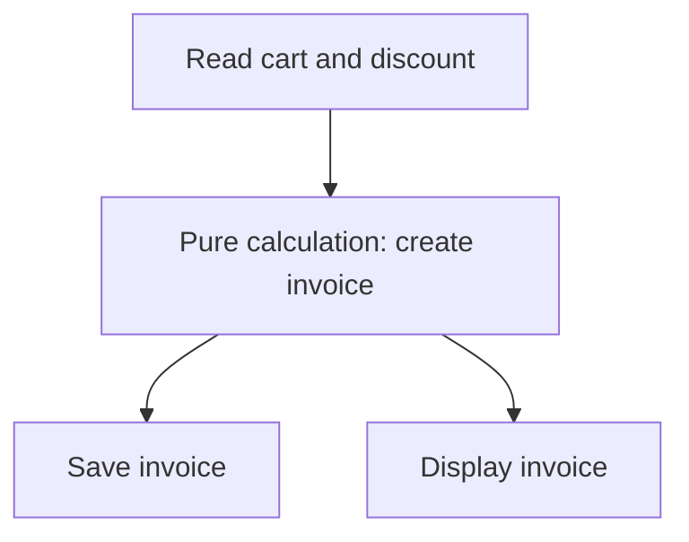

# Pure functions and side effects

A pure function works like a small calculator: give it the same input values and it gives the same result, without changing anything outside the call. Saving a file, changing the screen, or changing the caller’s list is an action called a **side effect**.

**Before you start:** know function parameters, return values, arrays, and objects. By the end, you will separate a calculation from an action and update nested data without changing the original.


**First pass:** Start with the price calculation, then compare it with the logging action. Next, change a nested record by copying the parts you change. Finally, test the calculation separately from saving.

## What makes a function pure? {/* #what-are-pure-functions */}

Ask two questions: does the result depend only on the supplied values and any fixed helpers, and does the call leave everything outside it unchanged? For the examples here, inputs are plain data, not objects with getters or proxies that perform hidden work.

```js runnable
const lineTotal = (pricePaise, quantity) => pricePaise * quantity;
console.log(lineTotal(2500, 3));
console.log(lineTotal(2500, 3));
```

```text output
7500
7500
```

`lineTotal` calculates; `console.log` performs output. Calling a pure function from effectful code does not make the function itself effectful.

| Function behavior                            | Pure?                             | Reason                                                     |
| -------------------------------------------- | --------------------------------- | ---------------------------------------------------------- |
| Multiply two supplied numbers                | Yes                               | The supplied values determine the result.                  |
| Read a mutable global tax rate               | No                                | The same arguments can produce a different total.          |
| Call `Date.now()` or `Math.random()`         | No                                | The caller did not supply the changing value.              |
| Push into an input array                     | No                                | The caller's data changes.                                 |
| Write a log, file, database row, or DOM node | No                                | The call performs an observable action.                    |
| Build a local array and return it            | Can be pure under value semantics | Internal mutation is fine if no caller-owned data changes. |

Reading an immutable constant is fine. Calling a function outside the current file is also fine if that function is pure. Purity is about behavior, not where the code is written.

## Make hidden inputs visible {/* #pure-vs-impure-examples */}

A function that reads a changing discount from a global variable hides part of its input. Pass that value explicitly instead.

```js runnable
const applyDiscount = (pricePaise, discountPaise) =>
  Math.max(0, pricePaise - discountPaise);

console.log(applyDiscount(10000, 1500));
console.log(applyDiscount(10000, 12000));
```

```text output
8500
0
```

This example accepts non-negative integer amounts in the same currency. It returns zero if the discount would otherwise make the result negative. Input validation and rules for rounding or taxes belong in the contract of a real pricing function.

The same idea applies to time: pass `nowMs` into an expiry calculation. The caller can read the clock once; the test can supply a fixed time.

## Copy the part you change {/* #immutability-techniques */}

`const` prevents reassignment of a variable. It does not freeze an object. Spread syntax copies one level, so a nested update needs a copy at each changed level.

```js runnable
const moveToCity = (user, city) => ({
  ...user,
  address: { ...user.address, city },
});

const original = {
  name: 'Asha',
  address: { city: 'Pune', postcode: '411001' },
};
const moved = moveToCity(original, 'Delhi');
console.log(original.address.city);
console.log(moved.address.city);
console.log(original === moved);
console.log(original.address === moved.address);
```

```text output
Pune
Delhi
false
false
```

The postcode is copied unchanged. Any other nested objects are still shared. Treat those shared values as read-only too. `Object.freeze` is also shallow: freezing the outer object does not freeze its nested objects. See [spread syntax](../../javascript/spread-operator.md) for more detail.

| Goal                | Keeps the original array intact                  | Changes the original array          |
| ------------------- | ------------------------------------------------ | ----------------------------------- |
| Add an item         | `[...items, item]`                               | `items.push(item)`                  |
| Keep matching items | `items.filter(test)`                             | Remove items with `splice`          |
| Update one item     | `items.map(update)` with new records for changes | Assign to an item or its properties |
| Sort                | `[...items].sort(compare)`                       | `items.sort(compare)`               |

A copied array can still contain the same objects. Copy the item too when changing a property. Copying n elements takes O(n) time and space; it is not a free operation.

## Local mutation can stay inside a pure calculation

A loop is not automatically impure. Here the only changing value belongs to this call:

```js runnable
function sum(numbers) {
  let total = 0;
  for (const number of numbers) total += number;
  return total;
}
console.log(sum([2, 3, 4]));
console.log(sum([]));
```

```text output
9
0
```

This uses O(n) time and O(1) extra space for a plain array of numbers. Choose it when it is clearer or avoids unnecessary intermediate arrays.

## Separate decisions from actions {/* #side-effects-explained */}



Test the invoice calculation with values such as an empty cart, a zero discount, and a discount larger than the total. Test saving separately: it can fail even when the calculation is correct. Effects are necessary; making them explicit helps you control their order and failure behavior.

## Return expected failures as data {/* #error-handling-in-pure-functions */}

For normal validation failures, a result object makes both outcomes visible:

```js runnable
const divide = (a, b) =>
  b === 0
    ? { ok: false, error: 'Divisor must not be zero' }
    : { ok: true, value: a / b };

console.log(JSON.stringify(divide(10, 2)));
console.log(JSON.stringify(divide(10, 0)));
```

```text output
{"ok":true,"value":5}
{"ok":false,"error":"Divisor must not be zero"}
```

The contract here accepts finite numbers. Throwing an exception is a separate control-flow choice; it is not the same thing as mutating input or writing a file. A function that can throw is not a total function returning a value for every input. Choose and document one failure contract instead of labeling every thrown exception a mutation.

## How to test the boundary {/* #testing-pure-functions */}

Check normal results, empty input, invalid input, and preservation of the caller's data. Freezing the input used by a test can catch accidental writes in strict mode; freeze nested records as well. Running a function twice is useful evidence but cannot prove it has no hidden effects.

Run the [worked exercises](./exercises.js) from the repository root:

```sh
node docs/functional-programming/pure-function-and-side-effect/exercises.js
```

## Practice Problems

| Problem | Level / priority | Practice / notes | Example / answer |
| --- | --- | --- | --- |
| Calculate selected cart totals | Practice | Expected behavior: Return the sum in paise<br />Case to check: Empty input returns zero. | — |
| Change a user's city | Practice | Expected behavior: Return a new user and address<br />Case to check: Original city is unchanged. | — |
| Check expiry using supplied time | Practice | Expected behavior: Expired when `nowMs >= expiresAtMs`<br />Case to check: Exact expiry time counts as expired. | — |
| Return a division result | Practice | Expected behavior: Return success or an error record<br />Case to check: Zero divisor does not return Infinity. | — |

## Use it in the project

For a task app, count completed tasks without changing the list. Then return a new list with one task completed. Check that the old list and the old task are unchanged.

## Production and interview review

Do not retry a function containing a write merely because its calculation is pure. Separate the decision from the effect and define the write’s duplicate policy.

<details>
<summary>A function reads the current time but does not mutate anything. Is it pure?</summary>

Not under a contract where its explicit arguments are its only inputs: time is a hidden dependency, so repeated calls can return different results. Pass an instant into the calculation and keep reading the clock at the boundary. Test a fixed instant, including expiry boundaries.

</details>

## Continue learning

Next: [function composition](../function-and-composition/getting-started.md).
