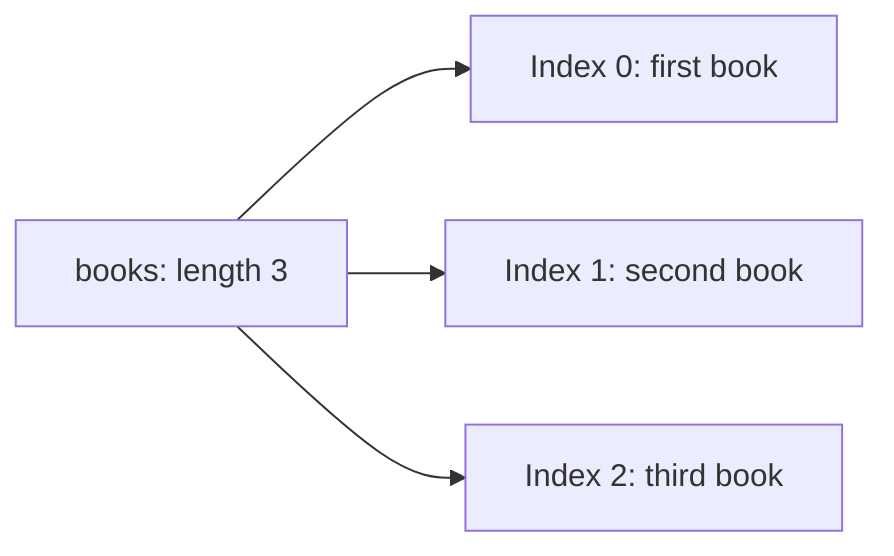

# Arrays

An array is a list of values kept in order. Think of a shopping list: the first item is at position `0`, the second at `1`, and so on. A position is called an **index**. You can read an item, replace it, or add more items.

Learn arrays in this order:

1. Create a short list and read its first and last items.
2. Change one item, then add or remove an item and inspect `length`.
3. Use a loop to visit each value. Next, learn [array methods](./array-methods.md) for searching and changing lists.
4. Compare sharing the same array with making a copy. A copied list can still contain references to the same objects.

Arrays can contain different types of values and can grow or shrink. Keep a list's purpose clear: a list of names is easier to reason about than an unrelated mix of names, prices, and settings. Leave sparse arrays, which have empty positions called **holes**, and TypeScript notes for a second pass.



## Creating Arrays

```js
// Preferred: literal syntax
const nums = [1, 2, 3];

// From individual arguments
const ofNums = Array.of(1, 2, 3);

// From iterable/array-like
const fromStr = Array.from('abc'); // ['a','b','c']
const doubled = Array.from([1, 2, 3], (n) => n * 2); // [2, 4, 6]

// Create N items (initialized)
const fiveZeros = Array(5).fill(0); // [0,0,0,0,0]
```

Initialization note: Prefer explicit initialization (e.g., `fill`) to avoid surprises from holes in sparse arrays.

## Accessing and Updating

```js
const a = ['x', 'y', 'z'];

a[0]; // 'x'
a.at(-1); // 'z'  (ES2022: negative index from end)

// Immutable update by index (ES2023)
const next = a.with(1, 'Y'); // ['x','Y','z']

// In-place update (mutates)
a[1] = 'Y'; // avoid in React reducers/state
```

## Copy vs Reference (simple)

```js
// Assignment makes a reference (both names point to the same array)
const original = [1, 2, 3];
const ref = original; // ref and original are the same array; mutations affect both

// Shallow copy (new top‑level array; nested objects/arrays are still shared)
const copy1 = [...original];
const copy2 = original.slice();
const copy3 = Array.from(original);

// Shallow copy pitfall with nested data
const nested = [[1], [2]];
const shallow = [...nested];
shallow[0].push(99);
// nested -> [[1, 99], [2]] (inner array reference is shared)

// Deep copy (independent nested structures)
const deep =
  typeof structuredClone === 'function'
    ? structuredClone(nested) // handles many built‑ins (Array, Object, Map, Set, Date, RegExp, etc.)
    : JSON.parse(JSON.stringify(nested)); // fallback: JSON-safe only (loses types/identity and throws for ordinary BigInt or cycles)
```

## Multidimensional Arrays

```js
const matrix = [
  [1, 2, 3],
  [4, 5, 6],
];
const item = matrix[1][2]; // 6
```

## Iteration Patterns

```js
const arr = [1, 2, 3];

for (const n of arr) {
  // ...
}

for (const [i, v] of arr.entries()) {
  // index + value
}

arr.forEach((v, i) => {
  // side effects only (returns undefined)
});

// map/filter/reduce compose transformations; callback purity is up to you
const squares = arr.map((n) => n * n);
```

## Real‑world examples

### React state updates (immutability friendly)

```tsx
import { useState } from 'react';

type Todo = { id: number; title: string; done: boolean };

export function Todos() {
  const [todos, setTodos] = useState<Todo[]>([
    { id: 1, title: 'Write docs', done: false },
    { id: 2, title: 'Ship build', done: true },
  ]);

  // Insert immutably
  const addTodo = (title: string) =>
    setTodos((prev) =>
      prev.toSpliced(prev.length, 0, {
        id: Date.now(),
        title,
        done: false,
      }),
    ); // ES2023: returns new array

  // Toggle immutably by index
  const toggle = (i: number) =>
    setTodos((prev) => prev.with(i, { ...prev[i], done: !prev[i].done }));

  // Sort immutably by title
  const sortByTitle = () =>
    setTodos((prev) => prev.toSorted((a, b) => a.title.localeCompare(b.title)));

  return null;
}
```

### Redux-style reducer (no mutation)

```ts
interface Add {
  type: 'add';
  payload: number;
}
interface RemoveAt {
  type: 'removeAt';
  index: number;
}

type Action = Add | RemoveAt;

export function reducer(state: number[], action: Action): number[] {
  switch (action.type) {
    case 'add':
      return state.toSpliced(state.length, 0, action.payload);
    case 'removeAt':
      return state.toSpliced(action.index, 1);
    default:
      return state;
  }
}
```

## Performance notes

- Immutable vs in-place:
  - `toSorted`, `toReversed`, `toSpliced`, `with` allocate a new array (extra memory, but safer for state).
  - `sort`, `reverse`, and `splice` mutate the receiver. Mutation does not imply zero allocation: `splice` returns removed elements and sorting may allocate working storage.
- Common dense-array cost models (not universal language guarantees):
  - Index access: O(1)
  - Push/pop (end): amortized O(1)
  - Shift/unshift (start): O(n) (elements reindexed)
  - toSpliced/concat/slice: O(n) copy cost proportional to result size
- Sparse arrays (holes) degrade performance of iteration and some VMs’ optimizations—prefer dense arrays.

## Compatibility and newer operations

Array.fromAsync (ES2026) collects finite async input. Object.groupBy and Map.groupBy (ES2024) group iterable values, and ES2025 iterator helpers process data lazily. Continue with [array methods](./array-methods.md) and [collections](../collections-and-iteration.md) for these additions.

Test each required method in the actual runtime. For example, toSorted, toReversed, toSpliced, and with are ES2023 copying methods. A maintained polyfill or an explicit minimum runtime is preferable to assuming a short helper has identical semantics. Negative indices, out-of-range replacement, sparse arrays, omitted arguments, and subclasses all matter.

```js runnable
const values = [3, 1, 2];
console.log(JSON.stringify(values.with(-1, 9)));
try { values.with(3, 9); }
catch (error) { console.log(error.name); }
console.log(JSON.stringify(values));
```

```text output
[3,1,9]
RangeError
[3,1,2]
```

A helper using `copy[index] = value` would behave differently for both negative and out-of-range indices. The [compatibility guide](../compatibility.md) explains syntax transforms versus API support.

## TypeScript tips

- Prefer `readonly T[]` for immutable inputs.
- Use tuples for fixed-length heterogeneous lists: `readonly [number, string]`.
- Narrowing unknown values:

```ts
function ensureArray<T>(x: T | T[]): T[] {
  return Array.isArray(x) ? x : [x];
}
```

## Common pitfalls

- Avoid `for...in` on arrays (iterates keys including custom properties). Use `for...of` or classic `for`.
- Don’t use `delete arr[i]` (creates a hole). Use `toSpliced(i, 1)` or `splice(i, 1)`.
- `[] === []` is false because arrays compare by identity. Define a content-equality contract; JSON serialization is not a general equality test.
- `JSON.stringify` serializes both array holes and undefined array elements as null; undefined-valued object properties are omitted.

Further reading:

1. [Array Methods](./array-methods.md)
1. [Array Properties](./array-properties.md)
1. [Array Patterns](./array-patterns.md)

## Interview preparation

Practise the questions alongside their concept explanations: [Sorting and mutation](array-methods.md#interview-questions) · [Holes and length](array-properties.md#interview-questions) · [Deduplication](array-patterns.md#interview-questions).

Predict each worked example, explain the result, and answer its follow-up. Use the [complete interview route](../index.md#interview-preparation) to cover the remaining topics.
