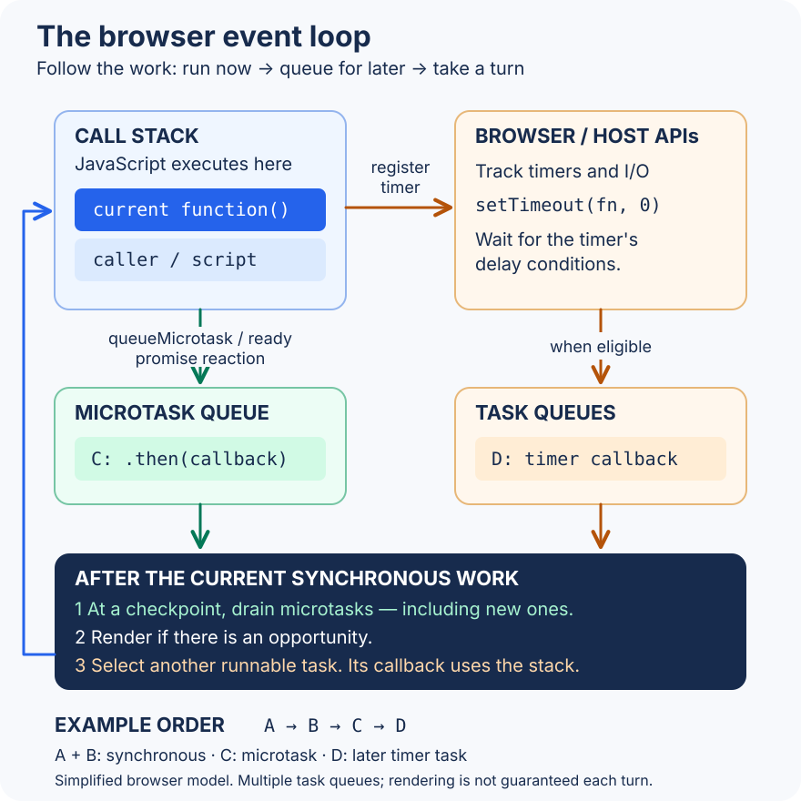

# The event loop and async execution

The event loop helps decide when ready work gets a turn to run. Start with a classroom analogy: one person is speaking, while other people wait for a turn. A waiting callback cannot interrupt an ordinary function that is still running on the browser's main JavaScript thread.

You need [callbacks](../functions/function-callback.md) and ordinary function calls first. The browser can track timers and network activity while JavaScript runs; running their callbacks still needs a turn on that thread.

1. Trace normal function calls using the call stack: the list of calls currently in progress.
2. Add one timer and explain why it runs after the current code.
3. Add one promise callback and compare its queue with the timer's queue.
4. Read `await`, rendering, and Node.js differences after you can explain the first three traces.

The goal is to predict output and explain why a long calculation can freeze a page. Continue to [promises](./promises.md) for a fuller explanation of their syntax.

## Start with the call stack

The **call stack** records active function calls. Calling a function puts its execution on top; returning removes it and resumes the caller. This is last in, first out.

```js runnable
function inner() {
  console.log('inside inner');
}

function outer() {
  console.log('outer starts');
  inner();
  console.log('outer resumes');
}

outer();
console.log('script continues');
```

```text output
outer starts
inside inner
outer resumes
script continues
```

While `inner()` runs, `outer()` is waiting below it on the stack. Returning from `inner()` resumes `outer()` immediately; it does not give timers a turn. Ordinary synchronous execution runs to completion before another queued callback can take over. See the [JavaScript execution model](https://developer.mozilla.org/en-US/docs/Web/JavaScript/Reference/Execution_model).

A **callback** is simply a function passed to another operation. The API determines whether it runs now or later: an array's `forEach` calls its callback synchronously, while `setTimeout` schedules its callback for later.

## The pieces of browser scheduling

| Piece | Responsibility | Example |
| --- | --- | --- |
| Call stack | Executes the current JavaScript work | A timer callback uses this same stack when it eventually runs |
| Host APIs | Manage timers, network requests, and other browser facilities | `setTimeout` registers a timer and returns |
| Task queues | Hold runnable work from task sources | An eligible timer callback or work delivering user input |
| Microtask queue | Holds work to drain at a microtask checkpoint | Promise reactions and `queueMicrotask` callbacks |
| Rendering work | Updates what the user sees when a rendering opportunity occurs | Layout and painting after DOM changes |

A promise **reaction** is a handler registered with `.then()` or `.catch()`. Registering a handler on a pending promise does not make it runnable yet. Once the promise settles, the appropriate reaction can be queued. For an already fulfilled promise, `.then(handler)` queues the reaction without calling the handler inline. [ECMAScript promise reactions](https://tc39.es/ecma262/multipage/control-abstraction-objects.html#sec-performpromisethen).

For the ordinary script and timer examples here, use this browser scheduling model:

1. Run the selected task's synchronous JavaScript.
2. At the following **microtask checkpoint**, drain queued microtasks in enqueue order. Include microtasks added during that drain.
3. The browser may have a rendering opportunity.
4. Select another runnable task and repeat; if nothing is ready, wait for work.



This is a teaching model, not a complete browser algorithm. Checkpoints also occur at specified script/callback cleanup boundaries. Browsers have multiple task sources and queues, so there is no universal FIFO queue ordering timers against every input or network event. “Macrotask” is a common informal name for a **task**. [HTML event-loop processing model](https://html.spec.whatwg.org/multipage/webappapis.html#event-loop-processing-model).

## Trace synchronous code, a promise, and a timer

Run each runnable example as a whole script. Unless marked Node-only, these examples work in a browser or a Node ES module and demonstrate the same logged order. Entering lines separately in a developer console creates different execution boundaries.

```js runnable
console.log('A: synchronous');
setTimeout(() => console.log('D: timer task'), 0);
Promise.resolve().then(() => console.log('C: promise reaction'));
console.log('B: synchronous');
```

```text output
A: synchronous
B: synchronous
C: promise reaction
D: timer task
```

| Step | What happens | Waiting work |
| --- | --- | --- |
| 1 | Log A on the current stack | None |
| 2 | Register the timer; its callback is not called now | Timer waits for eligibility and a later turn |
| 3 | Attach `.then()` to an already fulfilled promise | Microtask C is queued |
| 4 | Log B; finish the current synchronous code | C is still queued; D has not run |
| 5 | At the checkpoint, run C | The microtask queue becomes empty |
| 6 | When the timer task is eligible and selected, run D | No work remains from this example |

The order follows from **when each callback becomes eligible and which scheduling boundary runs it**. A zero delay does not make D synchronous, and placing its registration earlier does not move it ahead of C.

## Promise construction is synchronous

The function passed to `new Promise(...)` is its **executor**. It runs during construction. The `.then()` handler runs later:

```js runnable
console.log('start');
const result = new Promise(resolve => {
  console.log('executor');
  resolve('value');
  console.log('executor continues');
});
result.then(value => console.log(`reaction: ${value}`));
console.log('end');
```

```text output
start
executor
executor continues
end
reaction: value
```

Here, `resolve('value')` fulfills the promise. It neither returns from the executor nor calls the later handler immediately. Putting an expensive loop inside the executor would still block the calling thread. [ECMAScript Promise constructor](https://tc39.es/ecma262/multipage/control-abstraction-objects.html#sec-promise-executor).

## Microtasks added during a checkpoint run in that checkpoint

```js runnable
setTimeout(() => console.log('timer'), 0);

Promise.resolve().then(() => {
  console.log('promise');
  queueMicrotask(() => console.log('nested microtask'));
});
queueMicrotask(() => console.log('already queued microtask'));
console.log('script');
```

```text output
script
promise
already queued microtask
nested microtask
timer
```

At the first checkpoint the queue is `[promise, already queued microtask]`. Running `promise` appends the nested callback, leaving `[already queued microtask, nested microtask]`. The newly added callback goes to the back; it does not interrupt its parent or jump ahead of existing work. The checkpoint drains both remaining callbacks before the timer runs. Promise reactions and `queueMicrotask` do not have separate priority levels here. [Microtask queue behavior](https://developer.mozilla.org/en-US/docs/Web/API/HTML_DOM_API/Microtask_guide).

### A checkpoint also follows a timer callback

```js runnable
setTimeout(() => {
  console.log('first timer');
  Promise.resolve().then(() => console.log('microtask from timer'));
  setTimeout(() => console.log('later timer'), 0);
  console.log('first timer ends');
}, 0);
```

```text output
first timer
first timer ends
microtask from timer
later timer
```

The first timer's callback finishes before its promise reaction runs. The reaction then runs before the later timer. Microtasks are processed throughout execution, not just once after the initial script.

### A pending promise cannot jump ahead of the work that fulfills it

```js runnable
const result = new Promise(resolve => {
  setTimeout(() => {
    console.log('timer fulfills promise');
    resolve('ready');
    console.log('timer finishes');
  }, 0);
});

result.then(value => console.log(`reaction: ${value}`));
queueMicrotask(() => console.log('microtask queued now'));
console.log('script');
```

```text output
script
microtask queued now
timer fulfills promise
timer finishes
reaction: ready
```

The `.then()` call registers a reaction while `result` is pending. That reaction becomes runnable only when the timer fulfills `result`. “Promises always run before timers” therefore gives the wrong answer: track settlement and enqueue time instead.

## What `await` actually suspends

Calling an `async` function starts executing its body immediately. `await` evaluates its operand, suspends that function, and arranges for it to resume through promise processing. Even an already fulfilled promise causes the continuation after `await` to run asynchronously. [Await control flow](https://developer.mozilla.org/en-US/docs/Web/JavaScript/Reference/Operators/await#control_flow_effects_of_await).

```js runnable
async function readValue() {
  console.log('inside before await');
  const value = await Promise.resolve(7);
  console.log(`inside after await: ${value}`);
}

console.log('script starts');
readValue();
queueMicrotask(() => console.log('explicit microtask'));
console.log('caller continues');
```

```text output
script starts
inside before await
caller continues
inside after await: 7
explicit microtask
```

`readValue()` reaches `await` and gives control back to its caller. Because the awaited promise is already fulfilled, its continuation is queued before the explicit microtask in this example. If that promise were pending, the continuation would have to wait for settlement.

The suspension belongs to `readValue()`, so the caller can log `caller continues`. Code before the first `await`, and code after resumption, still uses the JavaScript thread. Adding `async` to a CPU-heavy function does not move its computation to a worker.

## Why a timer can run late

`setTimeout(callback, delay)` requests a timer; the callback runs only after the host's delay conditions are met and execution is available. It is not a reservation for an exact instant. Browser clamping, background-tab throttling, synchronous work, and microtasks can all affect when it runs. [Browser timer delays](https://developer.mozilla.org/en-US/docs/Web/API/Window/setTimeout#reasons_for_delays_longer_than_specified).

```js runnable
let finished = false;
setTimeout(() => console.log(`timer sees finished: ${finished}`), 0);

let total = 0;
for (let number = 1; number <= 100_000; number++) {
  total += number;
}
finished = true;
console.log(`synchronous total: ${total}`);
```

```text output
synchronous total: 5000050000
timer sees finished: true
```

Regardless of this loop's duration, the timer cannot interrupt it. Increasing the amount of synchronous work delays the timer further. On a browser main thread, that same work also delays input handling and rendering work that needs the thread.

## Microtask starvation and giving other work a turn

A checkpoint keeps draining until the microtask queue is empty. Continually adding microtasks can therefore keep timers and rendering waiting. This bounded example makes the effect visible without creating an infinite loop:

```js runnable
let count = 0;
function next() {
  count++;
  console.log(`microtask ${count}`);
  if (count < 3) queueMicrotask(next);
}

setTimeout(() => console.log('timer gets a turn'), 0);
queueMicrotask(next);
```

```text output
microtask 1
microtask 2
microtask 3
timer gets a turn
```

Removing the stopping condition would continually refill the queue. Similarly, repeatedly using `await Promise.resolve()` yields to microtask processing; it does not by itself give a timer or painting a turn. [Microtask starvation](https://developer.mozilla.org/en-US/docs/Web/API/HTML_DOM_API/Microtask_guide#microtasks).

For long work, reduce the computation, process bounded chunks separated by a host scheduling mechanism, or use a [worker](../javascript-engine-basic-unit.md) for appropriate CPU work. For example, `await new Promise(resolve => setTimeout(resolve, 0))` defers a continuation until a later timer callback. Each chunk must still be short enough to keep the application responsive.

## Rendering is a separate concern

Changing the DOM updates document state; visible pixels need rendering work. A promise reaction running after a DOM change does not prove the browser has painted it. Rendering is not guaranteed after every task, and a timer boundary is not a promise that a paint has occurred.

Use `requestAnimationFrame` to schedule visual work for a rendering update, before repaint. It is neither a promise microtask nor a general background-work queue. Heavy work in its callback can delay that frame too. [HTML animation-frame processing](https://html.spec.whatwg.org/multipage/imagebitmap-and-animations.html#animation-frames).

## Timers, cancellation, and stale results

Scheduling and cancellation solve different problems. `clearTimeout` cancels a pending timer; it cannot interrupt a callback already executing. Promises have no general-purpose cancel method. Host APIs may accept an `AbortSignal`, and the operation must cooperate with it.

Racing a request against a timeout only chooses which outcome the caller observes; it does not itself stop the request. A UI may also need a rule that only the latest request updates the screen. See [async/await and cancellation](./async-await.md) and [event listener cleanup](../event-handling.md).

## Node.js scheduling

Node's libuv event loop has phases with different responsibilities. This is a phase overview, not a total ordering of every callback:

| Phase | Work |
| --- | --- |
| Timers | Eligible timeout and interval callbacks |
| Pending callbacks | Certain deferred I/O callbacks |
| Idle and prepare | Internal event-loop work |
| Poll | Retrieve I/O events, run relevant callbacks, or wait for work |
| Check | `setImmediate` callbacks |
| Close callbacks | Certain handle-close callbacks |

Since libuv 1.45 / Node 20, timers run after poll in each iteration; libuv also makes an initial timer pass before entering the loop for compatibility. Timer thresholds, I/O readiness, the current callback, and runtime details affect which operation runs next. A top-level `setTimeout(..., 0)` and `setImmediate(...)` race is not a portable ordering guarantee. [Node event-loop guide](https://nodejs.org/en/learn/asynchronous-work/event-loop-timers-and-nexttick).

### Next ticks and microtasks

`process.nextTick` uses a Node-specific queue, not an event-loop phase. At an ordinary callback boundary, Node drains next-tick work before promise/`queueMicrotask` work. Top-level ESM evaluation itself runs through microtask processing, so its observed ordering can differ from top-level CommonJS. Use `queueMicrotask` when its scheduling contract fits portable deferred work, and avoid recursively filling either queue. [Node nextTick and queueMicrotask](https://nodejs.org/api/process.html#when-to-use-queuemicrotask-vs-processnexttick).

This **Node-only** example schedules the work inside a timer callback so the boundary is explicit:

```js runnable
await new Promise(resolve => {
  setTimeout(() => {
    console.log('timer callback');
    process.nextTick(() => console.log('next tick'));
    queueMicrotask(() => console.log('microtask'));
    Promise.resolve().then(() => console.log('promise reaction'));
    setImmediate(() => {
      console.log('immediate');
      resolve();
    });
  }, 0);
});
```

```text output
timer callback
next tick
microtask
promise reaction
immediate
```

The two microtasks run in enqueue order after the next-tick callback. The immediate waits until the check phase. This explains this particular setup; changing the surrounding execution context can change the comparison. CPU-heavy callbacks still block their JavaScript thread regardless of which queue selected them. See [Node's host architecture](../javascript-engine-basic-unit.md#nodejs-as-a-host) for I/O and worker responsibilities.

## A repeatable way to predict output

1. Identify the environment: browser, Node CommonJS, or Node ES module.
2. Execute the current synchronous code in order, including promise executors and async function bodies up to suspension.
3. Track registrations separately from queued work. A timer may still be waiting; a pending promise's reaction is not ready yet.
4. At each checkpoint, take the oldest queued microtask and append any new ones it creates. Continue until the queue is empty.
5. Advance to eligible host work, execute its callback, and apply the checkpoint rules again. Do not invent an order when the host does not guarantee one.

Predict the output before running the examples above. Use the traces to justify each answer.

<span id="practice" />

## Interview questions {/* #interview-questions */}

**Level: Intermediate.** [How to practise](../index.md#interview-preparation).

### 1. How do synchronous work, nested microtasks, and a timer affect output order?

<details>
<summary>Answer and worked example</summary>

Finish the current synchronous work first. At the following microtask checkpoint, process queued microtasks, including newly queued ones, before another task runs. This example behaves the same in a browser and a Node ES module.

```js runnable
console.log('start');
setTimeout(() => console.log('timer'), 0);
Promise.resolve().then(() => {
  console.log('promise');
  queueMicrotask(() => console.log('nested'));
});
queueMicrotask(() => console.log('queued'));
console.log('end');
```

**Expected output**

```text output
start
end
promise
queued
nested
timer
```

The promise reaction is enqueued before queued. When it runs, nested goes behind the microtask already waiting. A zero-delay timer still waits for its later task; it cannot interrupt this checkpoint.

Trace the queue from left (next to run) to right. Timer registration is separate from the microtask queue; its eligibility depends on the host timer rules.

| Step | New output | Microtasks after the step |
| --- | --- | --- |
| Finish the synchronous code | `start`, `end` | `promise`, `queued` |
| Run the promise reaction; append its nested callback | `promise` | `queued`, `nested` |
| Run the already waiting callback | `queued` | `nested` |
| Run the nested callback | `nested` | Empty |
| Host later runs the eligible timer callback | `timer` | Empty |

**Change one thing:** if the explicit `queueMicrotask` registration moves above `.then`, `queued` appears before `promise`. The nested callback still comes after its parent reaction. The deciding factor is enqueue order, not a higher priority assigned to promises over `queueMicrotask`.

</details>

### 2. Can repeatedly scheduling microtasks keep a page responsive?

**Apply it:** Explain why repeatedly awaiting an already fulfilled promise does not give a waiting timer a turn.

<details>
<summary>Answer, walkthrough, and tradeoffs</summary>

No. A checkpoint drains newly added microtasks too, so an unbounded chain can delay tasks and rendering. Yield through an appropriate host scheduler or move suitable CPU work to a worker. Rendering is an opportunity, not a guarantee after every task.

This bounded demonstration finishes safely. Extending the loop indefinitely would prevent the timer from progressing.

```js runnable
setTimeout(() => console.log('timer'), 0);
async function work() {
  for (let step = 1; step <= 3; step++) {
    await Promise.resolve();
    console.log(`step ${step}`);
  }
}
await work();
console.log('finished');
```

**Expected output**

```text output
step 1
step 2
step 3
finished
timer
```

Each continuation queues the next continuation during microtask processing. The checkpoint keeps draining; `await` suspends this function but does not necessarily yield to another task or to rendering. For browser work, split expensive processing into bounded chunks and use a suitable task-yielding scheduler between chunks, or move independent CPU work to a worker. See the [microtask guide](https://developer.mozilla.org/en-US/docs/Web/API/HTML_DOM_API/Microtask_guide) and the [yielding example above](#microtask-starvation-and-giving-other-work-a-turn).

</details>

## Practice Problems

| Problem | Level / priority | Practice / notes | Example / answer |
| --- | --- | --- | --- |
| Queue a second promise reaction inside the first and predict its position relative to a timer. | Practice | Track enqueue order, including newly added work. | [Nested microtasks](#microtasks-added-during-a-checkpoint-run-in-that-checkpoint) |
| Explain why a timer can run late when earlier synchronous work is expensive. | Practice | Distinguish delay eligibility from actual execution. | [Timer delay](#why-a-timer-can-run-late) |
| Compare browser tasks with Node's event-loop phases. | Practice | Avoid one universal ordering for immediates, timers, and next ticks. | [Node.js scheduling](#nodejs-scheduling) |
| Does calling `resolve()` immediately run a registered `.then()` handler? | Practice | Explain the executor's remaining statements. | [Promise construction](#promise-construction-is-synchronous) |
| Can a timer log before a promise reaction registered earlier? | Practice | Make the timer fulfill the pending promise. | [Pending promise](#a-pending-promise-cannot-jump-ahead-of-the-work-that-fulfills-it) |
| Does `await Promise.resolve()` guarantee that the browser has painted? | Practice | Distinguish a microtask continuation from rendering. | [Starvation](#microtask-starvation-and-giving-other-work-a-turn) and [rendering](#rendering-is-a-separate-concern) |

## Continue learning

Continue with [promises](./promises.md) and [async/await](./async-await.md). For the runtime around the event loop, read [JavaScript engines and hosts](../javascript-engine-basic-unit.md).

For an illustrated scheduling walkthrough, see [Jake Archibald: tasks, microtasks, queues and schedules](https://jakearchibald.com/2015/tasks-microtasks-queues-and-schedules/). Its browser bug reports describe 2015 implementations; use the standards linked above for current rules.
