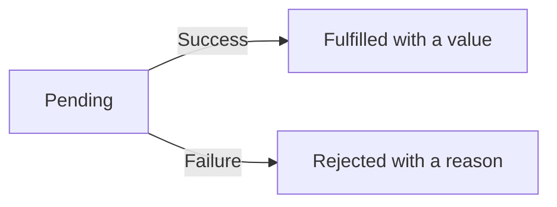

# Promises and composition

A promise represents the eventual result of an operation. Think of ordering a book: the order is waiting, then it either succeeds or fails. A JavaScript promise is **pending**, **fulfilled** with a value, or **rejected** with a reason.

Begin after [callbacks](../functions/function-callback.md) and [scheduling](./asynchronous.md).

1. Follow one promise from pending to a settled outcome. **Settled** means fulfilled or rejected.
2. Use `.then` to connect the next step and `.catch` to handle failure. Return the next result so the chain stays connected.
3. Compare the ways to combine several promises: all results, all outcomes, first success, or first completion.

Once a promise is settled, its outcome does not change. Resolving with another promise adopts that promise's eventual outcome, so “resolved” does not always mean “already fulfilled”. Keep that distinction for the examples below.



## Start with one result

Use an already fulfilled promise to learn how a result reaches a callback. A real download can take longer, but its consumer can use the same `.then` shape.

```js runnable
const order = Promise.resolve('Book ready');
order.then(message => console.log(message));
```

```text output
Book ready
```

`message` receives the fulfilled value. The arrow is the callback; passing it to `.then` does not mean calling it yourself at that line. Continue to [returning work from a chain](#return-work-from-a-chain) for several steps. The next section explains the deeper case where one promise follows another promise's outcome.

## State, resolution, and observation {/* #promise-state */}

The example below adds one important case to the state diagram: `outer` is resolved with `inner`. That commits `outer` to following `inner`, even while `inner` is still waiting. Resolution is not a fourth promise state. Trace which call fixes the outcome before predicting the later rejection.

```js runnable
let completeInner;
const inner = new Promise(resolve => { completeInner = resolve; });
const outer = new Promise((resolve, reject) => {
  resolve(inner);
  reject(new Error('ignored'));
});
console.log('outcome follows inner');
completeInner('ready');
console.log(await outer);
```

```text output
outcome follows inner
ready
```

Calling `resolve(inner)` commits `outer` to adopting `inner`’s outcome; it does not fulfill `outer` with the promise object as an ordinary result. The later reject call cannot override that commitment. When `inner` fulfills, `outer` can fulfill with `"ready"`. If `inner` never settles, `outer` remains pending.

Promises do not expose a synchronous public state getter. Observe outcomes through `then`, `catch`, or `await`. Creating a promise also does not itself move JavaScript to another thread or start a network operation; the executor or the underlying API determines what work starts. [MDN Promise states and resolution](https://developer.mozilla.org/en-US/docs/Web/JavaScript/Reference/Global_Objects/Promise).

## Return work from a chain

```js runnable
const result = await Promise.resolve(4)
  .then(value => value + 2)
  .then(value => Promise.resolve(value * 3));
console.log(result);
```

```text output
18
```

Each `then` returns a new promise. Returning a value fulfills it; throwing rejects it; returning a promise makes the next step wait. Forgetting to return an inner promise breaks the chain’s sequencing and error propagation.

### Returning connects the next step {/* #return-connects-a-chain */}

```js runnable
const missingReturn = await Promise.resolve(4).then(value => {
  Promise.resolve(value * 2);
});
const returned = await Promise.resolve(4).then(value => {
  return Promise.resolve(value * 2);
});
console.log(missingReturn, returned);

const recovered = await Promise.resolve()
  .then(() => { throw new Error('unavailable'); })
  .catch(() => 'fallback')
  .then(value => value.toUpperCase());
console.log(recovered);
```

```text output
undefined 8
FALLBACK
```

The first handler reaches its end without returning, so its result is `undefined`. Creating an inner promise does not automatically connect it to the promise returned by `then`. The second handler returns that inner promise, so the next step adopts its outcome.

The final chain switches from fulfillment to rejection when the handler throws. `catch` returns a normal value, restoring fulfillment for the following `then`. A catch handler that only logs and returns nothing also recovers, but with `undefined`; rethrow when the caller must still observe failure. In real work, a forgotten return can let dependent code run early and detach failures from the intended error handler. [MDN promise chaining](https://developer.mozilla.org/en-US/docs/Web/JavaScript/Guide/Using_promises).

## Executors run immediately

```js runnable
const result = new Promise(resolve => {
  console.log('executor');
  resolve('reaction');
});
result.then(value => console.log(value));
console.log('synchronous');
```

```text output
executor
synchronous
reaction
```

Do not use an async promise executor. Its own rejected promise is not automatically connected to the outer promise. Usually an async function is already the abstraction you need.

## Select a combinator

| Method | Fulfills when | Rejects when | Empty input |
| --- | --- | --- | --- |
| `all` | Every input fulfills | Any input rejects | Fulfills with `[]` |
| `allSettled` | Every input settles | Input iteration itself can fail | Fulfills with `[]` |
| `any` | Any input fulfills | Every input rejects | Rejects with AggregateError |
| `race` | First settlement is fulfillment | First settlement is rejection | Remains pending |

Input iteration and thenable access can also fail; the table describes ordinary input promises. `all` and `allSettled` retain input order. None of these combinators cancels input operations.

```js runnable
const values = await Promise.all([Promise.resolve('first'), 'second']);
const outcomes = await Promise.allSettled([Promise.reject('offline'), Promise.resolve(3)]);
console.log(values.join(', '));
console.log(outcomes.map(outcome => outcome.status).join(', '));
```

```text output
first, second
rejected, fulfilled
```

## Control completion order without timers {/* #completion-trace */}

A combinator observes input promises. It does not start functions passed as values, impose a concurrency limit, or cancel the losers. Use manually resolved promises to inspect ordering without assuming timer timing.

```js runnable
let finishFirst;
let finishSecond;
const first = new Promise(resolve => { finishFirst = resolve; });
const second = new Promise(resolve => { finishSecond = resolve; });
const grouped = Promise.all([first, second]);
const fastest = Promise.race([first, second]);
finishSecond('B');
finishFirst('A');
console.log((await grouped).join(', '));
console.log(await fastest);
```

```text output
A, B
B
```

`all` keeps a result slot for each input position. The second promise settles first, but its result still belongs in slot one. `race` follows the first observed settlement, so it yields B. Handlers were attached before either resolver was called, making this example's result deterministic.

For real work, `Promise.all(items.map(load))` invokes `load` for every item while constructing the input array. A large array may start too much I/O at once. Use a worker pool when you need a limit. Passing `[loadA, loadB]` instead merely passes function values; it does not call them. If you pass already-settled promises to `race`, do not interpret the result as a historical timing measurement. See [async concurrency and cancellation](./async-await.md) and [Promise algorithms](https://tc39.es/ecma262/multipage/control-abstraction-objects.html#sec-promise.all).

## Handle errors at the owning boundary

```js runnable
const result = await Promise.resolve()
  .then(() => { throw new Error('invalid input'); })
  .catch(error => `recovered: ${error.message}`)
  .finally(() => console.log('cleanup'));
console.log(result);
```

```text output
cleanup
recovered: invalid input
```

A catch handler that returns a normal value recovers the chain. Re-throw if the caller should still see failure. Cleanup in `finally` should avoid masking the original error.

### finally preserves an outcome unless cleanup fails {/* #finally-outcomes */}

```js runnable
console.log(await Promise.resolve('saved').finally(() => 'ignored'));
console.log(await Promise.reject(new Error('original'))
  .finally(() => {})
  .catch(error => error.message));
console.log(await Promise.reject(new Error('original'))
  .finally(() => { throw new Error('cleanup failed'); })
  .catch(error => error.message));
```

```text output
saved
original
cleanup failed
```

A successful `finally` callback passes through the original fulfillment or rejection; its ordinary return value is ignored. A throw or a returned rejected promise replaces that outcome. Returning a pending promise delays the chain until cleanup settles. Use this for releasing loading indicators or resources, but decide how to report cleanup failures without losing the primary diagnostic. [Promise finally semantics](https://tc39.es/ecma262/multipage/control-abstraction-objects.html#sec-promise.prototype.finally).

**Try it:** replace the throw with `return Promise.reject(new Error('cleanup failed'))`. Predict the same outcome, then compare it with returning a fulfilled promise.

## First success and AggregateError — ES2021

```js runnable
const result = await Promise.any([
  Promise.reject(new Error('cache miss')),
  Promise.resolve('origin response'),
]);
console.log(result);
try {
  await Promise.any([Promise.reject('a'), Promise.reject('b')]);
} catch (error) {
  console.log(error instanceof AggregateError);
  console.log(error.errors.join(', '));
}
```

```text output
origin response
true
a, b
```

`race` settles with the first fulfillment or rejection. `any` waits for a fulfillment, rejecting with an `AggregateError` only when every input rejects. Neither combinator cancels the remaining operations. Empty `any` rejects; empty `race` remains pending.

## Promise.withResolvers — ES2024

```js runnable requires=Promise.withResolvers
const { promise, resolve } = Promise.withResolvers();
resolve('ready');
resolve('ignored');
console.log(await promise);
```

```text output
ready
```

Only the first settlement takes effect. Keep resolvers private when possible: leaking them lets unrelated code control an operation’s lifecycle. This API is useful for event adapters, not a reason to wrap every existing promise.

## Promise.try — ES2025

```js runnable requires=Promise.try
function parseCount(text) {
  const count = Number(text);
  if (!Number.isInteger(count)) throw new TypeError('Invalid count');
  return count;
}
console.log(await Promise.try(parseCount, '8'));
console.log(await Promise.try(parseCount, 'bad').catch(error => error.name));
```

```text output
8
TypeError
```

The callback is invoked synchronously; promise handlers run later. `Promise.resolve(fn())` does not catch an exception thrown while evaluating `fn()` before the promise call.


## Edition progression and failure details

| Edition | Addition | Use it when |
| --- | --- | --- |
| 2015 | Promise, then/catch, resolve/reject, all/race | Composing one eventual outcome or a set of operations |
| 2018 | finally | Cleanup should preserve fulfillment/rejection unless cleanup itself fails |
| 2020 | allSettled | Partial results are meaningful |
| 2021 | any and AggregateError | One successful source is sufficient |
| 2024 | withResolvers | Adapting an external event to a controlled promise lifecycle |
| 2025 | try | A callable may either throw synchronously or return a value/promise |

Calling resolve with a thenable adopts its eventual result. Calling resolve a second time cannot replace that choice, even if the adopted promise is still pending. A finally callback receives no outcome argument; its normal returned value is ignored, but a thrown error or rejected returned promise replaces the outcome.

Promise.try calls the callback synchronously. By contrast, `Promise.resolve().then(callback)` schedules the call in a later promise job. `Promise.resolve(callback())` evaluates the call before entering resolve, so its synchronous throw escapes that expression. None of these APIs supplies cancellation; keep an explicit host cancellation signal or application lifecycle contract.

## Interview questions {/* #interview-questions */}

**Level: Intermediate.** [How to practise](../index.md#interview-preparation).

### 1. Does Promise.all return results in completion order?

<details>
<summary>Answer and worked example</summary>

Its fulfillment array follows input order. A failure rejects the aggregate, but does not automatically cancel the other operations.

```js runnable
let releaseFirst;
const first = new Promise(resolve => { releaseFirst = resolve; });
const second = Promise.resolve('second');
const combined = Promise.all([first, second]);
releaseFirst('first');
console.log((await combined).join(', '));
const outcomes = await Promise.allSettled([Promise.resolve(1), Promise.reject(new Error('offline'))]);
console.log(outcomes.map(item => item.status).join(', '));
```

**Expected output**

```text output
first, second
fulfilled, rejected
```

The second input is already fulfilled while the first is pending, but its result stays second. allSettled reports both outcomes without converting the rejected input into a success value.

</details>

### 2. What happens with empty inputs to all, allSettled, any, and race?

**Apply it:** Predict the empty-input behavior of all four combinators. Explain why awaiting race([]) would never reach the next statement.

<details>
<summary>Answer, walkthrough, and tradeoffs</summary>

all and allSettled fulfill with empty arrays. any rejects with AggregateError because there is no fulfillment. race stays pending because no input can settle it. Promise reactions still run asynchronously, including reactions to an already fulfilled empty all.

Inspect empty results and rejection details without attempting to await a permanently pending race.

```js runnable
console.log(JSON.stringify(await Promise.all([])));
console.log(JSON.stringify(await Promise.allSettled([])));
try {
  await Promise.any([]);
} catch (error) {
  console.log(error.name, error.errors.length);
}
let observed = 'pending';
Promise.race([]).then(
  () => { observed = 'fulfilled'; },
  () => { observed = 'rejected'; },
);
await Promise.resolve();
console.log(observed);
```

**Expected output**

```text output
[]
[]
AggregateError 0
pending
```

“Every input succeeded” is satisfied by an empty list, while “at least one input succeeded” is not. A race has no settlement to adopt. The last log only observes this moment; the reason it remains pending is that no input can ever settle this returned promise. These edge cases matter when filtering a batch removes every job. Also remember that rejection of `all` does not cancel work already started. See [MDN: Promise.all](https://developer.mozilla.org/en-US/docs/Web/JavaScript/Reference/Global_Objects/Promise/all).

</details>

## Worked examples and answers {/* #workbook-practice */}

Use the [practice routine and file setup](../workbook.md#a-practice-session), then try the [Practice Problems](#practice-problems) below.

### 16. Promises async functions and execution order {/* #workbook-16 */}

<details>
<summary>Worked lesson and setup</summary>

**Goal:** predict when callbacks get their turn.

Read the example from top to bottom. Mark which logs run immediately and which are callbacks scheduled for later. Finish the current synchronous code before following the promise reaction and then the timer in this small example.

Review [promise state](#promise-state), [connected chains](#return-connects-a-chain), and the [event-loop trace](./asynchronous.md). A timer delay is not an exact appointment. For the later async exercises, decide whether each step needs the previous result; use [async/await](./async-await.md) for that decision.

**Worked example**

```js
console.log("A");
Promise.resolve().then(() => console.log("B"));
setTimeout(() => console.log("C"), 0);
console.log("D");
```

**Expected output**

```text
A
D
B
C
```

A and D run synchronously. The promise callback runs after the current synchronous work. The timer callback runs later. A zero delay does not mean the timer interrupts the statements already executing.

**Trace the example step by step**

1. console.log("A") executes immediately. The promise is already fulfilled, but its then reaction is queued for later.

2. setTimeout registers a timer callback. It does not print C at the registration point.

3. console.log("D") still belongs to the current synchronous work and executes next.

4. The promise reaction prints B when microtasks run. The later timer callback prints C, producing A, D, B, C.

**Common mistakes and how to reason about them**

An async callback inside forEach creates promises that forEach does not collect or await. Awaiting the undefined result of forEach cannot recover those discarded promises. Use a for...of loop with await for deliberate sequential work, or map and Promise.all when you want to wait for independent operations together. Handle rejections at a level that can respond to them.

</details>

Find **16A–C** in the [Practice Problems](#practice-problems) table.

<details id="workbook-16-answer">
<summary>Check your reasoning and answer</summary>

**16A.** A promise fulfilled with 42, not the number 42 directly.

Calling answer() gives a promise whose eventual fulfillment value is 42. Calling await answer() inside a permitted context gives that value. Keeping the promise and the eventual value separate in your mental model prevents accidental calculations with a Promise object.

**16B.** forEach returns undefined and ignores the promises returned by its callback.

forEach invokes each callback and discards its return value. Awaiting forEach therefore awaits undefined, not the individual saves. Promise.all(values.map(save)) collects the returned promises, assuming save has the required callback signature.

**16C.** The async function returns a promise; await extracts its fulfilled value.

sumAsync returns a promise fulfilled with 7 for inputs 2 and 5. Awaiting it obtains 7 for console.log. The arithmetic itself is synchronous; this deliberately small example isolates the behavior introduced by async and await.

**Reference code**

```js
async function sumAsync(a, b) {
  return a + b;
}
console.log(await sumAsync(2, 5));
```

**Check the result**

```js
assert.equal(await sumAsync(2, 5), 7);
```

</details>

<span id="practice" />

## Practice Problems

| Problem | Level / priority | Practice / notes | Example / answer |
| --- | --- | --- | --- |
| **16A — What type of result does async function answer() \{ return 42; \} return?** | **Must fix** | [Worked example](#workbook-16) | [Answer](#workbook-16-answer) |
| **16B — Why does awaiting values.forEach(async value =&gt; save(value)) not wait for all saves?** | **Must fix** | [Worked example](#workbook-16) | [Answer](#workbook-16-answer) |
| **16C — Write async sumAsync(a, b), await it, and print the result for 2 and 5.** | **Must fix** | [Worked example](#workbook-16) | [Answer](#workbook-16-answer) |
| Write a three-step chain with an intentional failure in the middle; prove the final success handler is skipped. | Practice | — | — |
| Use `allSettled` to keep successful results while preserving each failure reason. | Practice | — | — |
| Explain why `Promise.all(items.map(asyncOperation))` starts every mapped operation immediately and can exceed a service’s concurrency limit. | Practice | — | — |

## Continue learning

References: [Promise reference](https://developer.mozilla.org/en-US/docs/Web/JavaScript/Reference/Global_Objects/Promise). Continue with [async/await](./async-await.md).
