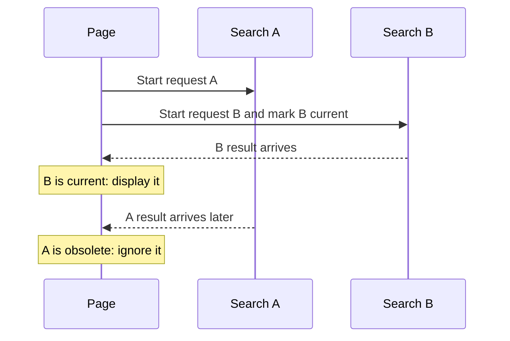

# Browser state, storage, and network boundaries

A page needs to remember things: the current search text, a selected tab, and the result of a request. That remembered information is called **state**. Different state needs different lifetimes: a typing draft may last seconds, while a saved preference may last across visits.

First complete [DOM](./document-object-model.md), [events](./event-handling.md), [JSON](./json-and-serialization.md), and [async/await](./asynchronous/async-await.md).

1. Decide which values belong in memory, the URL, or browser storage.
2. Read saved data and check that it has the shape your page expects.
3. Load one result and show loading, success, empty, and error states.
4. Search twice quickly. Make sure the older response cannot replace the newer result.

The examples build toward that last problem. Stopping an old request and deciding whether its result is still relevant are separate jobs.



## Give each piece of state a lifetime

| Location                          | Suitable use                                   | Boundary to handle                                      |
| --------------------------------- | ---------------------------------------------- | ------------------------------------------------------- |
| Local variable or component state | Current selection and in-flight work           | Lost when its owner is disposed                         |
| URL query parameters              | Shareable filters or navigation state          | Parse and validate user-editable strings                |
| `sessionStorage`                  | Small settings for a page session              | Origin and tab context; access and writes may fail      |
| `localStorage`                    | Small settings retained across ordinary visits | Synchronous string storage; policy and quota failures   |
| IndexedDB                         | Larger structured offline data                 | Async transactions, schema upgrades, and quota          |
| Server                            | Shared, authoritative application records      | Authentication, validation, conflicts, and connectivity |

Web Storage is not a database transaction system or a secrets vault. Tabs can overwrite each other's changes. The `storage` event informs other eligible documents; it is not fired in the document that performed the write. A single read-modify-write sequence is not a cross-tab lock. See the [HTML Web Storage standard](https://html.spec.whatwg.org/multipage/webstorage.html).

## Treat persisted JSON as external input

This example stores a versioned reading preference. A valid record must be an object with the expected version and mode. Missing, corrupt, or inaccessible storage falls back to a fresh default. It does not overwrite an unknown version just because reading failed.

```js runnable
import assert from 'node:assert/strict';

function readPreference(getStorage) {
  try {
    const value = JSON.parse(getStorage().getItem('reading-preference'));
    if (
      value &&
      !Array.isArray(value) &&
      value.version === 1 &&
      ['compact', 'comfortable'].includes(value.mode)
    ) {
      return { version: 1, mode: value.mode };
    }
  } catch {
    // Missing permission, inaccessible storage, or invalid JSON uses a default.
  }
  return { version: 1, mode: 'comfortable' };
}

function savePreference(getStorage, mode) {
  if (!['compact', 'comfortable'].includes(mode)) throw new TypeError('Invalid mode');
  try {
    getStorage().setItem('reading-preference', JSON.stringify({ version: 1, mode }));
    return true;
  } catch {
    return false;
  }
}

const values = new Map();
const storage = {
  getItem: (key) => values.get(key) ?? null,
  setItem: (key, value) => values.set(key, value),
};
const getStorage = () => storage;
assert.equal(readPreference(getStorage).mode, 'comfortable');
assert.equal(savePreference(getStorage, 'compact'), true);
assert.equal(readPreference(getStorage).mode, 'compact');
storage.setItem('reading-preference', '{broken');
assert.equal(readPreference(getStorage).mode, 'comfortable');
for (const value of [[], { version: 2, mode: 'compact' }, { version: 1, mode: 'unknown' }]) {
  storage.setItem('reading-preference', JSON.stringify(value));
  assert.equal(readPreference(getStorage).mode, 'comfortable');
}
const denied = () => {
  throw new Error('Storage unavailable');
};
assert.equal(savePreference(denied, 'compact'), false);
assert.equal(readPreference(denied).mode, 'comfortable');
const quotaFull = () => ({
  setItem() {
    throw new Error('Quota exceeded');
  },
});
assert.equal(savePreference(quotaFull, 'compact'), false);
console.log('missing, valid, corrupt, wrong-schema, and unavailable storage checked');
```

```text output
missing, valid, corrupt, wrong-schema, and unavailable storage checked
```

In a browser, pass `() => window.localStorage`. The callback keeps even access to the storage property inside the `try`. Update the visible preference whether or not persistence succeeds; tell users when it will not survive a reload. The fake checks your boundary policy, while a browser check verifies the actual storage integration.

## Build URLs with parameter APIs

```js runnable
const url = new URL('/search', 'https://example.test');
url.searchParams.set('q', 'maps & sets');
console.log(url.search);
console.log(url.searchParams.get('q'));
```

```text output
?q=maps+%26+sets
maps & sets
```

The ampersand is data inside one parameter. Do not construct a query by concatenating unescaped input. Decoding the parameter still gives untrusted text; URL encoding does not validate its meaning.

## Separate the request's failure stages

| Stage          | Example                                               | Application response                                         |
| -------------- | ----------------------------------------------------- | ------------------------------------------------------------ |
| Transport      | Offline, failed connection, or browser CORS rejection | Show a useful failure state; the response may be unavailable |
| HTTP           | A response with status 404 or 500                     | Check `response.ok`; map status to an application policy     |
| Representation | An OK response contains malformed JSON                | Handle the parsing failure                                   |
| Schema         | Valid JSON has the wrong fields or types              | Reject the record before it enters application state         |
| Lifecycle      | View removed, user canceled, or newer query started   | Suppress obsolete updates and release resources              |

Fetch normally resolves with a response for HTTP errors, and reading the body is another asynchronous operation. Validate after parsing. A browser's CORS restriction cannot be repaired by weakening validation or using `no-cors` to obtain readable JSON. See the [Fetch Standard](https://fetch.spec.whatwg.org/).

## Freshness and cancellation solve separate problems

An abort asks a cooperating operation to stop. A freshness check decides whether a result still belongs to the current view. Use both when replacing an earlier search. Checking only before `await` leaves a race after the operation completes.

```js runnable
function latestOnly() {
  let current;
  return {
    begin() {
      return (current = {});
    },
    isCurrent(token) {
      return current !== undefined && token === current;
    },
    invalidate() {
      current = undefined;
    },
  };
}

const requests = latestOnly();
const first = requests.begin();
const second = requests.begin();
console.log(requests.isCurrent(first), requests.isCurrent(second));
requests.invalidate();
console.log(requests.isCurrent(second), requests.isCurrent(undefined));
```

```text output
false true
false false
```

Every token has unique object identity, without a growing sequence counter. Invalidating on disposal also blocks a late success or failure. The token does not cancel network work by itself.

### A request controller with explicit ownership

Use the `latestOnly` definition above with this controller. `load(query, signal)` owns fetching, HTTP checks, body parsing, and schema validation. `render(state)` owns the UI and should not throw; if it displays text, use `textContent` and native controls.

```js
function createSearch(load, render) {
  const requests = latestOnly();
  let controller;
  let disposed = false;
  return {
    async run(query) {
      if (disposed) return;
      const token = requests.begin();
      controller?.abort();
      const active = new AbortController();
      controller = active;
      render({ status: 'loading' });
      try {
        const items = await load(query, active.signal);
        if (!requests.isCurrent(token)) return;
        render({ status: items.length ? 'ready' : 'empty', items });
      } catch (error) {
        if (!requests.isCurrent(token)) return;
        render(active.signal.aborted ? { status: 'idle' } : { status: 'error', error });
      } finally {
        if (requests.isCurrent(token)) controller = undefined;
      }
    },
    dispose() {
      disposed = true;
      requests.invalidate();
      controller?.abort();
      controller = undefined;
    },
  };
}
```

Advance the token before aborting the old request. After every await, verify ownership before rendering; the same rule applies to error and loading-state updates. Disposal removes the view's authority to update even when an injected loader ignores the signal. See [a deterministic out-of-order completion test](./testing-guide.md#test-completion-order).

## Connect the controller to a form

Listen for `submit` on the form so Enter and the submit button follow the same path. Give the input a visible label, associate validation messages with it, and announce loading, empty, and failure states using an appropriate status region. Preserve focus when rerendering results.

Keep the submit button usable if starting a newer search is part of the contract. Bind listeners using one view-lifetime AbortController; teardown aborts those listeners **and** calls the search controller's `dispose()`. A listener signal does not cancel requests unless you connect their ownership too.

For CPU-heavy processing, a dedicated worker has a different role from a service worker used for network/offline behavior. Moving data also has a cost; [buffer transfer](./binary-data-and-shared-memory.md) transfers ownership rather than sharing an ordinary object by reference.

## Interview questions {/* #interview-questions */}

**Level: Intermediate.** [How to practise](./index.md#interview-preparation).

### 1. How can a newer search prevent an older response from overwriting it?

<details>
<summary>Answer and worked example</summary>

Assign a unique ownership token when each search starts. After awaiting completion, render only if its token is still current. This example controls completion without network calls or timer races.

```js runnable
let current;
const rendered = [];
async function show(pending) {
  const token = {};
  current = token;
  const value = await pending;
  if (token === current) rendered.push(value);
}
let finishOld;
const old = show(new Promise(resolve => { finishOld = resolve; }));
await show(Promise.resolve('new'));
finishOld('old');
await old;
console.log(rendered.join(', '));
```

**Expected output**

```text output
new
```

The old request completes successfully, but has lost ownership. The token check protects the visible state even if the underlying operation cannot be stopped.

</details>

### 2. Is aborting the old request enough, and how should disposal work?

**Apply it:** A search for "ca" starts, then a search for "cat" starts. The second succeeds first and the first later fails. Decide which result and error may update the screen.

<details>
<summary>Answer, walkthrough, and tradeoffs</summary>

Not every dependency cooperates with abort, and completion can race with cancellation. Check ownership on success and failure, invalidate it on disposal, and abort work to save resources where supported. Validate persisted storage and network responses before allowing them into state.

**Ownership trace:** assign each search a monotonically increasing request ID. The second request becomes the current owner. Its success may display the `"cat"` results; the old request’s later failure must not replace them with an error. Guard **success, catch, and finally** paths, since an obsolete `finally` can incorrectly clear the current loading indicator too.

Aborting the old fetch can save work, but the ownership check is still needed for dependencies that ignore cancellation or have already completed. On disposal, invalidate the owner and abort active work so late completion cannot update the removed view.

**Test design:** use controllable promises to finish requests in the opposite order, reject the obsolete request, and finish a request after disposal. Assert visible state after each step. Random network delays make these tests slower and less reliable. The implementation earlier in this lesson demonstrates this ownership boundary.

</details>

## Worked examples and answers {/* #workbook-practice */}

Use the [practice routine and file setup](./workbook.md#a-practice-session), then try the [Practice Problems](#practice-problems) below.

### 35. Browser programs events storage and safe interfaces {/* #workbook-35 */}

<details>
<summary>Worked lesson and setup</summary>

**Goal:** build a URL without confusing data with separators.

The query contains spaces and `&`. Set it through `searchParams`, read it back, and compare the stored value with the encoded search string. Do not manually join unescaped user text into a URL.

Review [URL parameters](#build-urls-with-parameter-apis), [persisted data](#treat-persisted-json-as-external-input), and [request freshness](#freshness-and-cancellation-solve-separate-problems). The browser exercises extend these ideas: validate stored JSON, render untrusted values as text, remove obsolete listeners, and explain loading, error, and empty states to the user.

**Worked example**

```js
const url = new URL("https://example.test/search");
url.searchParams.set("q", "maps & sets");
console.log(url.searchParams.get("q"));
console.log(url.search);
```

**Expected output**

```text
maps & sets
?q=maps+%26+sets
```

**Why the example works**

The parameter utility encodes the ampersand as data instead of allowing it to start a second parameter. The URL class is also available in Node, so this small boundary example can run in an .mjs file. The earlier DOM lesson shows the separate HTML setup for page events.

</details>

Find **35A–C** in the [Practice Problems](#practice-problems) table.

<details id="workbook-35-answer">
<summary>Check your reasoning and answer</summary>

**35A.** Form submission has keyboard and other activation paths. A form-level handler expresses the action itself and can apply the same validation to all those paths.

**35B.** Completion order is independent of start order. If every completed response renders without a freshness check, a slow first response can replace a newer second response.

**35C.** Each empty object has a unique identity. Retaining only the latest token lets a caller check freshness after an await. This rejects stale updates; it does not cancel the network operation itself.

**Reference code**

```js
function latestOnly() {
  let current;
  return {
    begin() { current = {}; return current; },
    isCurrent(token) { return token !== undefined && token === current; }
  };
}
```

**Check the result**

```js
const gate = latestOnly();
assert.equal(gate.isCurrent(undefined), false);
const a = gate.begin();
assert.equal(gate.isCurrent(a), true);
const b = gate.begin();
assert.equal(gate.isCurrent(a), false);
assert.equal(gate.isCurrent(b), true);
```

</details>

<span id="practice" />

## Practice Problems

| Problem | Level / priority | Practice / notes | Example / answer |
| --- | --- | --- | --- |
| **35A — Why listen for submit on the form?** | **Must fix** | [Worked example](#workbook-35) | [Answer](#workbook-35-answer) |
| **35B — How can an older request overwrite a newer result?** | **Must fix** | [Worked example](#workbook-35) | [Answer](#workbook-35-answer) |
| **35C — Write a latestOnly() helper. Each begin() returns a token, and isCurrent(token) reports whether it is the most recently issued token. Use object identity, not an unbounded numeric counter.** | **Must fix** | [Worked example](#workbook-35) | [Answer](#workbook-35-answer) |
| Persist only a validated filter, never an entire response by accident. Verify missing, invalid, unknown-version, and denied-storage cases. | Practice | — | — |
| Complete an old request after a new one, then repeat with an old rejection. Neither should overwrite the current state. | Practice | — | — |
| Dispose during a request whose loader ignores abort. Prove that no later render occurs. | Practice | — | — |
| Test the form with Enter, an empty query, and a focused result that disappears after filtering. | Practice | — | — |

## Continue learning

Continue with [events and cleanup](./event-handling.md), [async cancellation](./asynchronous/async-await.md), and [the dashboard project](./projects.md#resilient-data-dashboard).
