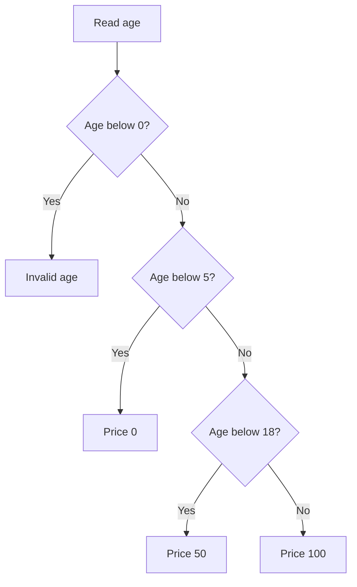

# Control flow and conditions

A program often needs to choose: if a score reaches the pass mark, show “Pass”; otherwise show “Try again”. **Control flow** is the order in which statements run. A condition chooses which branch to follow.

1. Read a value and write one condition that is true or false.
2. Trace both paths of an `if`/`else` before adding more branches.
3. Check invalid input early so the main calculation stays easy to read.
4. Use `switch` for a set of specific choices; continue with [loops](./loops.md) for repeated work.

A **guard clause** is an early return for a case that should stop. Use it to keep the normal path short, rather than hiding it inside many nested conditions.



## Validate at the boundary

```js runnable
function grade(score) {
  if (!Number.isFinite(score) || score < 0 || score > 100) {
    throw new RangeError('score must be between 0 and 100');
  }
  if (score >= 90) return 'A';
  if (score >= 75) return 'B';
  return 'C';
}
console.log(grade(95), grade(80), grade(0));
```

```text output
A B C
```

The early error keeps invalid input out of later branches. A condition uses Boolean conversion. Falsy primitive values are `undefined`, `null`, `false`, positive/negative zero, `0n`, `NaN`, and the empty string. Objects and arrays are truthy; browsers retain a legacy exception for `document.all`.

## Short-circuit operators return operands

`&&` returns the first falsy operand, or its last operand if none is falsy. `||` returns the first truthy operand, or its last operand if none is truthy. They do not necessarily return Booleans. `??` uses only `null` and `undefined` as missing values.

```js runnable
console.log(0 && 'later');
console.log('ready' && 12);
console.log('' || 'fallback');
console.log(0 ?? 99);
```

```text output
0
12
fallback
0
```

Use an `if` statement when the main purpose is a side effect. Use a conditional expression such as `isReady ? 'Ready' : 'Waiting'` when selecting a value. Avoid deeply nested ternaries that obscure independent decisions.

## Switch uses strict matching

```js runnable
function describe(command) {
  switch (command) {
    case 'start':
    case 'resume':
      return 'running';
    case 'stop':
      return 'stopped';
    default:
      return 'unknown';
  }
}
console.log(describe('resume'), describe('stop'), describe(1));
```

```text output
running stopped unknown
```

Cases use strict equality semantics. Without `break`, `return`, or another exit, execution falls through to the next case. A switch shares one lexical block, so wrap a case body in braces when declaring case-local `let` or `const` bindings with names reused in other cases.

## Interview questions {/* #interview-questions */}

**Level: Beginner.** [How to practise](./index.md#interview-preparation).

### 1. Why can a switch statement miss a value that looks correct?

<details>
<summary>Answer and worked example</summary>

Case matching uses strict equality semantics. A string from a form does not match a numeric case unless you explicitly convert and validate it.

```js runnable
function classify(value) {
  switch (value) {
    case 1: return 'numeric one';
    case '1': return 'text one';
    default: return 'other';
  }
}
console.log(classify(1), classify('1'));
console.log(classify(true));
```

**Expected output**

```text output
numeric one text one
other
```

Each return exits the function, so these cases cannot fall through. Without a return or break, execution would continue into the following case body after a match.

</details>

### 2. When are guard clauses preferable to nested conditions?

**Apply it:** Refactor a checkout decision so invalid quantities never reach stock lookup. Show which branches actually call the dependency.

<details>
<summary>Answer, walkthrough, and tradeoffs</summary>

Use guards to reject invalid input or finish simple cases early, leaving the normal path readable. Preserve the order of side effects and cleanup; shortening nesting is not a reason to change which checks run.

Put a cheap, decisive input guard before a dependency call. This example accepts only positive safe-integer quantities.

```js runnable
let stockChecks = 0;
function checkout(quantity, getStock) {
  if (!Number.isSafeInteger(quantity) || quantity <= 0) return 'invalid';
  if (quantity > getStock()) return 'out of stock';
  return 'ready';
}
function getStock() {
  stockChecks++;
  return 2;
}
console.log(checkout(0, getStock), stockChecks);
console.log(checkout(3, getStock), stockChecks);
console.log(checkout(2, getStock), stockChecks);
```

**Expected output**

```text output
invalid 0
out of stock 1
ready 2
```

The counter makes the side-effect order visible: invalid input performs no lookup, and valid input performs exactly one. Reordering guards could change cost and observable behavior. This function only decides readiness; reserving stock atomically would be a separate application requirement.

</details>

## Worked examples and answers {/* #workbook-practice */}

Use the [practice routine and file setup](./workbook.md#a-practice-session), then try the [Practice Problems](#practice-problems) below.

### 04. Conditions and decision making {/* #workbook-04 */}

<details>
<summary>Worked lesson and setup</summary>

**Goal:** turn a ticket-price rule into branches.

The example rejects a negative age, makes a ticket free below five, charges 50 below eighteen, and charges 100 otherwise. Only the first matching return is used.

Trace ages 4 and 18, then test just below, exactly at, and just above each boundary. Write which price includes the boundary before changing an operator. Review [early validation](#validate-at-the-boundary) for the guard clause and [switch matching](#switch-uses-strict-matching) when a task involves separate named choices.

**Worked example**

```js
function ticketPrice(age) {
  if (age < 0) return "Invalid age";
  if (age < 5) return 0;
  if (age < 18) return 50;
  return 100;
}
console.log(ticketPrice(4));
console.log(ticketPrice(18));
```

**Expected output**

```text
0
100
```

The negative-age check handles invalid input first. Ages below 5 return before the next condition. Age 18 fails both discount checks and reaches the final return. This function assumes age is already a number.

**Trace the example step by step**

1. The function receives one age value. It first checks whether the age is negative and returns the invalid- input result if so.

2. If the age is valid and below 5, the first discount result is returned. Execution stops for that call.

3. Otherwise, the function checks whether age is below 18. At this point the earlier checks already establish that age is at least 5.

4. An age of 18 matches neither discount condition, so the final return gives the full price.

**Common mistakes and how to reason about them**

Adding another condition does not automatically make the decision complete. Check whether any values match several branches or no branch. A switch can be convenient for exact categories, while ordered if checks are often clearer for numerical ranges. Keep the decision readable before trying to shorten it with nested ternary expressions.

</details>

Find **04A–C** in the [Practice Problems](#practice-problems) table.

<details id="workbook-04-answer">
<summary>Check your reasoning and answer</summary>

**04A.** 50. Age 5 is not below 5, but it is below 18.

The comparison 5 &lt; 5 is false, so the first discount is skipped. The comparison 5 &lt; 18 is true, giving 50. This is precisely why boundary examples are useful: changing &lt; to &lt;= would change the price at age 5.

**04B.** Scores of 90 or above already match the first branch. Check the 90 threshold first.

A broad passing condition already includes every distinction score. In an else-if chain, the first matching branch wins. Checking distinction first leaves the passing branch to handle scores that pass but do not qualify for distinction.

**04C.** Check below zero, then equality with zero. The remaining finite numbers are positive.

There are three exhaustive categories for finite real numbers. After excluding numbers below zero and zero itself, the only remaining possibility is a positive number. The finite-number assumption matters because NaN would fail both comparisons without being positive.

**Reference code**

```js
function signLabel(n) {
  if (n < 0) return "negative";
  if (n === 0) return "zero";
  return "positive";
}
```

**Check the result**

```js
assert.equal(signLabel(-1), "negative");
assert.equal(signLabel(0), "zero");
assert.equal(signLabel(2), "positive");
```

</details>

## Practice Problems

| Problem | Level / priority | Practice / notes | Example / answer |
| --- | --- | --- | --- |
| **04A — What does ticketPrice(5) return? Explain which branch matches.** | **Must fix** | [Worked example](#workbook-04) | [Answer](#workbook-04-answer) |
| **04B — Why is if (score &gt;= 50) before else if (score &gt;= 90) wrong for assigning pass and distinction?** | **Must fix** | [Worked example](#workbook-04) | [Answer](#workbook-04-answer) |
| **04C — Write signLabel(n), returning "negative", "zero", or "positive" for a finite number.** | **Must fix** | [Worked example](#workbook-04) | [Answer](#workbook-04-answer) |
| 1 — Return `'empty'`, `'one'`, or `'many'` based on an array's length. | Practice | — | — |
| 2 — Accept zero as a valid setting while supplying a default for `null` and `undefined`. | Practice | — | — |
| 3 — Build a command switch with two aliases for one action and an explicit unknown-command result. | Practice | — | — |

## Next steps

References: [MDN control flow](https://developer.mozilla.org/en-US/docs/Web/JavaScript/Guide/Control_flow_and_error_handling), [operators](./operators-and-operands.md).
