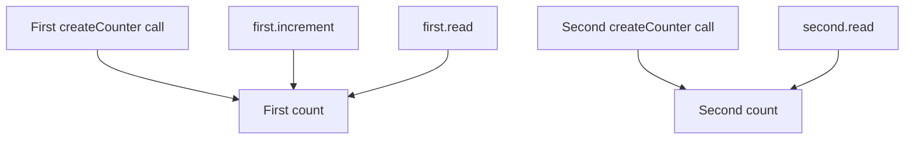

# JavaScript Closures

A closure lets a function keep access to variables from where it was created, even when it is called later. Imagine making two counters: each counter should remember its own count.

1. Find the outer function's variable and the inner function that uses it.
2. Call the outer function and keep the inner function it returns.
3. Call that inner function twice and trace the same remembered variable.
4. Create a second counter and check that its state is separate.

Read [scope](../fundamentals/scope.md) first. A closure keeps access to a binding, which is the connection between a name and its value; it does not simply freeze a copy of the value. Later sections cover loops, event listeners, and cleanup.



## What is a closure?

Keep two events separate: the outer function finishes its call, but a returned function may still need its variables. In the next example, the discount function keeps access to `rate` and receives a fresh `price` on each later call. Review [function values](./function-types.md#function-values-and-calls) if returning a function is unfamiliar. Reference: [MDN closures](https://developer.mozilla.org/en-US/docs/Web/JavaScript/Guide/Closures).

## Trace creation, retention, and a later call {/* #closure-lifetime */}

```js runnable
function createDiscount(rate) {
  return function applyDiscount(price) {
    return price * (1 - rate);
  };
}
const tenPercentOff = createDiscount(0.1);
console.log(tenPercentOff(100));
console.log(tenPercentOff(50));
```

```text output
90
45
```

1. `createDiscount(0.1)` creates a call with its own `rate` parameter.
2. Evaluating the inner function expression creates a function with access to that surrounding environment.
3. Returning it ends the outer call. `tenPercentOff` now refers to the returned function, so the captured binding remains available to it.
4. Each later call gets its own `price` parameter and reads the retained `rate` binding.

A closure does not keep an old call actively running on the stack. It preserves access to the environment that its code needs. This example keeps a configuration value unchanged; the counter below shows that multiple returned functions can also read and update one shared binding.

Use closures to associate a callback with configuration or state. A returned function is a useful demonstration, but returning is not required for a closure to exist. For production currency calculations, separately define units and rounding; this example isolates scope behavior.

## Shared bindings and independent factory calls

```js runnable
function createCounter(initialValue = 0) {
  let count = initialValue;
  return {
    increment() { return ++count; },
    read() { return count; },
    reset() { count = initialValue; },
  };
}

const first = createCounter();
const second = createCounter();
console.log(first.increment(), first.read(), second.read());
first.reset();
console.log(first.read());
```

```text output
1 1 0
0
```

The three methods returned by one call share one `count` binding. Calling the factory again creates another environment. Saying “every closure gets its own copy of the variables” would incorrectly predict that `first.read()` cannot see the increment. [javascript.info lexical environments](https://javascript.info/closure).

## Private state still needs a safe public API

A caller cannot name `count` directly, but returning a reference to a private object would expose that object. Copy the data that callers may safely edit. Here the log accepts strings, so copying its array is sufficient; a shallow array copy would still share nested objects.

```js runnable
function createLogger() {
  let messages = [];
  return {
    log(message) {
      if (typeof message !== 'string') throw new TypeError('Expected a string');
      messages.push(message);
    },
    getHistory() { return [...messages]; },
    clear() { messages = []; },
  };
}

const logger = createLogger();
logger.log('ready');
const snapshot = logger.getHistory();
snapshot.push('outside');
console.log(logger.getHistory().join(', '));
logger.clear();
console.log(logger.getHistory().length);
```

```text output
ready
0
```

An IIFE can create this private scope once; a factory creates it on demand. Use [ES modules](../import-and-export.md) for file-level dependencies. Closure privacy does not validate amounts in a banking example, sanitize text, or make a shared nested object immutable: those are separate contracts.

## Loop callbacks: one binding or one per iteration?

```js runnable
const shared = [];
for (var index = 0; index < 3; index++) {
  shared.push(() => index);
}
const separate = [];
for (let index = 0; index < 3; index++) {
  separate.push(() => index);
}
console.log(shared.map(read => read()).join(', '));
console.log(separate.map(read => read()).join(', '));
```

```text output
3, 3, 3
0, 1, 2
```

All callbacks in the first loop read the same binding after it reaches 3. A `let` in this loop header creates per-iteration bindings. It is the binding's scope, not the callback being a timer or event listener, that causes the difference. Older code can capture a separate argument through an [IIFE](./function-iife.md#example-creating-dynamic-buttons) or partial application with `bind`.

## An event handler with state and cleanup

**Browser example:** place a button such as `<button id="save" type="button">Save</button>` in the document before running this script. `event.currentTarget` is the subscribed button, even when a click originates from an element inside it.

```js
function attachClickCounter(button, limit = 5) {
  let count = 0;
  function onClick(event) {
    count++;
    event.currentTarget.textContent = `Saved ${count} times`;
    if (count >= limit) event.currentTarget.disabled = true;
  }
  button.addEventListener('click', onClick);
  return () => button.removeEventListener('click', onClick);
}

const button = document.querySelector('#save');
if (!button) throw new Error('Missing Save button');
const dispose = attachClickCounter(button);
// Call dispose() when the view no longer owns this subscription.
```

## Closures and retained memory

Reachable functions can retain the bindings and objects they need. Merely declaring a large unused local next to a callback does **not** prove the callback retains it: engines can optimize unused bindings away. Diagnose retention with a heap snapshot and a retaining path. [javascript.info on closure garbage collection](https://javascript.info/closure#garbage-collection).

This example deliberately reads the retained object and provides an explicit teardown. It demonstrates ownership; it does not assert when garbage collection runs.

```js
// Browser helper; the caller supplies an existing button and a records array.
function attachPreview(button, records) {
  let retained = records;
  function showCount() {
    button.textContent = String(retained.length);
  }
  button.addEventListener('click', showCount);
  return function dispose() {
    button.removeEventListener('click', showCount);
    retained = null;
  };
}
```

Disposal removes the listener and releases this helper's reference to `records`, even if the caller still keeps the disposer. Other references can keep the records alive. Dropping the disposer as well releases its remaining references when they are otherwise unreachable. See [memory and garbage collection](../metaprogramming-and-memory.md#diagnose-retained-memory).

## Factories, currying, and scheduling helpers

A factory can capture configuration, such as `factor => value => factor * value`. Currying and partial application build on this idea but have different call contracts. A generic curry helper based on `fn.length` must account for default and rest parameters; metadata is not a declaration of every argument the function accepts.

Debounce and throttle also use closures to remember pending work. Their definitions differ in timing, leading/trailing calls, cancellation, and receiver handling. Use the complete [function utilities lesson](./function-utilities.md) for implementations with explicit contracts rather than duplicating a second incomplete version here.

## Counter, logger, and timer setup

### Exercise 1: Counter with Reset

Extend `createCounter` above with `decrement()` and a `getValue()` alias for `read()`. Starting at 10, incrementing gives 11 and resetting gives 10. Create two counters to verify independent state.

### Exercise 2: Private Variable Logger

Extend the string logger above with a maximum history length. Decide whether to evict the oldest message or reject new messages when full. Verify that mutating a returned history array cannot change stored history.

### Exercise 3: Function Timer

Return a function that measures a **synchronous** callback with `performance.now()` and returns `{ result, timeMs }`. This runnable version checks the contract without asserting a machine-dependent duration:

```js runnable
function createTimer() {
  return function measure(fn) {
    const start = performance.now();
    const result = fn();
    return { result, timeMs: performance.now() - start };
  };
}
const measure = createTimer();
const measurement = measure(() => 'done');
console.log(measurement.result, measurement.timeMs >= 0);
```

```text output
done true
```

Thrown errors propagate. A returned promise is measured only until it is returned, not until settlement; an async timer needs to await it and define rejection handling. Exact timings vary, and tiny measurements are affected by clock precision and runtime optimizations.

Continue with [IIFEs](./function-iife.md), [memoization](./function-memoization.md), and [event cleanup](../event-handling.md).

## Interview questions {/* #interview-questions */}

**Level: Intermediate.** [How to practise](../index.md#interview-preparation).

### 1. Do two counters from the same factory share one count?

<details>
<summary>Answer and worked example</summary>

Each factory invocation creates a separate binding. Calls through one returned closure share its binding; closures returned from different invocations are independent.

```js runnable
function makeCounter() {
  let count = 0;
  return () => ++count;
}
const first = makeCounter();
const second = makeCounter();
console.log(first(), first(), second(), first());
```

**Expected output**

```text output
1 2 1 3
```

first retains one count and second retains another. Returning from makeCounter does not remove access to the binding needed by its returned function.

</details>

### 2. Why do callbacks created in a var loop often all read the final value?

**Apply it:** Show the var-loop bug without timers, then compare it with per-iteration let bindings.

<details>
<summary>Answer, walkthrough, and tradeoffs</summary>

They share the same function-scoped binding. A for loop declared with let creates separate iteration bindings. Closures retain access to bindings rather than automatically taking a snapshot of every value at creation.

Store callbacks during the loop and invoke them afterward. Scheduling is unnecessary to demonstrate closure behavior.

```js runnable
const shared = [];
for (var i = 0; i < 3; i++) shared.push(() => i);
const separate = [];
for (let j = 0; j < 3; j++) separate.push(() => j);

console.log(shared.map(read => read()).join(','));
console.log(separate.map(read => read()).join(','));

let current = 1;
const readCurrent = () => current;
current = 9;
console.log(readCurrent());
```

**Expected output**

```text output
3,3,3
0,1,2
9
```

All three `shared` callbacks read one binding, whose value is 3 after the loop. Each `separate` callback reads its own iteration binding. The final example shows that `let` does not automatically capture a snapshot: updating the same captured binding remains visible. See [javascript.info: lexical environments](https://javascript.info/closure).

</details>

## Worked examples and answers {/* #workbook-practice */}

Use the [practice routine and file setup](../workbook.md#a-practice-session), then try the [Practice Problems](#practice-problems) below.

### 07. Scope hoisting and closures {/* #workbook-07 */}

<details>
<summary>Worked lesson and setup</summary>

**Goal:** explain which calls share a remembered count.

Draw one box for the `count` created by the first call to `makeCounter`. Both calls to `next` use that box. The final expression creates another counter and calls it once, so give it a separate box.

Use the [closure lifetime trace](#closure-lifetime) if you lose track of which variable survives. [Scope lookup](../fundamentals/scope.md#scope-chain) tells you which name a function uses; [hoisting](../fundamentals/hoisting.md) tells you whether that binding is ready. Neither requires treating source lines as if they physically move.

**Worked example**

```js
function makeCounter() {
  let count = 0;
  return function () {
    count += 1;
    return count;
  };
}
const next = makeCounter();
console.log(next());
console.log(next());
console.log(makeCounter()());
```

**Expected output**

```text
1
2
1
```

next keeps access to one count variable. Its second call sees the update made by its first call. The final line creates a new counter with a fresh count before calling it.

**Trace the example step by step**

1. makeCounter() creates a count binding initialized to 0 and returns an inner function without calling it.

2. next refers to that inner function. Calling next() changes its retained count to 1 and returns 1.

3. Calling the same next again changes the same count to 2. The outer function does not need to run again for this update.

4. makeCounter()() first creates a separate counter, then immediately calls it. Its count starts independently at 0, so it returns 1.

**Common mistakes and how to reason about them**

Avoid storing a counter in an accidental global variable: every supposed instance would then share it. A let binding exists before its declaration is evaluated but cannot be read during that temporal dead zone. Saying that let is simply "not hoisted" misses this distinction and can make shadowing errors harder to understand.

</details>

Find **07A–C** in the [Practice Problems](#practice-problems) table.

<details id="workbook-07-answer">
<summary>Check your reasoning and answer</summary>

**07A.** No. count is local to the factory call. The returned function can access it through its closure.

The count binding is not in the outside lexical scope, so outside code cannot name it directly. The returned function can read and update it because that function was created in an environment containing count. Access comes through the function, not through public access to the local variable.

**07B.** A ReferenceError occurs because the variable is in its temporal dead zone.

Access before initialization throws ReferenceError. This is different from reading a var binding before its assignment, which normally gives undefined. The rule catches uses of let and const before their values have been established.

**07C.** The returned function closes over base. Each factory call can keep a different base.

makeAdder(10) returns a function connected to the base binding holding 10. Calling it with 3 gives 13. A separate makeAdder(100) creates a different binding and adds 100 instead. Neither returned function needs a global base.

**Reference code**

```js
function makeAdder(base) {
  return function (value) {
    return base + value;
  };
}
```

**Check the result**

```js
assert.equal(makeAdder(5)(3), 8);
assert.equal(makeAdder(-2)(3), 1);
```

</details>

## Practice Problems

| Problem | Level / priority | Practice / notes | Example / answer |
| --- | --- | --- | --- |
| **07A — Can code outside makeCounter read its count directly?** | **Must fix** | [Worked example](#workbook-07) | [Answer](#workbook-07-answer) |
| **07B — What happens when you read a let variable before its declaration executes?** | **Must fix** | [Worked example](#workbook-07) | [Answer](#workbook-07-answer) |
| **07C — Write makeAdder(base), returning a function that adds base to its argument.** | **Must fix** | [Worked example](#workbook-07) | [Answer](#workbook-07-answer) |
| Counter with Reset | Practice | [Task and starter code](#exercise-1-counter-with-reset) | — |
| Private Variable Logger | Practice | [Task and starter code](#exercise-2-private-variable-logger) | — |
| Function Timer | Practice | [Task and starter code](#exercise-3-function-timer) | — |
