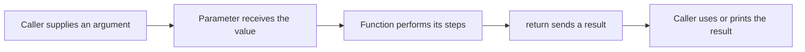

# JavaScript Function Types

A function is a value containing work you can call. The function itself and the value it returns are different: a recipe is different from the meal made by following it.

1. Create a function, store it in a variable, and call it.
2. Match each argument to its parameter and follow the returned result.
3. Compare declarations, expressions, and arrows as ways to write functions.
4. Learn roles such as predicate and callback from the jobs they do. A **predicate** is a function that answers a true/false question.

Begin with [values](../fundamentals/types-of-identifiers.md), [scope](../fundamentals/scope.md), and basic expressions. The first examples run synchronously, meaning they finish their calls before the next statement continues. Advanced function patterns can wait until that behavior is clear.



## A function value is different from its result {/* #function-values-and-calls */}

A function is a callable object. Evaluating `add` produces that function value; evaluating `add(2, 3)` calls it and produces its result. Parameters are the local names in the definition; arguments are the values supplied by a call.

```js runnable
function add(left, right) {
  return left + right;
}
const operation = add;
const result = operation(2, 3);
console.log(typeof operation, result);
console.log(operation === add);
```

```text output
function 5
true
```

Assigning `add` to `operation` copies the function value; it does not call or clone the function. During the call, `left` receives 2 and `right` receives 3. `return` ends that call and supplies 5 to the caller. If execution reaches the end without returning a value, the result is `undefined`. Printing a value with `console.log` does not replace returning it.

When an API expects a callback, passing `operation` lets that API decide when to call it. Passing `operation(2, 3)` instead calls it immediately and passes the number 5. See [callback timing](./function-callback.md).

## Parameters receive values {/* #parameter-values */}

```js runnable
function change(quantity, cart) {
  quantity = 99;
  cart.quantity = 2;
  cart = { quantity: 3 };
  return cart;
}
const quantity = 1;
const original = { quantity: 1 };
const returned = change(quantity, original);
console.log(quantity, original.quantity, returned.quantity);
console.log(original === returned);
```

```text output
1 2 3
false
```

Each parameter is a local binding initialized with an argument value. Reassigning `quantity` changes only the local binding. Initially, the `cart` parameter and `original` refer to the same object, so the property write is visible to the caller. Reassigning `cart` then points only that local binding at a new object. The returned object is different from `original`.

This is why “objects are passed by reference” is misleading if it suggests that a callee can replace the caller’s variable. The shared object can be mutated; the caller’s binding is not passed as an assignable location. [MDN function parameters](https://developer.mozilla.org/en-US/docs/Web/JavaScript/Guide/Functions).

## Function Arity

Arity describes a function’s intended number of inputs. JavaScript permits omitted and extra arguments; validation must enforce any stricter contract. `fn.length` counts formal parameters before the first default and excludes a rest parameter, so it is metadata rather than a runtime argument-count check.

### Unary Function (1 argument)

`value => value * 2` is unary: it is designed to transform one value. It can be passed directly to `map` because the extra index and array arguments do not affect its body. That assumption is not safe for every unary-looking API; see [the parseInt callback trap](./function-callback.md#interview-questions).

### Binary Function (2 arguments)

The `add(left, right)` function above is binary. Calling `add(2)` supplies `undefined` for `right`, and ordinary Number addition then produces `NaN`. Being callable does not prove that the supplied values satisfy the function’s intended contract.

### Variadic Function (variable arguments)

```js runnable
function sum(...numbers) {
  return numbers.reduce((total, number) => total + number, 0);
}
function describe(label = 'items', ...items) {
  return `${label}: ${items.length}`;
}
console.log(sum(), sum(2, 3, 4));
console.log(describe(undefined, 'a', 'b'));
console.log(describe(null, 'a'));
console.log(sum.length, describe.length);
```

```text output
0 9
items: 2
null: 1
0 0
```

The rest parameter creates an array. The initial reduce value defines the empty sum as 0. `sum` assumes Number inputs; it does not validate arbitrary user data. A default parameter handles omission or `undefined`, not `null`. Ordinary functions also have an array-like `arguments` object, but rest parameters state the intended collection more clearly and avoid legacy aliasing rules.

## Function Categories

These categories describe **roles**. One function can be a factory, a higher-order function, and a closure at the same time. They are not mutually exclusive JavaScript data types.

### Factory Function

A factory creates a value for the caller. A fresh object per call gives callers independent containers.

```js runnable
function createCart() {
  return { items: [] };
}
const first = createCart();
const second = createCart();
first.items.push('book');
console.log(first.items.length, second.items.length);
console.log(first === second);
```

```text output
1 0
false
```

The array literal is evaluated during each call. Moving one shared `items` array outside the factory would change the ownership contract. A factory can also expose private state through [closures](./function-closure.md) rather than public mutable properties.

### Higher-Order Function

A higher-order function accepts a function or returns one. The returned function below also closes over the factor from one call.

```js runnable
function createMultiplier(factor) {
  return number => number * factor;
}
const double = createMultiplier(2);
console.log([1, 2, 3].map(double).join(','));
console.log(createMultiplier(3)(4));
```

```text output
2,4,6
12
```

`createMultiplier(3)(4)` first returns a function configured with factor 3, then calls that function with 4. Neither the factory nor `map` becomes asynchronous because functions are passed around.

### Curried Function

Currying changes a multi-argument interface into a sequence of single-argument calls. For example, `a => b => a + b` is a curried addition function. It is useful when a caller wants to configure one input and supply another later; it is not inherently faster or more readable in every context.

### Partial Application {/* #partial-function */}

Partial application preselects some arguments while leaving the others for a later call. Unlike currying, the returned function may still accept several arguments. It also differs from the mathematical term “partial function,” meaning a function undefined for some inputs.

```js runnable
const volume = (width, height, depth) => width * height * depth;
const curriedVolume = width => height => depth => volume(width, height, depth);
const widthTwo = (height, depth) => volume(2, height, depth);
console.log(curriedVolume(2)(3)(4));
console.log(widthTwo(3, 4));
```

```text output
24
24
```

The first call shape supplies one argument at each stage; the second fixes width and accepts the remaining pair together. `bind` can also preselect arguments, with separate receiver behavior covered in [function utilities](./function-utilities.md).

## Advanced Function Patterns

### Memoized Function

Memoization reuses a result for an equivalent input. Correctness depends on what “equivalent” means, which state affects the result, and when entries expire. A JSON string of arbitrary arguments is not a universal cache key. Use the [memoization lesson](./function-memoization.md) for a complete implementation with an explicit key and lifetime policy.

Wrapping only the outer call of a recursive function does not automatically cache its internal recursive calls. Establish correctness and measure repeated work before choosing this optimization.

### Pure Function

A pure calculation depends only on its inputs and makes no externally observable changes. A function that reads mutable global settings or mutates an argument is not pure merely because it has a return statement. Purity is a behavior contract, not a keyword that JavaScript enforces.

### Predicate Function

A predicate answers a yes/no question. Prefer an explicit Boolean contract even though APIs such as `filter` accept truthy or falsy results.

```js runnable
const isPositive = number => number > 0;
const numbers = [-2, 0, 3, 4];
console.log(numbers.filter(isPositive).join(','));
console.log(numbers.some(isPositive), numbers.every(isPositive));
console.log(numbers.join(','));
```

```text output
3,4
true false
-2,0,3,4
```

The predicate selects positive values, `some` checks existence, and `every` checks all values. The original array remains unchanged in this example. Callback side effects could change that; a method returning a new array is not a guarantee that the whole calculation is pure.

### Composer Function

Composition connects compatible outputs and inputs. This small helper composes synchronous unary functions from right to left; it does not await promises or preserve method receivers.

```js runnable
function compose(...functions) {
  return input => functions.reduceRight((value, fn) => fn(value), input);
}
const addOne = value => value + 1;
const double = value => value * 2;
console.log(compose(double, addOne)(3));
console.log(compose()(3));
```

```text output
8
3
```

Read the first call as `double(addOne(3))`: 3 becomes 4, then 8. With no functions, the initial input is returned unchanged. For more application examples, continue with [functional programming](../../functional-programming/index.md).

## Best Practices

Before choosing a pattern, state the input types, returned value, errors, and allowed mutation. Use a plain function when that expresses the requirement. Use higher-order functions to make a real variation explicit, and keep side effects at boundaries where callers can observe and test them.

**Check yourself:** explain the difference between passing `double` and passing `double(3)`. Then explain why changing a property through a parameter can affect the caller while assigning a new object to the parameter cannot replace the caller’s binding.

References: [MDN function reference](https://developer.mozilla.org/en-US/docs/Web/JavaScript/Reference/Functions), [MDN function length](https://developer.mozilla.org/en-US/docs/Web/JavaScript/Reference/Global_Objects/Function/length), and [ECMAScript 2015 function definitions](https://262.ecma-international.org/6.0/#sec-function-definitions).

## Interview questions {/* #interview-questions */}

**Level: Beginner.** [How to practise](../index.md#interview-preparation).

### 1. What does function.length tell you, and does it enforce the number of arguments?

<details>
<summary>Answer and worked example</summary>

It counts formal parameters before the first default parameter, excluding rest parameters. It does not enforce arity. Predict the metadata separately from the call result.

```js runnable
function describe(first, second = 10, ...rest) {
  return [first, second, rest.length];
}
console.log(describe.length);
console.log(JSON.stringify(describe(1, undefined, 3, 4)));
console.log(JSON.stringify(describe(1, null)));
```

**Expected output**

```text output
1
[1,10,2]
[1,null,0]
```

undefined activates the default; null does not. Arguments after the second position become rest elements even though length is only 1.

</details>

### 2. How do currying and partial application differ?

**Apply it:** Express the same price calculation using currying and partial application, and explain the difference in call shape.

<details>
<summary>Answer, walkthrough, and tradeoffs</summary>

Currying changes a multi-argument function into a sequence of calls, such as `add(a)(b)`. Partial application fixes some arguments and returns a function for the remaining ones. Either needs an explicit policy for argument count and this.

Assume numeric inputs; these helpers have fixed arity and do not use `this`.

```js runnable
const total = (tax, price, count) => price * count * (1 + tax);
const curriedTotal = tax => price => count => total(tax, price, count);
const withTax = tax => (price, count) => total(tax, price, count);

console.log(curriedTotal(0.1)(10)(2));
console.log(withTax(0.1)(10, 2));
console.log(curriedTotal(0.1).length, withTax(0.1).length);
```

**Expected output**

```text output
22
22
1 2
```

Currying changes the interface into one argument per call. Partial application preselects the tax and leaves two arguments in the returned function. Neither guarantees better performance, and this floating-point example is not a complete money-rounding policy. A reusable helper would also need to specify how it handles extra arguments and receivers.

</details>

## Worked examples and answers {/* #workbook-practice */}

Use the [practice routine and file setup](../workbook.md#a-practice-session), then try the [Practice Problems](#practice-problems) below.

### 06. Functions parameters and return values {/* #workbook-06 */}

<details>
<summary>Worked lesson and setup</summary>

**Goal:** distinguish inputs, returned values, and printed output.

The example has three functions: a greeting with a default name, a function that doubles one number, and a function that totals any number of arguments. Trace each call separately before reading the final output.

Review [function values and calls](#function-values-and-calls) and [parameters](#parameter-values). An omitted or `undefined` argument triggers a default; `null` does not. In `addAll`, rest gathers arguments into an array. Compare that with [spread at a call site](../spread-operator.md), which expands values in the other direction.

**Worked example**

```js
function greet(name = "friend") {
  return `Hello, ${name}`;
}
const double = (n) => n * 2;
function addAll(...numbers) {
  let total = 0;
  for (const n of numbers) total += n;
  return total;
}
console.log(greet());
console.log(double(4), addAll(1, 2, 3));
```

**Expected output**

```text
Hello, friend
8 6
```

greet uses its default because no argument is supplied. double returns the multiplication result. addAll receives an array containing every argument, then reduces it to a sum using a loop.

**Trace the example step by step**

1. Calling greet() supplies no name, so the default parameter is used. Passing null explicitly would bypass that default.

2. double uses a concise arrow body. The multiplication expression becomes the return value without a written return statement.

3. addAll collects its arguments into an array through a rest parameter, then visits them in order.

4. Its return statement sends the accumulated sum back to the caller. The caller decides whether to store, print, or further calculate with it.

**Common mistakes and how to reason about them**

Do not place a line break immediately after return when the next line is meant to be its expression; automatic semicolon insertion can cause an early return of undefined. Do not depend on a global variable when the value can be a parameter. Explicit inputs make it easier to see why the same function produces different results.

</details>

Find **06A–C** in the [Practice Problems](#practice-problems) table.

<details id="workbook-06-answer">
<summary>Check your reasoning and answer</summary>

**06A.** undefined. The braces create a function body, and there is no return statement.

The multiplication is evaluated but its result is discarded. A braced function body reaches its end without returning a value, so the call evaluates to undefined. Add return n * n or use the expression form n =&gt; n * n.

**06B.** No. The result is "Hello, null" because defaults apply to undefined, not null.

null is an explicit argument, and default parameters do not replace it. The template literal converts null to the text "null" when building the greeting. If your application treats null as missing, express that rule deliberately with a check or ??.

**06C.** Handle the empty case before dividing, then divide the sum by the length.

The arithmetic mean is the sum divided by the number of elements. For [], there is no meaningful mean under this contract, so null communicates absence. Returning 0 instead would confuse an empty dataset with actual values whose mean is zero.

**Reference code**

```js
function average(values) {
  if (values.length === 0) return null;
  let total = 0;
  for (const value of values) total += value;
  return total / values.length;
}
```

**Check the result**

```js
assert.equal(average([2, 4, 6]), 4);
assert.equal(average([]), null);
```

</details>

## Practice Problems

| Problem | Level / priority | Practice / notes | Example / answer |
| --- | --- | --- | --- |
| **06A — What does const square = n =&gt; \{ n * n; \}; return for square(3)?** | **Must fix** | [Worked example](#workbook-06) | [Answer](#workbook-06-answer) |
| **06B — Does greet(null) use the default name? Explain.** | **Must fix** | [Worked example](#workbook-06) | [Answer](#workbook-06-answer) |
| **06C — Write average(values). Return null for an empty array and the numeric mean otherwise.** | **Must fix** | [Worked example](#workbook-06) | [Answer](#workbook-06-answer) |
