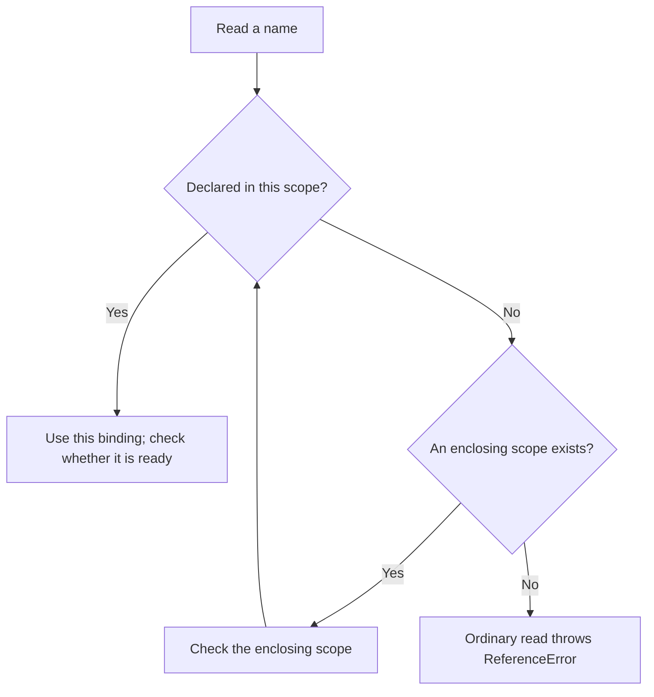

# JavaScript Scope

Scope tells you where a name can be used. A variable declared inside a function is normally available inside that function, not everywhere in the program. This lets two functions use a local name such as `score` without sharing the same variable.

1. Find where the variable is declared.
2. Start at the line that uses it and look outward through the surrounding scopes.
3. Stop at the nearest matching declaration.
4. Compare declaring a new local name with assigning a new value to an existing name.

Read [bindings and declaration keywords](./variables-var-let-const.md) first. A **binding** connects a name to a value. **Shadowing** means an inner declaration uses the same name as an outer one. Examples here use ES modules; browser classic scripts have different top-level rules.



## What is Scope?

JavaScript uses **lexical scope**: where a function is written determines which surrounding names it can use. Calling it from a different function does not give it access to that caller’s local variables.

Keep two questions separate: **which binding does this name select?** and **has that binding been initialized yet?** Scope answers the first; [hoisting and the temporal dead zone](./hoisting.md) explain the second.

## Types of Scope

### Function scope {/* #2-function-scope */}

Each call creates its own parameter and local bindings. One call’s local total does not become the next call’s starting total.

```js runnable
function addFee(amount) {
  const fee = 2;
  const total = amount + fee;
  return total;
}
console.log(addFee(10), addFee(20));
try {
  console.log(fee);
} catch (error) {
  console.log(error.name);
}
```

```text output
12 22
ReferenceError
```

The caller receives the return value, not access to the callee’s local names. A returned function can retain access to selected outer bindings through a [closure](../functions/function-closure.md); that does not make the names global.

### Block scope {/* #3-block-scope */}

`let`, `const`, and class declarations are scoped to their enclosing block. Strict-mode block-level function declarations also stay in the block. `var` ignores ordinary block boundaries; class static blocks are a separate `var` scope.

```js runnable
function describe() {
  const label = 'outside';
  if (true) {
    const label = 'inside';
    console.log(label);
  }
  console.log(label);
}
describe();
```

```text output
inside
outside
```

The inner declaration creates a different binding. It does not temporarily overwrite the outer binding and then restore it. If you remove the inner declaration and assign to the outer `const` instead, the assignment fails.

### Global scope: a later environment check {/* #1-global-scope */}

A browser classic script has access to the global environment. Its top-level `var` declarations normally create global object properties; top-level `let` and `const` declarations do not. In an ES module, top-level bindings belong to that module and must be exported/imported to share them explicitly. In Node CommonJS, top-level declarations are scoped to the module wrapper.

Use `globalThis` for the global object when you need it, but do not equate “the global environment” with “every property on `globalThis`.” A name being at the top of a file does not establish its scope without knowing the file’s execution mode.

## Scope Chain

For an ordinary identifier read, use this procedure:

1. Start in the current scope and look for that name.
2. If it is absent, continue to the scope surrounding it in the source code.
3. Stop at the first matching binding. If it is uninitialized, throw; do not skip it to find a more distant binding.
4. If no binding is found, an ordinary read throws `ReferenceError`. `typeof` has a special case for an unresolvable name, explained in [hoisting](./hoisting.md#common-gotchas).

This is a reasoning model for specified behavior, not a claim that an engine literally searches a chain for every optimized read.

## Key Rules

Inner code can read an outer binding when no nearer declaration shadows it. Outer code cannot reach inward merely by using the same name. A function’s call stack and lexical scope chain answer different questions: **who called this function?** versus **where does this function resolve its names?**

Property lookup is also separate. In `user.name`, lexical lookup resolves `user`; object property rules then resolve `name`. It does not look for a variable named `name` in the scope chain.

## Trace lexical lookup

```js runnable
const label = 'module';
function readLabel() {
  return label;
}
function caller() {
  const label = 'caller';
  console.log(readLabel(), label);
}
caller();
```

```text output
module caller
```

Inside `readLabel`, there is no local `label`, so lookup continues to its enclosing module and finds `"module"`. It never visits `caller`’s local environment, even though `caller` is on the call stack. The second argument to `console.log` is evaluated inside `caller`, where the local binding wins.

**Check yourself:** move the definition of `readLabel` inside `caller`, below its `label` declaration. It would then resolve that enclosing local binding and return `"caller"`. Moving only the call does not have the same effect.

References: [MDN block scope](https://developer.mozilla.org/en-US/docs/Web/JavaScript/Reference/Statements/block), [javascript.info lexical environments](https://javascript.info/closure), and [ECMAScript 2015 environment records](https://262.ecma-international.org/6.0/#sec-environment-records).

## Interview questions {/* #interview-questions */}

**Level: Beginner.** [How to practise](../index.md#interview-preparation).

### 1. Does a function read a variable from its caller or its definition site?

<details>
<summary>Answer and worked example</summary>

Lexical lookup follows the scopes surrounding the function definition. A same-named local in the caller does not replace that environment.

```js runnable
const role = 'reader';
function getRole() { return role; }
function run() {
  const role = 'admin';
  return [getRole(), role];
}
console.log(run().join(', '));
```

**Expected output**

```text output
reader, admin
```

getRole closes over the outer role binding. run reads its own role directly, so the two reads resolve to different bindings.

</details>

### 2. What happens if an inner let shadows an outer variable before the inner declaration?

**Apply it:** Explain why an inner declaration can prevent a read of an already initialized outer variable.

<details>
<summary>Answer, walkthrough, and tradeoffs</summary>

The inner binding shadows the outer binding throughout its block, including its temporal dead zone. Reading it before initialization throws ReferenceError; lookup does not skip it and fall back to the outer variable.

Trace the binding selected by lookup before asking whether that binding has a value.

```js runnable
const label = 'outer';
function inspect() {
  try {
    console.log(label);
  } catch (error) {
    console.log(error.name);
  }
  const label = 'inner';
  console.log(label);
}
inspect();
console.log(label);
```

**Expected output**

```text output
ReferenceError
inner
outer
```

Inside `inspect`, both reads refer to its local `label`. The first read occurs before initialization; the second occurs afterward. The outer binding is unchanged. Moving the local declaration above the first read fixes the temporal-dead-zone error, but renaming the local variable is appropriate if the first read was intended to use the outer value.

</details>
