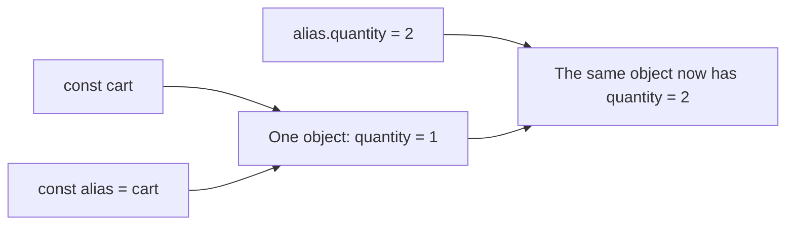

# var, let & const

A variable gives a value a name so you can use it later. For example, `const schoolName = 'Hill School'` names a piece of text, while `let score = 0` gives a starting value to a score that may change.

1. **Declare** a name with `const` or `let`.
2. **Assign** a value to it with `=`.
3. Read the value in a calculation or display it.
4. Compare assigning a different value with changing a property inside an object.

Use `const` when the name should keep the same value and `let` when you plan to reassign it. Learn `var` to understand existing code after those two are clear. Run each complete example separately as an ES module using the [course setup](../index.md#run-the-examples).



## Start with a name and a value {/* #bindings-and-values */}

In the example below, two notebooks cost 10 each. Predict the first total, then change the quantity to three. The key question is whether the saved `initialTotal` changes by itself. A **binding** is the connection between a name and its current value.

```js runnable
const unitPrice = 10;
let quantity = 2;
const initialTotal = unitPrice * quantity;
quantity = 3;
console.log(initialTotal);
console.log(unitPrice * quantity);
```

```text output
20
30
```

The first multiplication runs once and saves 20. Changing `quantity` does not recalculate that saved result. The second multiplication runs again with the new quantity and gives 30. A stored result can become outdated when its inputs change; calculate it again when you need a new result.

## Variable Declaration Keywords

### const (ES6)

Use `const` when the binding should keep its initial value. An ordinary `const` declaration requires an initializer, and a later assignment to that binding throws. In `for (const item of items)`, each iteration initializes a fresh iteration binding, so the loop does not reassign one constant repeatedly.

The restriction concerns the binding. It does not make an object’s contents immutable, make the value available before initialization, or promise an engine optimization.

### let (ES6)

Use `let` when the binding will be assigned another value, such as a running total or the current selection. It is block-scoped. `let total;` initializes the binding to `undefined` when that declaration executes; it is not readable before the declaration.

### var (before ES2015)

`var` allows reassignment and repeated `var` declarations for the same binding. An ordinary `if` or loop block does not contain it: the binding belongs to the enclosing function, class static block, or the top-level script/module context. Its early-read behavior is explained under [hoisting](./hoisting.md).

Use this knowledge when reading legacy code. For new code, `let` and `const` make block boundaries easier to express. Redeclaring with `var` is not universally allowed: conflicting lexical declarations can still make the program a syntax error.

## Important Differences

### Scope Comparison

```js runnable
function inspectScope() {
  var status = 'outer';
  let label = 'outer';
  if (true) {
    var status = 'inner';
    let label = 'inner';
    console.log(status, label);
  }
  console.log(status, label);
}
inspectScope();
```

```text output
inner inner
inner outer
```

The two `var status` declarations refer to one function-scoped binding. The inner `let label` creates a second binding and shadows the outer one only in that block. Follow the [scope lookup procedure](./scope.md#scope-chain) to decide which binding each read selects.

### Hoisting Behavior

Before its initializer executes, an ordinary local `var` binding can be read as `undefined`. A `let` or `const` binding exists but is uninitialized until its declaration executes; reading it then throws `ReferenceError`. This interval is the temporal dead zone. See the [binding-state trace](./hoisting.md#variable-hoisting) before trying to predict early reads.

### Object/Array with const

```js runnable
const cart = { quantity: 1 };
const alias = cart;
alias.quantity = 2;
console.log(cart.quantity, cart === alias);
try {
  cart = { quantity: 3 };
} catch (error) {
  console.log(error.name);
}
console.log(cart.quantity);
```

```text output
2 true
TypeError
2
```

`cart` and `alias` hold the same object value. The property assignment changes that object; it does not assign a new value to either binding. The attempted `cart = ...` is a different operation and fails. Arrays follow the same distinction: `items.push(value)` mutates an array, while `items = otherArray` reassigns a binding.

For copying and immutable updates, continue with [rest and spread](../spread-operator.md). `Object.freeze` is a separate, shallow object operation, demonstrated in the interview section below.

## Best Practices

Choose `const` first, then use `let` where reassignment is part of the algorithm. Keep names close to their use and scopes small enough to understand. Use names that communicate the value’s purpose and units, such as `timeoutMs` or `priceCents`.

**Check yourself:** if a `const` array grows, which changed—the binding or the object? If a total must reflect a later quantity, where should the calculation run? Answer both before moving to scope.

## Quick Reference Table

| Question | `var` | `let` | `const` |
| --- | --- | --- | --- |
| Does an ordinary block create a boundary? | No | Yes | Yes |
| Can this binding be reassigned? | Yes | Yes | No |
| Can the same declaration kind redeclare it in the same scope? | Usually; lexical conflicts still fail | No | No |
| What happens on an early read of a local binding? | Usually `undefined`; function declaration interactions have additional rules | `ReferenceError` | `ReferenceError` |
| May an ordinary declaration omit its initializer? | Yes | Yes | No |

References: [MDN var](https://developer.mozilla.org/en-US/docs/Web/JavaScript/Reference/Statements/var), [MDN let](https://developer.mozilla.org/en-US/docs/Web/JavaScript/Reference/Statements/let), [MDN const](https://developer.mozilla.org/en-US/docs/Web/JavaScript/Reference/Statements/const). `let` and `const` are part of [ECMAScript 2015](https://262.ecma-international.org/6.0/).

## Interview questions {/* #interview-questions */}

**Level: Beginner.** [How to practise](../index.md#interview-preparation).

### 1. Can a const object change, and what happens when you reassign its binding?

<details>
<summary>Answer and worked example</summary>

`const` prevents assigning a different value to the binding. It does not freeze the referenced object. Predict both the property value and the error below.

```js runnable
const settings = { theme: 'light' };
settings.theme = 'dark';
console.log(settings.theme);
try { settings = { theme: 'blue' }; }
catch (error) { console.log(error.name); }
```

**Expected output**

```text output
dark
TypeError
```

The property write changes the same object. The later assignment attempts to replace the binding and throws; it leaves the original object in place.

</details>

### 2. Does Object.freeze make every nested value immutable?

**Apply it:** Predict which assignment succeeds: changing a nested theme or replacing the theme object on a frozen settings object.

<details>
<summary>Answer, walkthrough, and tradeoffs</summary>

No. Freezing an ordinary object is shallow. A nested object can still change unless it is frozen too. Distinguish a binding restriction, a shallow frozen object, and an application policy for immutable data.

Freeze the outer object, then test both levels. This example runs as an ES module, so an invalid assignment throws.

```js runnable
const settings = Object.freeze({ theme: { color: 'blue' } });
settings.theme.color = 'green';
console.log(settings.theme.color);
try {
  settings.theme = { color: 'red' };
} catch (error) {
  console.log(error.name);
}
console.log(Object.isFrozen(settings), Object.isFrozen(settings.theme));
```

**Expected output**

```text output
green
TypeError
true false
```

The frozen property still points to the same mutable nested object. Freezing it does not recursively visit that object. For an immutable update, create a new outer object and a new object along every changed path. A general deep-freeze helper also needs a policy for cycles and special objects; recursion alone is not a complete contract. See [MDN: shallow freezing](https://developer.mozilla.org/en-US/docs/Web/JavaScript/Reference/Global_Objects/Object/freeze#deep_freezing).

</details>
