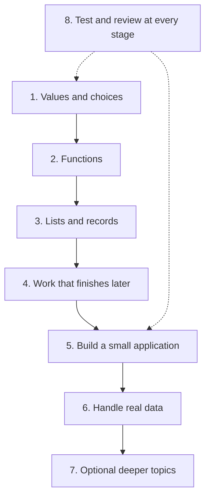

# JavaScript: Beginner to Expert

Start with one value and one instruction. Build up to functions, lists, browser pages, and larger programs. You do not need to know every language feature before making something useful.

**Start here:** [run one example](#run-the-examples), then begin [Stage 1](#1-beginner-values-and-control-flow). If writing steps is new, try [pseudocode](../pseudocode/index.md) first. Experienced readers can use the [feature study map](./professional-js.md), [quick reference](./quick-reference.md), or [edition inventory](#ecmascript-20152026-feature-coverage).

Continue at [functions](#2-beginner-to-intermediate-functions-and-reusable-behavior), [lists and records](#3-intermediate-objects-and-data-modeling), [async work](#4-intermediate-asynchronous-execution-and-errors), [applications](#5-advanced-modules-and-application-boundaries), or [real data](#6-advanced-text-numbers-and-interchange). Return later for [deeper topics](#7-expert-language-internals-and-memory), [testing and review](#8-expert-practice-testing-compatibility-and-performance), and [interview practice](#interview-preparation).

## How to use this course

Read a lesson's opening steps, predict a small example, and run it. Change one value and explain the difference. Then try the lesson's exercise before opening its answer. Use the [workbook](./workbook.md) to find all 50 lessons and 150 exercises.

The stages are a route, not a deadline. Move on when you can complete the checkpoint in your own words and code. Treat advanced sections as places to return to when a project needs them.



## Run the examples

A **runtime** is the environment that runs your code. For the Node examples, save the complete snippet in a file ending in `.mjs`. Run each example in its own file so repeated names do not conflict. Browser examples need a page and state their setup.

Use Node.js 24 or newer, as specified in this repository. For one lesson saved as `lesson.mjs`, run this command in your terminal:

```sh
node lesson.mjs
```

The terminal command is separate from the JavaScript inside the file. `.mjs` tells Node to use ES modules; the modules lesson explains that term. Expected output appears below checked examples so you can compare your result.

For repository-wide checks, install dependencies with `yarn install --frozen-lockfile`, then run:

```sh
yarn check:javascript
```

Recent built-ins may be missing even in a modern runtime. The check reports unsupported feature examples as skipped, and the [compatibility guide](./compatibility.md) explains how to inspect your deployment targets. Passing in one Node version is not a browser-support guarantee.

### Your first small program

This program stores a name, builds a greeting, and prints it. Change the name and predict the new output.

```js runnable
const learner = 'Mira';
console.log('Hello, ' + learner + '!');
```

```text output
Hello, Mira!
```

## 1. Values and choices {/* #1-beginner-values-and-control-flow */}

**Goal:** write a small program that reads values, makes a decision, and repeats a step.

1. Begin with [fundamentals](./fundamentals/README.md), [variables](./fundamentals/variables-var-let-const.md), and [types](./fundamentals/types-of-identifiers.md). Store a name, a score, and a true/false result.
2. Use [operators](./operators-and-operands.md) to calculate and compare. Read [conversion](./fundamentals/type-casting-and-coercion.md) when input arrives as text.
3. Add [conditions](./flow-of-control.md) and [loops](./loops.md). Trace each step on paper.
4. Learn [scope](./fundamentals/scope.md) and [hoisting](./fundamentals/hoisting.md) to explain where names work and when values are ready.

**Checkpoint:** total a short list of scores and show whether the total reaches a target. Try an empty list and zero. Explain each line before adding another feature.

## 2. Functions you can reuse {/* #2-beginner-to-intermediate-functions-and-reusable-behavior */}

**Goal:** turn a repeated calculation into a function with clear inputs and a return value.

1. Follow the [function learning path](./functions/README.md), then practise [arrows](./functions/function-lambda.md) and [callbacks](./functions/function-callback.md).
2. Use [templates](./template-literals.md) to build a message from the result.
3. Learn [closures](./functions/function-closure.md) when a function needs to remember state between calls.
4. Return to [recursion](./functions/function-recursion.md), [memoization](./functions/function-memoization.md), and [IIFEs](./functions/function-iife.md) as separate follow-up lessons.

**Checkpoint:** write a function that calculates a cart total. State its accepted input and test two different carts. Then make two independent counters with closures and explain why they do not share a count.

## 3. Lists and records {/* #3-intermediate-objects-and-data-modeling */}

**Goal:** choose a useful way to hold several values and transform them without accidental changes.

1. Learn [arrays](./arrays/index.md) for ordered lists and [objects](./objects-and-classes.md) for named properties.
2. Select an [array method](./arrays/array-methods.md) by the result you need; use [array recipes](./arrays/array-patterns.md) for common tasks.
3. Read [destructuring](./destructuring.md) and [rest/spread](./spread-operator.md) after ordinary access and copying are clear.
4. Use [Map and Set](./collections-and-iteration.md) for lookup and unique values. Leave [symbols](./symbol.md) and advanced class features for a second pass.
5. Study [prototype inheritance](./prototype-inheritance.md) to explain how objects share methods. Follow property lookup first, then connect it to constructors and `class extends`.

**Checkpoint:** build a reading list. Add a book, find one by ID, count books by category, and return a sorted copy. Explain which arrays and objects are still shared after copying.

### Put arrays and functions together {/* #your-first-modern-program */}

Return to this example after Stage 3. It selects purchases in one category, adds their prices, and applies a discount. The calculation is a **pure function** here: it returns a result without changing its input or performing an outside action. The code uses ES2015 syntax and ES2020 defaults.

```js runnable
const purchases = [
  { category: 'books', cents: 1200 },
  { category: 'books', cents: 800 },
  { category: 'tools', cents: 2500 },
];

function totalFor(items, category, discountCents = 0) {
  const subtotal = items
    .filter(item => item.category === category)
    .reduce((sum, item) => sum + item.cents, 0);
  return Math.max(0, subtotal - discountCents);
}

const settings = { discountCents: 0 };
console.log(totalFor(purchases, 'books', settings.discountCents ?? 100));
console.log(purchases.length);
```

```text output
2000
3
```

The input array is unchanged. Integer cents avoid introducing fractional currency arithmetic into this exercise; production money handling also needs an explicit rounding and currency policy. `??` preserves a legitimate zero. [Compare `??` with `||`](./operators-and-operands.md).

## 4. Work that finishes later {/* #4-intermediate-asynchronous-execution-and-errors */}

**Goal:** wait for a result, show progress, and handle a failure.

1. Trace the [event loop](./asynchronous/asynchronous.md), then learn [promises](./asynchronous/promises.md).
2. Use [async/await](./asynchronous/async-await.md) for a sequence of steps and [error handling](./error-handling.md) when one fails.
3. Start several operations together only after deciding whether they depend on each other.
4. Return to cancellation and [async iteration](./collections-and-iteration.md#async-iteration) when a project needs them.

**Checkpoint:** load a list with loading, success, empty, and error outcomes. Then change the search twice quickly and prevent an old response from replacing the current one.

For Node-specific work, use the [engine guide](./javascript-engine-basic-unit.md), [Node scheduling](./asynchronous/asynchronous.md#nodejs-scheduling), and [process error boundaries](./error-handling.md#nodejs-process-boundaries).

## 5. Build a small application {/* #5-advanced-modules-and-application-boundaries */}

**Goal:** connect calculations, files, and a usable page.

1. Split a program using [import/export](./import-and-export.md).
2. Learn [DOM updates](./document-object-model.md) and [events](./event-handling.md) through one button and one list.
3. Connect [browser state and network requests](./browser-state-and-network.md), then review [application structure](./modular-javascript.md).
4. Read [composition](./object-composition.md), [practical patterns](./modern-js-patterns.md), and [page loading](./how-browsers-load-webpages.md) when you improve the application.

**Checkpoint:** complete the [searchable reading list](./projects.md#reading-list). A keyboard user should be able to operate it, and the page should explain empty results and failed requests.

For other environments, compare [CommonJS with ES modules](./import-and-export.md#commonjs-in-nodejs) and [Node EventEmitter](./event-handling.md#nodejs-eventemitter) with browser events.

## 6. Handle real data carefully {/* #6-advanced-text-numbers-and-interchange */}

**Goal:** preserve what data means when reading, calculating, storing, and displaying it.

1. Start with ordinary [string operations](./strings-and-regular-expressions.md) and [number calculations](./numbers-and-math.md).
2. Read and write [JSON](./json-and-serialization.md), then check the fields your application requires.
3. Distinguish a calendar date from an instant using [dates and internationalization](./dates-and-internationalization.md).
4. Return to regex, Unicode, BigInt, and specialized recent APIs for the problems that need them.

**Checkpoint:** import a small catalog with names, IDs, and dates. Reject a malformed record, preserve its IDs, and display dates for a chosen time zone.

## 7. Optional deeper topics {/* #7-expert-language-internals-and-memory */}

These lessons are useful after building several small programs. Choose one topic at a time; they are not prerequisites for the earlier projects.

| When you need to understand… | Study | Small task |
| --- | --- | --- |
| Intercepting operations or retained objects | [Metaprogramming and memory](./metaprogramming-and-memory.md) | Trace a property read and draw which reference keeps an object alive. |
| Bytes, views, transfers, or shared data | [Binary data and shared memory](./binary-data-and-shared-memory.md) | Compare two views of one buffer with a copied buffer. |
| A difficult language edge case | [Language semantics](./language-semantics.md) | Follow one specification rule with a tiny input. |
| Engine behavior and memory measurements | [V8 execution tiers](./javascript-engine-basic-unit.md#v8-execution-tiers), [garbage collection](./javascript-engine-basic-unit.md#v8-memory-and-garbage-collection), [retained memory](./metaprogramming-and-memory.md#diagnose-retained-memory) | Reproduce a problem, measure it, and explain what the measurement does and does not show. |

## 8. Test and review throughout the course {/* #8-expert-practice-testing-compatibility-and-performance */}

Testing begins with your first small function. Deeper performance and tooling work comes later.

1. Use the [testing guide](./testing-guide.md) to check a normal input, an empty input, and a relevant failure.
2. Check [runtime compatibility](./compatibility.md) before depending on a feature.
3. Apply [production practices](./js-best-practices.md) to a finished project. Use [TypeScript and build tooling](./transpilers-and-compilers.md) when the project needs them.
4. Review the [mastery checklist](./quick-reference-cheatsheet.md), then finish a [capstone](./projects.md#capstone).

**Checkpoint:** demonstrate your project's expected behavior, one error case, and one compatibility decision. Measure a suspected performance problem before trying to optimize it.

## Build the core mental models {/* #core-concepts */}

Use this repair route when you can write syntax but cannot explain a result. Each question points to its main explanation.

| Question | Read |
| --- | --- |
| Did I change the name's value or the object itself? | [Bindings](./fundamentals/variables-var-let-const.md#bindings-and-values), [object identity](./fundamentals/types-of-identifiers.md#values-and-identity) |
| Which declaration does this name use, and is it ready? | [Scope lookup](./fundamentals/scope.md#scope-chain), [initialization](./fundamentals/hoisting.md#variable-hoisting) |
| Did I pass a function or call it? What does it remember? | [Functions and calls](./functions/function-types.md#function-values-and-calls), [parameters](./functions/function-types.md#parameter-values), [closures](./functions/function-closure.md#closure-lifetime), [receivers](./objects-and-classes.md#receiver-and-call-site) |
| Where did this property or method come from? | [Prototype inheritance](./prototype-inheritance.md), [own properties and overrides](./prototype-inheritance.md#3-check-ownership-then-try-an-override) |
| What result should this transformation produce? | [Array method choice](./arrays/array-methods.md#choose-by-result), [truthiness and equality](./fundamentals/type-casting-and-coercion.md#truthiness-and-equality) |
| When does the work start, finish, and continue? | [Promise state](./asynchronous/promises.md#promise-state), [connected chains](./asynchronous/promises.md#return-connects-a-chain), [await and errors](./asynchronous/async-await.md#await-and-error-boundaries) |

## Connect this course to application design

After functions and arrays, try [functional programming](../functional-programming/index.md) for clear calculations. After objects and modules, explore [design patterns](../design-pattern/index.md) and [SOLID](../solid-design-principles/index.md). Continue with [frontend](../frontend-engineering/index.md) or [backend](../system-design/case-studies/task-service.md) projects when you want to build a fuller application.

## What belongs to JavaScript

An **API** is an interface your code uses to ask for an operation. Some APIs belong to the language; others come from the environment running it.

| Source | What it provides | Read when needed |
| --- | --- | --- |
| ECMAScript / ECMA-262 | Core language rules, objects, arrays, promises, and modules | The concept lessons and edition map below |
| Internationalization / ECMA-402 | Formatting for languages and regions | [Dates and internationalization](./dates-and-internationalization.md) |
| Browser | The DOM, events, storage, timers, and network requests | [DOM](./document-object-model.md), [events](./event-handling.md), [browser runtime](./asynchronous/asynchronous.md) |
| Node.js | Files, networking, events, and other host tools | [Node and V8](./javascript-engine-basic-unit.md), [modules](./import-and-export.md#commonjs-in-nodejs) |
| Project tools | Type checking, transforms, packages, and testing | [Build tooling](./transpilers-and-compilers.md), [compatibility](./compatibility.md), [testing](./testing-guide.md) |

`fetch`, `structuredClone`, `TextEncoder`, and the DOM are host APIs. TypeScript and JSX are separate languages or syntax transforms. Their availability does not follow an annual ECMAScript edition.

## Interview preparation {/* #interview-preparation */}

Practise **104 interview questions with 81 worked code examples**, placed inside the topic lessons below. Each pair includes a worked example and an applied follow-up: trace state, diagnose a bug, implement a boundary check, or defend a design choice. Answers explain the result, the common mistake, and the limits of the solution. These are original practice questions, not claims about a particular company's interview process.

Use these questions after the matching lesson. Try your answer before opening the explanation, then change one input and check that your explanation still works. Browser and TypeScript examples state their setup; marked Node examples run as standalone ES modules.

| Topic | Questions, answers, and examples |
| --- | --- |
| Foundations | [var, let & const](./fundamentals/variables-var-let-const.md#interview-questions) · [Data types and identifiers](./fundamentals/types-of-identifiers.md#interview-questions) · [Conversions and equality](./fundamentals/type-casting-and-coercion.md#interview-questions) · [Scope](./fundamentals/scope.md#interview-questions) · [Hoisting](./fundamentals/hoisting.md#interview-questions) · [Keywords and names](./keyword.md#interview-questions) · [Strict mode](./use-strict.md#interview-questions) |
| Control flow | [Operators and expressions](./operators-and-operands.md#interview-questions) · [Control flow](./flow-of-control.md#interview-questions) · [Loops and iteration](./loops.md#interview-questions) |
| Functions | [Function types](./functions/function-types.md#interview-questions) · [Arrow functions](./functions/function-lambda.md#interview-questions) · [Callbacks and timing](./functions/function-callback.md#interview-questions) · [Closures](./functions/function-closure.md#interview-questions) · [IIFEs](./functions/function-iife.md#interview-questions) · [Recursion](./functions/function-recursion.md#interview-questions) · [Memoization](./functions/function-memoization.md#interview-questions) · [Binding and function utilities](./functions/function-utilities.md#interview-questions) |
| Arrays and collections | [Array methods](./arrays/array-methods.md#interview-questions) · [Array properties](./arrays/array-properties.md#interview-questions) · [Array patterns](./arrays/array-patterns.md#interview-questions) · [Collections and iteration](./collections-and-iteration.md#interview-questions) |
| Objects and syntax | [Objects and classes](./objects-and-classes.md#interview-questions) · [Object composition](./object-composition.md#interview-questions) · [Rest and spread](./spread-operator.md#interview-questions) · [Destructuring](./destructuring.md#interview-questions) · [Template literals and tags](./template-literals.md#interview-questions) · [Symbols and protocols](./symbol.md#interview-questions) |
| Async and failures | [Event loop](./asynchronous/asynchronous.md#interview-questions) · [Promises and composition](./asynchronous/promises.md#interview-questions) · [Async/await and cancellation](./asynchronous/async-await.md#interview-questions) · [Errors and recovery](./error-handling.md#interview-questions) |
| Data and text | [Numbers, BigInt, and Math](./numbers-and-math.md#interview-questions) · [Strings and regular expressions](./strings-and-regular-expressions.md#interview-questions) · [JSON and serialization](./json-and-serialization.md#interview-questions) · [Dates and internationalization](./dates-and-internationalization.md#interview-questions) · [Binary data and shared memory](./binary-data-and-shared-memory.md#interview-questions) |
| Browser | [DOM essentials](./document-object-model.md#interview-questions) · [Events, delegation, and cleanup](./event-handling.md#interview-questions) · [How browsers load pages](./how-browsers-load-webpages.md#interview-questions) · [Storage and network state](./browser-state-and-network.md#interview-questions) |
| Internals | [Engines, V8, and Node.js](./javascript-engine-basic-unit.md#interview-questions) · [Metaprogramming and memory](./metaprogramming-and-memory.md#interview-questions) · [Language semantics](./language-semantics.md#interview-questions) |
| Application design and tooling | [Import and export](./import-and-export.md#interview-questions) · [Application structure](./modular-javascript.md#interview-questions) · [Practical patterns](./modern-js-patterns.md#interview-questions) · [Testing JavaScript](./testing-guide.md#interview-questions) · [Production practices](./js-best-practices.md#interview-questions) · [Compatibility and tooling](./compatibility.md#interview-questions) · [TypeScript and build tooling](./transpilers-and-compilers.md#interview-questions) · [Workbook projects](./workbook-projects.md#interview-questions) |

### How to build a complete answer

1. Say what the code receives and what it should produce.
2. Trace one small example, including which values change.
3. Test a relevant difficult case: empty input, zero, a missing value, or a failed request.
4. Explain one limit of your solution and why you chose it.

Open the answer after attempting the **Apply it** task. If the answer surprises you, return to the linked concept rather than memorizing the printed output.

### Choose a revision session

Choose one row from the table above. For a 25-minute practice session, spend 5 minutes explaining a concept, 5 tracing an example, 10 solving its follow-up, and 5 checking an edge case. You can use the same method for a shorter session with one question.

## ECMAScript 2015–2026 feature coverage

**Optional reference.** Use this inventory to look up when a feature entered the language. It is not a second learning path: each feature links to its existing concept lesson. The annual specifications remain the detailed authority.

### ES2015 / ES6 — modern language foundations

| Feature family | Features and enhancements | Study inside JavaScript |
| --- | --- | --- |
| Scope and calls | `let`, `const`, block declarations, arrows, default/rest parameters, array/call spread, destructuring, function-name inference | [Fundamentals](./fundamentals/README.md), [functions](./functions/README.md), [semantics](./language-semantics.md) |
| Objects and classes | Shorthand properties/methods, computed keys, `super`, class/extends/static methods, `new.target`, subclassable built-ins; `Object.assign`, `Object.is`, `Object.setPrototypeOf`, symbol keys | [Objects and classes](./objects-and-classes.md), [metaprogramming](./metaprogramming-and-memory.md) |
| Protocols and collections | Symbol and well-known symbols; Map, Set, WeakMap, WeakSet; iterables, iterators, generators, `yield*`, `for...of` | [Symbols](./symbol.md), [collections](./collections-and-iteration.md) |
| Modules and async | Static import/export, module scope and live bindings; Promise, resolve/reject, then/catch, all/race | [Modules](./import-and-export.md), [promises](./asynchronous/promises.md) |
| Text and regex | Templates/tags, String.raw, codePointAt/fromCodePoint, normalize, repeat, includes/startsWith/endsWith; Unicode escapes, `u`/`y`, flags, regex symbol protocols | [Templates](./template-literals.md), [strings and regex](./strings-and-regular-expressions.md) |
| Arrays and binary data | Array.from/of, find/findIndex, fill/copyWithin, entries/keys/values; ArrayBuffer, DataView and numeric typed arrays | [Arrays](./arrays/array-methods.md), [binary data](./binary-data-and-shared-memory.md) |
| Numbers | Binary/octal literals; Number constants, predicates and parsing methods; new Math functions | [Numbers and Math](./numbers-and-math.md) |
| Advanced behavior | Proxy/Reflect, species, proper tail calls, strict-mode and legacy compatibility rules | [Metaprogramming](./metaprogramming-and-memory.md), [semantics](./language-semantics.md) |

Reference: [ES2015 specification](https://262.ecma-international.org/6.0/).

### ES2016–ES2019 — async functions and data transformations

| Edition | Features and enhancements | Study inside JavaScript |
| --- | --- | --- |
| [ES2016](https://262.ecma-international.org/7.0/) | Array/TypedArray `includes`; exponentiation `**` and `**=` | [Arrays](./arrays/array-methods.md), [numbers](./numbers-and-math.md) |
| [ES2017](https://262.ecma-international.org/8.0/) | Async functions/await; Object.values/entries/getOwnPropertyDescriptors; padStart/padEnd; trailing function parameter/call commas; SharedArrayBuffer and Atomics | [Async/await](./asynchronous/async-await.md), [objects](./objects-and-classes.md), [strings](./strings-and-regular-expressions.md), [binary memory](./binary-data-and-shared-memory.md), [semantics](./language-semantics.md) |
| [ES2018](https://262.ecma-international.org/9.0/) | Async iteration/generators and Symbol.asyncIterator; object rest/spread; Promise.finally; regex named captures, lookbehind, Unicode property escapes and `s`; tagged-template escape revision | [Collections](./collections-and-iteration.md), [spread](./spread-operator.md), [promises](./asynchronous/promises.md), [regex](./strings-and-regular-expressions.md), [semantics](./language-semantics.md) |
| [ES2019](https://262.ecma-international.org/10.0/) | flat/flatMap; Object.fromEntries; trimStart/trimEnd; optional catch binding; Symbol.description; stable Array/TypedArray sorting; well-formed JSON.stringify, JSON-superset strings, Function.toString revision | [Arrays](./arrays/array-methods.md), [objects](./objects-and-classes.md), [strings](./strings-and-regular-expressions.md), [errors](./error-handling.md), [symbols](./symbol.md), [JSON](./json-and-serialization.md), [semantics](./language-semantics.md) |

### ES2020–ES2023 — safer access, classes, and immutable updates

| Edition | Features and enhancements | Study inside JavaScript |
| --- | --- | --- |
| [ES2020](https://tc39.es/ecma262/2020/) | Optional chaining, nullish coalescing, BigInt and BigInt typed arrays; Promise.allSettled; matchAll/Symbol.matchAll; dynamic import, import.meta, namespace re-exports, globalThis; for-in ordering refinement | [Operators](./operators-and-operands.md), [numbers](./numbers-and-math.md), [binary data](./binary-data-and-shared-memory.md), [promises](./asynchronous/promises.md), [strings](./strings-and-regular-expressions.md), [modules](./import-and-export.md), [semantics](./language-semantics.md) |
| [ES2021](https://tc39.es/ecma262/2021/) | Logical assignment (`&&=`, `\|\|=`, `??=`); numeric separators; replaceAll; Promise.any and AggregateError; WeakRef and FinalizationRegistry | [Operators](./operators-and-operands.md), [numbers](./numbers-and-math.md), [strings](./strings-and-regular-expressions.md), [promises](./asynchronous/promises.md), [memory](./metaprogramming-and-memory.md) |
| [ES2022](https://tc39.es/ecma262/2022/) | Public/private instance and static fields, private methods/accessors, static initialization blocks, private `in` checks; top-level await; Error cause; Object.hasOwn; Array/String/TypedArray.at; regex `d` indices | [Classes](./objects-and-classes.md), [modules](./import-and-export.md), [errors](./error-handling.md), [arrays](./arrays/array-methods.md), [strings and regex](./strings-and-regular-expressions.md) |
| [ES2023](https://tc39.es/ecma262/2023/) | findLast/findLastIndex; toSorted/toReversed/with on arrays and typed arrays, Array.toSpliced; eligible symbols in weak collections/references; hashbang grammar | [Arrays](./arrays/array-methods.md), [binary data](./binary-data-and-shared-memory.md), [memory](./metaprogramming-and-memory.md), [semantics](./language-semantics.md) |

### ES2024–ES2026 — collection pipelines and precise data

| Edition | Features and enhancements | Study inside JavaScript |
| --- | --- | --- |
| [ES2024](https://tc39.es/ecma262/2024/) | Object.groupBy/Map.groupBy; Promise.withResolvers; resizable/transferable ArrayBuffers and detached inspection; growable SharedArrayBuffer; Atomics.waitAsync; regex `v` Unicode sets and string properties; isWellFormed/toWellFormed | [Collections](./collections-and-iteration.md), [promises](./asynchronous/promises.md), [binary memory](./binary-data-and-shared-memory.md), [strings and regex](./strings-and-regular-expressions.md) |
| [ES2025](https://tc39.es/ecma262/2025/) | Iterator and its helpers; seven Set operations; import attributes and JSON modules; RegExp.escape, scoped modifiers and duplicate named capture groups in separate alternatives; Promise.try; Float16Array, DataView float16, Math.f16round; global eval-var redeclaration refinement | [Collections](./collections-and-iteration.md), [modules](./import-and-export.md), [regex](./strings-and-regular-expressions.md), [promises](./asynchronous/promises.md), [binary data](./binary-data-and-shared-memory.md), [semantics](./language-semantics.md) |
| [ES2026](https://tc39.es/ecma262/2026/multipage/) | Array.fromAsync; Math.sumPrecise; Iterator.concat; Map/WeakMap.getOrInsert and getOrInsertComputed; Uint8Array base64/hex codecs; JSON.parse source context, JSON.rawJSON/isRawJSON; Error.isError | [Collections](./collections-and-iteration.md), [numbers](./numbers-and-math.md), [binary codecs](./binary-data-and-shared-memory.md), [JSON](./json-and-serialization.md), [errors](./error-handling.md) |

## Edition boundaries and runtime support

Edition assignments were checked on **23 October 2026** against [Ecma's publication record](https://ecma-international.org/publications-and-standards/standards/ecma-262/) and [TC39's finished proposals](https://github.com/tc39/proposals/blob/main/finished-proposals.md). ES2026 is the 17th edition. Calendar year and edition number differ: the 15th edition is ES2024.

Temporal, explicit resource management (`using` / `await using`), joint iteration, iterator chunking/includes/join, and `Atomics.pause` are listed for expected publication in **2027** in that snapshot. They are outside this course's ES2015–2026 feature boundary, even if a runtime already implements them. An expected year is not a guarantee.

Published does not mean available everywhere. Check each required API and syntax feature in your browser or Node targets. A transpiler can rewrite syntax but does not automatically provide built-ins, host APIs, or exact substitutes for every semantic feature. Use the [compatibility workflow](./compatibility.md); consult annual snapshots rather than assuming the living draft stops at ES2026.

## Practice beyond individual examples

Use the [workbook practice routine](./workbook.md#a-practice-session), then finish one [expense-summary or word-frequency project](./workbook-projects.md). Explain your result and test one changed input before extending it.

Continue with [projects](./projects.md), [JavaScript data-structure practice](../DSA/index.md), [frontend engineering](../frontend-engineering/index.md), or [design patterns](../design-pattern/index.md).

## Completion checkpoint

Build a searchable reading list from a small JSON file. The acceptance contract is: preserve IDs, retain the original data, support empty results, reject malformed records, and prevent a late response from replacing the current query. Test the visible keyboard journey using the [frontend review](../frontend-engineering/testing-accessibility.md).

<details>
<summary>Debugging interview: a correct promise returns the wrong search result</summary>

The promise can be correct while the application applies it to obsolete state. Track request identity or invalidate obsolete work, and apply the same policy to errors. Cancellation alone does not establish that a server-side operation never happened. Revisit [state and request ownership](../frontend-engineering/component-state.md).

</details>

**Revision cue:** contract → representation → scheduling → ownership → observable outcome. Use the stage checkpoints above to locate a gap rather than memorizing all APIs.

## How does Javascript Work?

Use the canonical [engine explanation](./javascript-engine-basic-unit.md) and [event-loop trace](./asynchronous/asynchronous.md) to connect execution and scheduling.

<span id="exercise" />

**Exercise:** a CPU-heavy callback blocks an otherwise asynchronous server. Explain why promises do not make that callback parallel and compare bounded worker execution with smaller units of work that yield.

<details>
<summary>Expected reasoning</summary>

A promise represents an eventual result; the callback still occupies its JavaScript execution thread while running. Smaller chunks can improve responsiveness without reducing total work. Workers can run suitable computation separately but add transfer, scheduling, and memory costs. Choose from measured workload and cancellation requirements.

</details>
