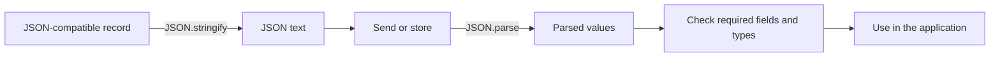

# JSON, serialization, and data contracts

JSON is a text format for exchanging data. For example, a server can send a student's name and score as text, and the browser can parse that text into values it can use. **Serialization** means turning data into a form that can be stored or sent.

1. Turn a simple object into JSON text with `JSON.stringify`.
2. Read the text back with `JSON.parse` and compare the result.
3. Check the expected fields and types before using them.
4. Return to replacers, revivers, and large-number handling when your data needs them.

Learn objects, arrays, types, and error handling first. Valid JSON is not the same as a valid student record: parsing checks the text's grammar, while your application checks its meaning. JSON does not preserve every JavaScript type or relationship between objects.



## What a round trip preserves

```js runnable
const record = { count: 0, missing: undefined, invalid: NaN, created: new Date('2020-01-01T00:00:00Z') };
const text = JSON.stringify(record);
console.log(text);
console.log(JSON.stringify([undefined, NaN, Infinity]));
console.log(JSON.stringify(new Map([['key', 1]])));
```

```text output
{"count":0,"invalid":null,"created":"2020-01-01T00:00:00.000Z"}
[null,null,null]
{}
```

Object properties with undefined/function/symbol values are omitted; such array elements become null. Symbol keys are omitted. Non-finite Numbers become null. Dates use `toJSON`; maps/sets need a custom representation. Cycles and ordinary BigInt values throw. An unsupported top-level value may produce `undefined` instead of a string.

JSON cannot preserve prototypes, functions, accessors, alias identity, or private fields. It is not a general deep-cloning algorithm. The host's `structuredClone` supports a different set of values and transferable buffers, but is not a portable wire format and cannot clone every object either.

## Define the schema before the serializer

For a catalog, decide that `id` is a decimal string, `tags` is an array of strings, and `version` identifies the schema. Define how missing differs from null, whether order matters, and how unknown fields are treated. Validate finite numbers and limits after parsing rather than trusting property names.

```js runnable
function readCatalogItem(text) {
  const value = JSON.parse(text);
  if (value === null || typeof value !== 'object' || Array.isArray(value) ||
      typeof value.id !== 'string' || !/^\d+$/.test(value.id) ||
      !Array.isArray(value.tags) || !value.tags.every(tag => typeof tag === 'string')) {
    throw new TypeError('Invalid catalog item');
  }
  return { id: value.id, tags: [...value.tags] };
}
console.log(readCatalogItem('{"id":"9007199254740993","tags":["js"]}').id);
try { readCatalogItem('{"id":42,"tags":[]}'); }
catch (error) { console.log(error.message); }
```

```text output
9007199254740993
Invalid catalog item
```

Construct an allow-listed result when accepting untrusted records. JSON can contain a `"__proto__"` own property; unsafe later merging can have different behavior from parsing. Prefer explicit fields, Map, or null-prototype dictionaries for arbitrary user keys.

## Replacers, revivers, and traversal

A stringify replacer can be a property-name array or a function transforming values. A parse reviver visits descendants before their containing object; returning undefined deletes a property. Both process the root using the empty-string key, so that key alone cannot distinguish every root from a real property of the same name. `toJSON` can run before the replacer sees a value.

```js runnable
const text = JSON.stringify({ id: 5n, label: 'item' }, (key, value) =>
  typeof value === 'bigint' ? value.toString() : value,
);
const restored = JSON.parse(text, (key, value) => key === 'id' ? BigInt(value) : value);
console.log(text);
console.log(typeof restored.id, String(restored.id));
```

```text output
{"id":"5","label":"item"}
bigint 5
```

The conversion above is valid because this example's schema reserves `id` for a BigInt string. A universal rule turning every decimal string into BigInt would corrupt ordinary strings. Tagged representations also need collision rules and schema validation.

## Well-formed output and JSON-compatible literals — ES2019

JSON.stringify escapes lone surrogates so the resulting JSON can be encoded as well-formed Unicode. JSON.parse restores the original code unit; escaping is not the same as repairing the source string.

```js runnable
const text = JSON.stringify('\uD800');
console.log(text);
console.log(JSON.parse(text).charCodeAt(0).toString(16));
```

```text output
"\ud800"
d800
```

ES2019 also allowed U+2028/U+2029 inside JavaScript string literals, aligning this aspect of source grammar with JSON. These changes do not make inserting JSON directly into an HTML script context automatically safe. Use the appropriate serialization/escaping for the surrounding host context. [Well-formed stringify proposal](https://github.com/tc39/proposal-well-formed-stringify).

## Preserve source digits — ES2026

A Number may be rounded before the reviver receives it. The additional reviver context supplies the original primitive source text, making exact integer reconstruction possible:

```js runnable requires=JSON.rawJSON
const record = JSON.parse('{"id":9007199254740993,"label":"book"}', (key, value, context) =>
  key === 'id' ? BigInt(context.source) : value,
);
console.log(String(record.id));
const text = JSON.stringify({ id: JSON.rawJSON(String(record.id)) });
console.log(text);
console.log(JSON.isRawJSON(JSON.rawJSON('42')));
```

```text output
9007199254740993
{"id":9007199254740993}
true
```

The example's schema guarantees that `id` is an integer token. `context.source` applies to primitive parse values; it is not a source slice for arbitrary arrays/objects. `JSON.rawJSON` creates a validated raw **primitive** JSON representation and `JSON.isRawJSON` detects that representation. It does not accept arbitrary object/array fragments or JavaScript source.

A receiver parsing the emitted number into ordinary Number can still lose precision. Use decimal strings when that is the agreed interoperable contract. Source access solves a parsing problem in a supporting runtime, not every system's data model. [JSON source proposal](https://github.com/tc39/proposal-json-parse-with-source).

## Interview questions {/* #interview-questions */}

**Level: Intermediate.** [How to practise](./index.md#interview-preparation).

### 1. Why is a JSON round trip not a general deep clone?

<details>
<summary>Answer and worked example</summary>

JSON represents a narrower data model than JavaScript. Undefined object properties disappear, undefined array entries become null, and special objects can be converted or rejected.

```js runnable
const value = { missing: undefined, items: [undefined, NaN] };
const text = JSON.stringify(value);
console.log(text);
console.log(Object.hasOwn(JSON.parse(text), 'missing'));
try { JSON.stringify({ id: 1n }); }
catch (error) { console.log(error.name); }
```

**Expected output**

```text output
{"items":[null,null]}
false
TypeError
```

The result no longer has the same property presence or numeric values. BigInt serialization needs an explicit contract instead of assuming ordinary JSON.stringify accepts it.

</details>

### 2. Why must parsed JSON still be validated?

**Apply it:** Parse a syntactically valid order whose quantity has the wrong type, and reject it before arithmetic.

<details>
<summary>Answer, walkthrough, and tradeoffs</summary>

Parsing proves the text follows JSON syntax, not that the value has required fields, types, ranges, or permissions. For large IDs, strings are a portable interchange choice. In supporting runtimes, reviver source access can help preserve exact numeric text under a deliberate schema.

This schema accepts a JSON object with an own `quantity` property containing a nonnegative safe integer; extra fields are permitted.

```js runnable
function parseOrder(text) {
  const value = JSON.parse(text);
  if (value === null || typeof value !== 'object' || Array.isArray(value) ||
      !Object.hasOwn(value, 'quantity') ||
      !Number.isSafeInteger(value.quantity) || value.quantity < 0) {
    throw new TypeError('Invalid order quantity');
  }
  return value;
}
for (const text of ['{"quantity":0}', '{"quantity":"2"}', 'null', '[]']) {
  try {
    console.log(parseOrder(text).quantity);
  } catch (error) {
    console.log(error.name);
  }
}
```

**Expected output**

```text output
0
TypeError
TypeError
TypeError
```

All four strings are valid JSON, so parsing alone succeeds. The schema accepts zero and rejects the numeric string instead of silently converting it. Syntax failures still throw from `JSON.parse`; schema failures throw from the boundary check. In a real application, give users an appropriate validation message without exposing raw internal payloads.

</details>

## Worked examples and answers {/* #workbook-practice */}

Use the [practice routine and file setup](./workbook.md#a-practice-session), then try the [Practice Problems](#practice-problems) below.

### 30. JSON cloning and data boundaries {/* #workbook-30 */}

<details>
<summary>Worked lesson and setup</summary>

**Goal:** compare a shallow copy with a separately cloned nested object.

Draw the nested `user` references before changing the name. Predict which name appears in `original` and which appears in `deep`. Then inspect which property survives JSON serialization.

Use [JSON round trips](#what-a-round-trip-preserves) and [the data schema](#define-the-schema-before-the-serializer) as references. `structuredClone` is a host API with its own supported-value rules, not a universal copier. A JSON snapshot is suitable only for data whose meaning survives JSON's rules; parsing it still does not validate your application's fields.

**Worked example**

```js
const original = { user: { name: "Mira" } };
const shallow = { ...original };
const deep = structuredClone(original);
shallow.user.name = "Ravi";
console.log(original.user.name, deep.user.name);
console.log(JSON.stringify({ kept: 1, skipped: undefined }));
```

**Expected output**

```text
Ravi Mira
{"kept":1}
```

**Why the example works**

The shallow copy shares user with original, so the mutation is visible through both references. The structured clone has a different nested object. The final line demonstrates that a property may disappear when its value has no JSON representation.

</details>

Find **30A–C** in the [Practice Problems](#practice-problems) table.

<details id="workbook-30-answer">
<summary>Check your reasoning and answer</summary>

**30A.** JSON discards or transforms unsupported values, rejects cycles and ordinary BigInt values, and does not preserve object behavior. A round trip may silently change the data contract.

**30B.** No. Parsing validates JSON grammar. Your program still has to validate the object shape, field types, and domain rules that make the record usable.

**30C.** The function validates only after parsing, excludes arrays and null, and constructs a new object with allowed keys. Trimming once makes the returned name consistent with the nonblank validation.

**Reference code**

```js
function parseUser(text) {
  const value = JSON.parse(text);
  if (!value || Array.isArray(value) ||
      typeof value.name !== "string" || value.name.trim() === "" ||
      !Number.isSafeInteger(value.age) || value.age < 0) {
    throw new TypeError("Invalid user");
  }
  return { name: value.name.trim(), age: value.age };
}
```

**Check the result**

```js
assert.deepEqual(parseUser('{"name":" Mira ","age":0}'),
  { name: "Mira", age: 0 });
assert.throws(() => parseUser('null'));
assert.throws(() => parseUser('{"name":" ","age":1}'));
assert.throws(() => parseUser('{"name":"Mira","age":-1}'));
```

</details>

<span id="practice" />

## Practice Problems

| Problem | Level / priority | Practice / notes | Example / answer |
| --- | --- | --- | --- |
| **30A — Why is JSON.parse(JSON.stringify(value)) not a general deep clone?** | **Must fix** | [Worked example](#workbook-30) | [Answer](#workbook-30-answer) |
| **30B — Does successfully parsing JSON prove that it is a valid user record?** | **Must fix** | [Worked example](#workbook-30) | [Answer](#workbook-30-answer) |
| **30C — Write parseUser(text) accepting JSON with a nonblank name string and nonnegative safe-integer age. Return only trimmed name and age.** | **Must fix** | [Worked example](#workbook-30) | [Answer](#workbook-30-answer) |
| List the types and identities lost by JSON.parse(JSON.stringify(value)); test a Date, Map, cycle, and shared reference. | Practice | — | — |
| Define a schema preserving BigInt IDs without confusing them with text labels. | Practice | — | — |
| Write a reviver that removes a field and observe its behavior inside an array. | Practice | — | — |
| Compare escaping a lone surrogate with String.toWellFormed repair. | Practice | — | — |
| Prove a large numeric token survives source-aware parsing, then test what an ordinary Number consumer sees. | Practice | — | — |

## Continue learning

Reference: [JSON specification](https://tc39.es/ecma262/2026/multipage/structured-data.html#sec-json-object). Continue with [modules and JSON imports](./import-and-export.md) or [the learning path](./index.md).
