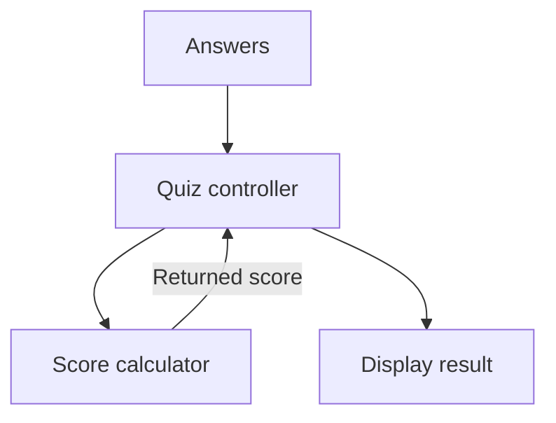

# Object composition and ownership

Composition builds a feature from smaller parts. A quiz app might combine a score calculator, a question store, and a display function. Each part has a job, and their connections explain how the feature works.

1. Start with [objects and classes](./objects-and-classes.md) and identify the state each part needs.
2. Pass required behavior as an explicit input.
3. Decide which part owns each mutable value, meaning which part is allowed to change it.
4. Test the smaller parts before connecting them.

Copying properties with object spread is one form of data composition, but it does not automatically create independent nested objects. The examples distinguish connecting behavior from copying data.



## Compose behavior through explicit inputs

Here a reading-list model owns its titles. A reporting function accepts the model's public interface. It does not need to inherit from the model or read its private storage.

```js runnable
function createReadingList() {
  const titles = new Set();
  return {
    add(title) { titles.add(title); },
    remove(title) { return titles.delete(title); },
    snapshot() { return [...titles]; },
  };
}
function summarize(list) {
  return `${list.snapshot().length} titles`;
}
const list = createReadingList();
list.add('Modules');
list.add('Modules');
const copy = list.snapshot();
copy.push('Outside');
console.log(summarize(list));
console.log(copy.length);
```

```text output
1 titles
2
```

The factory's closure keeps its Set private. The public snapshot is a new array, with immutable string elements. If those elements were objects, the snapshot would still share them; decide whether that is permitted by the contract.

## Object spread is data composition

```js runnable
const defaults = { theme: 'light', pageSize: 20, nested: { enabled: true } };
const settings = { ...defaults, theme: 'dark' };
console.log(settings.theme, settings.pageSize);
console.log(settings.nested === defaults.nested);
```

```text output
dark 20
true
```

Later properties overwrite earlier ones. Spread copies enumerable own string and symbol property values into a new ordinary object. It does not copy private fields, all property descriptors, or prototype methods. Getters can execute when their values are read.

## Decide between a class and a factory

| Approach | Useful when | Tradeoff |
| --- | --- | --- |
| Plain data plus pure functions | Transformations and serialization dominate | Invariants need explicit validation boundaries |
| Factory with closures | Each instance should own hidden state through a small interface | Methods are typically created for each instance |
| Class with private fields | Construction, shared prototype methods, and instance behavior fit naturally | Detached methods may lose their required receiver |
| Inheritance | A subtype truly preserves its parent's contract | Overrides can create coupling across the hierarchy |

Neither classes nor factories are universally faster or more maintainable. Measure performance if allocation or dispatch is a demonstrated bottleneck. Prefer a small, testable interface over a hierarchy created only to reuse a few lines.

## Keep dependencies at the boundary

A model should not need a DOM element merely to calculate a result. Pass a storage adapter or fetch function into the service that owns the effect. This makes failures and tests explicit; it is not a reason to create an interface for every arithmetic helper.

For detailed property rules, use [objects and classes](./objects-and-classes.md). For dependency layout, use [application modules](./modular-javascript.md). For copying data, use [spread](./spread-operator.md) and [array transformations](./arrays/array-patterns.md).

## Interview questions {/* #interview-questions */}

**Level: Intermediate.** [How to practise](./index.md#interview-preparation).

### 1. Can combining objects with spread silently replace behavior?

<details>
<summary>Answer and worked example</summary>

Yes. Later own enumerable properties replace earlier properties with the same key. Object spread is shallow property copying; it does not resolve capability conflicts for you.

```js runnable
const saveLocal = { save: () => 'local' };
const saveRemote = { save: () => 'remote' };
const combined = { ...saveLocal, ...saveRemote };
console.log(combined.save());
const explicit = { local: saveLocal, remote: saveRemote };
console.log(explicit.local.save(), explicit.remote.save());
```

**Expected output**

```text output
remote
local remote
```

The first composition loses access to the earlier save through that property. Explicit names preserve both choices and make the call site state which dependency it uses.

</details>

### 2. When would you prefer composition to inheritance?

**Apply it:** A report can be exported as CSV or JSON and delivered by download or email. Decide whether to create a subclass for every combination.

<details>
<summary>Answer, walkthrough, and tradeoffs</summary>

When behaviors vary independently or a subtype cannot honor the parent’s contract. Compose small dependencies with explicit ownership and conflict rules. Inheritance is useful when there is a coherent substitutable relationship, not merely because two classes share a few lines.

**Design answer:** separate formatting from delivery. A report service can receive a formatter that converts valid report data to a payload and a delivery dependency that accepts that payload and returns a completion promise. Two independent choices can then be combined without four subclasses; adding another format does not require duplicating every transport.

Define the boundary precisely: payload bytes or text, content type, filename, delivery failure, and which layer may retry. A repeated email send may have a user-visible side effect, so retry policy belongs in the contract rather than a generic catch block.

Inheritance is still reasonable when a subtype honors every operation promised by the parent. It becomes misleading when a subtype has to throw “unsupported” for ordinary parent behavior. Test composition by substituting small fake dependencies and checking the payload and failure propagation, not by asserting a particular class hierarchy.

</details>

## Practice Problems

| Problem | Level / priority | Practice / notes | Example / answer |
| --- | --- | --- | --- |
| 1 — Add `has(title)` to the reading-list interface without exposing the Set. | Practice | — | — |
| 2 — Compose a summary formatter that accepts any object with a `snapshot()` method. | Practice | — | — |
| 3 — Replace string titles with records and document whether callers may mutate returned records. | Practice | — | — |
| 4 — Write a test proving that two factory instances do not share state. | Practice | — | — |

## Next steps

Reference: [MDN working with objects](https://developer.mozilla.org/en-US/docs/Web/JavaScript/Guide/Working_with_objects).
