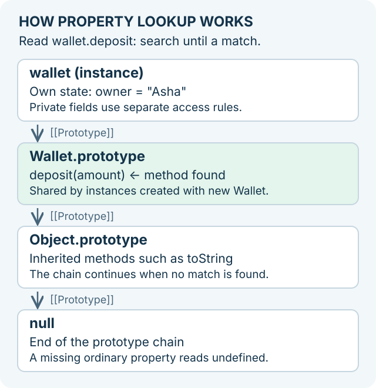

# Objects, this, prototypes, and classes

An object groups related information under property names. A student object might contain a name and a score. A function stored as a property is often called a **method**. A class gives you a way to create objects with a common structure and behavior.

1. Create a plain object, read a property, and update it.
2. Compare function references and object references, then create separate objects with a factory function.
3. Call a method and trace what `this` refers to at that call.
4. Follow [prototype inheritance](./prototype-inheritance.md) after plain objects and method calls are familiar, then return here for class features.

A **prototype** is another object JavaScript checks when a property is not found directly. Descriptors, private fields, inheritance, and initialization order are later steps. Read functions, property access, and scope first; you do not need to master all class features to model a small record.

## Start with one record

A task has a title and a completion state. Read a property with a dot, then assign a new value to update that property.

```js runnable
const task = { title: 'Read one lesson', done: false };
console.log(task.title);
task.done = true;
console.log(task.done);
```

```text output
Read one lesson
true
```

`const` prevents assigning a different object to `task`; it allows the existing object's `done` property to change. Try adding a second task. The next example asks a different question: do two names point to one object, or do they point to separate objects?

## Function objects, factories, and references {/* #function-object-references */}

A JavaScript **function is a callable object**: it can have properties, and you can store or pass its reference. `createTask` refers to a function; `createTask('Read')` calls it and evaluates to its return value. A **factory function** is a function that returns an object. These are different roles: the function object performs the work, and the returned object holds the task's data.

Think of a reference as a way to reach an existing object. Assigning it to another variable gives that object another name; it does not copy the object. Trace the function and its returned tasks separately:

```js runnable
function createTask(title) {
  return { title, done: false };
}

const makeTask = createTask;
makeTask.category = 'tasks';

const first = makeTask('Read');
const sameTask = first;
const separateTask = makeTask('Read');
sameTask.done = true;

console.log(makeTask === createTask, createTask.category);
console.log(first === sameTask, first === separateTask);
console.log(first.done, separateTask.done);
```

```text output
true tasks
true false
true false
```

`makeTask` and `createTask` reach **one function object**, so the property added through either name is shared. `first` and `sameTask` reach **one task object**. This factory evaluates a new object literal on each call, so `separateTask` has its own identity and data. A factory that deliberately returns a cached object would share that object instead.

Mutating a function property changes shared state, so prefer explicit arguments for per-call configuration. Extracting an ordinary, unbound method keeps the same function but does not bind it to the original object; see [how `this` follows the call](#receiver-and-call-site).

### Factory functions and constructor functions

Call this factory as `createTask('Read')`. A **constructor function** uses `new Task('Read')` to initialize an instance and connect it to `Task.prototype`; follow the [constructor and `new` walkthrough](./prototype-inheritance.md#5-connect-prototypes-to-constructors-and-new) for that mechanism. Classes also create instances through `new`. For private state and the choice between factories and classes, use [object composition and ownership](./object-composition.md#decide-between-a-class-and-a-factory).

**Try it:** after the example, set `const copy = { ...first }; copy.done = false;`. Predict `copy === first`, `first.done`, and `copy.done` before running it.

<details id="function-reference-answer">
<summary>Check the reference and copy behavior</summary>

The results are `false`, `true`, and `false`. Spread creates a different outer object, so assigning its own boolean property does not update `first`. Nested objects would still be shared; see [shallow copies](#descriptors-and-shallow-copies).

</details>

## Property lookup and identity



```js runnable
const base = { category: 'document' };
const item = Object.create(base);
item.title = 'Notes';
console.log(item.category);
console.log(Object.hasOwn(item, 'category'));
console.log(Object.keys(item).join(', '));
```

```text output
document
false
title
```

An inherited property can be read without being an own property. `Object.keys` lists enumerable own string keys. `Reflect.ownKeys` also includes symbols and non-enumerable own keys. Two objects with identical fields are still different identities.

Continue with the [step-by-step prototype inheritance lesson](./prototype-inheritance.md) to trace the chain, override a property, share methods, and connect `Object.create`, constructors, and `extends`.

## this follows the call for ordinary functions

```js runnable
const counter = {
  value: 3,
  read() { return this.value; },
};
const bound = counter.read.bind(counter);
console.log(counter.read());
console.log(counter.read.call({ value: 9 }));
console.log(bound());
```

```text output
3
9
3
```

`counter.read()` supplies `counter` as the receiver. Passing `counter.read` to another function loses that call form. In strict mode, an unbound ordinary function call has `this === undefined`. Arrow functions capture the enclosing `this`; `call`, `apply`, and `bind` cannot replace that captured value. Arrows also cannot be constructors.

### A receiver is supplied by the call expression {/* #receiver-and-call-site */}

First identify whether the function is ordinary, bound, or an arrow. For an ordinary unbound function, inspect the call expression: `object.method()` supplies `object`; `fn.call(other)` supplies `other`; a standalone `fn()` in strict code supplies `undefined`. A bound function keeps its bound receiver for ordinary calls. An arrow uses its enclosing `this` instead. Constructor calls have separate rules, discussed below.

```js runnable
function read() { return this?.name ?? 'no receiver'; }
const first = { name: 'first', read };
const second = { name: 'second', read: first.read };
const detached = first.read;
console.log(first.read(), second.read());
console.log(detached(), detached.call(first));
console.log(first.read === second.read);
```

```text output
first second
no receiver first
true
```

Both properties hold the same function. Its source has not moved or changed; the two method calls supply different receivers. Assigning a method to a variable copies the function value without storing the original call expression. In this ES-module example, optional chaining makes the missing receiver visible as text rather than throwing.

Do not confuse receiver selection with lexical name lookup: `this.name` uses the call’s receiver and then a property read; a plain `name` uses the function’s lexical scope. See [MDN this](https://developer.mozilla.org/en-US/docs/Web/JavaScript/Reference/Operators/this).

## Methods, fields, and private state

```js runnable
class ReadingList {
  #titles = [];
  add(title) { this.#titles.push(title); }
  snapshot() { return [...this.#titles]; }
}
const list = new ReadingList();
list.add('JavaScript');
const snapshot = list.snapshot();
snapshot.push('Outside mutation');
console.log(list.snapshot().length);
console.log(Object.getPrototypeOf(list) === ReadingList.prototype);
```

```text output
1
true
```

The methods live on the prototype; each instance owns its private state. This snapshot is safe for these string elements. If elements were mutable objects, copying only the array would still share those objects. The construction section below covers private fields and static blocks (ES2022).

## Descriptors and shallow copies

A property descriptor controls whether a property is writable, enumerable, and configurable, or exposes a getter/setter pair. `Object.assign` and object spread read property values and create a shallow result; they do not preserve every descriptor or the prototype. `Object.freeze` is also shallow.

```js runnable
const record = Object.freeze({ settings: { mode: 'light' } });
record.settings.mode = 'dark';
console.log(record.settings.mode);
console.log(Object.isFrozen(record.settings));
```

```text output
dark
false
```

Do not assume JSON serialization is a general clone. It loses unsupported values and throws for cycles and ordinary BigInt values. The host API `structuredClone` supports many structured values, but not functions or arbitrary prototype behavior.

## Composition, inheritance, and metaprogramming

Use inheritance when a subtype preserves the parent’s behavioral contract. Prefer [composition](./object-composition.md) when you need to combine independent capabilities. `Proxy` can intercept operations and `Reflect` supplies corresponding operations, but proxy traps must obey language invariants. A proxy is not automatically transparent to private fields or built-ins requiring internal slots.

## Object literals, ownership, and conversion

ES2015 added concise methods, shorthand properties, and computed keys. A method using super retains a home-object relationship for lookup; copying it to a different object does not redefine that relationship. Object.assign (2015) and object spread (2018) copy enumerable own string and symbol property values, not a whole object model.

| API | Purpose | Added |
| --- | --- | --- |
| Object.assign / Object.is / Object.setPrototypeOf | Copy values, compare with SameValue, change a prototype | 2015 |
| Object.values / Object.entries | Enumerate values or entries for own enumerable string keys | 2017 |
| Object.getOwnPropertyDescriptors | Inspect all own descriptors, including accessors and symbols | 2017 |
| Object.fromEntries | Build an object from key/value pairs; duplicate keys keep the last value | 2019 |
| Object.hasOwn | Check ownership even with null prototypes or a shadowed hasOwnProperty | 2022 |
| Object.groupBy | Group iterable values into arrays on a null-prototype object | 2024 |

Object.values returns property values of any type; its **keys** are restricted to strings. Reflection and enumeration differ from reading one property through a prototype chain. Changing a live object's prototype can disrupt assumptions and optimizations; choose Object.create or classes when establishing its model.

```js runnable
const source = { get total() { return this.quantity * 2; }, quantity: 3 };
const preserved = Object.create(Object.getPrototypeOf(source), Object.getOwnPropertyDescriptors(source));
const copied = { ...source };
preserved.quantity = 5;
copied.quantity = 5;
console.log(preserved.total, copied.total);
console.log(JSON.stringify(Object.fromEntries([['x', 1], ['x', 2]])));
```

```text output
10 6
{"x":2}
```

The preserved getter computes from its receiver; spread read the source's getter once and copied the result. Object.assign writes through target setters, whereas object spread creates own data properties on the new object. Neither is a deep clone. Freezing, sealing, and preventing extensions also have different contracts: freeze restricts own data-property writes, seal restricts reconfiguration, and preventExtensions only blocks new own properties.

## Construction, inheritance, and static behavior

ES2015 classes have a constructor, prototype methods, accessors, static methods, extends, and super. Call a class with new. A derived constructor must initialize this through super before using it. Instance methods are shared through the prototype; static methods belong to the constructor, not each instance.

ES2022 adds public/private instance and static fields, private methods/accessors, static blocks, and private membership checks. Instance field initializers execute per construction; static fields/blocks execute in declaration order when the class is evaluated. Derived instance fields initialize after super returns, so avoid base constructors depending on derived state.

```js runnable
class Counter {
  #value = 0;
  static #created = 0;
  static description;
  static { this.description = 'Independent counters'; }
  constructor() { Counter.#created++; }
  #validate(step) {
    if (!Number.isInteger(step)) throw new TypeError('Integer required');
  }
  increment(step = 1) { this.#validate(step); return this.#value += step; }
  get value() { return this.#value; }
  static get created() { return Counter.#created; }
  static recognizes(value) {
    return value !== null && (typeof value === 'object' || typeof value === 'function') && #value in value;
  }
}
const first = new Counter();
const second = new Counter();
console.log(first.increment(2), second.value, Counter.created);
console.log(Counter.recognizes(first), Counter.recognizes({}), Counter.recognizes(null));
console.log(Object.keys(first).length);
```

```text output
2 0 2
true false false
0
```

A private name is lexically bound to its declaring class and is not the string '#value'. Subclasses cannot directly access a parent's private names. Public fields are own data properties, while prototype methods are normally non-enumerable. An arrow stored in a field creates a new function for every instance and captures that instance's this; use it when that binding behavior is worth the allocation.

**Practice extension:** implement a derived class with a static factory, prove field-initializer order, and explain why a private-brand check is different from instanceof. Compare preserving descriptors with copying values. Continue to [Proxy and Reflect](./metaprogramming-and-memory.md).

## Trace class initialization order {/* #class-initialization */}

Static initialization happens when execution evaluates the class definition, not when a parser merely reads the source. Instance fields run for each object. This difference matters when a base constructor calls a method overridden by a derived class.

```js runnable
const trace = [];
class Base {
  label = 'base';
  constructor() { trace.push(`base constructor: ${this.label}`); }
}
class Report extends Base {
  static type = (trace.push('static field'), 'report');
  static { trace.push(`static block: ${this.type}`); }
  label = (trace.push('derived field'), 'report');
  constructor() {
    trace.push('before super');
    super();
    trace.push(`after super: ${this.label}`);
  }
}
trace.push('before new');
new Report();
console.log(trace.join(' | '));
```

```text output
static field | static block: report | before new | before super | base constructor: base | derived field | after super: report
```

Read the trace in three phases: class evaluation initializes the static members in source order; construction initializes base fields before the base constructor body; returning from `super()` initializes derived fields before the next derived-constructor statement. A second `new Report()` repeats instance work, but not the static work.

If the base constructor calls an overridden method, that method may run before derived fields exist. A derived private field access can throw at that point. Avoid invoking overridable behavior during construction when it needs subclass state. [ES2022 class definitions](https://tc39.es/ecma262/2022/multipage/ecmascript-language-functions-and-classes.html#sec-class-definitions).

### Static inheritance does not copy private brands

```js runnable
class Counter {
  static #count = 7;
  static readReceiver() { return this.#count; }
  static readOwner() { return Counter.#count; }
}
class SpecializedCounter extends Counter {}
console.log(Counter.readReceiver());
try { console.log(SpecializedCounter.readReceiver()); }
catch (error) { console.log(error.name); }
console.log(SpecializedCounter.readOwner());
```

```text output
7
TypeError
7
```

The inherited public method exists, but `this` is the subclass constructor. It lacks the private static field declared on `Counter`. Choosing `Counter.#count` deliberately selects base-owned state; choosing `this` for public state allows subclass-dependent lookup. Neither is universally preferable—decide whether the state belongs to one class or varies with the receiver.

**Try it:** add a public static field to the subclass and compare `this.field` with `Counter.field`. Then explain why writing a string property named `'#count'` would not change the private field.

## Interview questions {/* #interview-questions */}

**Level: Intermediate.** [How to practise](./index.md#interview-preparation).

### 1. What happens when an own property shadows a prototype property?

<details>
<summary>Answer and worked example</summary>

Ordinary lookup reads the own property first. Deleting that own property can reveal an inherited value; it does not delete the property from the prototype.

```js runnable
const defaults = { theme: 'light' };
const user = Object.create(defaults);
user.theme = 'dark';
console.log(user.theme, Object.hasOwn(user, 'theme'));
delete user.theme;
console.log(user.theme, Object.hasOwn(user, 'theme'), 'theme' in user);
```

**Expected output**

```text output
dark true
light false true
```

The in operator includes inherited properties, while Object.hasOwn does not. This distinction matters when reading configuration or iterating records.

</details>

### 2. Are class methods copied into every instance, and do they keep this when extracted?

**Apply it:** Compare method identity across two instances and then call an extracted method with and without an explicit receiver.

<details>
<summary>Answer, walkthrough, and tradeoffs</summary>

Ordinary instance methods live on the prototype and are shared. Extracting one does not bind it to its original instance. Public arrow fields are different: their initializer creates an instance-owned function with lexical this. Private fields additionally require the correct private brand.

Class bodies use strict semantics. An ordinary detached call does not retain its original instance.

```js runnable
class Counter {
  value = 1;
  read() { return this.value; }
  readArrow = () => this.value;
}
const first = new Counter();
const second = new Counter();
console.log(first.read === second.read);
console.log(first.readArrow === second.readArrow);
const detached = first.read;
try {
  detached();
} catch (error) {
  console.log(error.name);
}
console.log(detached.call(first), first.readArrow.call({ value: 9 }));
```

**Expected output**

```text output
true
false
TypeError
1 1
```

The prototype supplies one shared `read` function. Each instance initializes a separate arrow function that closes over its receiver. `call(first)` supplies a receiver to the ordinary method; `call` cannot replace the arrow’s lexical `this`. Choose binding deliberately for callbacks and keep the bound function if it must later be removed as a listener.

</details>

### 3. Does assigning a factory function to another variable create an object?

<details>
<summary>Answer</summary>

The assignment creates another reference to the existing function. Calling it runs the factory and returns its result. In the [task example](#function-object-references), each call creates a new task, while both function names continue to refer to the same callable object. Trace function identity and returned-object identity independently.

</details>

## Worked examples and answers {/* #workbook-practice */}

Use the [practice routine and file setup](./workbook.md#a-practice-session), then try the [Practice Problems](#practice-problems) below.

### 13. This classes and prototypes {/* #workbook-13 */}

<details>
<summary>Worked lesson and setup</summary>

**Goal:** build and use a small stack object.

A stack returns the last item added first. In the example, `constructor` gives each instance its own array, `push` adds an item, `pop` removes the last item, and the `size` getter reads the length. Trace the two pushes and one pop.

Review [method receivers](#receiver-and-call-site) and [methods and fields](#methods-fields-and-private-state). Calling `stack.push(...)` supplies `stack` as `this`; detaching the method is a different call. Use the [DSA stack lesson](../DSA/stack/README.md) for the data-structure reasoning.

**Worked example**

```js
class Stack {
  constructor() { this.items = []; }
  push(value) { this.items.push(value); }
  pop() { return this.items.pop(); }
  get size() { return this.items.length; }
}
const stack = new Stack();
stack.push("A");
stack.push("B");
console.log(stack.pop(), stack.size);
```

**Expected output**

```text
B 1
```

new creates an instance and runs its constructor. Both methods access that instance through this. A stack removes the most recently added value first. The size getter is read like a property.

**Trace the example step by step**

1. The constructor stores a fresh empty array on the new stack instance.

2. push("A") appends A to that instance's array. push("B") appends B after A.

3. pop removes B because it was added most recently. The remaining array contains A.

4. Reading stack.size invokes the getter and returns 1. No parentheses are used for this access.

**Common mistakes and how to reason about them**

Do not define an arrow as an object method if you expect its this to come from the object at call time. Avoid moving mutable instance data onto a shared prototype unless shared state is intended. A #privateField restricts outside access to class state, but understand ordinary instance properties first.

</details>

Find **13A–C** in the [Practice Problems](#practice-problems) table.

<details id="workbook-13-answer">
<summary>Check your reasoning and answer</summary>

**13A.** undefined, because Array.prototype.pop returns undefined on an empty array.

The empty array has no last element, so pop returns undefined. An application may choose a stricter stack contract that throws on underflow, but this exercise follows the array method's behavior.

**13B.** The detached method loses the stack receiver. Use stack.push("C") or bind it to stack.

The standalone call has no stack receiver. Class methods run in strict mode, so this is undefined and accessing this.items fails. Calling through stack or using stack.push.bind(stack) restores the receiver.

**13C.** Store the value on each instance and update it through this.

Each constructor call creates its own value property initialized to 0. increment updates this.value and returns it. Two Counter instances should each return 1 on their first increment, testing that their state is independent.

**Reference code**

```js
class Counter {
  constructor() { this.value = 0; }
  increment() {
    this.value += 1;
    return this.value;
  }
}
```

**Check the result**

```js
const c = new Counter();
assert.equal(c.increment(), 1);
assert.equal(c.increment(), 2);
assert.equal(new Counter().value, 0);
```

</details>

### 26. Property descriptors inheritance and class design {/* #workbook-26 */}

<details>
<summary>Worked lesson and setup</summary>

**Goal:** distinguish property settings from nested object contents.

The example defines `id` with `Object.defineProperty`, freezes the outer product, then changes the nested stock value. Predict which keys appear in `Object.keys` and whether the nested change succeeds.

Use [descriptors and shallow copies](#descriptors-and-shallow-copies) to check the rules: omitted descriptor flags default to false, and freezing an outer object is shallow. Read [construction and inheritance](#construction-inheritance-and-static-behavior) for the later class exercises. Test behavior through the public operation rather than assuming how every instance stores it.

**Worked example**

```js
const product = { details: { stock: 2 } };
Object.defineProperty(product, "id", { value: 7 });
Object.freeze(product);
product.details.stock = 3;
console.log(product.id);
console.log(Object.keys(product).join(","));
console.log(product.details.stock);
```

**Expected output**

```text
7
details
3
```

**Why the example works**

id is readable but nonenumerable and nonwritable because omitted descriptor flags default to false. Freezing the outer object does not freeze details. Updating details.stock therefore succeeds even in a module's strict mode.

</details>

Find **26A–C** in the [Practice Problems](#practice-problems) table.

<details id="workbook-26-answer">
<summary>Check your reasoning and answer</summary>

**26A.** No. It changes the own property descriptors of the selected object. Recursively freezing an object graph requires separately visiting reachable objects and handling cycles.

**26B.** A method declared in the class body normally resides on the class prototype. Instances delegate lookup to that shared prototype instead of storing separate method copies.

**26C.** The constructor enforces the starting invariant, and increment preserves it. The getter exposes a value without exposing an assignable public field. The factory delegates validation to the constructor.

**Reference code**

```js
class Counter {
  #value;
  constructor(value = 0) {
    if (!Number.isSafeInteger(value) || value < 0) {
      throw new RangeError("Invalid count");
    }
    this.#value = value;
  }
  increment() {
    if (this.#value === Number.MAX_SAFE_INTEGER) {
      throw new RangeError("Count overflow");
    }
    return ++this.#value;
  }
  get value() { return this.#value; }
  static from(value) { return new Counter(value); }
}
```

**Check the result**

```js
const counter = Counter.from(2);
assert.equal(counter.increment(), 3);
assert.equal(counter.value, 3);
assert.throws(() => new Counter(-1));
assert.throws(() => Counter.from(Number.MAX_SAFE_INTEGER).increment());
```

</details>

<span id="practice" />

## Practice Problems

| Problem | Level / priority | Practice / notes | Example / answer |
| --- | --- | --- | --- |
| **13A — What does pop return for the empty stack above?** | **Must fix** | [Worked example](#workbook-13) | [Answer](#workbook-13-answer) |
| **13B — Why can const push = stack.push; push("C"); fail?** | **Must fix** | [Worked example](#workbook-13) | [Answer](#workbook-13-answer) |
| **13C — Write a Counter class with initial value 0 and an increment() method that returns the new value.** | **Must fix** | [Worked example](#workbook-13) | [Answer](#workbook-13-answer) |
| **26A — Does Object.freeze recursively freeze nested data?** | **Must fix** | [Worked example](#workbook-26) | [Answer](#workbook-26-answer) |
| **26B — Why is a class method usually shared between instances?** | **Must fix** | [Worked example](#workbook-26) | [Answer](#workbook-26-answer) |
| **26C — Create Counter with private #value, increment(), a value getter, and a static from(value). Accept nonnegative safe integers and detect overflow.** | **Must fix** | [Worked example](#workbook-26) | [Answer](#workbook-26-answer) |
| Compare a factory-function alias, a task-object alias, a second factory result, and a shallow copy. | Practice | [Reference walkthrough](#function-object-references) | [Check the copy](#function-reference-answer) |
| Predict the receiver when a method is called directly, detached, bound, or passed as a callback. | Practice | — | — |
| Create two reading lists and prove their private state is independent. | Practice | — | — |
| Compare an own property, an inherited property, and a non-enumerable property with `in`, `Object.hasOwn`, and `Object.keys`. | Practice | — | — |

## Continue learning

References: [Functions as objects](https://developer.mozilla.org/en-US/docs/Web/JavaScript/Reference/Functions), [object model](https://developer.mozilla.org/en-US/docs/Web/JavaScript/Guide/Inheritance_and_the_prototype_chain), [classes](https://developer.mozilla.org/en-US/docs/Web/JavaScript/Reference/Classes). Continue to [collections and iteration](./collections-and-iteration.md).
