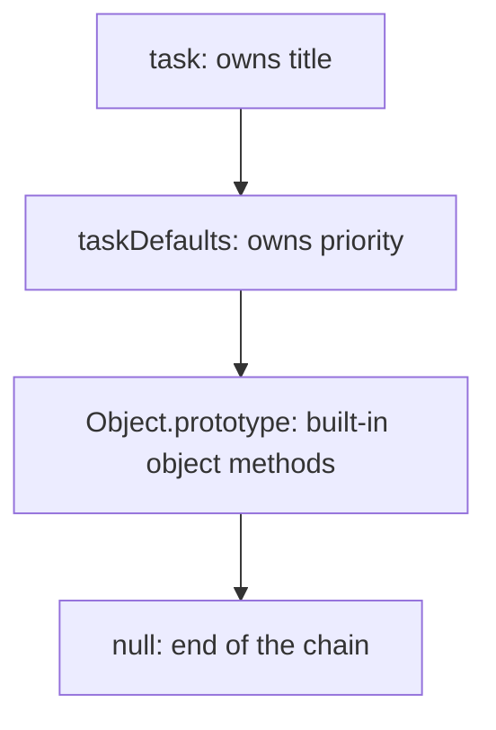
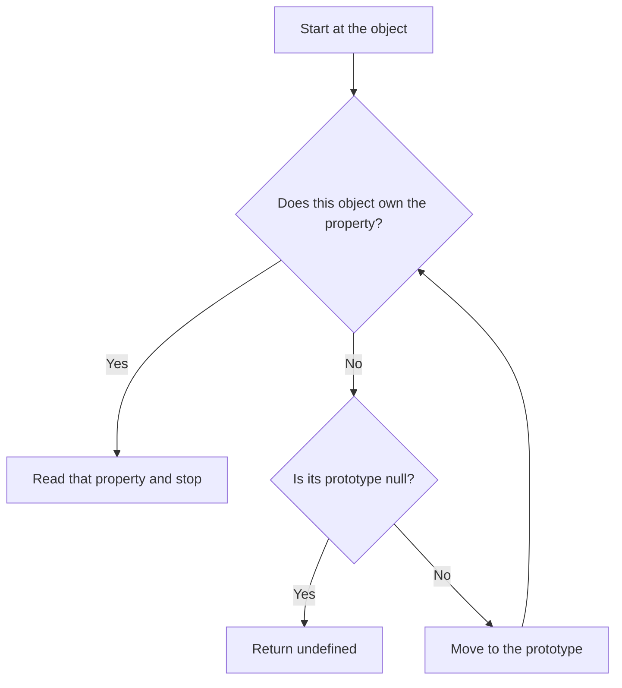

# Prototype inheritance

**Prototype inheritance**, also called **prototypal inheritance**, lets an object use properties and methods stored on another object. That other object is its **prototype**. For example, many tasks can share one `describe` method while each task keeps its own title.

Start after [plain objects](./objects-and-classes.md#start-with-one-record), [functions](./functions/README.md), and [method calls with `this`](./objects-and-classes.md#receiver-and-call-site). Run each example separately using the [course setup](./index.md#run-the-examples).

Work through the first four steps to understand the idea. Then connect it to `new` and `class`. By the end, you should be able to explain where a property comes from and give each object its own data.

## 1. Link one object to another

`Object.create(base)` makes a new object whose prototype is `base`. It does not copy `base`'s properties or run a constructor. [Object.create reference](https://developer.mozilla.org/en-US/docs/Web/JavaScript/Reference/Global_Objects/Object/create).

```js runnable
const taskDefaults = { priority: 'normal' };
const task = Object.create(taskDefaults);
task.title = 'Read one lesson';

console.log(task.title);
console.log(task.priority);
console.log(Object.getPrototypeOf(task) === taskDefaults);
```

```text output
Read one lesson
normal
true
```

`title` is an **own property**: it belongs directly to `task`. `priority` is an **inherited property**: JavaScript finds it on `taskDefaults`.

Think of a student checking their own notebook, then a shared reference book. The reference book stays shared; each student does not receive a copy of it.

## 2. Follow the prototype chain

A prototype can have its own prototype. These links form the **prototype chain**. In the previous example, the chain is:



For `task.priority`, JavaScript checks `task` first and then finds the property on `taskDefaults`. For `task.missing`, it reaches the end and returns `undefined`.

Use this flowchart for ordinary property reads in these examples:



Finding a property stops the search even when its value is `undefined`, `null`, `false`, or `0`. JavaScript checks whether the property exists, not whether its value is truthy. A getter runs when that property is read; its result does not restart the search. [Ordinary property-read rules](https://tc39.es/ecma262/multipage/ordinary-and-exotic-objects-behaviours.html#sec-ordinaryget).

## 3. Check ownership, then try an override

These tools answer different questions:

| Code | Question it answers |
| --- | --- |
| `Object.hasOwn(task, 'priority')` | Does `task` itself own this property? |
| `'priority' in task` | Does this property exist on `task` or its prototype chain? |
| `Object.keys(task)` | Which own, enumerable string keys does `task` have? |
| `Object.getPrototypeOf(task)` | Which object is the next link in the chain? |

**Enumerable** means included by operations such as `Object.keys`. Properties added by ordinary assignment are enumerable. A `for...in` loop also visits inherited enumerable string keys; use `Object.keys` or `Object.entries` when you want only an object's own record fields. [Ownership checks](https://developer.mozilla.org/en-US/docs/Web/JavaScript/Reference/Global_Objects/Object/hasOwn).

```js runnable
const taskDefaults = { priority: 'normal' };
const task = Object.create(taskDefaults);
task.title = 'Read one lesson';

console.log(Object.hasOwn(task, 'priority'), 'priority' in task);
console.log(Object.keys(task).join(', '));

task.priority = 'high';
console.log(task.priority, taskDefaults.priority);

taskDefaults.priority = 'low';
console.log(task.priority);
delete task.priority;
console.log(task.priority);
```

```text output
false true
title
high normal
high
low
```

Trace the changes:

1. At first, `task` inherits `priority`.
2. Assigning `task.priority` creates its own property here. This **shadows**, or hides, the inherited property.
3. Changing the shared default does not affect the task's own override.
4. Deleting that override reveals the updated default. This shows that inheritance follows a live link.

`delete task.priority` only attempts to remove the own property. It never removes `taskDefaults.priority`.

This assignment example uses a writable data property and an object that allows new properties. An inherited setter can run instead, and a non-writable inherited property can block assignment. Learn those later in [property descriptors](./objects-and-classes.md#descriptors-and-shallow-copies).

## 4. Share a method, keep separate data

A shared method can work with different objects. In `first.describe()`, the call supplies `first` as `this`, even though JavaScript finds the method on the prototype.

```js runnable
const taskMethods = {
  describe() {
    return this.title + (this.done ? ': done' : ': open');
  },
};

function makeTask(title) {
  const task = Object.create(taskMethods);
  task.title = title;
  task.done = false;
  return task;
}

const first = makeTask('Read');
const second = makeTask('Practise');
first.done = true;

console.log(first.describe());
console.log(second.describe());
console.log(first.describe === second.describe);
console.log(Object.hasOwn(first, 'describe'));
```

```text output
Read: done
Practise: open
true
false
```

There is one shared `describe` function. Each task owns its title and completion state. Finding a method through a prototype does not permanently bind it to an object; revisit [detached method calls](./objects-and-classes.md#receiver-and-call-site) before passing it as a callback.

## 5. Connect prototypes to constructors and new

A **constructor function** sets up an object when called with `new`. You will often see this form in older JavaScript:

```js runnable
function Task(title) {
  this.title = title;
}

Task.prototype.describe = function () {
  return 'Task: ' + this.title;
};

const first = new Task('Read');
const second = new Task('Practise');

console.log(first.describe());
console.log(Object.getPrototypeOf(first) === Task.prototype);
console.log(first.describe === second.describe);
console.log(Object.hasOwn(first, 'title'), Object.hasOwn(first, 'describe'));
```

```text output
Task: Read
true
true
true false
```

For this constructor, `new Task('Read')` creates an object, links it to `Task.prototype`, runs `Task` with that object as `this`, and returns the object. A constructor that explicitly returns another object can change that last step; this one does not.

Two similar-looking names have different jobs:

| Name | Meaning in this example |
| --- | --- |
| `first`'s `[[Prototype]]` | Its internal link to `Task.prototype`. Inspect it with `Object.getPrototypeOf(first)`. |
| `Task.prototype` | A property on the constructor holding the object shared by new tasks. |
| `Object.getPrototypeOf(Task)` | The prototype of the function itself: normally `Function.prototype` here. |

`[[Prototype]]` is specification notation, not JavaScript property-access syntax. Writing `first.prototype` does not inspect its internal link. You may encounter the old `__proto__` accessor; use `Object.getPrototypeOf` for inspection and `Object.create` for creation in new code. [Prototype and constructor guide](https://developer.mozilla.org/en-US/docs/Web/JavaScript/Guide/Inheritance_and_the_prototype_chain).

## 6. Use the same idea with classes

`class` provides another way to define constructors and shared methods. `extends` links a child class to a parent class. It still uses prototype inheritance.

Here, a timed task is a task with an extra due-day label:

```js runnable
class Task {
  constructor(title) {
    this.title = title;
  }

  describe() {
    return 'Task: ' + this.title;
  }
}

class TimedTask extends Task {
  constructor(title, dueDay) {
    super(title);
    this.dueDay = dueDay;
  }

  describe() {
    return super.describe() + ' (due ' + this.dueDay + ')';
  }
}

const task = new TimedTask('Practise', 'Friday');
console.log(task.describe());
console.log(Object.getPrototypeOf(task) === TimedTask.prototype);
console.log(Object.getPrototypeOf(TimedTask.prototype) === Task.prototype);
console.log(task instanceof TimedTask, task instanceof Task);
```

```text output
Task: Practise (due Friday)
true
true
true true
```

Follow the chain: `task → TimedTask.prototype → Task.prototype → Object.prototype → null`.

`super(title)` runs the parent constructor and initializes `this` before the child uses it. The child method overrides `describe`. Inside that method, `super.describe()` finds the parent method while keeping the same task as `this`. In this ordinary example, `instanceof` checks whether the constructor's prototype appears in the object's chain.

There is also a link from the child constructor `TimedTask` to the parent constructor `Task`, which allows inheritance of public static methods. Static methods belong to constructors; instances use the separate chain shown above. [How extends links classes](https://developer.mozilla.org/en-US/docs/Web/JavaScript/Reference/Classes/extends).

Use inheritance when the child can still do what the parent promises. For unrelated abilities, such as saving a task or sending a reminder, consider [composition](./object-composition.md). Return to [private fields and initialization order](./objects-and-classes.md#construction-inheritance-and-static-behavior) after this basic chain is clear.

## Avoid accidentally sharing an array

Methods are useful to share. Changing data, such as each task's tags, usually belongs on each object.

```js runnable
const taskDefaults = { tags: [] };
const first = Object.create(taskDefaults);
const second = Object.create(taskDefaults);

first.tags.push('study');
console.log(second.tags.join(', '));
console.log(first.tags === second.tags);
console.log(Object.hasOwn(first, 'tags'));
```

```text output
study
true
false
```

`first.tags` finds the inherited array, and `push` changes that array. It does not assign an own `tags` property to `first`. Give each task a fresh array during creation; the project exercise below does this.

Keep changes to your own prototypes deliberate. Adding methods to `Object.prototype` or `Array.prototype` affects other code too. Prefer defining the relationship when creating objects instead of changing existing objects with `Object.setPrototypeOf`.

## Try it yourself

### Predict a missing value

Create `defaults` with `priority: 'normal'`, then create `task` with `Object.create(defaults)`. Assign `task.priority = undefined`. Predict `task.priority`, `Object.hasOwn(task, 'priority')`, and the value after deleting `task.priority`.

<details>
<summary>Check your prediction</summary>

```js runnable
const defaults = { priority: 'normal' };
const task = Object.create(defaults);
task.priority = undefined;
console.log(task.priority, Object.hasOwn(task, 'priority'));
delete task.priority;
console.log(task.priority);
```

```text output
undefined true
normal
```

The own property exists, so it stops the search even when its value is `undefined`. Removing it reveals the inherited value.

</details>

### Build tasks with independent tags

Write a `Task` class that stores a title and a fresh `tags` array for each task. Add a shared `addTag(tag)` method. Create two tasks and tag only the first. Check that the second still has zero tags and that both tasks use the same method.

<details>
<summary>Check a working solution</summary>

```js runnable
class Task {
  constructor(title) {
    this.title = title;
    this.tags = [];
  }

  addTag(tag) {
    this.tags.push(tag);
  }
}

const first = new Task('Read');
const second = new Task('Practise');
first.addTag('study');

console.log(first.tags.join(', '), second.tags.length);
console.log(first.tags === second.tags);
console.log(first.addTag === second.addTag);
```

```text output
study 0
false
true
```

Each constructor call creates a separate array. Both instances find `addTag` on `Task.prototype`. Extend this exercise with a `TimedTask`, then confirm its tags are also independent.

</details>

### Explore an object with no prototype

Use `Object.create(null)` to make an object with no inherited properties. Set its `title`, inspect its prototype, and try `Object.hasOwn` on it. Predict whether it has a `toString` method.

<details>
<summary>Check the result</summary>

```js runnable
const record = Object.create(null);
record.title = 'Read';
console.log(Object.getPrototypeOf(record));
console.log(Object.hasOwn(record, 'title'));
console.log(typeof record.toString);
```

```text output
null
true
undefined
```

There is no `Object.prototype` in this chain. `Object.hasOwn` still works because it is called on `Object`, not as an inherited method of `record`. For a collection of keys and values, also compare [Map](./collections-and-iteration.md).

</details>

**Remember:** read from the object, follow its prototype links, and stop at the first matching property. Share behavior deliberately and give each object the changing data it owns.

Next, return to [classes and private state](./objects-and-classes.md#methods-fields-and-private-state), compare [composition](./object-composition.md), or apply the idea to the [reading-list project](./projects.md#reading-list).
