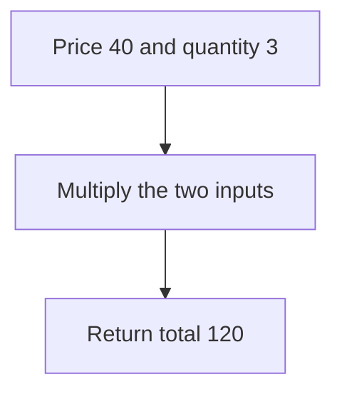

# 1. Inputs, values, and output

Start with what goes in and what should come out. These agreed rules are the **contract**. A clear rule helps you check whether your program solved the right problem.

## Step 1: make the request precise

“Calculate a bill” leaves many questions open. Use a small, complete version first:

| Part | Our rule |
| --- | --- |
| Input | A nonnegative integer price in cents and a nonnegative integer quantity. |
| Result | Their product, also in cents. |
| Limits | The product must be a safe integer when translated to JavaScript. |
| Empty purchase | Quantity `0` gives total `0`. |
| Excluded for now | Tax, discounts, refunds, and currency conversion. |

## Step 2: solve one example by hand

Three notebooks cost `40` cents each: `40 + 40 + 40 = 120`. Multiplication expresses the same operation more directly: `40 × 3 = 120`.



## Step 3: name the values and write the steps

```text
FUNCTION totalCost(priceCents, quantity)
    total ← priceCents × quantity
    RETURN total
END FUNCTION

bill ← totalCost(40, 3)
OUTPUT bill
```

`priceCents` and `quantity` are inputs. `total` is calculated. `RETURN` makes the result reusable; `OUTPUT` displays it. A function can return a result without printing anything.

## Step 4: trace the state

| Step | priceCents | quantity | total | What happens? |
| --- | --- | --- | --- | --- |
| Enter function | 40 | 3 | Not assigned | Inputs receive the supplied values. |
| Multiply | 40 | 3 | 120 | Store the product. |
| Return | 40 | 3 | 120 | The caller receives `120`. |

Assignment replaces a stored value. `total ← total + 5` means “read the old total, add five, and store the result.” It is not an algebra equation claiming a number equals itself plus five.

## Step 5: translate into JavaScript

```js runnable
function totalCost(priceCents, quantity) {
  return priceCents * quantity;
}
console.log(totalCost(40, 3));
console.log(totalCost(40, 0));
```

```text output
120
0
```

This function assumes its caller follows the contract. If input comes from a form, validate and convert it before calling the calculation. Do not silently treat the text `"three"` as a number.

## Apply it to your project

For a task app, write down what “add a task” receives and returns. Try a normal title and an empty title before writing any JavaScript.

## Practice Problems

| Problem | Level / priority | Practice / notes | Example / answer |
| --- | --- | --- | --- |
| Rectangle area | Practice | Contract and first check: Nonnegative width and height; `6 × 4 → 24`, and a zero side gives `0`. | — |
| Minutes to seconds | Practice | Contract and first check: Nonnegative integer minutes; `3 → 180`. Name the conversion factor. | — |
| Average of two values | Practice | Contract and first check: Two finite numbers; `4, 8 → 6`. State whether decimal results are allowed. | — |

## Interview and debugging check

<details>
<summary>A requirement says “return the biggest number.” What must you clarify before writing steps?</summary>

Ask whether the input can be empty, which numeric values are allowed, and what the result should be when no value exists. A precise contract determines initialization and failure behavior; guessing an initial maximum of zero fails for all-negative input.

</details>

## Next steps

Next: [conditions, loops, and tracing](./02-control-flow.md).
