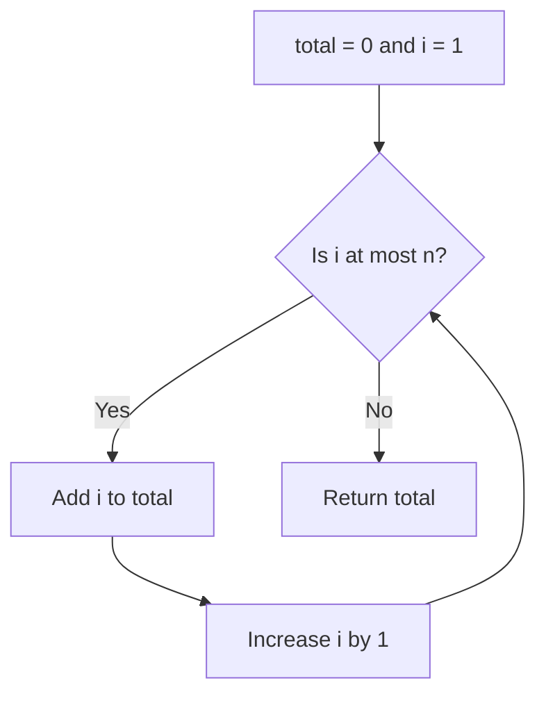

# 2. Conditions, loops, and tracing

A condition chooses a path. A loop repeats steps. Before continuing, be comfortable with [assignment and return](./01-foundations.md).

## Step 1: choose one branch

For a finite number, return exactly one label:

```text
FUNCTION signLabel(number)
    IF number < 0 THEN
        RETURN "negative"
    ELSE IF number = 0 THEN
        RETURN "zero"
    ELSE
        RETURN "positive"
    END IF
END FUNCTION
```

Once a branch returns, the function ends. Check a boundary from both sides: `-1`, `0`, and `1`. When several conditions overlap, order matters. For grade bands, test `score ≥ 90` before the broader `score ≥ 50`.

## Step 2: repeat a small action

Task: add every integer from `1` through a nonnegative integer `n`. When `n = 0`, return `0`.

```text
FUNCTION sumTo(n)
    total ← 0
    i ← 1
    WHILE i ≤ n
        total ← total + i
        i ← i + 1
    END WHILE
    RETURN total
END FUNCTION
```



## Step 3: record a trace for n = 3

| Before the condition | i | total | Decision |
| --- | --- | --- | --- |
| First check | 1 | 0 | `1 ≤ 3`: add 1, then increment i. |
| Second check | 2 | 1 | `2 ≤ 3`: add 2, then increment i. |
| Third check | 3 | 3 | `3 ≤ 3`: add 3, then increment i. |
| Final check | 4 | 6 | `4 ≤ 3` is false: return 6. |

Two questions explain the whole loop:

- **What remains true?** Before each check, `total` is the sum of integers from `1` through `i - 1`. This is the loop's **invariant**.
- **What gets closer to stopping?** `i` increases by one until it passes `n`. Forgetting the increment creates an infinite loop for positive `n`.

## Step 4: check the translation

```js runnable
function sumTo(n) {
  let total = 0;
  for (let i = 1; i <= n; i += 1) total += i;
  return total;
}
console.log(sumTo(3));
console.log(sumTo(0));
```

```text output
6
0
```

The loop does `n` additions, so the work grows with `n`: this is called `O(n)` time. It uses a fixed number of variables, called `O(1)` extra space. Here we count each small-number arithmetic operation as one step. The formula `n × (n + 1) / 2` is another solution; understanding the loop still helps with tasks that have no such formula.

## Apply it to your project

Count completed tasks by visiting each task once. Draw the check that decides whether the count increases. Try no tasks, no completed tasks, and all tasks completed.

## Practice Problems

| Problem | Level / priority | Practice / notes | Example / answer |
| --- | --- | --- | --- |
| Count multiples of 3 from 1 through n | Practice | Check before coding: `n = 8 → 2`; `n = 0 → 0`. | — |
| Find the first value at least 10 in a list | Practice | Check before coding: Explain why you can stop at the first match. | — |
| Fix a loop that skips the last item | Practice | Check before coding: Trace an array of length 1 and identify the wrong boundary. | — |

## Interview and debugging check

<details>
<summary>A loop processes indices 0 through n inclusive. Which smallest input exposes the boundary error?</summary>

An empty list already has no valid index 0; a one-item list also exposes the extra index 1. Valid indices are 0 through n − 1. State the invariant and show that each iteration approaches termination.

</details>

## Next steps

Next: [arrays, strings, and functions](./03-data-and-functions.md).
