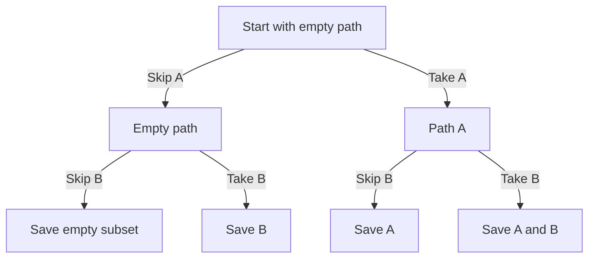

# 5. Recursion and backtracking

A recursive function solves a task by calling itself on a smaller task. A correct recursive definition needs a stopping case and measurable progress toward it.

## Step 1: name the smaller problem

For a nonnegative integer `n`, factorial is the product from `1` through `n`; by definition `factorial(0) = 1`.

```text
FUNCTION factorial(n)
    IF n = 0 THEN RETURN 1
    RETURN n × factorial(n - 1)
END FUNCTION
```

| Call | Work waiting for the smaller call | Returned value |
| --- | --- | --- |
| `factorial(3)` | `3 × factorial(2)` | 6 |
| `factorial(2)` | `2 × factorial(1)` | 2 |
| `factorial(1)` | `1 × factorial(0)` | 1 |
| `factorial(0)` | Nothing: base case | 1 |

The calls go down to zero; the results come back up. There are `O(n)` calls and `O(n)` stack space. Negative input violates the contract and would keep moving away from zero. Real runtimes also limit stack depth; an iterative version avoids that stack growth. JavaScript Number loses exact integer results for sufficiently large factorials.

## Step 2: explore choices

Backtracking makes a choice, explores its consequences, then undoes it. Generate all subsets of a list of distinct values. Keep the original list unchanged.

```text
FUNCTION subsets(values)
    results ← empty list
    path ← empty list

    FUNCTION visit(index)
        IF index = LENGTH(values) THEN
            APPEND(results, COPY(path))
            RETURN
        END IF

        visit(index + 1)                 // Do not take this value.
        APPEND(path, values[index])      // Take this value.
        visit(index + 1)
        REMOVE_LAST(path)                // Undo the choice.
    END FUNCTION

    visit(0)
    RETURN results
END FUNCTION
```

For `[A, B]`, the leaf results in this order are `[]`, `[B]`, `[A]`, `[A, B]`. At each index there are two branches: skip or take. Saving `path` itself would store repeated references to one changing list; save a copy.



There are `2^n` subsets. Copying each result gives `O(n × 2^n)` worst-case time and output space; the temporary path and call stack use `O(n)` space. This output size is unavoidable if the caller asks for every subset.

## Step 3: prune only impossible branches

For a target-sum search using **positive** numbers, a running sum already above the target cannot become smaller by adding more values. That allows pruning. With negative values, the same argument fails. Explain the reason before adding an early return.

## Apply it to your project

A project can contain smaller projects. Describe how to count its tasks by counting each smaller project. State when the recursive calls stop; assume the nesting has no cycles.

## Practice Problems

| Problem | Level / priority | Practice / notes | Example / answer |
| --- | --- | --- | --- |
| Factorial | Practice | Check: `0 → 1`, `4 → 24`; reject negative input. | — |
| Subsets | Practice | Check: `[] → [[]]`; `[A, B]` has four different results. | — |
| Balanced parentheses | Practice | Check: Only add `)` when more opening parentheses have been placed. Explain why. | — |
| Duplicate values | Practice | Check: Explain why `[A, A]` requires a different contract or a duplicate-skipping rule. | — |

## Interview and debugging check

<details>
<summary>Why can one missing undo step corrupt later branches?</summary>

Branches reuse mutable state. After returning from a choice, restore the state expected at the parent before trying a sibling. A copied state is another design, trading allocation for simpler ownership. Both still need a base case and progress.

</details>

## Next steps

Next: [trees and graphs](./06-trees-and-graphs.md).
