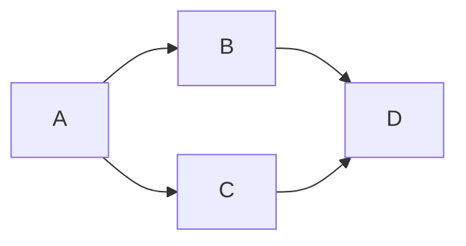

# 6. Trees and graphs

A graph has vertices and edges. An adjacency list maps each vertex to its outgoing neighbors. A tree is a connected graph with no cycles; a rooted tree gives each non-root node one parent.

Start with [loops](./02-control-flow.md) and [recursion](./05-recursion-and-backtracking.md). Here, every vertex has an adjacency-list entry, even when it has no neighbors.

## Step 1: define a small graph

```text
A: [B, C]
B: [D]
C: [D]
D: []
```

There are two directed routes from A to D. We want the smallest **number of edges**, not the smallest weighted distance.



## Step 2: explore one distance layer at a time

Breadth-first search (BFS) uses a queue. Mark a vertex when adding it to the queue so two parents do not add it twice.

```text
FUNCTION shortestEdgeCount(neighbors, start, target)
    queue ← [start]
    head ← 0
    distance ← MAP containing start → 0

    WHILE head < LENGTH(queue)
        current ← queue[head]
        head ← head + 1
        IF current = target THEN RETURN distance[current]

        FOR EACH next IN neighbors[current]
            IF next IS NOT A KEY IN distance THEN
                distance[next] ← distance[current] + 1
                APPEND(queue, next)
            END IF
        END FOR
    END WHILE
    RETURN NONE
END FUNCTION
```

| Vertex removed | Newly discovered | Pending queue | Known distances |
| --- | --- | --- | --- |
| A | B, C | B, C | A:0, B:1, C:1 |
| B | D | C, D | A:0, B:1, C:1, D:2 |
| C | None; D is already discovered | D | Unchanged |
| D | Target found | Empty | Return 2. |

The queue processes distance 0 before distance 1, then distance 2. The first discovery gives the shortest edge count. This relies on equal edge costs; use a suitable weighted-path algorithm when costs differ.

With adjacency lists and expected constant-time map operations, BFS takes `O(V + E)` time and `O(V)` extra space for the reachable part of the graph. A head index avoids repeatedly shifting the array's remaining items.

## Step 3: distinguish a path from its length

To return a path, also store `parent[next] ← current` when discovering a vertex. Starting at the target, follow parents back to the start, then reverse the collected list. The distance alone does not remember which route produced it.

DFS explores deeply before returning. It can use a stack or recursion; a graph still needs a visited set. For directed cycle detection, distinguish “currently on this search path” from “fully processed.” Seeing any visited vertex is not enough to prove a directed cycle.

## Apply it to your project

Draw tasks as points and prerequisite relationships as arrows. Explain why a tree is too restrictive when one task depends on two others. Check whether your drawing can contain a cycle.

## Practice Problems

| Problem | Level / priority | Practice / notes | Example / answer |
| --- | --- | --- | --- |
| Shortest edge count | Practice | Check: Start equals target gives `0`; unreachable target gives `NONE`. | — |
| Handle a cycle | Practice | Check: Add `D → A`; explain why each vertex is still enqueued once. | — |
| Return the route | Practice | Check: Accept either `[A, B, D]` or `[A, C, D]` for this graph. | — |
| Tree height | Practice | Check: State whether height counts edges or nodes before writing recursion. | — |

## Interview and debugging check

<details>
<summary>A graph search works on a tree but never finishes on a cycle. What assumption changed?</summary>

A tree child traversal has no route back to a visited ancestor under its structural contract. A general graph needs discovery state. Mark nodes at the algorithm’s intended discovery point and test a cycle and shared neighbor.

</details>

## Next steps

Next: [dynamic programming](./07-dynamic-programming.md).
